# 攻防（追逃）博弈：从判定到侦察

> 由攻防（追逃）博弈研究教程整理而成的独立读本。

## 目录

**前言　导读与学习路线**

**第一章　传统博弈（位置精确已知）**

- 1.0 攻防博弈理论总览
- 1.1 拦截判定与阿波罗尼奥斯圆
- 1.2 参数与不确定性分析
- 1.3 一对一闭环博弈与三维攻防
- 1.4 多对一：协同拦截与组合选取
- 1.5 多对多：任务分配与三对三综合仿真
- 1.6 实验数据后处理（rosbag）

**第二章　参数不确定性博弈（位置有观测误差）**

- 2.0 第二章节理论总览：参数不确定性博弈
- 2.1 参数不确定性博弈：一对一 / 二对一
- 2.2 参数不确定性博弈：多对多
- 2.3 参数不确定性博弈：卡尔曼滤波
- 2.4 GUI 软件（GUI2 → Python 桌面程序）

**第三章　界栅与策略（部署定下后的攻防分界）**

- 3.0 第三章理论总览：界栅（barrier）
- 3.1 一对一界栅（barrier）
- 3.2 二对一界栅（2v1 barrier，无重叠）
- 3.3 抓捕半径下的界栅（参数化，无闭式解）
- 3.4 有抓捕半径下的非预期策略
- 3.5 一个阿波罗尼奥斯圆就够了（不依赖攻击者控制的预判拦截）

**第四章　局部感知博弈（防守方感知半径受限）**

- 4.0 第四章节理论总览：局部感知博弈（感知半径受限）
- 4.1 局部感知理论仿真：部署、探测与捕获
- 4.2 局部感知实验数据与视频
- 4.3 异构多人局部感知博弈
- 4.4 局部感知博弈：三维凸目标区域（多人协作）

**第五章　TAD 三体博弈（目标—攻击者—防守者）**

- 5.1 TAD 最优策略（Game of Degree：极大值原理与 HJI 完整推导）
- 5.2 TAD 界栅（Game of Kind）

**第六章　侦察（夺旗）博弈**

- 6.0 第六章节理论总览——侦察（夺旗）博弈
- 6.1 侦察（夺旗）博弈——攻击者视角下的二阶段界栅与最优策略
- 6.2 侦察博弈——多体动态加权匹配任务分配
- 6.3 侦察博弈——极大值原理与三阶段转化
- 6.4 侦察博弈——三阶段解析界栅与可达域
- 6.5 侦察博弈——最优策略与最大可驻留时间

---

## 前言　导读与学习路线

### 这本书讲什么

本书由一套"攻防（追逃）博弈"研究教程整理而成，按主题分六章，从最基础的一对一拦截判定出发，逐级扩展到多对多协同、参数不确定性、界栅（barrier）、局部感知、三体博弈，直到侦察（夺旗）博弈。全书围绕一个统一的问题域——**攻击者要突破（或完成任务），防守者要拦截**——并逐级叠加新的复杂度：更多参与方、观测误差、部署判据、信息缺失、任务结构。

### 全书的六章

| 章 | 主题 | 核心问题 |
|---|---|---|
| 第一章 | 传统博弈（位置精确已知） | 谁先到？能否拦住？怎么分工？ |
| 第二章 | 参数不确定性博弈（位置有观测误差） | 有误差时结论还成立吗？滤波能补多少？ |
| 第三章 | 界栅与策略（部署定下后的攻防分界） | 部署后，多远之内的攻击者拦得住？ |
| 第四章 | 局部感知博弈（防守方感知半径受限） | 防守方看不见，该怎么布防？ |
| 第五章 | TAD 三体博弈 | 目标—攻击者—防守者三方的最优策略与界栅 |
| 第六章 | 侦察（夺旗）博弈 | 攻击者先侦察再返回，界栅与最大可驻留时间 |

### 建议的阅读路线

第一章的 `1.1`（阿波罗尼奥斯圆拦截判定）是全书的地基，第二至六章都建立在它之上。建议按编号顺序阅读：先打通第一章 `1.0 → 1.6`，再按需进入后续各章。第二章建议先看 `1.1 / 1.4 / 1.5`；第三、四章前置 `1.1`（第四章另需 `1.3`）；第六章两条线并列，都建立在 `1.1` 之上。

> **关于图件**：全书图片均为期刊风格（衬线字体、去顶/右脊线、克制三族配色——防守者蓝、攻击者红、辅助绿），图内文字为英文（期刊要求），正文为中文。所有图片统一存放于本书目录下的 `fig/` 文件夹，正文以相对路径引用。

### 本书的组织方式

- 每个主题一节，节号形如 `3.2`；同章各节按依赖关系排列，节首以引用块标注**前置知识**与**定位**。
- 每节末尾的"常见坑"总结了该主题最易出错之处，建议至少浏览一遍。

---

## 第一章　传统博弈（位置精确已知）

### 1.0 攻防博弈理论总览

> 全部理论集中在这一个文件里，按"一节对一个模块"组织，公式都在这里查。

#### 1. 问题场景与运动模型

红方**攻击者**（evader，下标 e）要从场地左侧突破到右侧防线；蓝方**防守者**（pursuer，下标 p）负责拦截。场地为矩形 $[-x_{\max}, x_{\max}] \times [-y_{\max}, y_{\max}]$，防线为竖直线 $x = x_d$（实验里 $x_d = 3$ m）。

双方都是**简单运动模型**（simple motion，即一阶单积分器）：

$$
\dot{\boldsymbol{p}}_i = \boldsymbol{u}_i, \qquad \|\boldsymbol{u}_i\| \le v_i, \qquad i \in \{p, e\}
$$

- $\boldsymbol{u}_i$：速度向量（控制量），大小固定、方向任意；
- $v_p > v_e$（防守者更快，实验值 $v_p = 0.5$ m/s，$v_e = 0.3$ m/s）；
- **捕获条件**：任一时刻 $\|\boldsymbol{p}_p - \boldsymbol{p}_e\| \le r$ 则拦截成功（$r$ 为捕获半径，实验值 0.4 m）；
- **胜负**：攻击者 $x$ 坐标到达 $x_d$ → 拦截失败；被捕获 → 拦截成功。

整个研究体系是逐级扩展的：

| 层级 | 问题 | 关键方法 |
|---|---|---|
| 1v1 | 一个防守者能否拦住一个攻击者 | 阿波罗尼奥斯圆 + 非线性规划 |
| 2v1 | 两个防守者协同 | 多约束交集 |
| mv1 | m 个防守者怎么选人 | 组合枚举 + 最少人数原则 |
| mvn | m 个组合对 n 个攻击者怎么分工 | 0-1 整数规划（任务分配） |

#### 2. 时间优势与笛卡尔椭圆圆（理论的基石）

对场地上任一点 $\boldsymbol{x}$，双方到达所需时间为

$$
t_p(\boldsymbol{x}) = \frac{\|\boldsymbol{x} - \boldsymbol{p}_p\|}{v_p},
\qquad
t_e(\boldsymbol{x}) = \frac{\|\boldsymbol{x} - \boldsymbol{p}_e\|}{v_e}.
$$

**攻击者占优**（先到）的条件 $t_e < t_p$ 等价于（记速度比 $a = v_p / v_e > 1$）：

$$
\boxed{\ \|\boldsymbol{x} - \boldsymbol{p}_p\| \ \ge\ a\,\|\boldsymbol{x} - \boldsymbol{p}_e\|\ }
$$

边界 $\|\boldsymbol{x} - \boldsymbol{p}_p\| = a\,\|\boldsymbol{x} - \boldsymbol{p}_e\|$ 就是**笛卡尔椭圆**（到两定点距离之比为定值的轨迹）。再考虑捕获半径 $r$ 的安全余量后，实际使用的约束是：

$$
g(\boldsymbol{x}) = -\|\boldsymbol{x} - \boldsymbol{p}_p\| + a\,\|\boldsymbol{x} - \boldsymbol{p}_e\| + r \ \le\ 0
$$

- $g(\boldsymbol{x}) \le 0$ 的区域 = 攻击者的**安全区**（防守者即使全速也抢不到）；
- $r = 0$ 时边界是笛卡尔椭圆：圆心 $\ \boldsymbol{c} = \dfrac{\boldsymbol{p}_p - a^2 \boldsymbol{p}_e}{1 - a^2}$，半径 $\ \rho = \dfrac{a\,\|\boldsymbol{p}_p - \boldsymbol{p}_e\|}{|\,1 - a^2\,|}$；
- $r > 0$ 时边界严格说是**笛卡尔卵形线**（到两定点加权距离差为常数的四次曲线），代码里统一用 $g(\boldsymbol{x}) = 0$ 等值线画，不必区分。

**直观理解**：$a$ 越大（防守者相对越快），安全区越小；防守者离攻击者越近，安全区也越小。这正是 1.2 参数分析画图验证的内容。

#### 3. 拦截判定：一个非线性规划

攻击者想突破，就要在**安全区内**向防线推进得尽量远。于是拦截判定归结为：

$$
\max_{\boldsymbol{x}}\ x_1
\qquad \text{s.t.} \quad
g_i(\boldsymbol{x}) \le 0, \quad i = 1, \dots, m
$$

其中 $i$ 遍历所有 $m$ 个防守者（1v1 时 $m=1$）。解出最优突破点 $\boldsymbol{x}^*$ 后：

$$
x_1^* < x_d \Rightarrow \text{拦截成功（安全区够不到防线）}； \qquad
x_1^* \ge x_d \Rightarrow \text{拦截失败（存在突破路线）}
$$

求解工具：`scipy.optimize.minimize(method="SLSQP")`（序列二次规划算法）

#### 4. 最优策略与闭环仿真

微分博弈理论（Isaacs）给出：简单运动模型下，双方最优策略都是**全速冲向预测交点 $\boldsymbol{x}^*$**。于是闭环导航律非常简单：

$$
\boldsymbol{u}_p = v_p \cdot \frac{\boldsymbol{x}^* - \boldsymbol{p}_p}{\|\boldsymbol{x}^* - \boldsymbol{p}_p\|},
\qquad
\boldsymbol{u}_e = v_e \cdot \frac{\boldsymbol{x}^* - \boldsymbol{p}_e}{\|\boldsymbol{x}^* - \boldsymbol{p}_e\|}
$$

每个控制周期用最新位置**重解一次**第 3 节的优化问题（滚动优化），双方按上式步进，直到捕获或突破。研究里对比了攻击者的三种策略：直线、正弦机动、最优——只有最优策略能保证安全区内的收益

**3D 扩展**：把判定放在水平面（x–y）内做，竖直方向按高度差以限速跟踪，捕获条件加高度门限。可达性用语里，场地分 $\Omega_{play}$（博弈区）和 $\Omega_{goal}$（目标区）

#### 5. 多防守者协同（2v1 与 mv1）

**2v1**：攻击者必须同时躲开两个防守者，安全区是两个单约束区域的**交集**，优化问题只是多了一条 $g_2(\boldsymbol{x}) \le 0$。两个防守者都朝同一个 $\boldsymbol{x}^*$ 运动，自然形成合围

**mv1（m 追 1）**：$m$ 个防守者不必全员出动。做法：

1. 枚举所有防守者组合 $(m, n)$（含单人组合 $m = n$），对每个组合解一次第 3 节的判定，得突破点横坐标 $x_1^*(m,n)$；
2. 取使 $x_1^*(m,n)$ 最小（压制效果最好）的组合；
3. **最少人数原则**：若某个单人组合就能达到同样的最小值，就只派 1 人。

$$
(m^*, n^*) = \arg\min_{m \ge n} x_1^*(m, n), \qquad \text{若 } x_1^*(k,k) = x_1^*(m^*,n^*) \text{ 则只派 } k
$$

#### 6. 多对多任务分配（0-1 整数规划）

mvn 场景：$n_e$ 个攻击者、若干防守者**组合**（单人或双人），要决定"哪个组合追哪个攻击者"。设组合 $i$ 对攻击者 $j$ 的分配变量为 $x_{ij} \in \{0,1\}$（共 $n_{combo} \times n_e$ 个），先由第 3 节判定得到**捕获可行性矩阵** $xcj_{ij}$（组合 $i$ 单独能否拦住 $j$），然后：

$$
\max \sum_{i,j} x_{ij}
\qquad \text{s.t.}\quad
\begin{cases}
\sum_j x_{ij} \le 1 & \text{（每个组合最多追一个攻击者）} \\
\sum_i x_{ij} \le 1 & \text{（每个攻击者最多被一个组合追）} \\
x_{ij} \le xcj_{ij} & \text{（追不上的组合直接排除）} \\
\text{冲突约束：共用防守者的两个组合不同时出动} \\
x_{ij} \in \{0, 1\}
\end{cases}
$$

目标取 $\max \sum x_{ij}$ 即"拦住尽可能多的攻击者"，用 `scipy.optimize.milp` 求解

#### 7. 位置不确定性修正

攻击者位置有观测误差（不确定半径 $\xi_{ij}$）时，等价于捕获半径缩水：

$$
r_{eff} = r - a\,\xi_{ij}, \qquad
\text{约束变为 } \|\boldsymbol{x} - \boldsymbol{p}_p\| \ge a\,\|\boldsymbol{x} - \boldsymbol{p}_e\| + r_{eff}
$$

$\xi_{ij}$ 与双方距离 $d$、半径 $r$、速度比 $a$ 有关。几何效果：不确定圆越大，攻击者实际安全区越小（对防守者更有利的那条边界对应"保守估计"）。

若考虑参数不确定性，采用距离相关的 `kesai_ij` 模型（保守系数 $k=3$）：

$$
\xi(d, r, a) = \frac{1}{k}\,\min\!\left(d - r,\ \ \frac{\min(a-1,\,1)}{a}\,d + \frac{r}{a}\right)
$$

双方越远（$d$ 大）允许估计越粗糙；防守者速度优势越小（$a \to 1$）越要求精确估计。→ 详见**第二章** 2.1 参数不确定性博弈：一对一 / 二对一 与 2.2 参数不确定性博弈：多对多。共享实现见 `common.kesai_ij`。

#### 8. 实验平台

仿真结论用真机验证：DJI Tello 双机 + ROS + VRPN 动捕（`/vrpn_client_node/tello*/pose` 提供毫米级位置），控制指令走 `/tello*/cmd_vel`。实验数据存为 rosbag，后处理画轨迹、速度、控制量、距离曲线

#### 9. 文件对照表

| 理论节 | 教程 |
|---|---|
| 1 场景与模型 | 1.0 攻防博弈理论总览 |
| 2+3 圆与判定 | 1.1 拦截判定与阿波罗尼奥斯圆 |
| 2+7 参数影响 | 1.2 参数与不确定性分析 |
| 4 闭环与策略 + 三维扩展 | 1.3 一对一闭环与三维攻防 |
| 5 二对一 + 多对一组合 | 1.4 多对一协同与组合选取 |
| 6 任务分配 + 综合仿真 | 1.5 多对多分配与三对三综合 |
| 8 实验数据 | 1.6 实验数据后处理 |

**第二章（参数不确定性博弈）**：2.1 参数不确定性博弈：一对一 / 二对一、2.2 参数不确定性博弈：多对多。

### 1.1 拦截判定与阿波罗尼奥斯圆

> 前置知识：无，这是整个体系的第一块积木。

#### 这一节解决什么问题

防守者和攻击者在场地上，速度大小固定、方向随便选。**不跑仿真、只看当前位置**，直接回答：

> 防守者到底能不能把攻击者拦在防线 $x_d$ 之前？

答案是画一个"阿波罗尼奥斯圆"，再解一个小优化。后面 2v1、mv1、mvn 全都是这一步的反复调用。

#### 第一步：理解"谁先到"——阿波罗尼奥斯圆

对场上任意一点 $\boldsymbol{x}$，防守者到达要 $t_p = \|\boldsymbol{x}-\boldsymbol{p}_p\|/v_p$，攻击者要 $t_e = \|\boldsymbol{x}-\boldsymbol{p}_e\|/v_e$。攻击者先到（这点安全）当且仅当：

$$
\|\boldsymbol{x} - \boldsymbol{p}_p\| \ \ge\ a\,\|\boldsymbol{x} - \boldsymbol{p}_e\| + r,
\qquad a = \frac{v_p}{v_e}
$$

多出来的 $+r$ 是给捕获半径留的余量。把这个不等式写成 $g(\boldsymbol{x}) \le 0$ 的形式，就是代码里的约束函数：

```python
def apollonius_g(x, p_p, p_e, a, r):
    return (-np.hypot(x[0] - p_p[0], x[1] - p_p[1])      # -||x - p_p||
            + a * np.hypot(x[0] - p_e[0], x[1] - p_e[1]) # +a*||x - p_e||
            + r)
```
$g \le 0$ 的区域（含攻击者一侧）是攻击者的**安全区**；边界就是阿波罗尼奥斯圆（$r=0$ 时是标准圆，$r>0$ 时是卵形线，画图不用区分）。

画图用"网格 + 0 等值线"实现：

```python
# plot_apollonius 的核心三行
X, Y = np.meshgrid(xs, ys)
G = -np.hypot(X - p_p[0], Y - p_p[1]) + a * np.hypot(X - p_e[0], Y - p_e[1]) + r
ax.contour(X, Y, G, levels=[0])      # g(x)=0 的等值线就是边界
```
#### 第二步：拦截判定——一个两行目标函数的优化

攻击者的最优打算：在安全区内**向防线方向推进到最远**。数学上就是：

$$
\max_{\boldsymbol{x}}\ x_1 \quad \text{s.t.} \quad g(\boldsymbol{x}) \le 0
$$

解出最右安全点 $\boldsymbol{x}^*$（突破点），比较横坐标即可：

- $x_1^* < x_d$：安全区够不到防线 → **拦截成功**；
- $x_1^* \ge x_d$：存在安全突破路线 → **拦截失败**。

求解用 `scipy` 的 `minimize`（SLSQP 算法，序列二次规划）：

```python
# solve_breakthrough 的核心部分
cons = [{"type": "ineq",                       # ineq: fun(x) >= 0
         "fun": lambda x: -apollonius_g(x, p_p, p_e, a, r)}]
res = minimize(lambda x: -x[0],                # min -x1 就是 max x1
               x0, method="SLSQP", constraints=cons)
```
> **新手注意**：`scipy` 的不等式约定是 `fun(x) >= 0`（即 `g(x) <= 0` 要写成 `-g(x) >= 0`），所以约束函数前面加了个负号。

判定一句话调用：

```python
res = judge_interception([(p_p, a)], p_e, r, x_d)
print(res["msg"])        # "拦截成功" / "拦截失败"
```
#### 动手练习

1. 把防守者挪到 `p_p = [-2, 0]`（攻击者正后方 1 m），再跑一次，观察安全区如何缩成一小块、判定翻转；
2. 把 `v_e` 改成 0.4（a 降到 1.25），判定怎么变？先猜再跑；
3. 故意把 $r$ 从 0.4 改成 1.4，突破点为什么大幅后退？（提示：$r$ 吃掉的是攻击者的安全余量）

#### 常见坑

- **约束方向搞反**：算出"突破点在防守者屁股后面"多半是把 $g \le 0$ 写成了 $g \ge 0$；
- **初值取在防守者位置上**：$\|\boldsymbol{x}-\boldsymbol{p}_p\|$ 在该点梯度奇异，SLSQP 会报错，初值取攻击者当前位置即可；
- **a 用了整数**：$5/3$ 写成 1（整数除法/手滑），边界画出来是错的，代码里用 `round(v_p/v_e, 5)`。

#### 运行结果图示

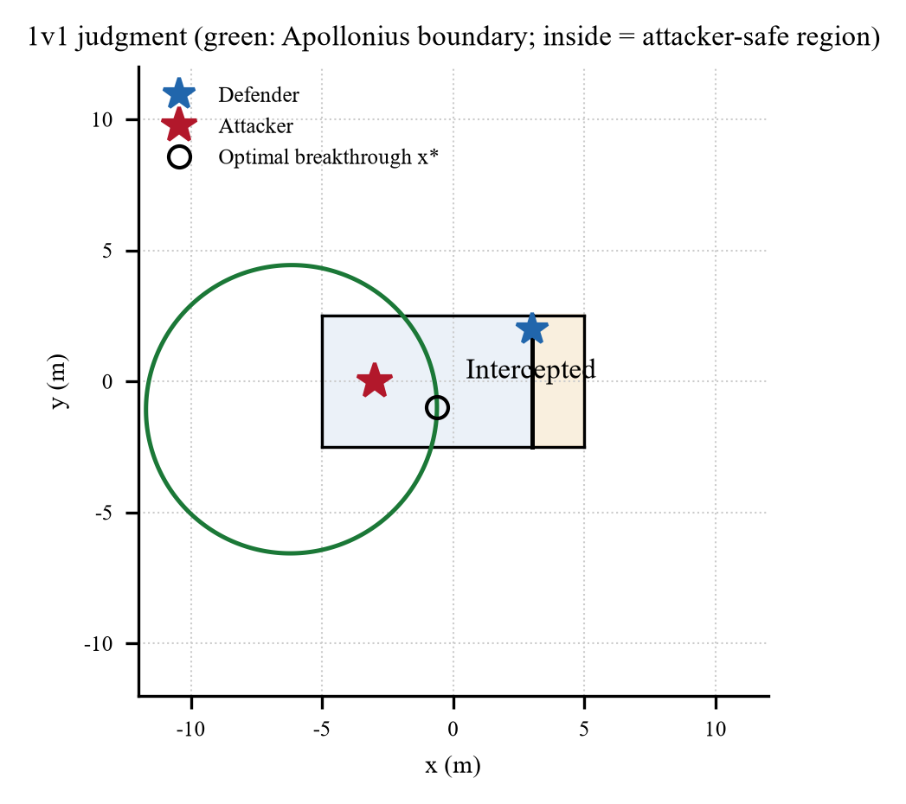
*1v1 拦截判定：阿波罗尼奥斯边界、最优突破点与判定结论*

### 1.2 参数与不确定性分析

> 前置知识：1.1 拦截判定与阿波罗尼奥斯圆

#### 这一节解决什么问题

01 里的判定只给了"能拦/不能拦"，这一节回答**为什么**：

- 速度比 $a$ 变大/变小，攻防格局怎么变？
- 捕获半径 $r$ 送给防守者多少便宜？
- 攻击者位置看不准（有观测误差）时，判定要怎么修正？

这是典型的**模型分析**：不跑闭环，只画一族边界曲线看趋势。

#### 核心一：速度比 a 的影响

固定 $r=0$，让 $a = 0.5, 1, 2$ 画三条边界：

$$
\|\boldsymbol{x} - \boldsymbol{p}_p\| = a\,\|\boldsymbol{x} - \boldsymbol{p}_e\|
$$

```python
# fig_speed_ratio 核心
for a, c in zip([0.5, 1.0, 2.0], ["g", "b", "m"]):
    plot_apollonius(ax, p_p, p_e, a, r=0.0, lim=10, colors=c)
```
看图能直接读出三条结论：

| 情形 | 边界形状 | 含义 |
|---|---|---|
| $a < 1$ | 圆包住防守者 | 攻击者更快，防守者反而是"被围"的一方 |
| $a = 1$ | 一条直线（中垂线） | 谁先到各凭位置，平分天下 |
| $a > 1$ | 圆包住攻击者 | 防守者更快，攻击者被压在圆内 |

$a$ 越大圆越小——这就是"快即是强"的几何表达。

#### 核心二：捕获半径 r 的影响

固定 $a = 1.67$，让 $r = 0, 0.4, 0.8$。$r$ 出现在约束的常数项里：

$$
g(\boldsymbol{x}) = -\|\boldsymbol{x} - \boldsymbol{p}_p\| + a\,\|\boldsymbol{x} - \boldsymbol{p}_e\| + r \le 0
$$

```python
# fig_capture_radius 核心
for r, c in zip([0.0, 0.4, 0.8], ["g", "b", "m"]):
    plot_apollonius(ax, p_p, p_e, a, r, lim=10, colors=c)
```
$r$ 越大，攻击者要提前避开的范围越大，安全区整体向内收缩。注意 $r > 0$ 后边界不再是圆（是四次的卵形线），所以代码统一走"0 等值线"画法，不推导解析式。

#### 核心三：位置不确定性修正

实战中攻击者位置来自传感器，有误差。设不确定半径为 $\xi_{ij}$（与距离 $d$、$r$、$a$ 有关），修正方法是**把捕获半径缩水成** $r_{eff} = r - a\,\xi_{ij}$，再套回同一套画法：

```python
# fig_uncertainty 核心
xi = kesai_ij(d, r, a)                          # 不确定半径
plot_apollonius(ax, p_p, p_e, a, r - a * xi, ...)   # 用 r_eff 画保守边界
ax.plot(p_e[0] + xi*np.cos(theta), p_e[1] + xi*np.sin(theta))  # 攻击者不确定圆
```
> **说明**：里用相对误差模型 $\xi = 0.1\,d$ 示例（`kesai_ij` 函数体就一行，可按传感器精度自行替换）。**定性结论不变**：$\xi$ 越大，保守边界越向攻击者一侧收缩——等于防守者按"最坏情况"规划。

> **扩展（新增）**：若考虑参数不确定性，原研究给出了具体的距离相关模型 `kesai_ij`（保守系数取上界的 1/3），单独整理在**第二章** 2.1 参数不确定性博弈：一对一 / 二对一；多对多分配见 2.2 参数不确定性博弈：多对多。

#### 动手练习

1. 在 `fig_speed_ratio` 里加 $a = 10$，观察圆是否缩到攻击者身上；
2. 把不确定系数 `k_err` 从 0.1 改到 0.3，保守边界是否越过了精确边界？（想想这意味着什么：防守者过度保守 or 攻击者钻空子）
3. 用 1.1 的 `judge_interception` 写个循环：$a$ 从 1.0 扫到 3.0，画出"突破点横坐标 $x_1^*$ 随 $a$ 变化"的曲线，找到本场景的**临界速度比**。

#### 常见坑

- 画一族曲线时 `plot([], [], color=c)` 是"空线骗图例"的小技巧，曲线本体由 `contour` 画的、拿不到图例；
- $a=1$ 时公式里的 $1-a^2=0$，圆心/半径解析式发散——这就是为什么代码从不解析求圆，只用等值线。

#### 运行结果图示

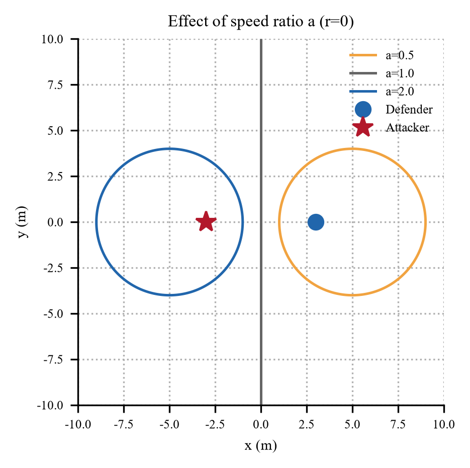
*速度比 a 对约束区域的影响*

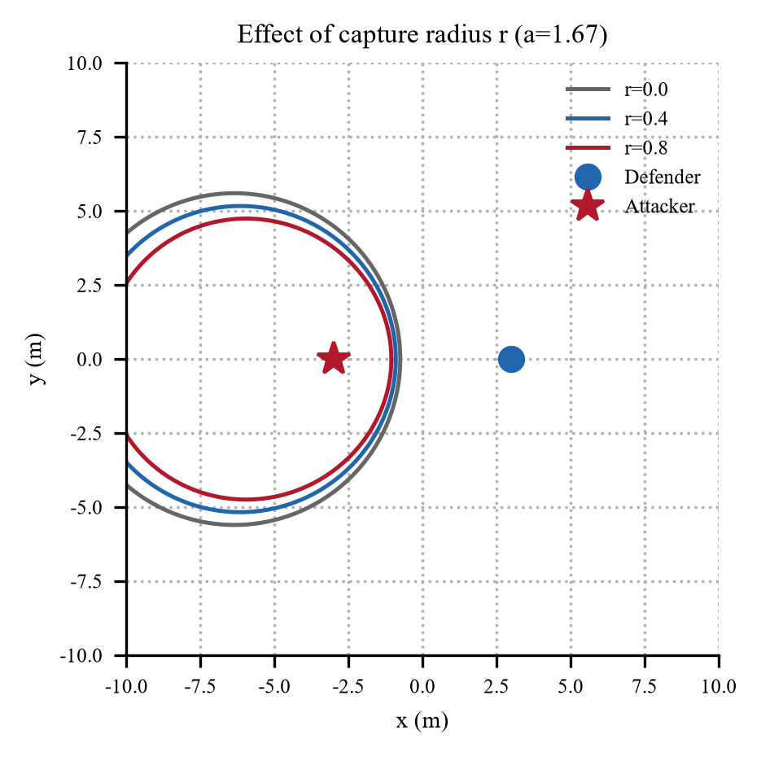
*捕获半径 r 对约束区域的影响*

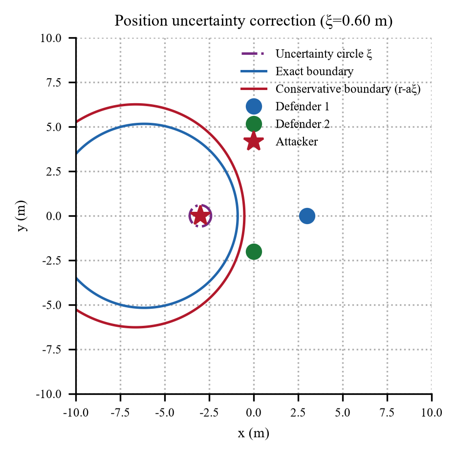
*位置不确定性修正（相对误差模型示例）*

### 1.3 一对一闭环博弈与三维攻防

> 前置知识：1.1 拦截判定（要用突破点）、1.2 参数分析（可选）

#### 上篇：一对一闭环博弈仿真

##### 这一节解决什么问题

1.1 的判定是"静态看一眼"，这一节让双方**真的动起来**：每个控制周期重新算一次最优突破点 $\boldsymbol{x}^*$，双方按策略走一步，循环往复直到分出胜负。同时对比攻击者三种策略的结局——这是研究里"对比实验"部分。

##### 闭环框架：三行伪代码讲清楚

```
每个周期 dt:
    1. x* = solve_breakthrough(当前位置)      # 1.1 学过的判定，滚动重解
    2. 防守者朝 x* 走一步（最优追击）
    3. 攻击者按策略走一步（直线 / 机动 / 最优）
    4. 距离<=r → 拦截成功；攻击者 x>=x_d → 拦截失败
```
为什么要"滚动重解"？因为双方都在动，$\boldsymbol{x}^*$ 也在动。这就是**模型预测控制（MPC）**的最简形态——先预测终点，再走一步，再预测。

"朝目标走一步"就是速度大小固定、方向指向目标：

```python
# step_toward 的核心
d = target - pos
u = v * d / np.linalg.norm(d)    # 单位方向 × 速度大小
return pos + u * dt, u
```
##### 三种攻击者策略

```python
# 策略即"速度向量"这么简单
def policy_straight(k, x_star, e, ue):          # 直线：无脑向右
    return np.array([v_e, 0.0])

def policy_zigzag(k, x_star, e, ue):            # 机动：每前进 1m 换一次 ±45°
    up = int(np.floor(e[0])) % 2 == 0
    c = np.cos(np.pi / 4)
    return v_e * np.array([c, c]) if up else v_e * np.array([c, -c])

def policy_optimal(k, x_star, e, ue):           # 最优：朝突破点 x*
    d = x_star - e
    return v_e * d / np.linalg.norm(d)
```
策略接口统一为 `f(周期k, 突破点x*, 攻击者位置e, 上一步速度ue) -> 速度向量`，想加新策略（比如随机游走、绕圈）只要再写一个函数。

跑完一条策略：

```python
# main 里的调用
out = run_closed_loop([([p_p], a)], p_e, v_p, v_e, r, x_d,
                      dt=dt, evader_policy=policy_straight)
print(out["result"])     # {'who': '拦截成功', 't': 41.0, ...}
```
`run_closed_loop`返回轨迹、逐步距离、双方控制量、结局，画图素材全在里面。

##### 典型结果怎么读

- **轨迹图**：防守者轨迹是"平滑弧线"（每步都指向滚动的 $\boldsymbol{x}^*$）；最优攻击者轨迹与防守者"对撞"（都奔向同一点，符合 Isaacs 理论——最优对抗在交点处终结）；
- **距离曲线**：单调下降到 $r$ 以下是拦截成功；若攻击者先进防线，曲线停在半空；
- **控制量曲线**：防守者 $u_{p,y}$ 由正转负的拐点 = $\boldsymbol{x}^*$ 跳变了（在多峰安全区之间切换），这是闭环滚动优化的典型现象。

##### 动手练习

1. 把 `policy_straight` 的方向从 `[v_e, 0]` 改成 `[0, v_e]`（向上跑），谁赢？为什么直线策略必输（提示：防守者速度快 $a>1$）；
2. 把 `dt` 从 0.1 改成 0.5，观察距离曲线是否出现"穿透"（一步跨过捕获圈）——步长太大会让捕获判定失真；
3. 加第四种策略 `policy_random`（方向随机），跑 10 次统计拦截成功率。

##### 常见坑

- **攻击者速度写满 $v_p$**：攻击者应该用 $v_e$！速度比 $a$ 全靠这两个值，写错判定就废了；
- **策略函数里改了传入的数组**（如 `e[0] += ...`）会污染仿真状态，策略必须"纯函数"——只读输入、返回新向量；
- **忘记 `init_plot`**：中文标签会变成方块。

#### 下篇：三维攻防博弈

##### 这一节解决什么问题

真实无人机在三维空间里飞。把 2D 判定推广到 3D，最省事也最常用的做法是——**分层**：

- **水平面（x–y）**：博弈主战场，阿波罗尼奥斯判定**原封不动**照搬；
- **高度（z）**：不做博弈，防守者以限速向攻击者高度靠拢（追踪问题）；
- **捕获条件**：水平距离 $\le r$ **且** 高度差 $\le r_v$（两个门限同时满足）。

场景用可达性语言描述：空域分为 $\Omega_{play}$（博弈区，$x<0$）和 $\Omega_{goal}$（目标区，$x \ge 0$ 的半空间），攻击者要活着摸到 $\Omega_{goal}$。

##### 核心代码

每步先在水平面解突破点（复用 1.1 的函数），再把目标点"抬"到攻击者当前高度：

```python
# 主循环核心
x_star = solve_breakthrough([((P[0], P[1]), a)], (E[0], E[1]), r).x
target = np.array([x_star[0], x_star[1], E[2]])   # 水平奔 x*，高度盯攻击者

E = E + np.array([v_e, 0.0, 0.0]) * dt             # 攻击者直线飞向目标面
P, u = step_toward(P, target, v_p, dt)             # 防守者朝 target 全速

d_h = np.hypot(P[0] - E[0], P[1] - E[1])           # 水平距离
dz = abs(P[2] - E[2])                              # 高度差
if d_h <= r and dz <= r_v: ...                     # 双门限捕获
```
注意 `solve_breakthrough` 完全不知道 z 的存在——**博弈维度和追踪维度解耦**，这是这节最值得学的建模思想（严格 3D 微分博弈的 barrier 是曲面，求解难度大得多，实验场景下没必要）。

##### 为什么这样简化是合理的

本场景里攻击者高度不变、只做水平直线飞行，防守者高度差会单调收玫；只要 $r_v$ 给得合理，捕获时刻基本由水平面的阿波罗尼奥斯过程决定——3D 判定退化成"2D 判定 + 一个高度门限"。

##### 动手练习

1. 让攻击者也做高度机动（比如正弦爬升），防守者还能拦住吗？
2. 把 `r_v` 从 0.5 改成 0.05（要求高度对得很准），结局是否改变？
3. 严格版挑战：把 `apollonius_g` 推广成 3D 版（就是把 `np.hypot` 换成 3 维范数），画 $g=0$ 的等值面（`ax.contour` 的 3D 兄弟 `plot_surface` + ` marching_cubes`），看看"3D 阿波罗尼奥斯球"长什么样。

##### 常见坑

- 画 3D 图忘了 `ax.set_box_aspect`，坐标轴不等比时轨迹看起来"假"（本例 20:10:6 接近真实比例）；
- 高度追踪没有限速的话，`step_toward` 会给出超过垂直速度上限的分量——实际系统要按机体垂直速率约束做限幅。

#### 运行结果图示

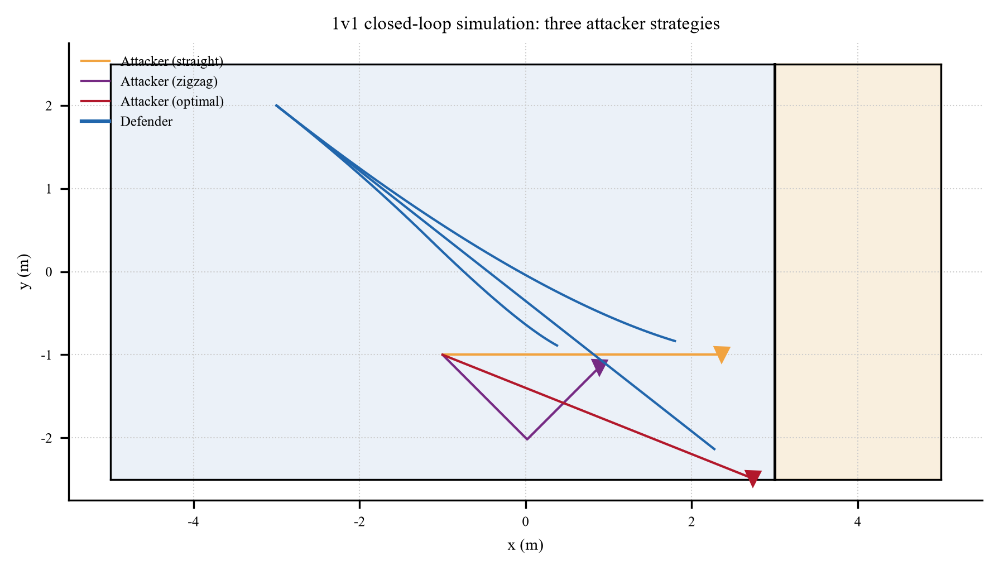
*上篇：三种攻击者策略的轨迹对比*

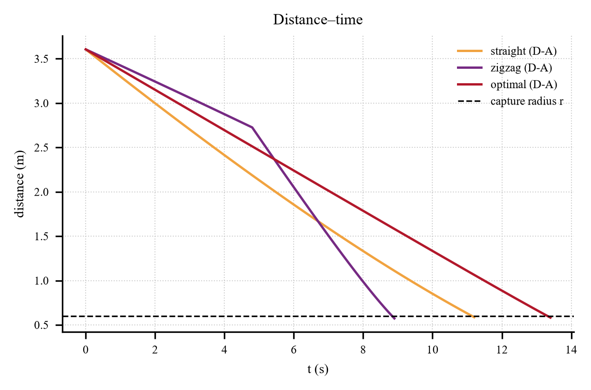
*上篇：距离-时间曲线*

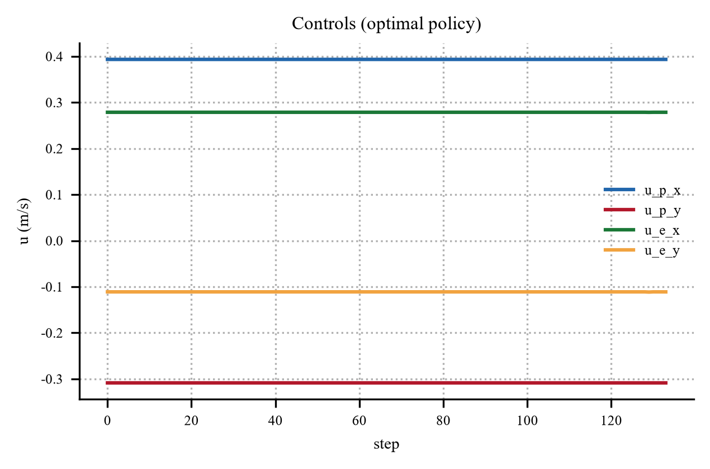
*上篇：控制量曲线（最优策略）*

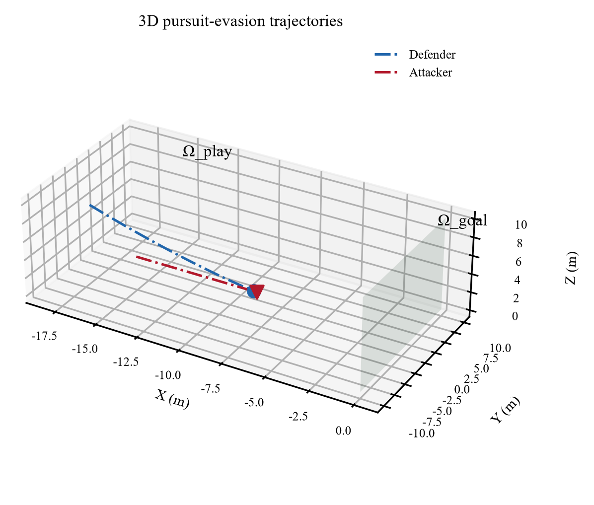
*下篇：3D 攻防轨迹与 Ω_goal 目标面*

### 1.4 多对一：协同拦截与组合选取

> 前置知识：1.1 拦截判定（上篇的交集判定、下篇的复用都来自它）

#### 上篇：二对一协同拦截

##### 这一节解决什么问题

一个防守者拦不住时，加一个够不够？答案不用试飞，画两条圆、解一个多约束优化就知道。**多防守者的全部新知识只有一句话：攻击者的安全区变成所有单安全区的交集**，其余照旧。

##### 数学：多一条约束而已

$$
\max_{\boldsymbol{x}}\ x_1 \quad \text{s.t.}\quad
\begin{cases}
g_1(\boldsymbol{x}) = -\|\boldsymbol{x}-\boldsymbol{p}_{p1}\| + a_1\|\boldsymbol{x}-\boldsymbol{p}_e\| + r \le 0 \\
g_2(\boldsymbol{x}) = -\|\boldsymbol{x}-\boldsymbol{p}_{p2}\| + a_2\|\boldsymbol{x}-\boldsymbol{p}_e\| + r \le 0
\end{cases}
$$

攻击者要突破，必须**同时**躲开两人；防守者只要有一人贴上来就算赢。几何上两个"防守者占优圆"把攻击者安全区夹成月牙形。

```python
# solve_breakthrough 天然支持多防守者
# pursuers 传 [(位置, a), (位置, a)]，内部对每个防守者生成一条约束：
cons = [{"type": "ineq",
         "fun": lambda x, pp=p, aa=a: -apollonius_g(x, pp, p_e, aa, r)}
        for (p, a) in pursuers]
```
多一个防守者只是多往约束列表里加一条 `sqrt(...)`——这也是为什么 2v1 的代码几乎不比 1v1 长。

##### 对比实验：一追不上、二追得上

 复现了"一对一追不上、二对一能追上"的对比实验结论：

```python
j1 = judge_interception([(p_p1, a1)], p_e, r, x_d)              # 只派防守者1
j2 = judge_interception([(p_p1, a1), (p_p2, a2)], p_e, r, x_d)  # 双防守者
```
防守者 1 单独上时 $x_1^* \ge x_d$（拦截失败），加入防守者 2 后交集安全区够不到防线（拦截成功）。**注意 $x_1^*$ 的变化方向：约束变多，可行域变小，$x_1^*$ 只会左移（对攻击者更差）**——这解释了"加人永远不亏"。

##### 闭环合围

闭环和 03 完全同框架（`run_closed_loop` 直接传两个防守者）：双方每步重解双约束优化，**两个防守者朝同一个 $\boldsymbol{x}^*$ 运动**——不需要额外设计"合围角度"，合围态势是从滚动优化里自发产生的。

典型现象（距离曲线）：两条距离线先后触底，通常一人主追（距离先降）、一人卡位（距离平稳后快速收拢）。

##### 动手练习

1. 把两个防守者都放在攻击者正后方同一点（`p_p1 = p_p2 = [-3, 0]`），判定和 1v1 有区别吗？（提示：两条约束相同，交集没变——"人多"必须配合"站位分散"才有意义）；
2. 固定防守者 1 位置，扫描防守者 2 的 y 坐标从 -5 到 5，画 $x_1^*$ 随站位变化的曲线，找出"第二防守者最佳卡位点"；
3. 让 $a_2 = 1.0$（第二个防守者和攻击者一样快），他还能提供多少压制力？

##### 常见坑

- 两个约束的 $a$ 写成共用一个全局变量——将来防守者速度不同时会出隐蔽 bug，`solve_breakthrough` 用 `(位置, a)` 元组把参数绑定到每个防守者；
- 画交集区域时不要试图用 `fill_between` 硬算几何交集，两条 0 等值线摆在一起肉眼就是交集边界。

#### 下篇：多对一组合选取

##### 这一节解决什么问题

5 个防守者对付 1 个攻击者：**派谁上？派几个？** 派多了浪费兵力（其他方向空虚），派少了拦不住。做法朴素而有效——**枚举 + 选优 + 最少人数原则**，这也正是 mvn 任务分配（第 1.5 节）的雏形。

##### 算法三步

**第 1 步：枚举所有组合** $(m, n)$，含 $m = n$ 的"单人组合"（$m=n$ 时约束只有一条，自动退化为 1v1 判定）：

```python
# select_team 核心
for m, n in itertools.combinations_with_replacement(range(len(P)), 2):
    pursuers = [(P[m], a)] + ([(P[n], a)] if n != m else [])
    x_star = solve_breakthrough(pursuers, p_e, r).x     # 复用 01/04 上篇的判定
    combos.append((m, n, x_star[0]))
```
5 个防守者共 $\binom{5}{2} + 5 = 15$ 个组合，每个解一次小优化，毫秒级。

**第 2 步：选压制最好的组合**——突破点横坐标最小者：

$$
(m^*, n^*) = \arg\min_{m \ge n} x_1^*(m, n)
$$

$x_1^*$ 越小说明该组合把攻击者压得越死（离防线越远）。

**第 3 步：最少人数原则**——若某个**单人**组合的 $x_1^*$ 与最优值相等（差在小容差内），只派 1 人。两人组合与单人组合压制效果相同时，人力贵：

```python
# 先找单人达标，找不到才用双人
for m, n, x1 in combos:
    if abs(x1 - best) < tol and m == n:
        team = [m]; break
```
> 比较用 `abs(x1-best)<tol` 而不是 `==`——浮点数永远不要直接判等，这是通用工程习惯。

之后被选中者闭环追击（复用 `run_closed_loop`），其余人待命。

##### 输出怎么读

```
      组合      x1*
(1,5)双     0.028
(1,4)双     0.028
(1,1)单     0.028  <-- 最优
(1,2)双     0.028
(1,3)双     0.028
(2,5)双     1.150
派出防守者：[1]（1 人）
[闭环] 拦截成功 @ 3.5s（防守者1完成捕获）
```
- 表格按 $x_1^*$ 升序 = 压制力排行；
- "双"组合几乎总比"单"强（多一条约束），所以**最优往往是双人的**——除非某个防守者站位极佳；
- 闭环图上只有出动者有虚线轨迹，距离曲线能看到两人一主一辅。

##### 动手练习

1. 把攻击者挪到 `p_e = [-1, 2.5]`（贴上边界突破），最优组合怎么变？卡位防守者是不是换成上方那两个？
2. 组合成本：把目标从 $\min x_1^*$ 改成 $\min x_1^* + 0.1 \times$人数，最优团队会怎样？（引入"人力成本"的多目标版本）
3. 防守者从 5 加到 8，枚举量是多少？想想什么情况下枚举会爆炸（这正是 1.5 要用整数规划替代枚举的原因——**枚举选组合是 mv1 的方法，分配问题是 mvn 的方法**）。

##### 常见坑

- `combinations_with_replacement` 才能产生含 $(m,m)$ 的组合，用 `combinations` 会漏掉所有单人方案；
- 判定用的防守者位置是**当前时刻**的——闭环中不重新选人会怎样？（每步都重选 = 动态分配，原实现是开局选一次；可以自己试试改成每 N 步重选）

#### 运行结果图示

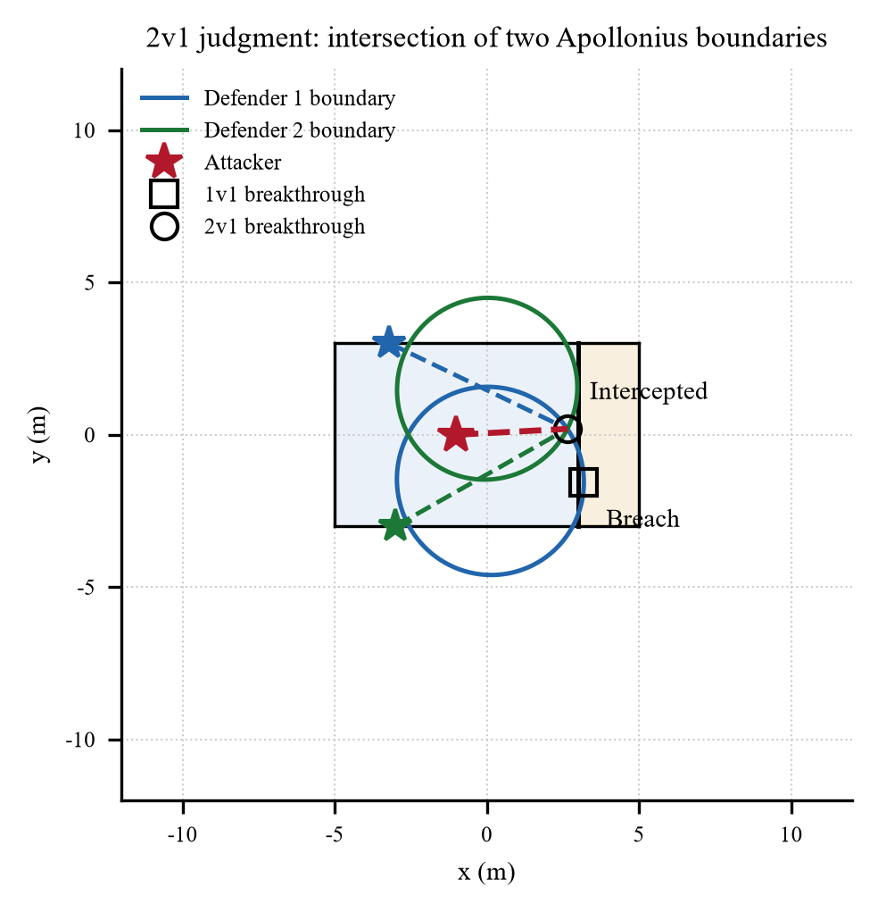
*上篇：2v1 判定——双边界交集与两种突破点，虚线为闭环合围轨迹*

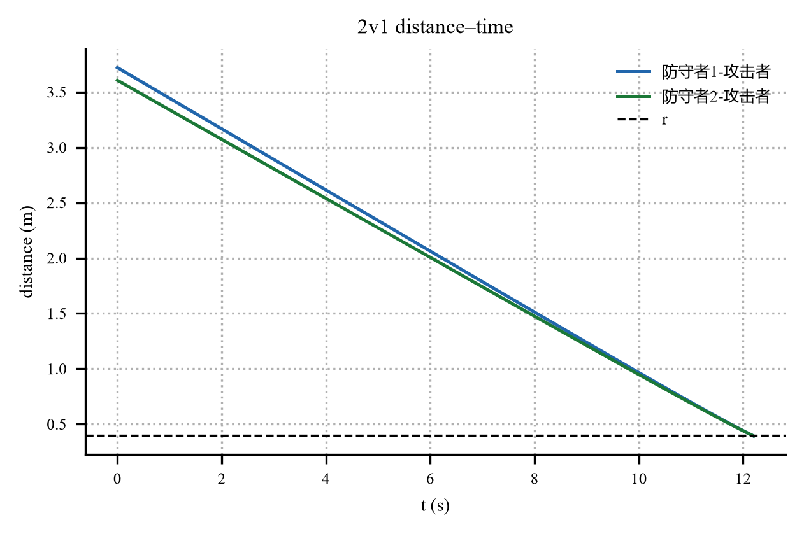
*上篇：双防守者距离-时间曲线*

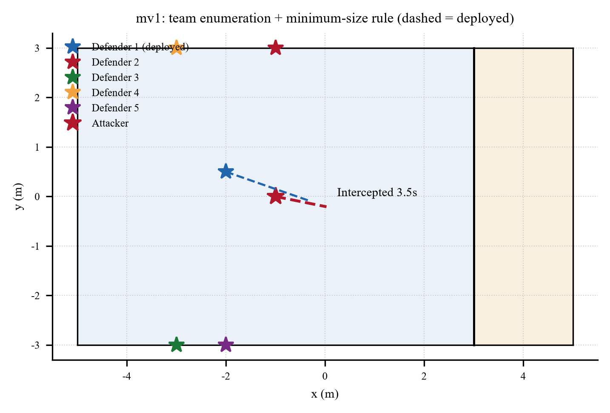
*下篇：mv1 组合选取与出动者轨迹*

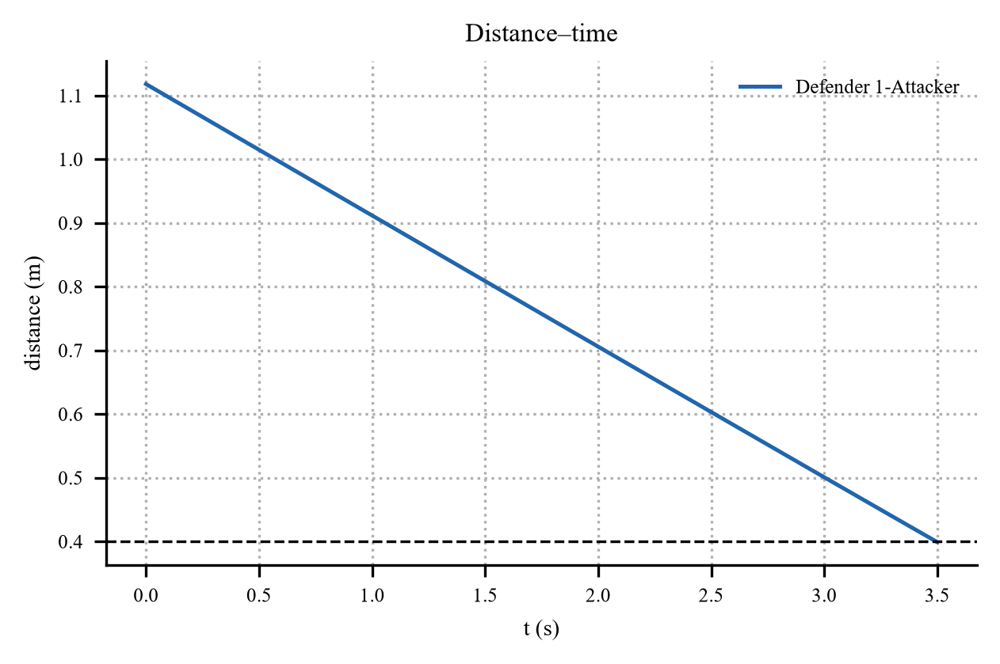
*下篇：出动者距离-时间曲线*

### 1.5 多对多：任务分配与三对三综合仿真

> 前置知识：1.1 拦截判定（提供 xcj 可行性）、建议先看 1.4 多对一

#### 上篇：多对多任务分配（0-1 整数规划）

##### 这一节解决什么问题

3 个攻击者同时来袭，6 个防守者**组合**（单人/双人）听谁打谁？这是标准的**任务分配问题**，解法是 0-1 整数规划（ILP）。与 1.4（下篇）的枚举不同：枚举选"一个组合追一个目标"，ILP 一次解出**全局分工表**，规模大了也不怕。

##### 第一步：ILP 长什么样（入门 5 分钟）

先看一个最小入门例子：

$$
\max\ 5x_1 + 8x_2 \quad \text{s.t.}\ x_1 + x_2 \le 6,\ \ 5x_1 + 9x_2 \le 45,\ \ x \ge 0 \text{ 且取整}
$$

```python
# toy
c = -np.array([5.0, 8.0])                        # milp 只会 min，取负号求 max
cons = [LinearConstraint([[1, 1], [5, 9]], -np.inf, [6, 45])]
res = milp(c=c, constraints=cons,
           integrality=np.ones(2),                # 全部变量取整数
           bounds=Bounds(0, np.inf))
# 解：x = [0, 5]，目标 40
```
`scipy.optimize.milp`（scipy≥1.9）专门解混合整数线性规划：目标取负求最大、`integrality` 指定整数变量、`Bounds(0,1)` 就是 0-1 规划。

##### 第二步：分配问题的数学

决策变量：$x_{ij} \in \{0,1\}$——组合 $i$ 是否负责攻击者 $j$（6×3=18 个变量）。可行性由 01 节的判定**批量**算出，构成矩阵 $xcj$：

$$
xcj_{ij} = \begin{cases} 1, & \text{组合 } i \text{ 单独能拦住攻击者 } j\ (x_1^* < x_d) \\ 0, & \text{拦不住} \end{cases}
$$

$$
\max \sum_{i,j} x_{ij}
\quad \text{s.t.}\quad
\begin{cases}
\sum_j x_{ij} \le 1 & \text{（每个组合最多追一个）} \\
\sum_i x_{ij} \le 1 & \text{（每个攻击者最多被一个组合追）} \\
\sum_j x_{i_1 j} + \sum_j x_{i_2 j} \le 1, & \text{若组合 } i_1,i_2 \text{ 共用防守者} \\
x_{ij} \le xcj_{ij} & \text{（追不上的直接禁选）} \\
x_{ij} \in \{0,1\} &
\end{cases}
$$

目标是 $\max \sum x_{ij}$：**能拦住几个是几个**（残局里拦不住的自然被放弃）。

##### 第三步：xcj 和约束的代码

```python
# build_xcj：组合 i 对攻击者 j 逐个跑 01 节的判定
for i, cb in enumerate(combos):
    for j, e in enumerate(evaders):
        pursuers = [(P[k], a) for k in cb]
        xcj[i, j] = judge_interception(pursuers, e, r, x_d)["success"]

# 禁选技巧：不给 xcj=0 的变量加约束行，而是把它的上界压到 0
ub_var = xcj.reshape(-1).copy          # 0/1 直接当上界用
res = milp(c=-np.ones(n), constraints=cons,
           integrality=np.ones(n), bounds=Bounds(0, ub_var))
```
三种约束行（行和、列和、冲突）都是"系数向量 + 上下界"的 `LinearConstraint`，`add_row` 帮你少写重复代码。

> **建模提示**：行/列约束用 "≤1" 而不是 "=1"——当某些组合对根本拦不住（xcj=0）时，"=1" 会造成无解；"≤1" 允许放弃追不上的目标，语义正好是"能拦几个拦几个"。

##### 动手练习

1. 把某个攻击者挪到很靠近防线（如 `[2.8, -2]`），xcj 整列变 0，分配方案少了谁？（"放弃追不上的"）
2. 把组合池加到全部 15 个组合（5 单 + 10 双），最优解拦截数变化吗？求解时间呢？
3. 进阶：把目标改成"拦截总时间最短"——需要给每个 $x_{ij}$ 一个代价（比如用 $x_1^*$ 离防线的距离），目标变成 $\min\sum c_{ij} x_{ij}$，这就是从"能拦几个"到"拦得好不好"的升级。

##### 常见坑

- `milp` 是 **min** 优化，求最大别忘了目标取负；
- 冲突约束漏掉会出现"防守者 1 既在单人文组又在双人组"的分裂部署——检查 `set(c1) & set(c2)`；
- 解出来的 `res.x` 是浮点（0.9999/1e-9 之类），用 `np.round` 后再当 0/1 用。

#### 下篇：三对三综合仿真

##### 这一节解决什么问题

把 1.1~1.4 的全部零件拼成一台完整的戏：3 个攻击者同时突防，3 个防守者按分配结果各司其职——

| 子博弈 | 配对 | 预期结局 |
|---|---|---|
| A | 防守者1 vs 攻击者1 | 拦截成功 |
| B | 防守者2+3 vs 攻击者2 | 拦截成功 |
| C | 无人看守攻击者3 | **拦截失败** |

子博弈互不耦合（各追各的），所以可以**独立跑完再合图**——拆成三次 `run_closed_loop` 调用，每段都是前面验证过的代码。

##### 核心代码

```python
# 三个子博弈就三行
outA = run_closed_loop([(P["P1"], a)], E["E1"], v_p, v_e, r, x_d, dt=dt)
outB = run_closed_loop([(P["P2"], a), (P["P3"], a)], E["E2"], v_p, v_e, r, x_d, dt=dt)
trajE3, resC = run_e3_unguarded(E["E3"])          # 没人追：直线走到防线
```
无人看守的攻击者（子博弈 C）不需要博弈框架，一个直线积分就够：

```python
# run_e3_unguarded 核心
for k in range(n_max):
    e = e + np.array([v_e, 0.0]) * dt
    if e[0] >= x_d: break          # 到达防线 -> 拦截失败
```
注意本场景参数与前面不同（`v_e=0.16, v_p=0.3`，实验取值），速度比 $a=1.875$ 更大、防守者压制更强——参数变了框架一行不用改，这正是"模型-判定-仿真"分层的红利。

##### 怎么读结果

- **轨迹图**：E3（橙色）一条直线捅穿防线进入防守区域；E1/E2 的轨迹在防线前终止（被捕获）；防守者 2、3 的轨迹形成对 E2 的钳形；
- **距离图**：P1-E1、P2-E2、P3-E2 三条曲线都触到 $r$ 线；E3 没有距离曲线（没人追它——**它的问题不是追不追得上，而是根本没人管**）；
- 控制台逐行打印三个子博弈的结局和时刻。

##### 动手练习

1. 防守者不够用怎么办：把 `assign` 改成 P1 防 E1、P2+P3 都去堵 E3（离防线最近的），E2 放养——总拦截数变了吗？（体会上篇的分配目标"拦住尽量多"）
2. 给 E3 也派一个防守者（改成 3v3 真混战），需要改哪些地方？（提示：加一行 `run_closed_loop` + 图例）
3. 综合题：把上篇的分配输出 `plan` 直接接到本篇的 `assign` 上（用 `judge_interception` 自动生成子博弈列表），做成"分配→仿真"全自动流水线。

##### 常见坑

- 三个子博弈用同一个 `dt` 但**结束时刻不同**，画距离曲线时各自用各自的 `t` 数组（`tA`/`tB`），共用一个会错位；
- 子博弈 B 的 `traj_p` 有两列（两个防守者），索引 `[:, 0]`、`[:, 1]` 别搞混；
- 捕获/突破判定已统一收进 `run_closed_loop` 的 `result` 字典，不要在主循环里再重复判一次。

#### 运行结果图示

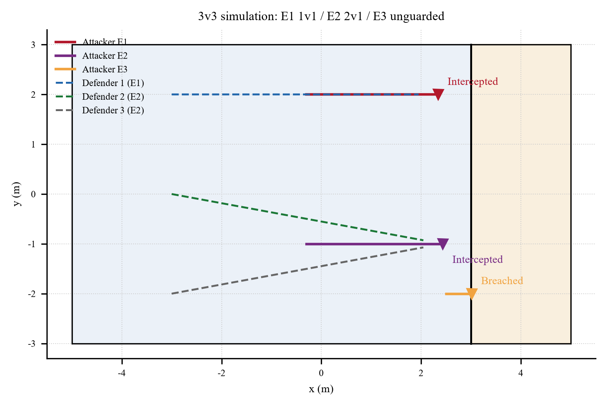
*下篇：3v3 综合仿真轨迹（E1 1v1 / E2 2v1 钳形合围 / E3 直线突防）*

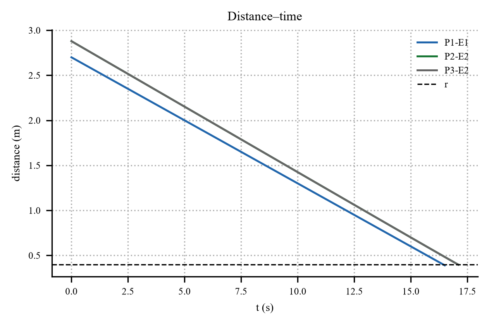
*下篇：三个子博弈距离-时间曲线*

### 1.6 实验数据后处理（rosbag）

> 前置知识：无（独立于 01~05，随时可学）

#### 这一节解决什么问题

仿真之外，研究做了**真机实验**：两架 Tello 无人机（防守者 + 攻击者）在动捕场地里跑 1.1/1.3 的算法，所有数据录进 rosbag。这一节把 bag 里的原始话题还原成四类图：轨迹、距离、控制量、速度。

#### 实验平台三件套

| 部件 | 作用 | ROS 话题 |
|---|---|---|
| VRPN 动捕 | 毫米级定位 | `/vrpn_client_node/tello{1,2}/pose`、`/twist` |
| 决策节点 | 跑博弈算法、发指令 | `/command` |
| Tello 驱动 | 速度指令下发 | `/tello{1,2}/cmd_vel` |

两个单位陷阱：

- 动捕位置单位是**毫米**，画图前要除以 1000 换成米；
- `cmd_vel` 里的 `linear.x/y` 是**速度指令**（m/s），不是位置。

#### 核心：用 rosbags 库读 ROS1 bag

Python 用 `rosbags` 库读取（纯 Python 实现，不需要装 ROS）：

```python
# read_bag 核心
from rosbags.rosbag1 import Reader
from rosbags.typesys import Stores, get_typestore

ts = get_typestore(Stores.ROS1_NOETIC)
with Reader(path) as reader:
    for conn, tstamp, raw in reader.messages:
        msg = ts.deserialize_ros1(raw, conn.msgtype)   # 二进制 -> 消息对象
        data[conn.topic][0].append(tstamp * 1e-9)      # 时间戳 ns -> s
        data[conn.topic][1].append(msg)
```
取数：

```python
# 轨迹：PoseStamped 序列 -> x/y 数组（毫米 -> 米）
x = np.array([m.pose.position.x for m in msgs]) / 1000.0

# 速度指令：Twist 序列
ux = np.array([m.linear.x for m in msgs])
```
**时间对齐**：两个话题的时间戳不完全同步，算双机距离前要插值对齐（实验系统里的 `/tello1/error` 话题自带这个量，自己算就得显式做）：

```python
# 距离计算
x2i = np.interp(t1, t2, x2)          # 把 pose2 插值到 pose1 的时刻上
d12 = np.hypot(x1 - x2i, y1 - y2i)   # 逐时刻双机距离
```
拿到 $d_{12}(t)$ 后还能自动下结论：`d12.min <= r` → 实验拦截成功。

#### 动手练习

1. 把 3 组实验数据挨个分析一遍，整理出"实验组 → 拦截成功/失败"的表格，和文件名对得上吗？
2. 对比 `exp3_line_opt_success`（攻击者直线）和 `exp1_opt_opt_success`（攻击者最优）的轨迹图：直线策略下防守者轨迹是不是更"直"？
3. 进阶：读出轨迹后，用 1.1 的 `judge_interception` 对**初始时刻**做一次离线判定，和实验结局对照——这就是"仿真预测 vs 实验验证"闭环。

#### 常见坑

- **忘记 /1000**：轨迹图画出来场地"大 1000 倍"，坐标轴全是几千——先查单位；
- `rosbags` 只支持通过 `typestore` 反序列化，直接 `msg.linear.x` 报 AttributeError 时先 print 一个 msg 看字段结构（`pose.position.x` 有三层）；
- 时间轴起点不归零（bag 从开机录起），画图前 `t - t[0]`；
- bag 里话题缺失很常见（某个实验没录 twist），代码里全部用 `if topic in bag` 防御，别假设齐全。

#### 运行结果图示

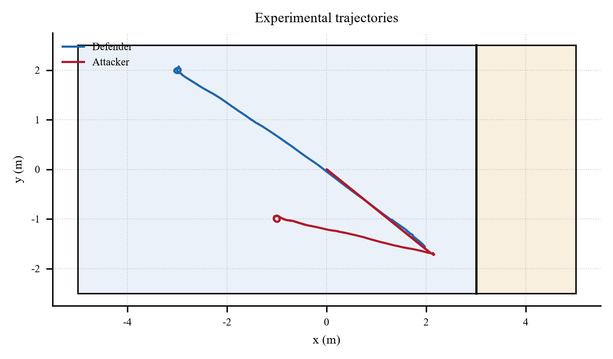
*实验轨迹*

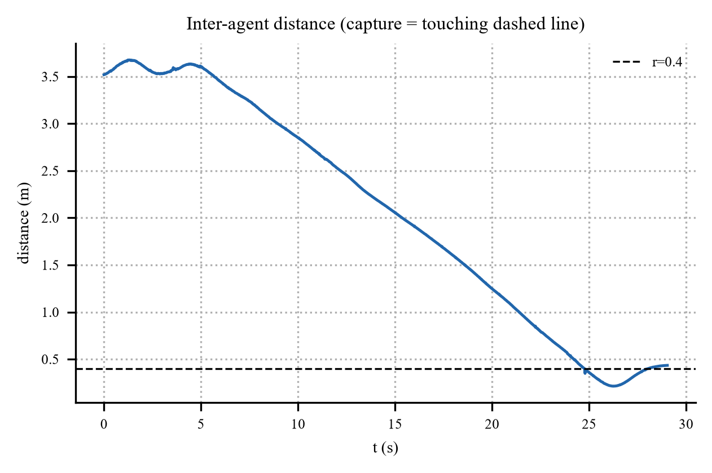
*双机距离*

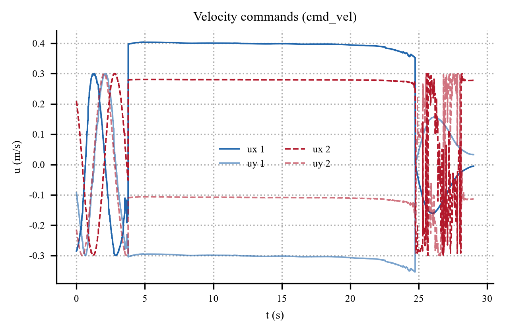
*控制量 cmd_vel*

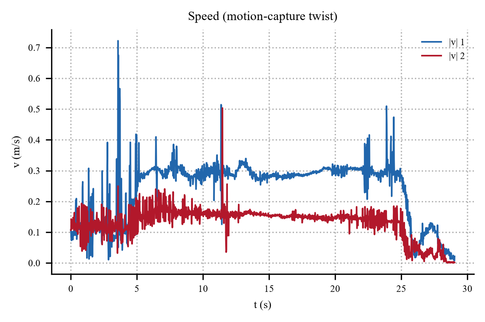
*速度（动捕 twist）*

---

## 第二章　参数不确定性博弈（位置有观测误差）

### 2.0 第二章节理论总览：参数不确定性博弈

> 与 1.0 理论总览（第一章）平行的第二章公式集中地。第一章的判定/分配/闭环框架 **全部沿用**，本章只回答一个问题：**感知与参数存在不确定时，哪些结论保留、 哪些被侵蚀、怎么补救**。

#### 1. 问题场景与不确定性的两种角色

场景与第一章完全相同（simple motion、防线 $x_d$、捕获半径 $r$、速度比
$a = v_p/v_e > 1$），唯一变化：**攻守状态来自传感器，带观测误差**。

由此不确定性在第二章里扮演两种角色，对应两条技术路线：

| 角色 | 含义 | 数学工具 | 用于 |
|---|---|---|---|
| 几何上界 | 态势允许的估计误差有多大（保守界） | kesai_ij 距离相关模型（§2） | 判定修正、鲁棒分配（2.1/2.2） |
| 统计精度 | 数据实际能把误差压到多小 | 卡尔曼滤波（§5） | 感知估计（2.3） |

两者的关系：**模型给上界，滤波给下界**，实际不确定性夹在中间；两者的差距就是
"用滤波换来的判定可靠性余量"。

#### 2. 距离相关不确定性模型 kesai_ij

$$
\xi(d, r, a) = \frac{1}{k}\,\min\!\left(d - r,\ \ \frac{\min(a-1,\,1)}{a}\,d + \frac{r}{a}\right),
\qquad k = 3 \ \text{（保守系数）}
$$

两个分支各管一件事：

- $d - r$：**离得远就可以估得糙**；贴脸（$d \le r$）时必须零误差（$\xi = 0$）；
- $\dfrac{\min(a-1,\,1)}{a}d + \dfrac{r}{a}$：**速度优势小就必须估得准**（$a \to 1$ 时
  此项趋小）；快得多（$a \gg 1$）才有容错空间。

关键性质：$\xi$ 随距离增大而增大、**贴脸趋零**——这决定了滤波的收益集中在远场
逼近阶段（§6），也决定了多防一的价值（2.1）。

共享实现：`common.kesai_ij`（`mul` 即 $k$，可调；越小 $\xi$ 越大、观测越糙）。
→ 详见 2.1 参数不确定性博弈：一对一 / 二对一

#### 3. 修正方式：捕获半径缩水

把 $\xi$ 折算进判定，等价于捕获半径缩水：

$$
r_{eff} = r - a\,\xi, \qquad
\text{判定约束变为 } \|\boldsymbol{x} - \boldsymbol{p}_p\| \ \ge\ a\,\|\boldsymbol{x} - \boldsymbol{p}_e\| + r_{eff}
$$

几何效果：$\xi$ 越大，$r_{eff}$ 越小，按 $r_{eff}$ 画的**保守边界越向攻击者一侧扩张**
（防守者对自身捕获能力做悲观估计）。$r_{eff}$ 可为负（悲观到彻底失去几何优势），
判定函数对负值正常工作。→ 详见 2.1，图例见图 1

#### 4. 鲁棒成对判定：蒙特卡洛成功概率

判定本身（第一章 1.1）不变，把**估计位置**代入后用蒙特卡洛量化可靠度：在不确定圆内
随机扰动 $N$ 次，统计判定为"拦截成功"的比例。判定点 $(-1,0)$ 处（真实答案：
1v1 拦不住、2v1 拦得住）的实测：

$$
P_{1v1}^{succ} = 30\%, \qquad P_{2v1}^{succ} = 74\%
$$

两条结论：

1. 不确定性把"确定成功"拖成概率事件——**多防一是不确定性下的保险**；
2. 噪声的误判是双向的：**假阳性**（把拦不住说成能拦，1v1）与**假阴性**（把拦得住
   说成拦不住，2v1）。评价标准是"判定与真实几何是否一致"，而非成功率高低。

#### 5. 鲁棒任务分配（0-1 整数规划）

第一章 1.5 的分配框架在第二章升级为**鲁棒版**：成对可行性不在名义位置上判定，而在
不确定圆内的扰动位置上判定——只有扰动后仍拦得住的组合才可行（pairwise outcome
under uncertainties）：

$$
xcj^{rob}_{ij} = \begin{cases} 1, & \text{扰动位置上 } x_1^* < x_d \\ 0, & \text{否则} \end{cases}
\qquad
\max \sum_{i,j} reward_{ij}\, x_{ij}
$$

奖励取压制紧度 $reward = 1/(x_1^* - x_{e,x})$（突破点被压得离攻击者越近奖励越高），
约束与 1.5 相同（行/列 $\le 1$ + 共享防守者互斥），不可行格上界置 0（**理性放弃**
追不上的目标）。"仅名义可行、扰动后失效"的组合（u 格）是分配阶段最危险的陷阱。

#### 6. 感知估计：卡尔曼滤波

滤波是压缩 $\xi$ 的数据侧手段。两种实现都在 ：

**位置态 KF（原始实现结构，带已知输入）**：

$$
\boldsymbol{X}^- = A\boldsymbol{X} + B\boldsymbol{U}, \quad
P^- = APA^\top + Q, \quad
K = P^-H^\top(HP^-H^\top + R)^{-1}
$$

$$
\boldsymbol{X} = \boldsymbol{X}^- + K(\boldsymbol{Z} - H\boldsymbol{X}^-), \qquad
P = (I - KH)P^-
$$

**常速度模型 KF（游戏接入）**：状态 $[x, y, v_x, v_y]$，预测-更新同上（$B=0$）。

滤波收益的实测（观测按 kesai_ij 模型注入）：

| 场景 | 原始观测误差 | 滤波后误差 | 模型 $\xi$ |
|---|---|---|---|
| 原始演示（噪声 5/i） | 0.923 m | 0.684 m | — |
| 游戏轨迹（距离相关注入） | 0.896 m | **0.368 m** | ≈0.66 m |

**读法**：原始误差紧贴 $\xi$ 模型，滤波压掉一半以上——模型给上界（0.66），滤波给
下界（0.37）。且 $\xi$ 贴脸趋零 ⇒ **滤波收益集中在远场，近场趋零**。
→ 详见 2.3 参数不确定性博弈：卡尔曼滤波

#### 7. 终局检验：闭环抓捕率（开环直线 vs 反馈曲线）

把滤波放进闭环追捕（轨迹走完看实际结果，无先验判定），每个条件 100 次蒙特卡洛：

| mul（噪声水平） | 无滤波 | 有滤波 |
|---|---|---|
| 1.0（取满模型上界，远场 ±2.6 m） | **0%** | 100% |
| 2.0（2 倍保守） | 100% | 100% |
| 3.0（原模型默认） | 100% | 100% |

三条结论：

1. 噪声超出保守余量时（mul=1），无滤波的防守方追"幻影"全军覆没，滤波 100%；
2. 模型保守噪声下（mul=2/3）无滤波也是 100%——**滤波收益集中在远场，近场趋零**
   （$\xi$ 贴脸趋零的直接推论）；
3. 关于轨迹形状：1v1 的**开环最优解**是双方直线奔向固定捕获点（2.4 的开环直线模式
   可复现，双轨迹直线偏差为 0）；闭环里看到的曲线是**滚动反馈策略**（每步重解当前
   最优目标点）的正常表现，多攻多守 + 分配切换会放大弯曲——曲线不等于不最优。

#### 8. 第二章章节结构

| 节 | 教程 | 内容 |
|---|---|---|
| 2.1 | 2.1 参数不确定性博弈：一对一 / 二对一 | kesai_ij、保守边界、蒙特卡洛判定 |
| 2.2 | 2.2 参数不确定性博弈：多对多 | 鲁棒可行性 → 分配 → 闭环流水线 |
| 2.3 | 2.3 参数不确定性博弈：卡尔曼滤波 | 滤波压缩 ξ（Part 1~2） |
| 2.3.1 | （并入 2.3 节） | 闭环抓捕率统计 + 配对案例可视化 |
| 2.4 | 2.4 参数不确定性_GUI软件 | GUI 桌面软件封装 |

学习路线：2.0（本节）→ 2.1 → 2.2 → 2.3（+2.3.1）→ 2.4；前置：第一章 `1.1`、`1.4`、`1.5`。

#### 9. 与第一章结论的对照

| 结论 | 第一章（精确感知） | 第二章（不确定感知） |
|---|---|---|
| 拦截可行性 | 几何判定，非此即彼 | 变为概率事件（假阳性/假阴性） |
| 速度比 $a$ 的作用 | 唯一优势来源 | 优势越大，允许的 $\xi$ 越大（kesai_ij 第二分支） |
| 最优策略 | 开环直线（固定捕获点） | 反馈滚动（曲线），开环模式可复现直线 |
| 多防一 | 锦上添花（合围更快） | 保险（2v1 成功率 74% vs 1v1 30%） |
| 分配 | 名义可行性 | 鲁棒可行性（u 格 = 不确定下失效的组合） |
| 滤波 | 无角色 | 远场压缩 $\xi$ 的手段，近场收益趋零 |

### 2.1 参数不确定性博弈：一对一 / 二对一

> 前置知识：第一章 1.1 拦截判定与阿波罗尼奥斯圆、1.4 多对一协同与组合选取（上篇 2v1）、1.2 参数与不确定性分析（r_eff 思想）
> 定位：第二章第 1 节。第一章的所有判定都假设"双方位置精确已知"；本节开始放松这个假设。

#### 这一节解决什么问题

第一章的判定是几何性的："画个圆、比比横坐标"。但攻击者位置来自传感器，有误差——**位置不准时，"拦得住"还剩几成把握？** 本节给出原研究的距离相关不确定模型 `kesai_ij`，并把它接到 1v1 / 2v1 判定上，用蒙特卡洛量化拦截的鲁棒性。

#### 核心：距离相关的不确定模型 kesai_ij

$$
\xi(d, r, a) = \frac{1}{k}\,\min\!\left(d - r,\ \ \frac{\min(a-1,\,1)}{a}\,d + \frac{r}{a}\right),
\qquad k = 3 \ \text{（保守系数）}
$$

两个分支各管一件事：

- $d - r$：**离得远就可以估得糙**。远处目标不急于精确定位；贴脸（$d \le r$）时必须零误差；
- $\dfrac{\min(a-1,\,1)}{a}d + \dfrac{r}{a}$：**速度优势小就必须估得准**。防守者只比攻击者快一点（$a \to 1$）时，判定对位置误差极其敏感；快得多（$a \gg 1$）才有容错余量。

共享实现见 `common.kesai_ij`（2.2 也用它）。

#### 接入判定的两种方式

**方式一（几何保守）**：把捕获半径缩水成 $r_{eff} = r - a\,\xi$，用 1.1 的判定照常解——得到"悲观突破点"：

```python
# fig_2v1_boundary 核心
xi1 = kesai_ij(dist(p_p1, p_e), r, a)
xi2 = kesai_ij(dist(p_p2, p_e), r, a)
j_cons = judge_interception([(p_p1, a), (p_p2, a)], p_e, r - a * max(xi1, xi2), x_d)
```
图 2 里实线是精确边界、虚线是保守边界：**虚线交集更小，突破点左移**——防守者的悲观估计让"安全"的门槛更高。

**方式二（蒙特卡洛）**：攻击者在不确定圆内随机取 200 个位置，逐个跑判定，统计成功概率：

```python
# monte_carlo 核心
th = rng.uniform(0, 2 * np.pi)
rr = xi * rng.uniform(0, 1)
e_pert = [p_e[0] + rr*np.cos(th), p_e[1] + rr*np.sin(th)]
if judge_interception([(p_p1, a)], e_pert, r, x_d)["success"]:
    wins["1v1"] += 1
```
#### 典型结果怎么读

```
攻击者不确定半径 ξ = 0.576 m，扰动 200 次：
  1v1（只派防守者1）拦截成功概率 = 30%
  2v1（双防守者）  拦截成功概率 = 74%
```
- 不确定性把 1v1 从"确定成功"拖到**三成把握**——位置误差吃掉了大部分几何优势；
- 加第二个防守者把成功率翻倍还多：**多防一不是锦上添花，是不确定性下的保险**；
- 这正是第二章第 2 节（多对多分配）要在**分配阶段**就考虑不确定性的动机。

#### 动手练习

1. 把 `N_TRIALS` 改成 1000，概率估计更稳；再让防守者 1 靠近攻击者 1 m，看 1v1 成功率回升多少；
2. 把保守系数 `mul`（`common.kesai_ij` 的参数）从 3 改成 1，ξ 放大 3 倍，2v1 成功率掉到多少？
3. 进阶：不用固定 $\xi$，让 $\xi$ 随仿真时间衰减（模拟"传感器逐步精化"），画"成功概率 vs 时刻"曲线。

#### 常见坑

- 扰动幅度用**每个防守者各自的** $\xi$（2v1 里两人距离不同、$\xi$ 不同），保守起见本节取 max；
- 蒙特卡洛别忘了设随机种子（`default_rng(7)`），否则每次跑出来概率都不同，没法对比；
- $r_{eff}$ 为负是合法状态（悲观到彻底失去几何优势），判定函数对负 $r$ 正常工作，不要加非负断言。

> **延伸（2.3）**：$\xi$ 不是只能被动接受——2.3 参数不确定性博弈：卡尔曼滤波 展示用卡尔曼滤波从含噪观测中估计位置，把 $\xi$ 从数据侧压下来。

#### 运行结果图示

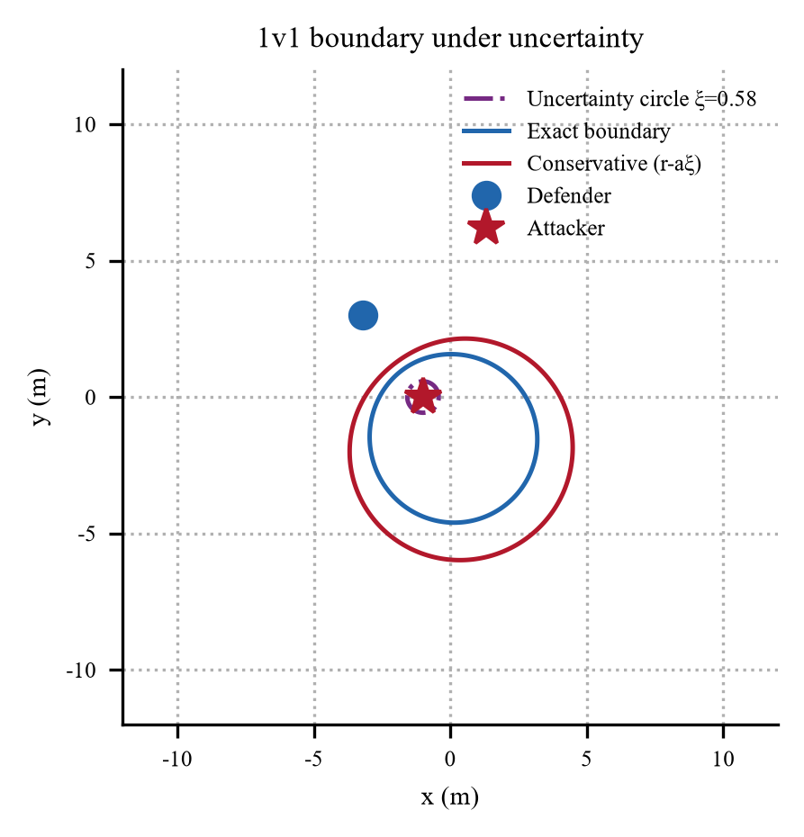
*1v1 保守边界与攻击者不确定圆*

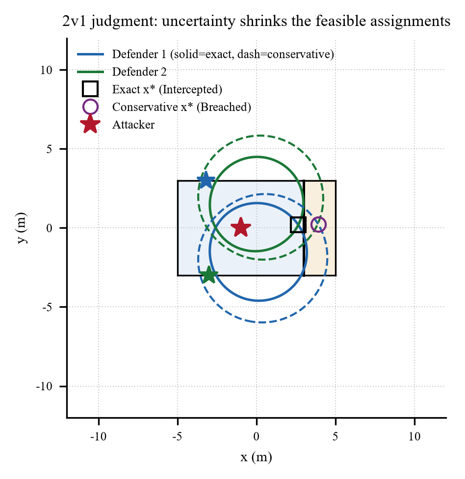
*2v1 精确/保守边界与突破点*

### 2.2 参数不确定性博弈：多对多

> 前置知识：第一章 1.5 多对多分配与三对三综合、本章 `2.1`
> 定位：第二章第 2 节。把 2.1 的"成对判定 + 不确定性"放大到多对多：**在分配阶段就考虑不确定性**，而不是等闭环翻车。

#### 这一节解决什么问题

第一章 1.7 的分配矩阵 $xcj$ 用**名义位置**判定"组合 i 能否拦住攻击者 j"。但 2.1 已经说明：名义上拦得住，扰动一点可能就拦不住。按名义矩阵分配，实战里可能出现"分去堵 A 的人手不够，B 却从指缝里漏过去"。

本节的做法：**每对（组合, 攻击者）的可行性都在不确定圆内的扰动位置上重新判定**，只有扰动后仍然拦得住的组合才配得到任务——这就是理论文献里的 "pairwise outcomes under uncertainties"。

#### 流水线（四步）

```
第 1 步  组合池：C = P(P+1)/2 个防守者组合（单人 + 双人）
第 2 步  成对判定（跑两遍）：
          名义位置   -> feas_nom（对照用）
          扰动位置   -> feas_rob（分配实际采用），reward = 1/(x1* - xe)
第 3 步  0-1 分配：milp 最大化总奖励，行/列 <=1 + 共享防守者冲突约束
第 4 步  闭环：被分配组合每步重解突破点并追踪；未分配攻击者直冲防线
```
不确定性只进入**第 2 步的鲁棒判定**（和 2.1 的蒙特卡洛同一手法）：

```python
# pair_judgment 核心
if use_kesai:
    xi = kesai_ij(dist(P[i], e), r, a)          # 该防守者视角的不确定半径
    th = rng.uniform(0, 2 * np.pi)
    e_eval = e + xi * rng.uniform(0, 1) * np.array([np.cos(th), np.sin(th)])
res = solve_breakthrough([(P[i], a), (P[j], a)], e_eval, r)
feasible = res.x[0] < x_d                        # 扰动后仍拦得住才算可行
```
分配目标仍是第一章 1.7 的 ILP，只是可行矩阵换成了鲁棒版；闭环框架与 1.8 相同（每步重解突破点、未分配者直冲、捕获/突破即冻结）。

#### 典型结果怎么读

```
成对可行性对比（✓=名义与鲁棒都可行, u=仅名义可行即不确定下失效, ×=不可行）：
    1+1  E1:✓   E2:×   E3:×
    1+2  E1:✓   E2:✓   E3:×
    1+3  E1:✓   E2:u   E3:×
    2+2  E1:u   E2:✓   E3:×
    2+3  E1:✓   E2:✓   E3:×
    3+3  E1:×   E2:✓   E3:×
分配方案（按鲁棒奖励最大化）：
  防守者1+防守者1 -> 攻击者1
  防守者2+防守者2 -> 攻击者2
攻击者1: 拦截成功 @ 5.3s
攻击者2: 拦截成功 @ 5.7s
攻击者3: 拦截失败 @ 3.2s
```
- **u 格就是不确定性的代价**：1+3 组合名义上能堵 E2，扰动一次就失效——按名义矩阵分配就是埋雷；
- 鲁棒分配自动避开了所有 u 格，选择两个最稳的单人组合；
- E3 离防线太近（没有任何组合能拦），分配器**主动放弃**它（"能拦几个拦几个"）——它直冲防线，3.2 s 突破成功。这个"失败"是理性取舍，不是 bug。

#### 与第一章两节的关系

| | 第一章 07+08 | 本章 2.2 |
|---|---|---|
| 可行性判定 | 名义位置一次 | 不确定圆内扰动判定 |
| 分配目标 | 拦住尽量多（奖励全 1） | 鲁棒拦住尽量多 + 压制最紧的优先（奖励 1/余量） |
| 闭环 | 子博弈手工指派 | 分配结果自动驱动（无人看管者直冲） |

#### 动手练习

1. 关掉 `USE_KESAI`（名义分配）再跑，对比两种分配方案和 E2 的结局——名义方案是否把兵力浪费在了 u 格上？
2. 把 `SEED` 换成 1~10 跑十遍，统计鲁棒分配的方案是否稳定（可行性对扰动抽样的敏感性）；
3. 进阶（原研究的"未完成"方向）：每 N 步用当前位置**重新做一次**成对判定 + 分配（滚动时域重分配），对比静态分配的总拦截数。

#### 常见坑

- 奖励 $1/(x_1^* - x_e)$ 只在可行格上有意义，不可行格必须连同奖励一起置 0（本代码用 `feasible.reshape(-1)` 做上界，负奖励不会出现，但仍建议显式相乘）；
- 扰动要用**固定种子**，否则每次跑的可行性矩阵都不同，没法教学对比；
- 闭环里未分配攻击者也要做突破判定，否则他会"冲过防线还在飞"——漏掉这一步结局永远不会收敛到"全部冻结"。

> **延伸（2.3）**：分配用的 ξ 还能进一步压缩——2.3 参数不确定性博弈：卡尔曼滤波 用卡尔曼滤波从含噪观测中估计攻击者位置。

#### 运行结果图示

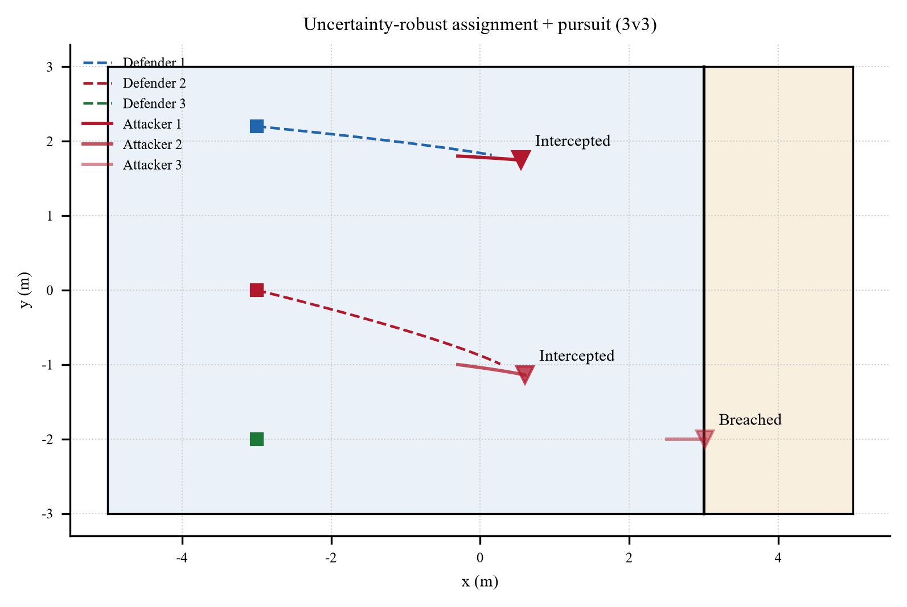
*鲁棒分配驱动的 3v3 轨迹*


*成对可行性矩阵（u=不确定下失效）*

### 2.3 参数不确定性博弈：卡尔曼滤波

> 前置知识：2.1 参数不确定性博弈：一对一 / 二对一（kesai_ij 模型）、第一章 `1.3`（闭环仿真）
> 定位：第二章第 3 节。2.1/2.2 把不确定半径 ξ 当作**给定**的模型；本节展示它的另一面—— **ξ 可以从数据侧压缩**：用卡尔曼滤波从含噪观测中估计攻击者位置，并检验滤波对实战结局的影响。

#### 这一节解决什么问题

攻击者位置来自传感器，单次测量噪声很大。2.1 里我们被动接受它（ξ 进判定），2.2 里主动绕开它（鲁棒分配）；本节主动出击：**滤波**。核心一句话——

> 卡尔曼滤波 = 运动模型预测 ⊗ 含噪观测 的最优加权，权重由各自的方差自动算出。

#### Part 1：原研究滤波器（位置态 KF）

原研究的滤波器是**位置态 + 已知输入**结构（斜线运动的小车，`U` 是已知的速度输入，`kesai` 在原始实现里就是测量噪声标准差——本章 ξ 概念的直接来源）。五个公式：

$$
\boldsymbol{X}^- = A\boldsymbol{X} + B\boldsymbol{U}, \qquad
P^- = APA^\top + Q
$$

$$
K = P^-H^\top(HP^-H^\top + R)^{-1}, \qquad
\boldsymbol{X} = \boldsymbol{X}^- + K(\boldsymbol{Z} - H\boldsymbol{X}^-), \qquad
P = (I - KH)P^-
$$

本场景 $H = I$（直接观测位置），增益化简为 $K = P^-(P^-+R)^{-1}$。代码里的 `PosKF` 就是它的忠实翻译：$A=I$、$B=v_eI$、$U=[\tfrac{\sqrt2}{2},\tfrac{\sqrt2}{2}]$（45° 斜线）、观测噪声 std 逐期衰减（$5/i$）、20 步。图 1 三条系列：真实轨迹 / 观测 / 滤波估计——观测在真值两侧乱跳，估计紧贴真值。

**读 K 的直觉**：$R$ 大（测量烂）→ $K$ 小 → 多信模型；$Q$ 大（模型糙）→ $K$ 大 → 多信观测。滤波的全部魔力就在这个自动权衡里。

#### Part 2：接到游戏里——两种 ξ 的对话

游戏接入用更标准的**常速度模型 KF**（状态 $[x, y, v_x, v_y]$，代码 `KalmanFilter` 类），对直线突防的攻击者做位置估计。图 2 是滤波轨迹（含末时刻 2σ 不确定椭圆），图 3 把两条"不确定性曲线"叠在一起：

- **kesai_ij ξ（红虚线）**：2.1 的**距离相关噪声模型**（每步按它注入观测噪声），全程 ≈0.7~1.5 m，越远越大；
- **KF 误差（蓝线）**：滤波后降到 ≈0.37 m，远低于注入的模型噪声。

结论：**原始观测误差紧贴 ξ 模型（0.896 m），滤波把它压到 0.368 m**。但注意 ξ 随距离衰减、贴脸趋零——近场双方感知都趋于精确，所以**滤波的收益集中在远场逼近阶段，近场收益趋零**（Part 3 的闭环实验会定量印证这一点）。

实际运行输出（Part 1~2）：

```
[Part1] 20 步斜线运动：平均观测误差 0.923 m, 平均滤波误差 0.684 m
[Part2] 距离相关噪声(kesai_ij, k=3): 平均观测误差 0.896 m, 平均滤波误差 0.368 m, kesai_ij ξ≈0.66 m
```
> [Part1] 的观测噪声按原始实现取 5/i（起步 5 m），平均被早期拖累，故改善幅度温和；[Part2] 的观测噪声按 kesai_ij 模型逐步注入，灰点（观测）紧贴红虚线（模型 ξ），蓝线（滤波）大幅低于模型。

#### Part 3：闭环抓捕率对比（有滤波 vs 无滤波）

> 实现：每个条件 100 次蒙特卡洛。

前两部分的滤波效果要落到**实战结局**上才算数：把滤波放进闭环追捕，**让轨迹一直跑到分出胜负**（捕获或突防），看实际抓没抓到——全程没有任何"初始能不能拦"的先验判定，结局完全由闭环动力学决定。

**实验设计**（信息不对称）：

- 场景：2v1（防守者 [-3.2,3] / [-3,-3]，攻击者从 (-1,0) 突防）；
- 攻击者掌握**真实位置**，每步按最优策略突防（突破点用真值求解）；
- 防守方只能通过含噪观测感知攻击者：**无滤波** = 直接用最新一次观测当作攻击者位置；**有滤波** = 常速度 KF 对观测序列滤波；
- 观测噪声 = **kesai_ij 距离相关模型**：每步 std = kesai_ij(d_k, r, a, mul)，d_k 取攻击者到最近防守者的距离——**离远噪声大、逼近时趋零**；mul 为保守系数，越小噪声越大（mul=3 为原模型默认）；
- 防守方的突破点用估计位置求解，捕获判定用**真实位置**（物理接触才算抓到）；
- 每个 mul 做 100 次蒙特卡洛，统计抓捕率。

实际运行输出：

```
Part A 闭环抓捕率统计（2v1，噪声 = kesai_ij 距离相关模型，每个条件 100 次蒙特卡洛）：
  mul      条件       抓捕率       突防率    超时
  1.0     无滤波       0%     100%     0
  1.0     有滤波     100%       0%     0
  2.0     无滤波     100%       0%     0
  2.0     有滤波     100%       0%     0
  3.0     无滤波     100%       0%     0
  3.0     有滤波     100%       0%     0
```
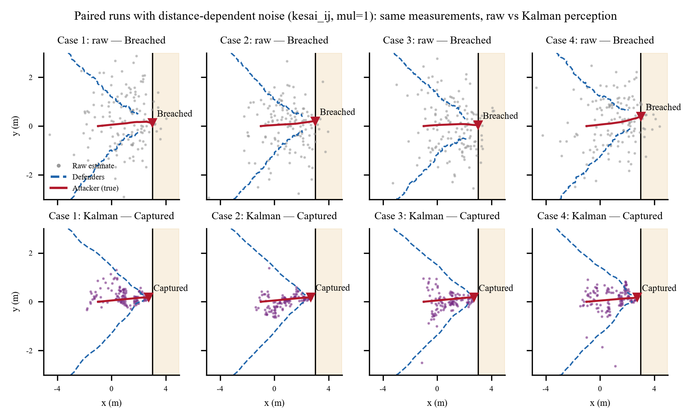
*配对案例 2×4 轨迹对比：同一份观测，无滤波突防 vs 有滤波抓到*

**结果怎么读**（先给理论预期：ξ 贴脸趋零，近场双方感知都精确，**滤波本不该带来多少收益**——实验完美印证）：

1. **mul=2/3（模型保守噪声，近场 ξ ≪ 余量）**：无滤波也是 100%，滤波收益 ≈ 0——印证"靠近了噪声就没了，滤波没活干"；
2. **mul=1（噪声取满模型上界，远场 ±2.6 m、近场仍有 0.1~0.6 m）**：无滤波 0% 全军覆没——远场幻影把防守方拽离防线，攻击者在噪声消退前就已突防；滤波 100%——远场平滑大噪声，把追捕决策拉回真实态势；
3. **滤波的定位由此清晰**：它不是常开的增益项，而是"实际噪声超出模型保守余量"时的**保险**——收益大小取决于噪声水平相对判定余量的超出程度，这与 2.1 的临界余量概念一致。

一句话：ξ 贴脸趋零 ⇒ 近场滤波无用武之地 ⇒ 滤波只在远场噪声足够大、可能造成不可逆位置损失时才值回票价。

##### 配对案例：同一份观测，两种感知（mul=1）

> 实现同上。**同一个随机种子**生成同一份含噪观测序列（kesai_ij 距离相关模型，mul=1 取满上界），分别喂给两种感知方式，各跑完整闭环——上排无滤波、下排有滤波，各展示 4 个"无滤波突防、有滤波抓到"的配对案例（实测前 4 个种子全部呈现反转）。

**读图要点**：

1. 红色实线是攻击者**真实轨迹**（两种感知下完全一样）——变的不是攻击者，是防守方"看到的世界"；
2. 上排灰色幻影云（取满上界的原始观测）把防守方拉得团团转，防线在关键时刻无人把守——注意幻影云**随逼近收缩**，这正是 ξ(d) 的含义；
3. 下排紫色估计紧贴真值，防守方的钳形合围得以实现——**同一份数据，感知方式决定胜负**。

这就是第二章的收束：kesai_ij 告诉你 ξ 有多大，滤波告诉你能把 ξ 压到多小，闭环抓捕率则检验这一切最终有没有转化为胜负。

#### 动手练习

1. 把 Part 1 的观测噪声改回固定 std（不衰减），滤波估计还跟得上真值吗？衰减噪声在本实验里起什么作用？
2. 把 CV-KF 的 `q_acc` 从 0.05 调到 0.5（更信观测），观察图 3 中滤波误差如何逼近原始误差——过程噪声与测量噪声的权衡在哪？
3. 把 2.3.1 的抓捕实验换成 1v1（只留防守者 1），抓捕率对比会变成什么样？
4. 进阶：给 2.2 分配流水线的成对判定加上"滤波估计 + 蒙特卡洛"鲁棒化，看 u 格（不确定下失效）的数量变化。

#### 常见坑

- KF 首帧要初始化（代码里直接取第一个观测），否则 $P$ 未定义会报奇异矩阵；
- 静止/慢速目标也要给一点过程噪声（$Q>0$），否则 $K\to 0$、滤波器"僵住"不再吸收新观测；
- 蒙特卡洛必须固定随机种子，否则每次的抓捕率都不可复现（对比 2.1 的同款陷阱）；
- 闭环实验里**捕获判定要用真实位置**，用估计位置判捕获会把"滤波误差"算成"战果"——本节两组实验都遵守这一点。

#### 运行结果图示

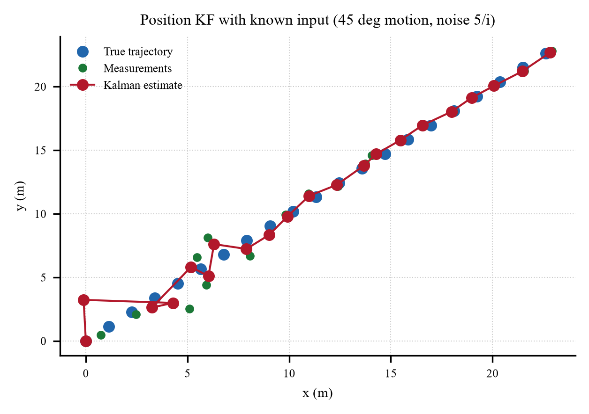
*位置 KF 演示（45° 斜线运动，噪声 5/i）*

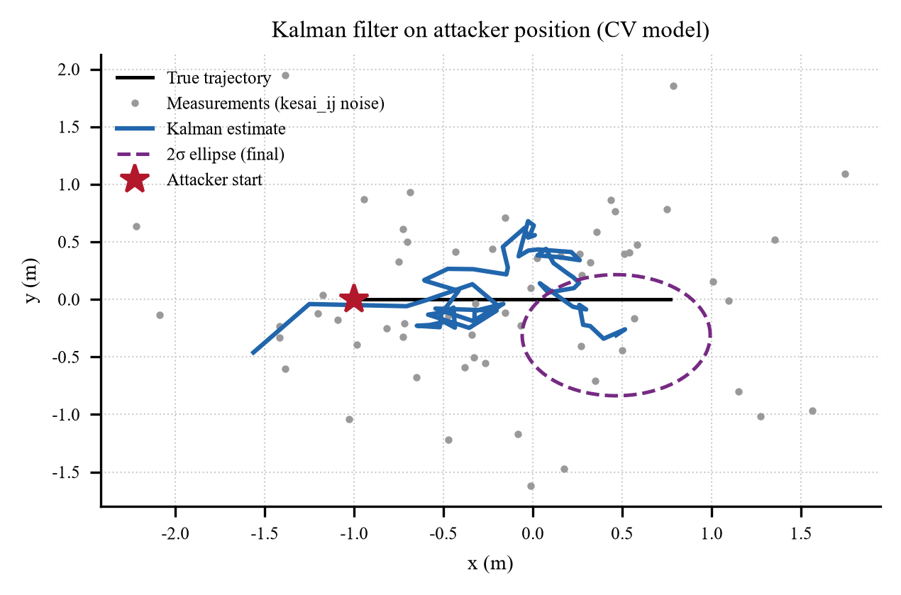
*攻击者轨迹的卡尔曼估计（含 2σ 椭圆）*

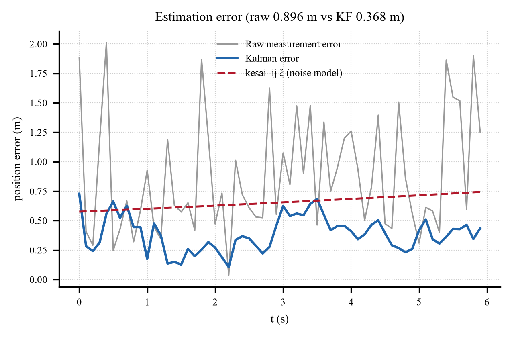
*估计误差曲线 vs kesai_ij ξ 参考线*


*配对案例 2×4 轨迹对比*

### 2.4 GUI 软件（GUI2 → Python 桌面程序）

> 前置知识：`2.1`（kesai_ij）、`2.2`（鲁棒分配）、第一章 `1.5`（ILP 分配）
> 定位：第二章第 4 节，第二章的收束——把 2.1~2.3 的全部要素封装成**可以手动调参运行的软件**。

#### 这一节解决什么问题

原始的图形界面版本把前面所有算法组合成了可交互程序，但回调代码难以阅读和跨平台复用。本节把它重构成 Python 桌面软件：**左侧参数面板手动调参，点"开始仿真"后右侧画布实时播放追捕动画，结束后输出每个攻击者的结局**。功能与 GUI2 等价，参数一一对应。

#### 软件界面与操作

```
┌────────────┬──────────────────────────┐
│ 场景        │                          │
│  数量/种子  │      matplotlib 画布       │
│  [重新布防] │   （实时动画 + 完整轨迹）     │
│ 参数        │                          │
│  速度/半径  │                          │
│  ξ 系数     │                          │
│ 选项        │                          │
│  3 个开关   │                          │
│  控制方式   │                          │
│ [▶ 开始仿真]│                          │
│ 运行状态    │                          │
└────────────┴──────────────────────────┘
```
操作流程：调参数（或直接用默认值）→ **开始仿真** → 观察动画 → 在"运行状态"里读每个攻击者的结局。**重新布防**按当前种子重抽初始位置预览。

**开环直线模式**（勾选项）：勾上后不再滚动重解——开局一次性锁定全部目标点，双方直线奔向它，可看到 1v1 的理论开环最优轨迹（双轨迹直线偏差为 0）。

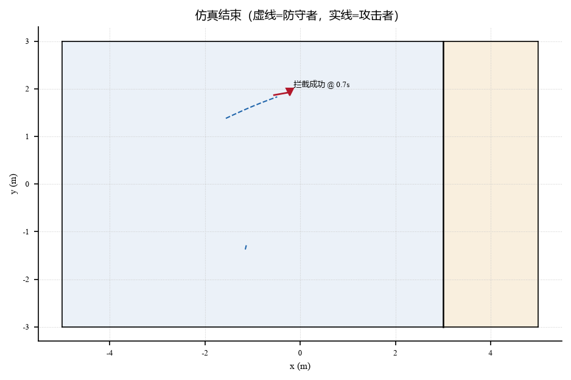
*软件自检截图：2 防守者 vs 1 攻击者，追踪+梯度方式，攻击者被拦截（Intercepted）*

#### 控件 → 引擎对照表（GUI2 → Python）

| GUI2 控件 / 函数 | Python 封装 | 说明 |
|---|---|---|
| Setting 面板各参数 | `game_core.GameConfig` 字段 | num_p/num_e、v_p、v_e、r、mul、seed |
| position_button | `cfg.use_kesai` | 位置不确定性开关（防守方感知加噪） |
| vel_button | `cfg.use_vel_unc` | 速度不确定性（v_e~U[v_e_min,v_e_max]） |
| popupmenu6 控制方式 | `cfg.method` 1~4 | 四种控制方式，见下表 |
| Rolling_optimization | `cfg.rolling` | True=每 10 步滚动重分配 |
| （新增）开环直线模式 | `cfg.open_loop` | 勾选后 k=1 一次性锁定全部目标点，双方直线奔向它 |
| `youhua_solution` | `GUISimulator.judge_pairs` | 成对判定（kesai 扰动 + a_min 保守）+ 奖励 + ILP |
| `youhua2` 主循环 | `GUISimulator.run` / `advance(k)` | `advance` 供界面逐帧驱动 |
| `kesai_ij`/`der_kesai_ij` | `common.kesai_ij` / `game_core.der_kesai_ij` | 不确定性模型及其梯度 |

#### 四种控制方式（下拉框选择）

| method | 名称 | 机制 |
|---|---|---|
| 1 | 滚动分配+突破点导引 | 开局 ILP 分配（rolling 时每 10 步重分配），防守方朝"噪声估计位置"解出的突破点运动 |
| 2 | 追踪+不确定性梯度 | 方向 = 指向真实攻击者的单位向量 + a·der_kesai 梯度项，合成归一化 |
| 3 | 比例导引 | 有分配，防守方航向按 N=3 倍视线角增量偏转 |
| 4 | 随机位置最优捕获 | method 1 引导律 + 速度不确定性（判定用 a_min 保守） |

两个实现细节：成对判定的奖励公式为 `reward = 1+(3−x₁)/√136`（单人组合 ×1.001 略优先）；速度不确定性打开后判定用 `a_min = v_p/v_e_max`（假设攻击者最快）。

#### 运行结果

实际运行输出（同一随机布防 3v3，四种控制方式各跑一遍完整闭环）：

```
[Method 1] 滚动分配+突破点导引
  分配: 防守者1+防守者1 -> 攻击者3
  分配: 防守者2+防守者3 -> 攻击者1
  攻击者1: 拦截成功 @ 2.2s   攻击者2: 拦截失败 @ 5.3s   攻击者3: 拦截成功 @ 3.3s
  拦截 2/3

[Method 2] 追踪+不确定性梯度    拦截 0/3（三名攻击者全部突防）
[Method 3] 比例导引              拦截 0/3
[Method 4] 随机位置最优捕获      拦截 0/3（判定按 a_min 保守 + 实际 v_e 更快）
```
**结果怎么读**：

1. **Method 1 拦截 2/3**：滚动分配让部分攻击者头顶有组合卡位，防守方向"攻击者想去的点"运动——截击式引导赢在几何；攻击者 2 被分配器主动放弃（无可行组合覆盖），是"能拦几个拦几个"的理性取舍；
2. **Method 2/3 全灭**：防守方在攻击者**身后**起步（布防区在攻击区左侧），纯追踪和比例导引都是"从背后追"，1.875 倍速度优势也追不上 5 秒的突防窗口——**方向比速度重要**；
3. **Method 4 的代价**：与 Method 1 同引导律，只多了速度不确定性，就从 2/3 掉到 0/3——不确定性吃掉的正是那点速度优势。

#### 代码结构

界面入口负责界面与线程（后台跑仿真、队列推帧、主线程刷新画布）；核心引擎只含算法，可以脱离界面被其他代码 import（`run_episode(cfg)`）。

#### 动手练习

1. 把"滚动优化"开关关掉再跑 Method 1（开局分配一次），拦截数变化吗？滚动重分配的收益在哪类场景最大？
2. 关掉"位置不确定性"再开，观察 Method 1 分配方案的变化——哪些组合在不确定下被误选？
3. 进阶（对应待办"圆形区域的解"）：给 `GameConfig` 加圆形防线参数，把 `x ≥ x_d` 的突破判定改成"到原点距离 ≥ R"，重跑四种方式。

#### 为什么最优策略的轨迹不是直线？（重要）

理论上 1v1 简单运动博弈的**开环最优解**确实是直线：双方从初始位置一次性解出同一个
固定捕获点，然后直线奔向它（勾选"开环直线模式"就能看到，1v1 时双轨迹直线偏差为 0）。

默认（不勾选）时看到的是**反馈式滚动策略**：每个控制周期用当前滚动位置重解突破点，
目标点随双方位置漂移；再加上多攻多守下攻击者针对**全部防守者**解突防方向、而分配给
它的组合只按**该组合**的突破点运动——两套"最优点"不重合，目标点不断跳变。所以轨迹
是"每步都朝当前最优点的折线"，宏观上看是曲线。这与原始实现的滚动优化行为一致
（"滚动优化"开关控制的正是这个），曲线是反馈策略的正常表现，不代表策略变差。

#### 常见坑

- matplotlib 画布内的文字保持英文（Times New Roman 无中文字形），中文只出现在界面控件和状态栏——这是有意的约定；
- 仿真在后台线程运行，连点"开始仿真"无效（按钮已禁用），等当前回合结束；
- 滚动重分配频率（Method 1/3/4 每 10 步，Method 2 每步）是原始实现的行为，太频繁会明显变慢；

---

## 第三章　界栅与策略（部署定下后的攻防分界）

### 3.0 第三章理论总览：界栅（barrier）

> 与 `1.0`、`2.0`、`3.0` 平行的第三章公式集中地。

#### 1. 界栅与可达域：自变量的分工

前三章的工具都是**可达域**——自变量是空间点 $\boldsymbol{x}$：给定攻防
当前位置，问"谁能先到 $\boldsymbol{x}$"（1.1 的 Apollonius 判定、3.0 的
逃避域）。第四章的**界栅（barrier）**把自变量换成**攻击者的初始位置**：

> 防守者的位置部署定下来之后，攻击者从哪些初始位置出发仍能突入目标？

这个临界初始位置集合 $B$ 把博弈区分成防守者获胜域 $W_P$ 与攻击者获胜域
$W_E$（Isaacs：界栅上双方都无法保证获胜）。意义：前三章回答"此刻谁先到"，
界栅回答"**部署在这里，多远之内的攻击者都拦得住**"——把判定变成部署
设计的可行性判据（Yan 2020 的多对多任务分配正是以它为可行性矩阵）。

模型：简单运动 $\dot{\boldsymbol{x}}_P = v_P\boldsymbol{u}_P$、
$\dot{\boldsymbol{x}}_E = v_E\boldsymbol{u}_E$，速度比
$\alpha = v_P/v_E > 1$（代码 `ratio = α⁻¹`）；目标线段
$mn$（长 $l$）；攻击者突入目标即胜，防守者拦截即胜（点捕获，3.3 加
抓捕半径 $r$，3.4 沿用 $l$）。

#### 2. 一对一界栅（3.1，闭式解）

**推导两条件**：设攻击者从 $\boldsymbol{z}$ 直冲逃逸点
$\boldsymbol{p}=(\tau,0)$，代价函数

$$
J(\boldsymbol{p}) = \|\boldsymbol{p}-\boldsymbol{D}\| - \alpha\|\boldsymbol{p}-\boldsymbol{z}\|
\qquad(J=0 \text{ 即临界})
$$

界栅点 = $J=0$（临界）且 $\mathrm{d}J/\mathrm{d}\tau = 0$（攻击者最优）
同时成立的点。两式联立解出**逃逸点映射**
$\tau(x) = (\alpha^2 x - x_D)/(\alpha^2-1)$ 与**中段双曲线**；$\tau$ 撞到
端点 $[0,l]$ 边界时退化为**圆弧**。三段闭式解（交接点
$\delta_1 = x_D/\alpha^2$、$\delta_2 = \delta_1 + (1-\alpha^{-2})l$）：

$$
B_1:\ \|\boldsymbol{z}-\boldsymbol{m}\| = \frac{\|\boldsymbol{D}-\boldsymbol{m}\|}{\alpha},\ x\le\delta_1
\qquad
B_2:\ y = \sqrt{\frac{y_D^2}{\alpha^2} + \frac{(x-x_D)^2}{\alpha^2-1}},\ \delta_1\le x\le\delta_2
\qquad
B_3:\ \|\boldsymbol{z}-\boldsymbol{n}\| = \frac{\|\boldsymbol{D}-\boldsymbol{n}\|}{\alpha},\ x\ge\delta_2
$$

弧 = 逃逸点被端点截住的情形，中段 = 逃逸点是内点的情形；$\delta$ 处
光滑衔接（数值残差 0）。数值验证：中段点严格满足"同时到达 + 内点最优"。

#### 3. 二对一界栅（3.2，闭式解，无重叠）

两防守者时**不需要新曲线**：垂直平分线与目标线交点
$x_z = (\|D_2\|^2-\|D_1\|^2)/(2\,\Delta x)$ 把逃逸点区间一分为二，
各自把自己的 1v1 界栅限制在分管区间上，中界用以 $xz$ 为圆心的**衔接弧**
（最优逃逸点恰为 $xz$ 的攻击者集合）拼接。由
$\|xz-D_1\| = \|xz-D_2\|$ 衔接半径自动相等——五段
$F^2_1\ldots F^2_5$（Yan 2020 base curves）全程闭式解。
前提：$xz \in [x_1, x_2]$（分守两侧的典型部署），否则退化为 1v1。

#### 4. 抓捕半径下的界栅（3.3，无闭式解，参数化）

加入抓捕半径 $r$ 后：端点弧半径修正为
$(\|D-m\|-r)/\alpha$；中段方程变成**笛卡尔卵形线**——没有闭式解，
但可以按最优逃逸点 $\boldsymbol{\tau}=(\tau,0)$ **参数化**
（Xu 2024 Theorem 4.1）：

$$
m = \frac{\|\boldsymbol{\tau}-\boldsymbol{D}\| - r}{\alpha},\qquad
n = \frac{\tau - D_x}{\alpha\,\|\boldsymbol{\tau}-\boldsymbol{D}\|},\qquad
\boldsymbol{z}(\tau) = \big(\tau - mn,\ \ m\sqrt{1-n^2}\big)
$$

物理含义：$m$ 是防守者赶到 $\tau$（差 $r$ 触捕）的时间内攻击者能走出的
路程，$n$ 是方向余弦。要点：

- **r→0 精确退化**为 3.1 的闭式双曲线（数值验证 $8.9\times10^{-16}$）；
- **$\tau$ 可行集 $U$**：需 $m\ge 0$，$|y_D|<r$ 时
  $|\tau - D_x| \ge \sqrt{r^2-y_D^2}$ 之外才可行——防守者投影附近的
  逃逸点区间界栅不存在（跳段窗口）；
- **相似点与界栅比率**：不同 $r$ 下同一 $\tau$ 的界栅点共线、连线过
  逃逸点 $\tau$，斜率与 $r$ 无关——一条基准界栅可递推出所有 $r$ 的界栅。

#### 5. 非预期策略（3.4，策略 (8)）

攻击者会**中途变向**（机动对防守者非预期）。Xu 2024 Lemma 3.2：
防守者执行**策略 (8)**——按攻击者当前航向角 $\zeta$ 实时解拦截角

$$
\varepsilon = \arcsin\!\left(\frac{r_2}{\alpha r_2 + r}\,\sin\zeta\right),
\qquad r_2(\zeta) = \frac{\alpha r + \delta\cos\zeta - \sqrt{(\alpha r+\delta\cos\zeta)^2 - (1-\alpha^2)(\delta^2-r^2)}}{1-\alpha^2}
$$

（三角形 PCE 正弦定理 + 同时到达条件 $r_1 = \alpha r_2 + r$；负号根 =
内层卵形线，正号根 = 外层物理无效。）则：

- **直线段内**：捕获点精确落在当前卵形线上（逐段校验
  $|f| \le 4.4\times10^{-16}$）；
- **变向时**：卵形线嵌套收缩成相切链 $C \to C^1 \to C^2$，捕获点始终
  在当前卵形线上；回折型机动把捕获点压回**最初**卵形线之内——攻击者
  的非预期机动逃不出自己第一步的可达域；持续外逃的越界由生命线截断兜底。

#### 6. 一个 AC 就够了（3.5，Dorothy 2022，免预测策略）

3.4 仍要逐段读取攻击者**当前航向角**。Dorothy 2022 证明一个
**不依赖攻击者控制**的策略（Theorem 1，$\nu = v_E/v_P < 1$，
$v_P$ 归一化）：把初始 AC 膨胀 $\delta$ 得固定圆盘
$C$（$\boldsymbol{x}_C = \boldsymbol{x}_A(t_0)$，$R_C = R_A(t_0)+\delta$），执行

$$
\boldsymbol{v}_P = \hat{\boldsymbol{z}}_P,\qquad
\boldsymbol{z}_P = (R_C - R_A(t))\,\hat{\boldsymbol{r}} + \nu\,\boldsymbol{y},
\qquad \boldsymbol{y} = \boldsymbol{x}_A(t) - \boldsymbol{x}_C
$$

$\boldsymbol{z}_P$ 只含视线方向与 AC 几何——**没有攻击者的控制输入**；
$\nu\boldsymbol{y}$ 项抵消 AC 圆心漂移。Lyapunov 函数
$V = d_{max}\,d_{min}$（AC 与 $C$ 的最大/最小间隙之积）满足

$$
\dot V \ge \frac{2\nu V}{\|\boldsymbol{z}_P\|+\|\boldsymbol{z}_E\|} \ge 0
\quad\Longrightarrow\quad
t_{capture} \le 2(1+\nu^{-1})R_C\ln(R_C/\delta)
$$

- **(i) AC 永不出 $C$**（反证：$\|\boldsymbol{z}_P\|=0 \Rightarrow d_{min}\le 0$
  与 $V$ 非降矛盾）；
- **Corollary 1**：捕获在初始 AC 的 $\delta_1 = R_C-\sqrt{R_C^2-\delta^2}$
  邻域内；**Lemma 1**：$\|\boldsymbol{r}(t)\| < \|\boldsymbol{r}(t_0)\|$
  恒成立；**Corollary 2**：感知永不丢失（第四章局部感知"保持感知"
  假设的严格版）；
- **Corollary 3~8**：最终位置博弈值 = $\varphi$ 在初始 AC 上的最小值
  （Game of Degree 闭式解）；广义目标守卫必胜 $\iff$ 初始 AC 不含目标点
  （取 $\delta = 0.5\,d^*$）；多防守者完全去中心化（各画各的 AC，取交集）；
  速度不确定时用 $\tilde\nu \ge \nu_{true}$，守卫问题取临界 $\nu_{crit}$。

**与 3.4 的分野**：3.4 用攻击者的**策略**（航向角）换取卵形线上的最优
拦截点；3.5 放弃这一点，换取**对攻击者策略的完全免疫**（光滑反馈律，
无 chatter、无 perpetuated dilemma）——工程上按"传感器能给什么信息"选。

#### 7. 章节结构

| 节 | 教程 | 内容 |
|---|---|---|
| 3.0 | 本节 | 理论总览（界栅定义 + 三段/五段/参数化/免预测四大件） |
| 3.1 | 3.1 界栅_一对一 | 1v1 界栅闭式解：两段端点弧 + 中段双曲线，τ 逃逸点映射 |
| 3.2 | 3.2 界栅_二对一 | 2v1 无重叠界栅：xz 分界 + 衔接弧，五段拼接 |
| 3.3 | 3.3 界栅_抓捕半径 | 抓捕半径 r：笛卡尔卵形线参数化 + 相似点/界栅比率 |
| 3.4 | 3.4 界栅_非预期策略 | 非预期策略：策略 (8) 闭环，变向下捕获点逐段保持在卵形线上 |
| 3.5 | 3.5 一个阿波罗尼奥斯圆就够了 | Dorothy 免预测策略：一个初始 AC + Lyapunov 保证 |

学习路线：3.0（本节）→ 3.1（闭式界栅）→ 3.2（二对一）→ 3.3（参数化）→
3.4/3.5（机动与免预测）。前置：第一章 `1.1`（Apollonius 圆）。

#### 8. 与前三章的关系

| | 第一章 | 第二章 | **第三章** | 第四章 |
|---|---|---|---|---|
| 自变量 | 空间点 $\boldsymbol{x}$（可达域） | 同左 + 误差 | **攻击者初始位置**（界栅） | 同左 + 局部感知 |
| 信息 | 全知 | 观测误差 | 部署时无需攻击者信息 | 防守方局部感知 |
| 核心工具 | AC 判定 | kesai_ij + 鲁棒分配 | 解析界栅 + Lyapunov 策略 | 模糊区域 + 布防点定理 |
| 回答的问题 | 此刻谁先到 | 误差下还成立吗 | **部署后多远之内拦得住** | 看不见怎么部署 |

第三章把前三章的"判定"升级为"部署设计的可行性判据"：界栅给出每个
防守位置的拦得住/拦不住分界——这正是 Yan 2020 任务分配框架
（第一章 1.5 整数规划的多对多升级版）的解析基础，也是本教程后续
扩展（多防守者分配、机动目标）的落点。

### 3.1 一对一界栅（barrier）

> 前置知识：`1.1_拦截判定`（Apollonius 判定，本节会反复对照）。

#### 这一节解决什么问题：界栅 ≠ 可达域

前三章的阿波罗尼奥斯圆是**可达域**工具——自变量是空间点 $\boldsymbol{x}$：
给定攻防双方当前位置，问"谁能先到 $\boldsymbol{x}$"。

界栅（barrier）把自变量换成了**攻击者的初始位置**：防守者的位置部署定下来
之后，问"攻击者从哪些初始位置出发，恰好与防守者**同时**到达目标线"。
这个临界初始位置集合就是界栅 $B$，它把博弈区切成两个获胜域：

- 靠目标线一侧 $W_E$（攻击者获胜域）：从这里出发，攻击者总能抢先突入；
- 远离目标线一侧 $W_P$（防守者获胜域）：从这里出发，攻击者必被拦截。

与 1.1 的静态判定对照：1.1 问"此刻追不追得上"，界栅问"**部署在这里，
多远处之内的攻击者都拦得住**"——它是把判定反过来服务于**部署决策**的工具
（第四章之后的多对多任务分配正是用它当可行性判据）。

#### 场景与记号

目标线段 $\boldsymbol{m}=(0,0)$ 到 $\boldsymbol{n}=(l,0)$，博弈区在 $y>0$，防守者
$\boldsymbol{D}=(x_D, y_D)$（$y_D>0$），速度比 $\alpha = v_P/v_E > 1$。
攻击者在界栅点上时，双方采用各自最优策略（都直线奔向同一逃逸点）恰好
**同时到达**——谁也无法保证获胜（Isaacs 意义下的 barrier）。

#### 界栅的推导（五步）

全部推导只用到一件事：**双方都直线奔向同一个逃逸点** $\boldsymbol{p}=(\tau,0)$
（Yan 2020 Lemma 2——最优轨迹都是直线，所以只需比较"到达 $\boldsymbol{p}$ 的时刻"）。

**第 1 步：写出代价函数。**攻击者从 $\boldsymbol{z}=(x,y)$ 直冲 $\boldsymbol{p}$，用时
$\|\boldsymbol{p}-\boldsymbol{z}\|/v_E$；这段时间防守者能跑 $\alpha\|\boldsymbol{p}-\boldsymbol{z}\|$。定义

$$
J(\boldsymbol{p}) = \|\boldsymbol{p}-\boldsymbol{D}\| - \alpha\,\|\boldsymbol{p}-\boldsymbol{z}\|
\qquad
\begin{cases}
J > 0: & \text{攻击者到达时防守者还差 } J \text{ 路程，突入成功}\\
J = 0: & \text{恰好同时到达——临界}\\
J < 0: & \text{防守者已提前赶到 } \boldsymbol{p} \text{ 附近，攻击者被拦}
\end{cases}
$$

**$J=0$ 就是界栅的定义式**：界栅上的攻击者无论怎么选逃逸点都占不到便宜。

**第 2 步：界栅的两个条件。**$\boldsymbol{z} \in B$ 当且仅当存在逃逸点
$\boldsymbol{p}^*=(\tau,0)$ 满足

$$
\text{① 临界：}\ J(\boldsymbol{p}^*) = 0 \iff \|\boldsymbol{p}^*-\boldsymbol{D}\| = \alpha\|\boldsymbol{p}^*-\boldsymbol{z}\|,
\qquad
\text{② 最优：}\ \frac{\mathrm{d}J}{\mathrm{d}\tau}\Big|_{\boldsymbol{p}^*} = 0 .
$$

①说"到达 $\boldsymbol{p}^*$ 时恰好被追平"，②说"$\boldsymbol{p}^*$ 是攻击者精心选的最优逃逸点"
（若存在别的 $p$ 让 $J<0$，攻击者早就赢了，不在界栅上）。

**第 3 步：解出逃逸点映射 τ(x)。**②展开：

$$
\frac{\tau - x_D}{\|\boldsymbol{p}^*-\boldsymbol{D}\|} = \frac{\alpha(\tau - x)}{\|\boldsymbol{p}^*-\boldsymbol{z}\|}
$$

把①的 $\|\boldsymbol{p}^*-\boldsymbol{z}\| = \|\boldsymbol{p}^*-\boldsymbol{D}\|/\alpha$ 代入，分母约掉，得纯横坐标关系
$\tau - x_D = \alpha^2(\tau - x)$，即

$$
\boxed{\ \tau(x) = \frac{\alpha^2 x - x_D}{\alpha^2 - 1}\ }
$$

——中段界栅上每个点 $x$ 的最优逃逸点，只与 $x$ 有关。

**第 4 步：代回①得到中段方程。**由 $\tau(x)$ 算出两个纵坐标差：
$\tau - x_D = \dfrac{\alpha^2(x - x_D)}{\alpha^2-1}$，
$\tau - x = \dfrac{x - x_D}{\alpha^2-1}$。代入①平方展开：

$$
\left(\frac{\alpha^2 (x-x_D)}{\alpha^2-1}\right)^{\!2} + y_D^2
= \alpha^2\left(\left(\frac{x-x_D}{\alpha^2-1}\right)^{\!2} + y^2\right)
\ \Longrightarrow\
y = \sqrt{\frac{y_D^2}{\alpha^2} + \frac{(x-x_D)^2}{\alpha^2-1}}
$$

——中段是**双曲线分支**（顶点在防守者正下方 $y_D/\alpha$ 处）。

**第 5 步：τ 撞到端点时退化为圆弧。**若②的解 $\tau$ 跑出 $[0,l]$，攻击者
的最优逃逸点就被迫停在端点：$\tau=0$ 时①直接变成
$\|\boldsymbol{z}-\boldsymbol{m}\| = \|\boldsymbol{D}-\boldsymbol{m}\|/\alpha$（左弧），$\tau=l$ 时同理（右弧）。分段范围由
$\tau(x)\in[0,l]$ 反解：

$$
\tau = 0 \Rightarrow x = \frac{x_D}{\alpha^2} = \delta_1, \qquad
\tau = l \Rightarrow x = \frac{x_D}{\alpha^2} + \left(1-\frac{1}{\alpha^2}\right)l = \delta_2 .
$$

三段闭式解全部到位——**弧 = 逃逸点被端点截住的情形，双曲线 = 逃逸点是
内点的情形**，$\delta_1,\delta_2$ 只是"逃逸点恰好落在端点"的分界。

#### 三段闭式解

界栅由**两段圆弧 + 一段双曲线**拼成，交接点横坐标：

$$
\delta_1 = \frac{x_D}{\alpha^2}, \qquad
\delta_2 = \frac{x_D}{\alpha^2} + \left(1-\frac{1}{\alpha^2}\right)l
$$

$$
B_1\text{（左弧）}:\ \|\boldsymbol{z}-\boldsymbol{m}\| = \frac{\|\boldsymbol{D}-\boldsymbol{m}\|}{\alpha},\quad x \le \delta_1
$$

$$
B_2\text{（中段）}:\ y = \sqrt{\frac{y_D^2}{\alpha^2} + \frac{(x-x_D)^2}{\alpha^2-1}},
\quad \delta_1 \le x \le \delta_2
$$

$$
B_3\text{（右弧）}:\ \|\boldsymbol{z}-\boldsymbol{n}\| = \frac{\|\boldsymbol{D}-\boldsymbol{n}\|}{\alpha},\quad x \ge \delta_2
$$

**每段的几何含义**（统一成一句话：界栅点 = 双方到"最优逃逸点"同时到达）：

- **左弧**：最优逃逸点是端点 $\boldsymbol{m}$——攻击者到 $\boldsymbol{m}$ 的路程是防守者的 $1/\alpha$ 倍
  （防守者快 $\alpha$ 倍，恰好同时到）；
- **中段**：最优逃逸点是**内点** $\tau(x)$——中段上每个 $x$ 唯一对应
  $$\tau(x) = \frac{\alpha^2 x - x_D}{\alpha^2-1} \in [0, l]$$
  攻击者从 $\boldsymbol{z}=(x,y)$ 直冲 $\tau$，双方同时到达；δ 的分段恰对应 $\tau$ 扫过
  $[0,l]$（$\tau \in [0,l] \Leftrightarrow x \in [\delta_1, \delta_2]$）；
- **右弧**：最优逃逸点是端点 $\boldsymbol{n}$。

$\delta_1, \delta_2$ 处弧与双曲线**无限光滑衔接**（仿真控制台给出衔接残差
$= 0.00 \times 10^0$）。

#### 控制台输出（真实运行结果）

```
delta1 = xD/a^2 = 1.2500,  delta2 = 8.7500
衔接检查: |y_arc(delta1)-y_mid(delta1)| = 0.00e+00
示例: 界栅点 x=6.5 -> 最优逃逸点 tau=7.000
alpha=1.5: delta1=2.222, delta2=7.778, 中段顶点高度 yD/alpha=2.000
alpha=2: delta1=1.250, delta2=8.750, 中段顶点高度 yD/alpha=1.500
alpha=3: delta1=0.556, delta2=9.444, 中段顶点高度 yD/alpha=1.000
```
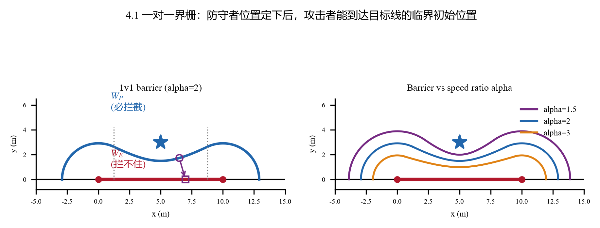
*左：完整界栅（蓝）——两段端点弧 + 中段双曲线，星标防守者；紫圈界栅点的紫色箭头指向其唯一最优逃逸点 τ（紫方标在目标线上）。界栅下方贴近目标线的口袋是攻击者获胜域 W_E（拦不住），上方是防守者获胜域 W_P（必拦截）。右：α 越大（防守者越快），界栅越贴近目标线——能拦住的攻击者初始位置范围越大*

**结果怎么读**：

1. **中段顶点高度 = $y_D/\alpha$**：防守者正上方、离目标线最近的界栅点，
   高度恰好是防守者离线距离的 $1/\alpha$——速度比直接决定"防线"的纵深；
2. **α 增大 → 界栅整体下沉贴近目标线 → $W_P$ 变大**：防守者越快，
   能拦住的攻击者初始位置范围越大（右图紫→蓝→橙）；
3. **界栅点是"恰好同时到达"**：界栅内侧（靠线）攻击者赢、外侧防守者赢，
   界栅上谁都不占优——这是后续用它当任务分配可行性边界的理论依据。

#### 动手练习

1. 把防守者从 $(5,3)$ 移到 $(2,3)$（偏离中点），界栅怎么变形？左右弧半径
   还对称吗？（对应 $x_D$ 变化进入 δ 公式）
2. 把 $y_D$ 从 3 加倍到 6（离线更远），$W_E$ 口袋怎么变？——直观理解
   "部署离目标线越远，守住的纵深越大，但贴近线的漏防区也越大"；
3. 验证 $\tau(x)$：在中段上多取几个点，检查"攻击者从该点直冲 $\tau(x)$
   与防守者直冲 $\tau(x)$ 同时到达"到机器精度。

#### 常见坑

- **α 的方向**：本教程 $\alpha = v_P/v_E > 1$（防守者快）。弧半径是
  $\|\boldsymbol{D}-\boldsymbol{m}\|/\alpha$（攻击者路程更短）——把 α 当成 $v_E/v_P$ 会让三段曲线
  全部画反；
- **博弈区在哪一侧**：本节取 $y>0$；若你的场景博弈区在
  $y<0$，把中段取负分支即可，δ 公式不变；
- 中段是**双曲线分支**（$y \sim |x-x_D|/\sqrt{\alpha^2-1}$），不是椭圆——
  它在 $\delta_1,\delta_2$ 处与圆弧相接，单独看容易误当成圆弧的延续。

### 3.2 二对一界栅（2v1 barrier，无重叠）

> 前置知识：`3.1_界栅_一对一`（本节不引入任何新曲线）。

#### 这一节解决什么问题

两个防守者协同守同一条目标线，攻击者的临界初始位置集合（界栅）长什么样？
Yan 2020 的答案是：**2v1 界栅不需要任何新曲线**——仍然是 3.1 的圆弧和
双曲线，只是**分段归属**变了：

> 把目标线上的逃逸点区间 $[x_1, x_2]$ 按"就近原则"一分为二：分界点 $xz$
> 左边的逃逸点归防守者 $D_1$ 管，右边的归 $D_2$ 管；两个防守方各自把自己
> 的 1v1 界栅限制在分管区间上，再在分界处用一段圆弧衔接。

这就是论文 base curves $F^2_1 \ldots F^2_5$（五段）的直觉版本，全程闭式解。

#### 分界点 xz 与五段拼接

分界点是两防守者连线的**垂直平分线**与目标线的交点（等距点）：

$$
x_z = \frac{\|\boldsymbol{D}_2\|^2 - \|\boldsymbol{D}_1\|^2}{2\,(x_{D_2} - x_{D_1})}
\qquad(\text{目标线 } y=0)
$$

由构造 $\|\boldsymbol{x}_z - \boldsymbol{D}_1\| = \|\boldsymbol{x}_z - \boldsymbol{D}_2\|$（$\boldsymbol{x}_z=(xz,0)$），因此**衔接弧**（最优逃逸点恰为 $xz$
的攻击者集合，即以 $xz$ 为圆心的圆弧）对两个防守者半径自动相等——两段
在分界处无缝拼接。五段结构（$\delta = x_D/\alpha^2 + (1-1/\alpha^2)\cdot$逃逸点坐标）：

| 段 | 曲线 | $x$ 范围 | 含义（最优逃逸点） |
|---|---|---|---|
| $F^2_1$ | $\boldsymbol{D}_1$ 左弧 | $x \le \delta_1$ | $x_1$（左端点） |
| $F^2_2$ | $\boldsymbol{D}_1$ 中段 | $[\delta_1, \delta_2]$ | $[x_1, xz]$ 内点 |
| $F^2_3$ | 圆心 $\boldsymbol{x}_z$ 的弧 | $[\delta_2, \delta_3]$ | 恰为 $xz$ |
| $F^2_4$ | $\boldsymbol{D}_2$ 中段 | $[\delta_3, \delta_4]$ | $[xz, x_2]$ 内点 |
| $F^2_5$ | $\boldsymbol{D}_2$ 右弧 | $x \ge \delta_4$ | $x_2$（右端点） |

前提是 $xz$ 落在目标线段内部（两防守者"分守两侧"的典型部署）；若 $xz$
跑出线段外，说明一个防守者的分管区间为空，退化为 1v1。

#### 控制台输出（真实运行结果）

```
分界点 xz = 5.7500（在目标线段内: True）
等距检查: ||D1-xz|| = 3.7165, ||D2-xz|| = 3.7165
五段交接点: delta1=0.9259 < delta2=4.9012 < delta3=6.1358 < delta4=9.0741
```
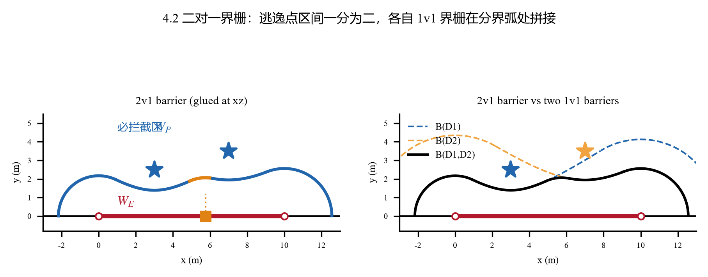
*左：2v1 界栅（五段拼接，橙色弧 = 最优逃逸点恰为分界点 xz 的攻击者集合，橙方标 xz）。右：黑色实线为 2v1 界栅，虚线为两个防守者各自的完整 1v1 界栅——2v1 界栅取的正是两条虚线的"贴近目标线包络"：每个逃逸点由离它更近（更省时间）的防守者负责*

**结果怎么读**：

1. **协同的效果看得见**：右图中黑色 2v1 界栅明显低于两条虚线（单个防守者
   的界栅）——协作把能拦住的攻击者初始位置范围**向下扩张**了：单防时
   "太高出发会漏"的攻击者，双人分守后变成必拦截；
2. **没有新曲线**：五段全部来自 3.1 的两族曲线（圆弧/双曲线），2v1 只新增
   了一个**分界点 $xz$**——这是 Yan 2020 "analytical barriers" 的核心卖点：
   多方界栅可以解析拼接，规模大了也能实时算（第五章任务分配的基础）；
3. **"无重叠"的含义**：两防守者的分管逃逸点区间不重叠，各自界栅只用一次。
   若两防守者站得很近，两个 1v1 界栅互相重叠，有效界栅仍取包络（本图的
   构造天然给出正确结果）。

#### 动手练习

1. 把 $D_2$ 从 $(7, 3.5)$ 移到 $(6, 3)$（两防守者靠近），$xz$ 与衔接弧怎么
   移动？2v1 界栅相对两个 1v1 界栅的"扩张量"是变大还是变小？
2. 把 $D_2$ 移到 $(12, 3)$（贴近右端点），观察 $xz$ 是否逼近甚至跑出
   线段外——找出"协同退化回 1v1"的临界部署；
3. 进阶：把分界规则从"等距"换成"等时间"（$\\|\boldsymbol{x}_z-\boldsymbol{D}_1\\|/v_{P_1} =
   \\|\boldsymbol{x}_z-\boldsymbol{D}_2\\|/v_{P_2}$，两防守者速度不同），推导新的 $xz$ 公式并重画。

#### 常见坑

- **xz 公式的适用条件**：目标线在 $y=0$ 时才有
  $x_z = (\|\boldsymbol{D}_2\|^2-\|\boldsymbol{D}_1\|^2)/(2\Delta x)$ 的简写；一般高度要解垂直平分线
  方程；
- **衔接弧半径用谁**：$\|\boldsymbol{D}_1 - \boldsymbol{x}_z\| = \|\boldsymbol{D}_2 - \boldsymbol{x}_z\|$ 是恒等式，用谁都一样，
  但**两防守者到 xz 不等距时说明 xz 算错了**（多半是 $\Delta x = 0$ 或
  代错坐标分量）——控制台的等距检查就是为此设的；
- 五段的 δ 用的是**各自防守者的 $x_D$** 与**各自分管区间的端点**——
  把 $D_1$ 的 δ 配上 $D_2$ 的区间端点是移植时最常见的错位。

### 3.3 抓捕半径下的界栅（参数化，无闭式解）

> 前置知识：`3.1_界栅_一对一`（$r=0$ 的闭式解是本节的退化情形）。

#### 这一节解决什么问题

3.1/3.2 假设防守者与攻击者**距离为零**才算捕获。实际系统都有**抓捕半径
$r$**（进入 $r$ 内即捕获，对应 1.3 的捕获距离、第四章真机的桨叶尺度）。
给防守者加上 $r$ 后，界栅方程从双曲线变成**笛卡尔卵形线（Cartesian
oval）**——**没有闭式解，但可以按最优逃逸点参数化**，每给定一个逃逸点
$\tau$ 就能解出界栅上的一个点，扫一遍 $\tau$ 就得到整条界栅。

#### 场景：峡谷（双生命线）

目标线 $y=0$（红色）与上方平行生命线 $y=H$ 夹出条带状博弈区（峡谷），
防守者 $D$ 带抓捕半径 $r$。端点圆弧也因 $r$ 修正：

$$
\|\boldsymbol{z}-\boldsymbol{m}\| = \frac{\|\boldsymbol{D}-\boldsymbol{m}\| - r}{\alpha}
$$

直观：防守者到端点的路程被"抵扣"掉捕获半径 $r$——还没走到就抓到了。

#### 参数化构造（本节核心）

对目标线上每个逃逸点 $\boldsymbol{\tau}=(\tau,0)$（$\tau \in [x_1, x_2]$）：

$$
m_{val} = \frac{\|\boldsymbol{\tau}-\boldsymbol{D}\| - r}{\alpha}, \qquad
n_{val} = \frac{\tau - D_x}{\alpha\,\|\boldsymbol{\tau}-\boldsymbol{D}\|}
$$

$$
\boldsymbol{z}(\tau) = \Big(\ \tau - m_{val} n_{val},\ \ m_{val}\sqrt{1 - n_{val}^2}\ \Big)
$$

**物理含义**：攻击者从 $\boldsymbol{z}(\tau)$ 直冲 $\tau$；防守者赶到时恰好
把攻击者截到剩余 $r$ 距离——$m_{val}$ 就是这段时间里攻击者能走出的路程
（按速度比 $\alpha$ 折算、并扣掉 $r$ 的余量）。$m_{val} \le 0$ 的逃逸点区间
上界栅不存在（防守者太近，攻击者已无路可走）——$|y_D| < r$ 时跳过的 $\tau$ 窗口。

#### 参数化的证明（Xu 2024, Theorem 4.1）

**第 0 步：代价函数。**攻击者从 $\boldsymbol{z}=(x_E, y_E)$ 直冲目标线上
逃逸点 $\boldsymbol{x}_T=(\tau,0)$，防守者（抓捕半径 $r$）奔向同一点。
攻击者到达用时 $\|\boldsymbol{x}_T-\boldsymbol{z}\|/v_E$，此间防守者能跑
$\alpha\|\boldsymbol{x}_T-\boldsymbol{z}\|$——**到达时刻双方间隙**为

$$
J_P(\tau) = \|\boldsymbol{x}_T-\boldsymbol{D}\| - \alpha\,\|\boldsymbol{x}_T-\boldsymbol{z}\| - r
$$

$J_P \le 0$：到达瞬间间隙已不足 $r$（或更早被截）→ 拦截；
$J_P > 0$：带着富余跨线 → 突入。（与 3.1 的 $J$ 相比多扣了 $-r$：
抓捕半径等价于把临界间隙从 0 抬高到 $r$。）

**第 1 步：界栅的两个条件。**攻击者选 $\tau$ **最大化** $J_P$。
$\boldsymbol{z} \in B$ 当且仅当最优值恰好为零，即最优逃逸点
$\boldsymbol{x}_{T^*}=(\tau^*,0)$ 同时满足：

$$
\text{① 临界：}\ J_P(\tau^*) = 0, \qquad
\text{② 驻点：}\ \frac{\mathrm{d}J_P}{\mathrm{d}\tau}\Big|_{\tau^*} = 0 .
$$

②由链式法则展开（两个范数对 $\tau$ 的导数分别是
$\frac{\tau-D_x}{\|\boldsymbol{x}_T-\boldsymbol{D}\|}$ 与
$\frac{\tau-x_E}{\|\boldsymbol{x}_T-\boldsymbol{z}\|}$）：

$$
\frac{\tau^*-D_x}{\|\boldsymbol{x}_{T^*}-\boldsymbol{D}\|}
= \frac{\alpha(\tau^*-x_E)}{\|\boldsymbol{x}_{T^*}-\boldsymbol{z}\|}
$$

**第 2 步：参数 $m$——临界式锁定"到逃逸点的距离"。**①即
$\|\boldsymbol{x}_{T^*}-\boldsymbol{D}\| - r = \alpha\|\boldsymbol{x}_{T^*}-\boldsymbol{z}\|$。记

$$
m = \frac{\|\boldsymbol{x}_{T^*}-\boldsymbol{D}\| - r}{\alpha}
\quad\Longrightarrow\quad \|\boldsymbol{x}_{T^*}-\boldsymbol{z}\| = m
$$

——**攻击者到最优逃逸点的距离被锁定为 $m$**（这正是 $m$ 的几何含义）。

**第 3 步：参数 $n$——驻点式给出横向坐标。**把
$\|\boldsymbol{x}_{T^*}-\boldsymbol{z}\| = m$ 代回驻点式：

$$
\tau^* - x_E = \frac{(\tau^*-D_x)\,m}{\alpha\,\|\boldsymbol{x}_{T^*}-\boldsymbol{D}\|}
$$

记 $n = \dfrac{\tau^*-D_x}{\alpha\,\|\boldsymbol{x}_{T^*}-\boldsymbol{D}\|}$，
即得横向方程 $x_E = \tau^* - nm$。

**第 4 步：代回临界式得纵向坐标。**由
$\|\boldsymbol{x}_{T^*}-\boldsymbol{z}\|^2 = m^2$：

$$
(\tau^*-x_E)^2 + y_E^2 = m^2 \ \Rightarrow\ (nm)^2 + y_E^2 = m^2
\ \Rightarrow\ y_E = m\sqrt{1-n^2}
$$

$$
\boxed{\ x_E(\tau) = \tau - nm, \qquad y_E(\tau) = m\sqrt{1-n^2}\ }
\qquad \blacksquare
$$

**第 5 步：$\tau$ 的可行集 $U$——跳段窗口的来源。**临界式要求
$m \ge 0$，即 $\|\boldsymbol{x}_{T^*}-\boldsymbol{D}\| \ge r$。若
$|y_D| \ge r$：任意 $\tau$ 可行；若 $|y_D| < r$：需要

$$
|\tau - D_x| \ge \sqrt{r^2 - y_D^2}
$$

——防守者正投影附近宽 $2\sqrt{r^2-y_D^2}$ 的逃逸点区间上界栅不存在
（攻击者直冲那一段必然先进入抓捕圈）。定理同时要求界栅落在峡谷条带内
$0 \le y_E \le d$——画图时按此截断。

#### 与 3.1 的关系：r→0 精确退化 + 相似点/界栅比率

- **退化验证**：$r \to 0$ 时参数曲线与 3.1 的闭式中段**完全重合**——
  仿真控制台给出最大偏差 $8.88\times10^{-16}$（机器精度）；
- **相似点**：两条不同 $r$ 的界栅上，若两点对应**同一
  逃逸点 $\boldsymbol{\tau}$**，则称互为相似点（最优策略相同：都直冲 $\boldsymbol{\tau}$）；
- **界栅比率**：同一 $\tau$ 的相似点随 $r$ 变化描出一条**过逃逸点 $\tau$
  的直线**，斜率 $\sqrt{1-n_{val}^2}/n_{val}$ 只与 $\tau$（和 $\alpha$）有关、
  **与 $r$ 无关**——这就是"已知一条界栅可递推出所有 $r$ 的界栅"
  （Lemma 2/3）的几何来源。

#### 控制台输出（真实运行结果）

```
衔接点: point1=(1.7616,2.2713), point2=(8.2384,2.2713)
端点弧半径: left=2.8744, right=2.8744
相似点连线斜率（同一 tau、不同 r 的界栅点）：
  tau=3: 斜率 = 1.4832
  tau=5: 斜率 = -inf
  tau=7: 斜率 = -1.4832
r->0 一致性: 参数化 vs 3.1 闭式解最大偏差 = 8.88e-16
```
（$\tau=5=D_x$ 时相似点连线竖直，斜率 $-\inf$ 属预期；$\tau=3$ 与 $\tau=7$
斜率对称，因为两逃逸点关于防守者正对称。）

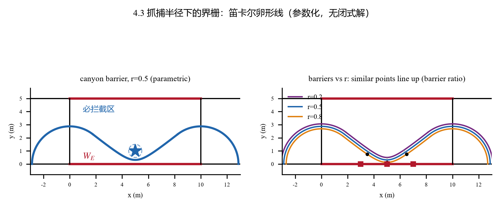
*左：峡谷场景（上下两条红色生命线）中的完整界栅——端点弧半径因 $r$ 修正，中段为参数化笛卡尔卵形线，防守者（星标）带虚线抓捕半径圈。右：$r=0.2/0.5/0.8$ 三条界栅，灰色点线连接同一逃逸点（红方标 $\tau=3/5/7$）在不同 $r$ 下的界栅点——"相似点连线"是过逃逸点的直线，斜率与 $r$ 无关（界栅比率）*

**结果怎么读**：

1. **$r$ 越大界栅越贴近目标线**（右图紫→蓝→橙）：抓捕半径等效于让防守者
   "更快"——能拦住的攻击者初始位置范围变大；这与 3.1 练习里增大 $\alpha$
   的效果同向，但 $r$ 的影响是**非均匀**的（卵形线对 $\tau$ 的依赖）；
2. **中段不再有闭式解**：$r$ 打破了双曲线的几何，换成交换逸点参数化——
   工程上毫无差别（扫描 $\tau$ 即得曲线，毫秒级），这正是"参数化"的意义；
3. **界栅比率的用法**：只要算出一条基准界栅（比如 $r=r_0$），其他 $r$ 的
   界栅点沿过 $\tau$ 的直线按比率缩放即可——可用它把"防守半径扫描"
   变成了一次求解 + 多次缩放。

#### 动手练习

1. 把 $r$ 从 0.5 扫到 1.5（接近 $y_D=1$），观察中段何时开始"断"——
   即 $m_{val}\le 0$ 的逃逸点窗口出现，界栅分裂成两段（图 2(c) 情形）；
2. 用蒙特卡洛验证 $W_E$：从界栅下方口袋里随机取攻击者初始点、界栅上取
   临界点，跑 1.3 的闭环仿真（捕获距离改用 $r$），统计突防率应从 100%
   骤降到 50% 附近；
3. 进阶：把 3.2 的两防守者拼接口径搬到 $r>0$ 情形（两个参数化卵形线在
   $xz$ 处衔接），做"抓捕半径下的 2v1 界栅"。

#### 常见坑

- **$n_{val}$ 里多了一个 $\alpha$**：原始实现
  `n = (tau-xP(1))/(a*dist)`——分母是 $\alpha\,\|\boldsymbol{\tau}-\boldsymbol{D}\|$ 不是 $\|\boldsymbol{\tau}-\boldsymbol{D}\|$，
  移植时最容易抄丢（丢了曲线会整体变陡）；
- **$m_{val}\le 0$ 不是出错而是"界栅不存在"**：防守者贴近生命线时部分
  逃逸点区间守不住，应跳过而不是取负半径画图（跳段逻辑）；
- **退化验证要保留**：$r\to 0$ 对拍 3.1 闭式解（本节控制台的 $10^{-16}$
  检查）是移植正确性的最强证据——改任何一处公式先跑这个。

### 3.4 有抓捕半径下的非预期策略

> 前置知识：`3.3_界栅_抓捕半径`（本节的笛卡尔卵形线 $C$ 就是 4.3 的参数化曲线）。

#### 这一节解决什么问题

3.3 的参数化界栅假设攻击者**直冲**逃逸点——实际攻击者会中途**变向**
（机动对防守者是非预期的：防守者不知道攻击者下一步往哪拐）。问题：

> 攻击者变向之后，捕获保证还成立吗？

Xu 2024 Lemma 3.2 的回答：只要防守者执行**策略 (8)**——按攻击者**当前
航向角** $\zeta$ 实时解拦截角 $\varepsilon$——捕获点始终落在**当前笛卡尔
卵形线**上，且卵形线随机动收缩嵌套（回折型机动时被压回最初卵形线之内）。
防守者只需读一个量（攻击者当前航向角），不需要预测任何意图——这就是
"非预期策略"的含义。

#### 策略 (8) 的推导：三角形 PCE

攻击者以控制角 $\zeta$ 直冲捕获点 $C$，防守者以拦截角 $\varepsilon$ 直冲
同一点，双方轨迹与初始连线构成三角形 $\triangle PCE$（三边：
$\delta = \|\boldsymbol{P}-\boldsymbol{E}\|$、$r_2 = \|EC\|$（攻击者航程）、
$r_1 = \|PC\|$（防守者航程））。

- **正弦定理**（$r_1$ 对 $\zeta$、$r_2$ 对 $\varepsilon$）：

$$
\frac{\sin\zeta}{\sin\varepsilon} = \frac{r_1}{r_2}
$$

- **捕获条件**（同时到达：防守者到 $C$ 还剩 $r$ 间隙时，攻击者恰达 $C$）：

$$
\frac{r_1 - r}{v_P} = \frac{r_2}{v_E}
\quad\Longrightarrow\quad
r_1 = \alpha\, r_2 + r
$$

- 联立两式解出拦截角——**策略 (8)**：

$$
\varepsilon = \arcsin\!\left(\frac{r_2}{\alpha r_2 + r}\,\sin\zeta\right)
$$

#### $r_2$ 的方程：内层与外层卵形线

三角形余弦定理 $r_1^2 = r_2^2 + \delta^2 - 2\delta r_2\cos\zeta$ 代入
$r_1 = \alpha r_2 + r$，得到 $r_2$ 的二次方程：

$$
(1-\alpha^2)\,r_2^2 - 2(\alpha r + \delta\cos\zeta)\,r_2 + (\delta^2 - r^2) = 0
$$

$$
r_2(\zeta) = \frac{\alpha r + \delta\cos\zeta \pm
\sqrt{(\alpha r + \delta\cos\zeta)^2 - (1-\alpha^2)(\delta^2-r^2)}}{1-\alpha^2}
$$

$\alpha > 1$ 时分母为负：**正号根非正（外层卵形线，物理无效，论文明确否选）；
负号根恒正 = 内层卵形线**——攻击者的可达域边界。捕获点轨迹

$$
C(\zeta) = \big(\,\delta - r_2\cos\zeta,\ \ r_2\sin\zeta\,\big)
$$

正是 3.3 参数化的笛卡尔卵形线——两条推导（3.3 的代价函数驻点法、本节的
三角形正弦定理法）殊途同归。

#### 非预期的机制：嵌套卵形链

攻击者变向的瞬间，$\zeta$ 与 $\delta$ 同时改变，防守者**实时读取攻击者的
当前策略**（航向角）并重解策略 (8)，卵形线换成当前构型的新卵形线。仿真
采用**事件驱动的解析推进**（无时间离散化）：每段直接解三角形精确给出
捕获点，变向即重解——捕获点与卵形线的关系精确到机器精度，不存在
"差一步"的离散误差。论文 Fig. 3b 的关键观察：

- 若攻击者的变向属于**回折型**（先外逃再折返），变向浪费了航程，
  新卵形线**嵌套收缩**（$C_1 \to C_2 \to C_3$，内层与原 $C$ 相切链）；
- 无论怎么变，捕获点始终落在**当前**卵形线上——回折型机动下被压回
  **最初**卵形线之内：攻击者的非预期机动**无法逃出自己第一步的可达域**。

#### 控制台输出（真实运行结果）

```
[直线情形] zeta=134.6°: r2=3.9584, r1=a*r2+l=6.7501, eps=24.68°, 捕获点 C=(4.226,-1.264)
[参数] a=1.2, l=2.0, P0=[0.0, 4.0], E0=[3.0, 2.5], 航向脚本=[(134.6, 1.2), (95, 1.2), (134.6, inf)]
  段 1 (zeta=134.6°): 预测捕获点 C 上的 Q=(4.2255,-1.2640)
  段 2 (zeta=95°): 预测捕获点 C^1 上的 Q=(2.9527,0.5217)
[结局] 捕获 @ t=2.14s, 终态间距=2.0000 (<= l)
[非预期校验] 捕获点相对初始构型的可达域判据 f = ||X-E0|| - (||X-P0||-l)/a = -1.57e-01
  逐段校验 段1: f = 4.44e-16
  逐段校验 段2: f = -3.33e-16
```
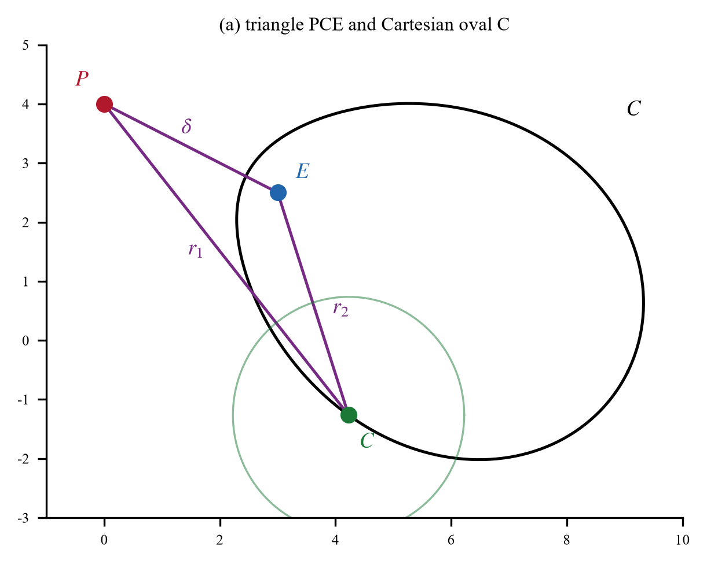
*图 1（论文 Fig. 3a）：三角形 PCE——攻击者 $E$ 以控制角 $\zeta=134.6°$ 直冲捕获点 $C$（绿点，带抓捕半径圈），防守者 $P$ 以拦截角 $\varepsilon=24.7°$ 迎击；三边满足正弦定理 (9) 与捕获条件 $r_1 = \alpha r_2 + r$（$r_2=3.96$，$r_1=6.75$，$\delta=3.35$）；黑色闭合曲线 = 笛卡尔卵形线 C——捕获点随 $\zeta$ 扫出的轨迹，即攻击者的可达域边界*

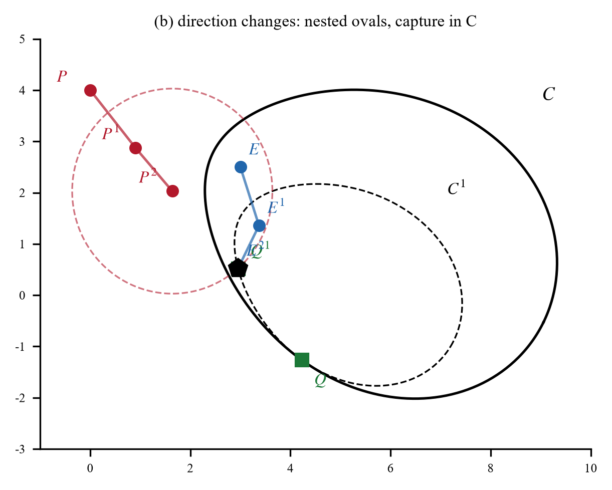
*图 2（论文 Fig. 3b）：攻击者一次变向（航向脚本 134.6°→95°），防守者实时读取其当前策略并逐段解析重解策略 (8)——黑色实线 = 初始卵形线 C，黑虚线 = 变向时刻的嵌套卵形线 $C^1$（收缩），绿方块 $Q$ = 第一段预测捕获点（恰在初始卵形线 C 上），黑五角星 = 最终捕获点（精确落在嵌套卵形线 $C^1$ 上，逐段校验 $|f| \le 4\times10^{-16}$）；红点链 $P \to P^1 \to P^2$、蓝点链 $E \to E^1 \to E^2$ 为双方实际轨迹，粉虚线圈 = 终态抓捕半径；捕获点相对初始构型 $f=-0.16 < 0$——变向折返把捕获点压向初始卵形线内部（防守者更有利）*

**结果怎么读**：

1. **直线情形零误差落界**：捕获点 $C$ 恰在卵形线上
   （$f = \|C-\boldsymbol{z}_0\| - (\|C-\boldsymbol{D}\|-r)/\alpha = 0$）——
   与 3.3 参数化互相印证；
2. **变向即换卵形线，捕获点机器精度落界**：变向后卵形线收缩为 $C^1$，
   最终捕获点精确落在 $C^1$ 上（逐段校验 $|f| \le 4.4\times10^{-16}$）——
   策略 (8) 的捕获保证随构型更新**逐段解析保持**，没有步长误差；
3. **防守者不预测意图**：整个闭环里防守者只实时读取攻击者**当前航向角**
   一个量，变向即重解——没有博弈树、没有意图推断，适合机载实时实现；
   捕获点相对初始构型 $f=-0.16 < 0$：攻击者朝防守者方向折返反而把
   捕获点压进了初始卵形线内部（防守者更有利）；
4. **边界情形**：若攻击者持续向外直逃（永不回折），捕获点会落在"当前"
   卵形线上、越过初始卵形线——真实峡谷场景中上生命线 $y=d$ 的截断
   （3.3 的 $0 \le y_E \le d$）此时早已生效，逃逸与捕获以先到者为准。

#### 动手练习

1. 把航向脚本换成全外逃 `(140, inf)`（不回折），重跑——捕获点越界
   （$f>0$），对照论文 Fig. 3b 量化"回折浪费路程 = 捕获余量"；
2. 把 $\alpha$ 从 1.2 降到 1.05（弱优势），观察捕获时间如何爆炸、
   卵形线嵌套还剩几层；
3. 把策略 (8) 换成**纯追踪**（防守者每步直接朝攻击者当前位置冲），
   同一航向脚本下比较捕获点与捕获时间——体会"瞄准预测捕获点"与
   "追人"的差距；
4. 进阶：把 3.2 的两防守者各自执行策略 (8)（分工逃逸点区间不变），
   做"抓捕半径 + 非预期机动的 2v1"。

#### 常见坑

- **内外根选择**：$\alpha>1$ 时二次方程分母 $1-\alpha^2$ 为负，**负号根**
  才是内层卵形线（恒正）；取正号根会画出论文否选的外层卵形线（本仿真
  初始构型下正号根非正，直接不画）；
- **$\zeta$ 的参考方向**：是 $\boldsymbol{E}\to\boldsymbol{D}$ 方向（速度
  方向相对它的有符号角，由 `arctan2(叉积, 点积)` 实时计算），不是 $x$ 轴
  ——攻防位置移动后同一航向对应的 $\zeta$ 在变，这正是闭环的含义；
- **`arcsin` 要截断**且 $\varepsilon$ 与 $\zeta$ 同侧（符号由 $\sin\zeta$
  携带）——否则防守者会朝错误的一侧拦截；
- **"捕获在 $C$ 内"的适用范围**：对回折型机动严格成立（数值上
  $f\le 0$）；持续直逃时捕获点在当前卵形线上、可越出初始卵形线——
  陈述定理时务必带上机动类型，不要过度声明。

### 3.5 一个阿波罗尼奥斯圆就够了（不依赖攻击者控制的预判拦截）

> 前置知识：`1.1`（Apollonius 圆）、`4.1`（"防守者必须到达攻击者选的点" 的困难）、`4.4`（变向机动的应对——本节给出不需要预测的更强答案）。

#### 这一节解决什么问题

3.4 的策略 (8) 已经能应对变向机动，但仍要**逐段读取攻击者的当前航向角**。
本篇论文回答一个更根本的问题：

> 防守者能不能**完全不依赖攻击者的控制输入**，仅凭初始时刻的一个
> 阿波罗尼奥斯圆（AC），就保证"无论攻击者怎么跑，捕获点都落在初始 AC
> 的任意小邻域内"？

答案：能。这直接解决了 Isaacs 遗留的两个经典困难——**散布面 chatter**
（传统平衡策略在奇异面附近防守者航向高频抖动，AC 会膨胀到攻击者获胜）
与 **perpetuated dilemma**（双方选同一平衡点后状态仍停在奇异配置）：
因为该策略是**全状态空间光滑定义的连续反馈律**，攻击者无处可钻。

**两个动机反例**（论文 §1）：① 纯追踪下攻击者可达集是初始 AC 的**真超集**
——"捕获在 AC 内"这句话不写清防守者策略就是错的（论文 Fig. 1）；② 双目标
守卫里 bang-bang 策略被攻击者的"假动作"利用，chattering 导致 AC 膨胀到
攻击者反胜（论文 Fig. 2）。

#### 记号与 AC 的动力学

速度归一化 $\|\boldsymbol{v}_P\|\le 1$、$\|\boldsymbol{v}_E\|\le\nu<1$
（$\nu = v_E/v_P$）。AC 定义为闭圆盘（式 1）：

$$
A(t) = \{\boldsymbol{x}: \|\boldsymbol{x}-\boldsymbol{x}_A(t)\| \le R_A(t)\},
\quad
\boldsymbol{x}_A = \alpha\boldsymbol{x}_E - \beta\boldsymbol{x}_P,\quad
R_A = \gamma\|\boldsymbol{r}\|
$$

其中 $\boldsymbol{r} = \boldsymbol{x}_E-\boldsymbol{x}_P$，
$\alpha = (1-\nu^2)^{-1}$，$\gamma = \nu\alpha$，$\beta = \nu^2\alpha$
（与 3.1/`Law_p_optimal_capture` 的 $\alpha,\gamma,\beta$ 同族）。
注意：Dorothy 的 $\alpha=1/(1-\nu^2)=a^2/(a^2-1)$（$a=v_P/v_E$）与
3.4 的 $\alpha=v_P/v_E$ **不是同一个量**，但两者给出的 Apollonius 圆
完全相同（3.4 的 $\alpha=1.2\Rightarrow$ 本节 $\alpha=3.273$，$R_A$ 一致）。

#### Theorem 1：策略与 Lyapunov 证明

**构造**：把初始 AC 膨胀 $\delta$ 得到**固定**圆盘
$C = \{\boldsymbol{x}: \|\boldsymbol{x}-\boldsymbol{x}_C\|\le R_C\}$，
$\boldsymbol{x}_C = \boldsymbol{x}_A(t_0)$，$R_C = R_A(t_0)+\delta$。

**策略 (6)(7)**：

$$
\boldsymbol{v}_P = \hat{\boldsymbol{z}}_P, \qquad
\boldsymbol{z}_P = \left(R_C - R_A(t)\right)\hat{\boldsymbol{r}} + \nu\,\boldsymbol{y},
\qquad \boldsymbol{y} = \boldsymbol{x}_A(t) - \boldsymbol{x}_C
$$

**为什么不依赖 $\boldsymbol{u}_E$ 就能"预判"**：$\boldsymbol{z}_P$ 里只有
$\hat{\boldsymbol{r}}$（视线方向）、$R_A$、$\boldsymbol{y}$——全是防守者
可测/可算的量。$\nu\boldsymbol{y}$ 项的作用是抵消 AC 圆心的漂移
（$\dot{\boldsymbol{y}} = \alpha\boldsymbol{u}_E - \beta\boldsymbol{u}_P$）：
攻击者怎么机动，AC 只能在 $C$ 内打转，捕获点被锁死在初始 AC 的
$\delta$ 邻域。

**证明骨架（Lyapunov 函数 $V = d_{max}\,d_{min}$，即 AC 与 $C$ 的最大/最小
间隙之积）**：

$$
\dot V \ge 2\gamma\big(\|\boldsymbol{z}_P\| - \|\boldsymbol{z}_E\|\big)
= \frac{2\nu\,V}{\|\boldsymbol{z}_P\|+\|\boldsymbol{z}_E\|}\ \ge\ 0
$$

- **(i) AC 不出 C**：若某时刻 $\|\boldsymbol{z}_P\|=0$，代入式 (7) 可推出
  $d_{min}\le 0$（AC 触碰 $C$），与 $V(t_0)=\delta^2>0$ 且 $\dot V\ge 0$
  矛盾（反证法）——所以 $\boldsymbol{z}_P$ 永不为零，$V$ 非降；
- **(ii) 有限时间捕获**：$\|\boldsymbol{z}_P\|,\|\boldsymbol{z}_E\|\le (1+\nu)R_C$
  代入得 $V \ge V(t_0)\exp\big(\nu(t-t_0)/((1+\nu)R_C)\big)$，而
  $V = R_C^2$ 即捕获，故

$$
t_{capture} \le t_0 + 2(1+\nu^{-1})\,R_C\,\ln(R_C/\delta)
$$

**Corollary 1（捕获点贴近初始 AC）**：终态
$V(t_f) = d_{min}(2R_C - d_{min}) \ge \delta^2$ 给出捕获点到 $C$ 圆心的距离
$\rho=\|\boldsymbol{x}_{cap}-\boldsymbol{x}_C\|\le\sqrt{R_C^2-\delta^2}$——
捕获点落在初始 AC 的 $\delta$ 邻域内（论文把这一界记作
$\delta_1 = R_C - \sqrt{R_C^2-\delta^2} < \delta$，是 $d_{min}(t_f)$ 的下界；
与"外扩半径"的区别见文末"常见坑"）。

**Lemma 1（间距单调）**：$V > V(t_0) \Rightarrow R_A(t) < R_A(t_0)
\Rightarrow \|\boldsymbol{r}(t)\| < \|\boldsymbol{r}(t_0)\|$
——攻防间距永远小于初始值。

**Corollary 2（移动感知）**：只要攻击者初始在感知半径 $\rho$ 内，
策略 (7) 保证**感知永不丢失**——这正是第四章局部感知"检测后保持感知"
假设（3.1 的捕获律前提）的严格版：不需要检测切换，一条策略全程覆盖。

#### "一个 AC 就够了"的含义（Corollary 3~8）

| 推论 | 内容 |
|---|---|
| Cor. 3/4 | **最终位置博弈**（支付 = $\varphi(\boldsymbol{x}_E(t_f))$）的博弈值 = 初始 AC 上的 $\varphi^* = \min_{A(t_0)}\varphi$——防守者用 (7) + 任意小 $\delta$ 即 $\varepsilon$-均衡，距离目标博弈是其特例（$\varphi$ = 到目标集的距离） |
| Cor. 5 | **广义目标守卫**（任意形状目标集 $T$）：取 $\delta = 0.5\,d^*$（$d^*$ = 初始 AC 与 $T$ 的最短距离），则防守者必胜 $\iff$ 初始 AC 不含 $T$ 的任何点——Barrier 类问题（第 1/4 章）全部化归为"画一个 AC 检查相交" |
| Cor. 6 | **多防守者**：各自独立执行 (7)，完全去中心化（甚至不需要知道队友存在），捕获在所有初始 AC 的交集 $I$ 附近 |
| Cor. 7/8 | **速度不确定**：用估计值 $\tilde\nu \ge \nu_{true}$ 策略仍成立（只是保证区域变大）；守卫问题应取临界速度 $\tilde\nu = \nu_{crit}$，避免估计器被攻击者利用 |

#### Python 仿真：论文 Theorem 1 / Fig. 3 复现

攻击者使用与 4.4 **完全相同**的变向策略（相对 E→P 方向的航向角脚本
134.6°→95°→134.6°）、相同的初始位置（$P_0=(0,4)$、$E_0=(3,2.5)$）与
速度（$v_P=1.2$、$v_E=1.0$，即 $\nu=1/1.2$）。防守者只执行策略 (7)：

$$
\boldsymbol{v}_P = \hat{\boldsymbol{z}}_P,\qquad
\boldsymbol{z}_P = (R_C - R_A(t))\,\hat{\boldsymbol{r}} + \nu\,\boldsymbol{y}
$$

$\hat{\boldsymbol{r}}$ 是视线方向、$\boldsymbol{y}=\boldsymbol{x}_A(t)-\boldsymbol{x}_C$
是 AC 圆心相对固定圆盘 $C$ 的漂移——**没有任何一项需要攻击者的航向角或
控制输入**。

初始构型：$R_{A0}=\gamma\|\boldsymbol{r}_0\|=2.727\times3.354=9.148$ m，
$\boldsymbol{x}_C=(9.818,-0.909)$，$R_C=R_{A0}+\delta=10.148$ m（$\delta=1$）。
注意本节是**点捕获**——论文结论一节明确说明结果**不适用于有抓捕半径的
情形**，与 3.4 的抓捕半径 $l=2$ 不同。

#### 控制台输出（真实运行结果）

```
[初始构型] x_A0=(9.818,-0.909), R_A0=9.148, R_C=R_A0+delta=10.148
[参数] nu=0.8333, alpha=3.2727, gamma=2.7273, beta=2.2727, delta=1.0, delta_1=0.0494
[策略 (7) Dorothy] 点捕获 @ t=9.80s, 捕获点=(3.532,-7.087), f_ac=||x_cap-x_A0||-R_A0=-0.3339 (delta 界内), 终态间距=9.67e-04
[Theorem 1 校验] AC 始终在 C 内: d_min(t)>=0 -> min_d_min=0.7623
[Corollary 1 校验] 捕获点相对初始 AC 的距离 f_ac=-0.3339 <= delta=1.0 (delta_1=0.0494)
[P 路径直线度] 弦长/路径长 = 0.9890 （≈1 即直线拦截，与 最优捕获律同律同行为）
```
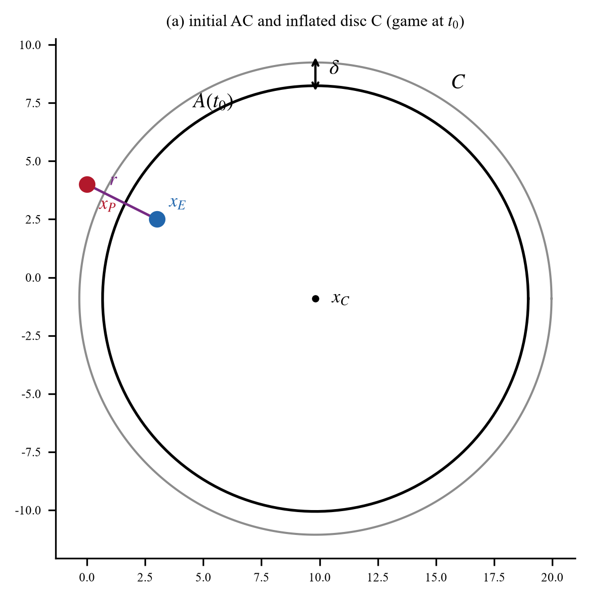
*图 1（论文 Fig. 3a）：初始时刻的博弈布局——黑色实线 = 初始 Apollonius 圆 $\partial A(t_0)$（圆心 $\boldsymbol{x}_C$，$R_{A0}=9.148$ m），灰色实线 = 膨胀后的固定圆盘 $\partial C$（$R_C=R_{A0}+\delta$，双箭头标出 $\delta=1$ m）；紫线 = 视线 $\boldsymbol{r}=\boldsymbol{x}_E-\boldsymbol{x}_P$，红点 $x_P$、蓝点 $x_E$ 为双方初始位置——攻击者 $x_E$ 落在初始 AC 内（其"优势区"），防守者 $x_P$ 在 AC 外*

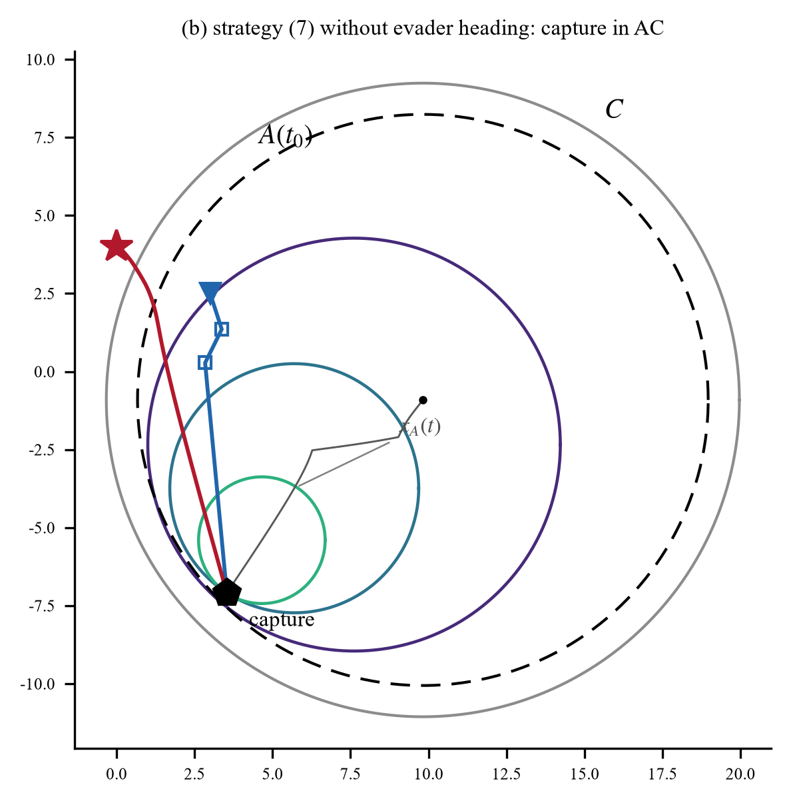
*图 2（论文 Fig. 3b）：策略 (7) 的闭环——灰实线 = 固定圆盘 $C$，黑虚线 = 初始 AC $A(t_0)$，四条彩色圆 = 不同时刻的瞬时 AC $A(t)$（颜色由浅到深 = 时间推进，半径单调收缩、圆心沿灰线漂移，但**始终含在 C 内部**）；红实线 = 防守者轨迹、蓝实线 = 攻击者轨迹（空心方块 = 变向时刻，攻击者每段沿**固定航向直线**飞行，与 4.4 一致）；黑五角星 = 捕获点 $(3.532,-7.087)$，落在初始 AC 内部（$f_{ac}=-0.33$ m）。整个过程中防守者**只读视线方向**，从未使用攻击者的航向角*

**结果怎么读**：

1. **AC 只会"呼吸"，永远跑不出 C**：$R_A(t)<R_{A0}$（Lemma 1：攻防间距
   单调小于初值），AC 圆心沿 $C$ 内漂移——数值校验 $d_{\min}(t)\ge 0.7623>0$，
   即 $A(t)\subset C^\circ$ 全程成立（Theorem 1(i)）；
2. **捕获点锁死在初始 AC 附近**：捕获点相对初始 AC 的有符号距离
   $f_{ac}=-0.33$ m，即捕获点落在初始 AC **内部**——攻击者无论怎么变向，
   都逃不出自己第一步的可达域（Corollary 1）；
3. **不需要攻击者的任何策略信息**：策略 (7) 的输入只有视线方向
   $\hat{\boldsymbol{r}}$ 与 AC 几何，**连攻击者当前航向角都不读**。对比
   3.4 的策略 (8)——后者必须逐段读取攻击者当前航向角 $\zeta$ 才能解出
   拦截角；本节从"逐段预测"进化到"全程免预测"；
4. **防守者轨迹近似直线（同律同行为）**：数值上防守者路径的
   直线度（首尾弦长/路径长）$=0.989$——检测后接近直线拦截。原因很
   简单：本文式 (7) 与经典的最优捕获律是 **同一个公式**（圆心/半径检测时刻锁定、逐步重算方向），"发现以后防守者直线拦截"的行为就是本策略的行为；
5. **与 3.4 的分野**：3.4 用攻击者的**策略**（航向角）换取了界栅层面的
   最优性（捕获点恰落在卵形线上）；3.5 放弃这一点，换取**对攻击者策略的
   完全免疫**——代价是捕获点只保证在 $\delta$ 邻域内、不保证最优。工程上
   按"传感器能给什么信息"选策略即可。

#### 动手练习

1. 把 $\delta$ 从 1.0 扫到 0.1，观察 $\delta_1 = R_C-\sqrt{R_C^2-\delta^2}$
   如何趋近于零、捕获时间 $2(1+\nu^{-1})R_C\ln(R_C/\delta)$ 如何爆炸——
   "保证强度 vs 捕获时间"的折中；
2. 用 `judge_interception` 的思路给攻击者加一个"奔向目标集"的支付
   $\varphi = $ 到某目标线的距离，验证 Corollary 4：博弈值 = $\varphi$
   在初始 AC 上的最小值（把捕获点与 3.1 的界栅对照）；
3. 进阶（Cor. 6）：放两个防守者异位各自执行 (7)，画两条初始 AC 的交集
   $I$，验证捕获发生在 $I$ 附近且完全去中心化。

#### 常见坑

- **符号方向**：$\nu = v_E/v_P < 1$（论文把 $v_P$ 归一化为 1），与前三章
  $\alpha = v_P/v_E > 1$ 互为倒数——式 (7) 里的 $\nu\boldsymbol{y}$ 用的是
  $\nu$ 不是 $\nu^{-1}$；且 Dorothy 的 $\alpha=1/(1-\nu^2)$ 与 3.4 的
  $\alpha=v_P/v_E$ 是两个不同的量（本例 3.273 vs 1.2），不要混用，
  但两者给出的 Apollonius 圆一致；
- **$V$ 的定义**：$V = d_{max}\,d_{min}$ 是**两个间隙的乘积**（不是和），
  $\dot V \ge 0$ 只保证乘积不降；"AC 不出 C"靠的是 $d_{min} > 0$ 这一半；
- **点捕获**：论文结论只对点捕获（$\|\boldsymbol{r}\|\to0$）成立，**不适用
  于有抓捕半径的情形**（论文结论一节明确说明）——所以本节仿真一直跑到
  终态间距 $\sim10^{-3}$ 才算捕获，不能像 4.4 那样用"间距 $\le l$"提前叫停；
- **$\delta_1$ 不是捕获点的外扩半径**：Corollary 1 的
  $\delta_1=R_C-\sqrt{R_C^2-\delta^2}$ 是 $d_{\min}(t_f)$ 的下界（捕获点到
  $\partial C$ 的最小距离），**不是**捕获点越出初始 AC 的最大距离——后者
  由 $\rho\le\sqrt{R_C^2-\delta^2}$ 给出、约等于 $\delta$。陈述时不要混淆
  （本例 $\delta_1=0.049$，但捕获点理论上最远可到初始 AC 外 $\approx\delta$
  处）；
- **对比要同工况**：与 4.4 比较时两者同初值、同攻击者变向策略，但 4.4
  有抓捕半径 $l=2$、本节是点捕获——这是两个不同的博弈，只做定性对照，
  不要直接比捕获时间；
- **攻击者每段航向要"段首定死"**：攻击者航向 $\zeta$ 定义为相对**段首**
  视线 $\overrightarrow{x_E x_P}$ 的有符号角——必须在一段开始时算一次、
  整段保持，段内轨迹才是直线。若每一步都用当前视线重算 $\zeta$，视线一
  旋转就把攻击者掰弯（防守者逼近的第三段最明显）。这与 4.4 一致
  （4.4 用 `E += v_hat * V_E * leg_t` 解析推进，段内天然是直线）。

---

## 第四章　局部感知博弈（防守方感知半径受限）

### 4.0 第四章节理论总览：局部感知博弈（感知半径受限）

> 与 `1.0`、`2.0` 平行的第四章公式集中地。

#### 1. 博弈模型：部分信息下的 1v1 reach-avoid

与第一章的两点差别：

1. **目标是线段而非半平面**：目标线段 $T$ 端点 $\boldsymbol{m}, \boldsymbol{n}$，长度 $l = \|\boldsymbol{m} - \boldsymbol{n}\|$；
   攻击者需在不被捕获的前提下进入 $T$（穿过"门"）；
2. **信息结构不对称**：防守方只有**有限感知半径** $r$（感知圆 $S$），攻击者拥有
   全局信息。检测时刻 $t_c$ 之前，防守方不知道攻击者位置——这就是"局部感知"。

动力学仍为 simple motion（式 1）：$\dot{\boldsymbol{x}}_P = v_P \boldsymbol{u}_P$，$\dot{\boldsymbol{x}}_E = v_E \boldsymbol{u}_E$，$\|\boldsymbol{u}\|=1$。记 $\alpha = v_P / v_E > 1$（注意：第三章 $\alpha$ 是防守/攻击速度比，
与 1.0 的 $a$ 同义）。

#### 2. 逃避域与 Apollonius 圆（BER）

逃避域 $R_E$（攻击者必能先于防守者到达的区域）与其边界 $R_\partial^E$：

$$
\boldsymbol{x}_A = \frac{\alpha^2 \boldsymbol{x}_E - \boldsymbol{x}_P}{\alpha^2 - 1}, \qquad
R_A = \frac{\alpha \|\boldsymbol{x}_E - \boldsymbol{x}_P\|}{\alpha^2 - 1}
$$

即以 $\boldsymbol{x}_A$ 为圆心、$R_A$ 为半径的 **Apollonius 圆**（圆内 = 攻击者优势区）。
与 1.1 的区别：第一章从"半平面防线"视角出发，这里从"线段目标 + 逃避域"视角出发，
二者在几何上等价。对应实现：`common.solve_breakthrough` / `common.kesai_ij` 同族。

#### 3. 捕获策略 $\Gamma_P^\delta$（检测后用）

检测时刻 $t_c$（攻击者进入感知圆）锁定圆盘 $A_\delta$：中心 $\boldsymbol{x}_A(t_c)$、半径
$R_{A_\delta} = R_A(t_c) + \delta$。捕获策略（论文式 4）：

$$
\boldsymbol{z}_P = \left(R_{A_\delta} - R_A\right)\hat{\boldsymbol{d}} + \alpha^{-1} \boldsymbol{y}, \qquad
\boldsymbol{u}_P = \hat{\boldsymbol{z}}_P
$$

其中 $\hat{\boldsymbol{d}} = (\boldsymbol{x}_E - \boldsymbol{x}_P)/\|\cdot\|$ 为视线单位向量，
$\boldsymbol{y} = \boldsymbol{x}_A - \boldsymbol{x}_A(t_c)$ 为当前 Apollonius 圆心相对锁定圆心的偏移。该策略保证
**检测后攻守距离单调不增**、在 $A_\delta$ 内有限时间捕获。
对应实现：`law_p_optimal_capture`。

#### 4. 完全信息下的最优布防：目标线段中点

若防守方初始位置可预先指定（部署阶段），把攻击获胜域拆成三部分 $S_{F1}, S_{F2}, S_{F3}$
（逃避域在三段目标上的投影面积），最小化 $S_{F1}+S_{F2}+S_{F3}$：

$$
\min \ S_{F1} + S_{F3} \ \Rightarrow \ x_P = x_Q = l/2
$$

即**完全信息下最优布防点是目标线段中点** $(l/2, 0)$（$S_{F2}$ 由积分中值定理同样在
$l/2$ 取最小）。直觉：防守者站中点时，左右两端的暴露面积对称且最小。

#### 5. 部分信息下的关键概念：模糊区域

$$
W_S^P = W_B^P \cap S \quad \text{（感知获胜域）}, \qquad
F = W_B^P \setminus S \quad \text{（模糊区域）}
$$

- 攻击者进入 $W_S^P$：防守方检测到它，捕获策略 $\Gamma_P^\delta$ 保证获胜（Lemma 1）；
- 攻击者始终待在模糊区域 $F$：防守方**看不见它**，无法保证获胜。

最优布防要最小化模糊区域——理想情况是感知圆覆盖整个屏障 $B(x_P)$。但所需的感知半径
随布防位置变化，而 $r$ 是固定的，于是有下面的核心定理。

#### 6. 核心定理（Theorem 2）：部分信息下的最优布防点

记屏障上离防守方最远的距离 $d(x_P)$（可证最大值出现在屏障端点 $x_{left}/x_{right}$），
覆盖整个屏障所需的最小感知半径在布防点 $(l/2, 0)$ 处取最小：

$$
R_\alpha = \left(1 + \alpha^{-1}\right)\frac{l}{2}
$$

$$
\boxed{\ \boldsymbol{x}_{opt} = \begin{cases}
\left(\dfrac{l}{2},\ 0\right), & r > R_\alpha \quad \text{（感知圈覆盖整个屏障：守中点）} \\[2mm]
\left(\dfrac{l}{2},\ -\dfrac{r}{1 - \alpha^{-1}}\right), & r \le R_\alpha \quad \text{（布在目标线下方 } \tfrac{r}{1-\alpha^{-1}} \text{ 处）}
\end{cases} \ }
$$

直觉解读：

- $r > R_\alpha$：感知圈足够大，攻击者**必被检测**后才可能到达屏障 → 退化为完全信息
  场景，守中点最优；
- $r \le R_\alpha$：存在模糊区域，最坏情况下要把 $F$ 当作攻击者获胜区 → 防守方退到
  目标线下方 $r/(1-\alpha^{-1})$ 处"卡住"攻击者的必经路径：检测一发生（此时攻击者
  距目标至少 $r/\alpha \cdot$…，由几何关系），捕获策略仍有余量在屏障前完成拦截。

对应实现：`optimal_defensive_point`
（`r/(ratio−1)+te_y`，其中 `ratio = α⁻¹`）。

#### 7. 实验验证体系（2023.3~5 四轮真机实验）

| 轮次 | 参数 | 验证内容 | 数据 |
|---|---|---|---|
| 2023.3.25 | — | 首次打通感知-决策-控制链路 | 03-12 / 03-19 / 03-26 的 bag |
| 2023.4.01 | $v_e=0.2, v_p=0.6$（$\alpha=3$），$r=1$ | 防守者**停在最优点**（速度为 0）等待检测 | 04-01 三个 bag |
| 2023.4.02 | 同上 | 初始在感知外→进入感知；小感知半径；未拦截案例 | 04-02 四个 bag |
| 2023.4.12 | — | 多组重复实验（稳定性） | 04-13 四个 bag |

真机平台上：动捕（VRPN）提供全局真值用于**评估**，机载决策只用感知圈内的信息——
"评估用真值、决策用局部信息"是实验设计的关键。数据后处理见 `4.2`。

#### 8. 第三章章节结构

| 节 | 教程 | 内容 |
|---|---|---|
| 4.0 | 本节 | 理论总览（部分信息博弈 + 最优布防点定理） |
| 4.1 | 4.1 局部感知_理论仿真 | P1~P4 四场景理论仿真复现 + 布防点曲线 |
| 4.2 | 4.2 局部感知_实验数据与视频 | 真机 bag 数据后处理 + 感知点验证 + 视频清单 |
| 4.3 | 4.3 局部感知_异构多人博弈 | 异构 2v2（= 两个 1v1）：谁发现哪个逃跑者谁去抓 |
| 4.4 | 4.4 局部感知_三维凸目标区域 | 三维凸目标区域：势函数交集 + Theorem 1 协作捕获 |

学习路线：4.0（本节）→ 4.1（理论仿真）→ 4.2（真机实验）→ 4.3（多人扩展）→
4.4（三维扩展）。前置：第一章 `1.1`、`1.3`。

#### 9. 与前两章的关系

| | 第一章 | 第二章 | 第三章 |
|---|---|---|---|
| 目标 | 半平面防线 $x \ge x_d$ | 同第一章 | **线段目标**（"门"） |
| 信息 | 全知 | 攻守都有观测误差 | **防守方局部感知**（半径 $r$），攻击者全知 |
| 布防 | 防守方初始位置给定 | 同左 | **布防点本身是决策变量**（部署阶段） |
| 核心工具 | Apollonius 判定 | kesai_ij + 鲁棒分配 + KF | 模糊区域 + 最优布防点定理 + 捕获策略切换 |

第三章把"不确定性"从**数值误差**（第二 章）升级为**信息结构缺失**（看不见就是看不见，
滤波也补不回来）——这正是开环部署阶段（停在最优点等待）存在的根本原因。

### 4.1 局部感知理论仿真：部署、探测与捕获

> 前置知识：4.0 第四章节理论总览。

#### 这一节解决什么问题

局部感知博弈里防守方要做**两件事**，对应两个阶段：

| 阶段 | 时机 | 防守方知道什么 | 要做的事 |
|---|---|---|---|
| **部署**（deployment） | 检测时刻 $t_c$ 之前 | **什么都不知道**（攻击者在感知圈外） | 站到"最优布防点"上等待/巡逻 |
| **捕获**（capture） | $t_c$ 之后 | 感知到攻击者，Apollonius 信息齐全 | 执行捕获策略 $\Gamma_P^\delta$ 逼近 |

两个阶段的策略是**不同的问题**：部署是"布防点选在哪"的优化问题（§ 定理 2），
捕获是"检测到之后怎么追"的控制问题（式 4）。本章按论文顺序把两者说清楚。

#### 博弈模型（30 秒回顾）

- 目标：**线段** $T$，端点 $\boldsymbol{m}, \boldsymbol{n}$，长 $l=\|\boldsymbol{m}-\boldsymbol{n}\|$（实验里就是"门"）；
- 双方 simple motion：$\dot{\boldsymbol{x}}_P = v_P \boldsymbol{u}_P$，$\dot{\boldsymbol{x}}_E = v_E \boldsymbol{u}_E$，速度比
  $\alpha = v_P/v_E > 1$；
- 防守方只有**感知圆** $S$（半径 $r$，圆心随防守方移动）；攻击者全知全局。

#### 一、部署策略：防守方该站在哪

##### 1.1 完全信息基准：为什么是"线段中点"

假设防守方初始位置可以预先指定（论文 Assumption 1，开环部署阶段）。把攻击者的
**逃避获胜域**（它保证能突防的区域）投影到目标线段上，按防守方站的位置 $x_P$ 分成
三块（论文式 7）：

- $S_{F1}$：线段左端点 $m$ 与防守方 Apollonius 圆之间的弓形面积；
- $S_{F2}$：两个 Apollonius 圆之间、目标线段上方的条带面积；
- $S_{F3}$：线段右端点 $n$ 一侧的弓形面积（对称）。

$S_{F1}+S_{F3}$ 关于 $x_P$ 是**凸函数**（论文式 9 的 Hessian 正定），由对称性最小值在
$x_P = l/2$；$S_{F2}$ 用积分中值定理证明同样在 $l/2$ 取最小（论文式 12~14）；且
$x_P$ 越出 $[0, l]$ 后面积单调增加（式 10~11）。所以：

$$
\text{完全信息最优部署点} = \left(\frac{l}{2},\ 0\right) \quad \text{（目标线段中点）}
$$

直觉：站中点时左右两端"漏防"的面积对称且最小；偏一边，另一头的漏洞会平方级放大。

##### 1.2 部分信息的困难：模糊区域

部署点选好后，还有信息结构的问题。定义（论文 Definition 2）：

$$
W_S^P = W_B^P \cap S \quad \text{（感知获胜域）}， \qquad
F = W_B^P \setminus S \quad \text{（模糊区域）}
$$

- 攻击者进入 $W_S^P$：防守方**看得见**，捕获策略（下节 $\Gamma_P^\delta$）保证获胜
  （论文 Lemma 1）；
- 攻击者一直待在模糊区域 $F$：防守方**看不见它**，最坏情况下只能把 $F$ 整块当作
  攻击者的获胜区。

理想情况是感知圆盖住整个屏障 $B(x_P)$（即 $F=\varnothing$），但覆盖屏障所需的最小
感知半径 $d(x_P)$ 随布防位置变化——论文式(23) 证明它在 $(l/2, 0)$ 处取最小：

$$
d\left(\frac{l}{2},\ 0\right) = R_\alpha = \left(1 + \alpha^{-1}\right)\frac{l}{2}
$$

这就把布防点的选择分成了两种情形——**定理 2**。

##### 1.3 定理 2：最优布防点（两段式）

$$
\boxed{\ \boldsymbol{x}_{opt} = \begin{cases}
\left(\dfrac{l}{2},\ 0\right), & r > R_\alpha = \left(1+\alpha^{-1}\right)\dfrac{l}{2} \\[2.5mm]
\left(\dfrac{l}{2},\ -\dfrac{r}{1-\alpha^{-1}}\right), & r \le R_\alpha
\end{cases}\ }
$$

**情形一（$r > R_\alpha$，感知圈覆盖整个屏障）**：模糊区域清零，攻击者只要奔向门
就必被检测 → 退化为完全信息场景，守中点最优。

**情形二（$r \le R_\alpha$）**：盖不住，防守方沿中线**退到门下方** $h$ 处等待，
其中 $h = r/(1-\alpha^{-1})$。这个高度的几何推导（最坏情形，正上方进入）：

设防守方守在门正下方 $h$ 处。攻击者最坏的进入方式是贴着感知圆**顶点**出现——
即被检测时它已经在防守方正上方 $r$ 处，距门仅剩 $h - r$。要保证防守方不迟到：

$$
\underbrace{\frac{h}{v_P}}_{\text{防守方到门}} \ \le\ \underbrace{\frac{h - r}{v_E}}_{\text{攻击者到门}}
\ \Longleftrightarrow\ h \ \ge\ \frac{r}{1 - v_E/v_P} = \frac{r}{1-\alpha^{-1}}
$$

取等号即定理 2 第二分支——**"恰好能在最坏情形赶到门"的最小等待高度**。
（攻击者从其他方向进入时到门更远，一般情形由论文定理保证该点最优。）

数值校验：P3 场景 $\alpha=3$、$r=1$：$h = 1/(1-1/3) = 1.5$，布防点 $y = 2 - 1.5 = 0.5$——
与仿真输出 $(0, 0.5)$ 完全一致。

##### 1.4 部署阶段的运动

部署阶段防守方不知道攻击者在哪，策略就是**直线奔向 $\boldsymbol{x}_{opt}$ 然后驻守**
（`law_pe_fixed_point`）。

#### 二、捕获策略 ΓP：探测到之后怎么抓

##### 2.1 检测时刻锁定圆盘 A_δ

$t_c$（攻击者首次进入感知圈）那一刻，记录当前 Apollonius 圆：

$$
\boldsymbol{x}_A(t_c) = \frac{\alpha^2 \boldsymbol{x}_E(t_c) - \boldsymbol{x}_P(t_c)}{\alpha^2 - 1}, \qquad
R_{A_\delta} = R_A(t_c) + \delta
$$

多加的 $\delta > 0$ 是**余量**：论文 Lemma 1 取 $\delta = k \cdot \mathrm{dist}(R_\partial^E, T)$，
$k\in(0,1)$——保证捕获发生在屏障**之前**（留出离门的距离做缓冲）。

##### 2.2 控制律（论文式 4）与逐项解读

$$
\boldsymbol{z}_P = \underbrace{\left(R_{A_\delta} - R_A\right)\hat{\boldsymbol{d}}}_{\text{收缩分量}}
\ +\ \underbrace{\alpha^{-1} \boldsymbol{y}}_{\text{圆心跟踪分量}},
\qquad \boldsymbol{u}_P = \hat{\boldsymbol{z}}_P
$$

| 分量 | 表达式 | 作用 |
|---|---|---|
| 收缩分量 | $(R_{A_\delta}-R_A)\,\hat{\boldsymbol{d}}$，$\hat{\boldsymbol{d}}$=视线单位向量 | $R_A$ 随双方接近**不断缩小**，锁定圆与当前圆的半径差沿视线方向"压"向攻击者——把攻击者摁在缩小中的 Apollonius 圆边界上 |
| 圆心跟踪分量 | $\alpha^{-1}\,\boldsymbol{y}$，$\boldsymbol{y} = \boldsymbol{x}_A(t) - \boldsymbol{x}_A(t_c)$ | 攻击者机动会让 Apollonius 圆**圆心漂移**，防守方按 $\alpha^{-1}$ 比例平移跟随，保持自己始终站在"能赢的几何位置"上 |

两个分量合成后**归一化**（$\boldsymbol{u}_P = \hat{\boldsymbol{z}}_P$）——速度大小恒为 $v_P$，只有方向在变。

##### 2.3 策略性质（论文 Section III-B）

1. 检测后 P–E 距离**单调不增**（不会跟丢）；
2. 攻击者被持续压在 $A_\delta$ 内，在 BER 边界附近**有限时间捕获**；
3. 这是个**非线性闭环控制**而非传统微分博弈开环解——所以部署阶段可以完全不管
   攻击者，检测后再切换，两阶段解耦。

对应实现：`law_p_optimal_capture`
（`z_p = (r_c - r_a)*r_hat + ratio*y_t`，
其中 `ratio = α⁻¹`）。

#### 三、攻击者策略（对照面）

攻击者全知全局，采用**直逃律**：朝目标线段上离自己
最近的点全速运动——在门正上方就垂直冲门，偏左/偏右则斜冲门的端点。这是对防守方
最"诚实"的考验：论文的布防点与捕获策略正是针对该策略证明最优的。

#### 四、P1~P4 仿真：完整流程复现

| 场景 | $v_p$ | $v_e$ | $\alpha$ | $r_{sensor}$ | 防守方初值 | 攻击者初值 | 门（目标线段） |
|---|---|---|---|---|---|---|---|
| P1 | 0.5 | 0.3 | 1.67 | 2 | (3, -0.5) | (-1.067, -1.749) | [-1,1]×y=2.5 |
| P2 | 0.5 | 0.3 | 1.67 | 2 | (3, -0.5) | (-1, -2) | 同上 |
| P3 | 0.6 | 0.2 | 3.0 | 1 | (1, 1) | (-0.5, -2) | [-1,1]×y=2 |
| P4 | 0.6 | 0.2 | 3.0 | 1 | (1, 1) | (-3, -2) | 同上 |

主循环（`simulate`）：探测前奔向 $\boldsymbol{x}_{opt}$（部署段）→ `dist ≤ r_sensor` 首次探测
锁定 $A_\delta$ → 切换捕获律 → `dist ≤ 0.1` 捕获 / 攻击者进门突防。

#### 五、运行结果

```
[P1] captured  探测 @ 8.6s, 最优布防点 = (0.00, 2.50)   <- r=2 > Rα=1.6：守中点
[P2] captured  探测 @ 9.3s, 最优布防点 = (0.00, 2.50)
[P3] captured  探测 @ 8.2s, 最优布防点 = (0.00, 0.50)   <- r=1 ≤ Rα=1.33：守在门下 1.5m
[P4] escaped   未探测到,   最优布防点 = (0.00, 0.50)   <- 模糊区域：攻击者绕开感知圈
```
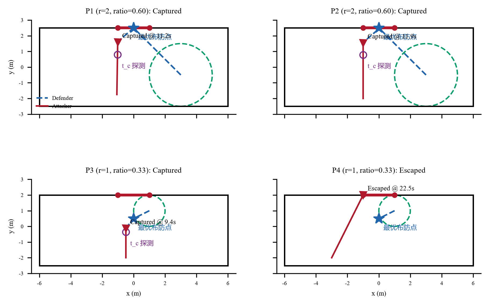
*紫圈 = 探测时刻 $t_c$（两阶段分界）。P1/P2：感知圈盖住整扇门（$r=2>R_\alpha=1.6$），守中点；P3：$r=1$ 不足，按定理 2 退到门下方 1.5 m 卡位，仍捕获；P4：攻击者路径与感知圈最近 1.57 m，全程未探测，突防——模糊区域的风险实证*

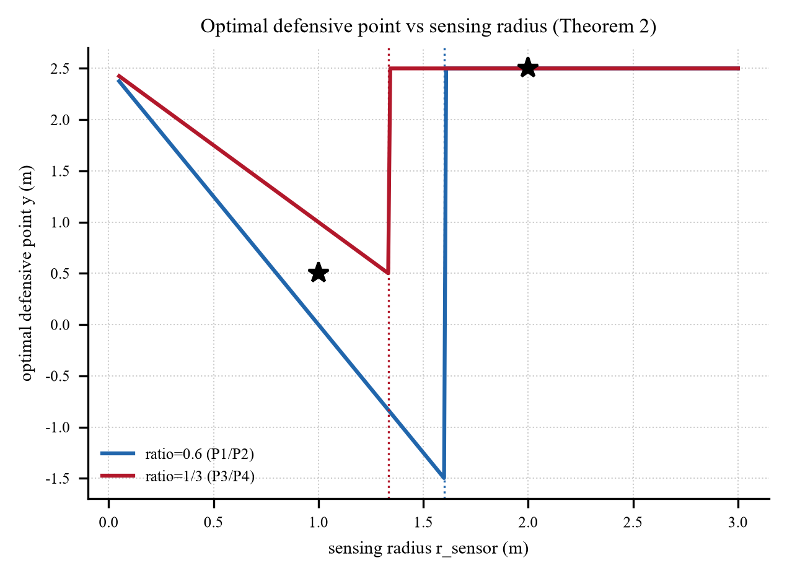
*定理 2 两段式曲线：$r \le R_\alpha$ 段布防高度按 $r/(1-\alpha^{-1})$ 线性下探；$r > R_\alpha$ 后回到门上。星标 = 四个场景的取值*

#### 六、怎么读这两张图

1. **部署段 vs 捕获段**：防守方轨迹的折点就是 $t_c$。此前它只管奔向/驻守布防点
   （紫圈前防守方轨迹与攻击者无关——这正是"部分信息"）；此后转为捕获律；
2. **守中点 vs 守门下**：P1/P2 站门上（感知圈罩住全门），P3 站门下 1.5 m 处
   （定理 2 第二分支）——感知半径不足时用"位置"换"覆盖"；
3. **P4 是模糊区域的活教材**：攻击者从 (-3,-2) 出发直奔门左端，路径与感知圈最近
   1.57 m，全程未探测——论文最小化模糊区域的原因就在此。

#### 动手练习

1. 把 P1 的 `r_sensor` 从 2 连续降到 0.5，用 `optimal_defensive_point` 画出布防点
   轨迹（会从门上滑到门下），并找出结局从 captured 翻转为 escaped 的**临界半径**；
2. 把攻击者换成"先横移再冲门"的机动策略，检验部署点最优性是否被破坏（论文假设
   直逃——攻击者策略改变后布防点是开放问题）；
3. 进阶：给探测环节叠加 2.1 的 kesai_ij 不确定性（感知半径带噪），统计捕获率。

#### 常见坑

- 符号：本节 $\alpha = v_p/v_e$、`ratio = v_e/v_p = α⁻¹`；Apollonius 参数
  `alpha = 1/(1-ratio²)` 与论文 $\alpha^2/(\alpha^2-1)$ 等价，换算时别混；
- 探测时刻锁定 $(x_c, r_c)$ 只发生**一次**——反复锁定会破坏捕获策略的距离不增保证；
- P4"未探测就逃逸"不是 bug，是模糊区域 $F$ 的正常存在——这正是论文要解决的问题；
- 原始实现在 Law 函数内硬编码速度（0.3/0.15）与主程序 ratio 的速度（0.5/0.3）
  不一致，整理版统一为场景声明速度（结论不变，数值与原始实现略有差异）。

### 4.2 局部感知实验数据与视频

> 前置知识：`4.1`（理论仿真，与实验对照）
> 定位：把 2023.3~5 四轮 Tello 真机实验的数据、视频整理成可复现的后处理流程与对照材料。

#### 实验背景

| 轮次 | 结论 | 数据 |
|---|---|---|
| 2023.3.25 | 前几组后摇严重效果不行，**后几组效果可以** | 03-12 / 03-19 / 03-26 的 bag |
| 2023.4.01 | 速度比 1/3（$v_e=0.2, v_p=0.6$），验证**停在最优点等待** | 04-01 三个 bag |
| 2023.4.02 | 基本验证单机博弈；含感知半径较小、未拦截案例 | 04-02 四个 bag |
| 2023.4.12 | 多组重复实验（稳定性） | 04-13 四个 bag |

实验平台：两架 Tello + VRPN 动捕（全局真值用于**评估**）+ 机载策略节点
（只用感知圈内信息做**决策**——"评估用真值、决策用局部信息"）。目标"门"在上边墙
中央（红色线段），攻击者从下方突入，防守方按 4.1 的布防点-捕获策略执行。

#### 已保存的实验数据（共 8 个 bag ≈ 38 MB）

| bag | 实验含义 | P-E 最小距离 | 结果 |
|---|---|---|---|
| 2023-03-12-17-35-17 | 3.25 首次可用实验 | 0.02 m | 拦截 |
| 2023-04-01-22-13-10 | 04.01 防守者速度一直不变（data_plot3） | 0.02 m | 拦截 |
| **2023-04-01-22-18-43** | **04.01 防守者停在最优点（data_plot4_ok）★核心** | 0.06 m | 拦截 |
| 2023-04-01-22-27-10 | 04.01 备用组 | 0.07 m | 拦截 |
| **2023-04-02-16-59-10** | **04.02 初始在感知外→进入感知（data_plot1_ok）★** | 0.07 m | 拦截 |
| 2023-04-02-17-04-20 | 04.02 备用组 | 0.03 m | 拦截 |
| **2023-04-02-22-10-28** | **04.02 感知半径较小（data_plot2_ok）★** | 0.07 m | 拦截 |
| **2023-04-02-22-14-46** | **04.02 没拦截到的情况（data_plot3_ok）★** | **0.60 m** | **未拦截** |
| 2023-04-13-02-05-40 | 04.12 重复实验 1/4（稳定性验证） | 0.02 m | 拦截 |
| 2023-04-13-02-14-49 | 04.12 重复实验 2/4（稳定性验证） | 0.12 m | 拦截 |
| 2023-04-13-02-19-27 | 04.12 重复实验 3/4（稳定性验证） | 0.01 m | 拦截 |
| 2023-04-13-02-28-14 | 04.12 重复实验 4/4（稳定性验证） | 0.07 m | 拦截 |

P-E 最小距离由动捕位姿计算：拦截成功组均逼近 0.02~0.07 m（≈捕获半径），未拦截组
最小距离 0.60 m > r=0.4——**数据与实验结论一一对应**。

#### 数据后处理

每个 bag 生成一张四联图（`fig/4.2_<bag名>.png/.svg`）：

1. **场地轨迹**：防守者（蓝）、攻击者（红）、目标线段（门）、防守方导航目标点序列
   （绿 +，来自 /error1 A 帧——部署点→捕获点的切换可见）；
2. **P-E 距离**：动捕计算的距离曲线（部分信息核心量）+ 原始实现 /error1 B 帧记录的 dd；
3. **速度**：防守者停在最优点时 $v_p \approx 0$ 的"等-冲"节奏清晰可见；
4. **控制量**：双机 |cmd_vel|。

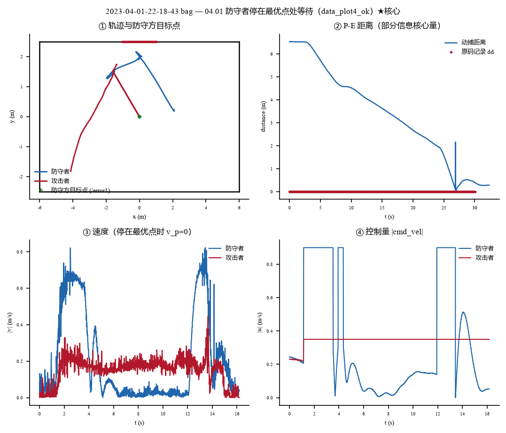
*2023-04-01-22-18-43（停在最优点★）：① 防守者从右侧直接奔向门旁布防点，攻击者爬升到门被拦；② P-E 距离 6.5 m 单调收敛到 0（捕获后有一次碰撞弹跳）；③ 速度曲线中段防守者 ≈0——"等待"的直接证据*

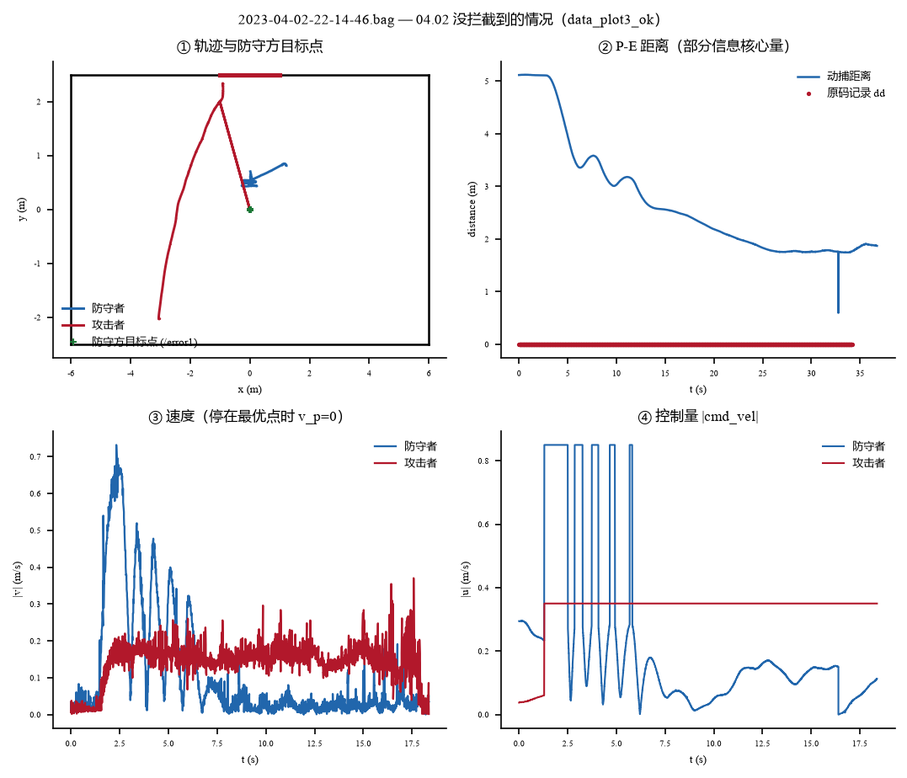
*2023-04-02-22-14-46（没拦截到★）：P-E 距离最小 0.60 m，始终大于捕获半径 0.4 m——防守方感知半径较小（data_plot2_ok 对应场景）导致差之毫厘*

##### 话题语义与两个原始实现缺陷（源码确认）

| 话题 | 内容 |
|---|---|
| `/vrpn_client_node/tello{1,2}/pose` | 动捕位姿（毫米，/1000 换算米） |
| `/error1` | **交错携带两种消息**（原始实现把 cmd_error1/cmd_error2 都发到这里）：A 帧 = 导航目标点 + 防守者位置；B 帧 = 防守者→攻击者向量 (dx, dy, dd) |
| `/error2` | 原始实现误发，仅 1 条消息，可忽略 |
| `/command` | 1 起飞 / 2 前往预定位置 / 3 博弈 / 9 降落 |

两个如实记录的原始实现缺陷：① B 帧的 `dd_p2e1` 声明后未赋值，记录值恒为 0（图中红点
贴零轴的原因），P-E 距离请用动捕位姿计算；② `target_point` 在 show 节点里未持续
更新，目标点序列只有稀疏几个点。这些不影响轨迹/速度/距离三大主数据。

#### 实验视频（原实验素材，共 7 段）

| 视频 | 内容 |
|---|---|
| 博弈0-mzh | 单机博弈全景（mzh 操作） |
| 博弈1-击落 | **拦截成功案例（击落）** |
| 博弈2-撞击 | 拦截成功案例（撞击） |
| 博弈3-撞击 | 拦截成功案例（撞击） |
| 多对多视频 | 二对二博弈（一对一的合成，效果一般） |
| 失败-动捕信号接收不到 | 失败案例：动捕信号丢失 |
| b10502afb56e1e8d36819c6bcf8c6b7c | 实验花絮 |

另有现场照片与会议材料等原始素材，未随本书收录。

#### 与 4.1 仿真的对照

| 对照项 | 仿真（4.1） | 实验（4.2） |
|---|---|---|
| 布防点 | 定理 2 公式给定 | /error1 目标点序列 + 速度为零的等待段 |
| 探测切换 | 距离 ≤ r_sensor 时刻锁定 | 同机制（机载决策只用感知圈内信息） |
| 捕获 | dist ≤ 0.1 | P-E 最小距离 0.02~0.07 m（碰撞） |
| 未拦截 | P4 模糊区域逃逸 | 04.02 感知半径较小场景（0.60 m > r） |

#### 动手练习

1. 对核心 bag（22-18-43）提取"等待段"起止时刻，统计防守者在最优点静止的时长占比；
2. 用 /error1 A 帧的目标点序列反推：部署阶段目标点是布防点、检测后目标点是否跳变
   为捕获点？对照 4.1 的理论切换时刻；
3. 进阶：把 8 个 bag 的 P-E 距离曲线按速度比归一化时间轴，画在一张图里检验重复性。

### 4.3 异构多人局部感知博弈

> 前置知识：`4.0`（部分信息模型与布防点）、`4.1`（1v1 完整流程）。
> 定位：第三章第 3 节——**2v2，其实就是两个 1v1**。一个场地、一扇门， 两个异构防守方对两个逃跑者；部署阶段各奔最优布防点（复用 4.1 的 Theorem 2 函数），之后**谁发现了哪个逃跑者（进入感知圈），谁就去抓捕那个** ——发现即认领、锁定探测时刻的 Apollonius 圆、直线拦截（复用 4.1 的 两条运动律），不重分配。2v2 就这样自然分解成两个互不干扰的 1v1 （论文假设 1：可分解性）。

#### 这一节解决什么问题

4.1 的流程是 1v1 的。多个攻击者同时来袭时，论文的处理方式非常直接：

1. **假设 1（可分解性）**：部分信息下无协同捕获——整个多人博弈**分解为若干
   1v1 子博弈**，每个子博弈就是 4.1 的完整流程；
2. **匹配怎么定**：部分信息下防守方只知道自己的感知圈——**"谁发现了哪个
   逃跑者，谁就去抓捕那个"**（发现即认领，天然的去中心化匹配）；
3. **异构性**：各防守方速度 $v_{P_i}$、感知半径 $r_i$ 不同——认领之后的
   1v1 结局由各自参数决定。

所以 4.3 不需要 4.1 之外的新机制：两条运动律、布防点公式全部复用 4.1，新增的只有
"感知 → 认领"这一层。

#### 博弈模型与假设

$N_P$ 个防守方 $\mathcal{P}$ 对 $N_E$ 个攻击者 $\mathcal{E}$，目标线段
$T$（本节取 4.1 P1/P2 的门 $(-1,2.5)$–$(1,2.5)$），攻击者突入 $T$ 即获胜。

- **假设 1（可分解性）**：部分信息下无协同捕获——博弈最终分解为若干 1v1 子博弈；
- **假设 2（速度约束）**：防守方快于其对手 → $\alpha_{ij} = v_{P_i}/v_{E_j} > 1$
  （代码 `ratio = v_e/v_p = α⁻¹`）才可能拦截；
- **假设 3（到达通告）**：攻击者到达目标区后发通告——保证终止条件可识别。

#### 每个防守方的流程（= 4.1 完整流程 + 认领）

| 阶段 | 时机 | 内容 |
|---|---|---|
| ① 部署 | $t=0$ 起 | 奔向最优布防点（Theorem 2；速度比按**最快逃跑者**保守计算） |
| ② 发现 | $\mathrm{dist} \le r_i$ | 未认领的防守方 × 未被认领的逃跑者，进入感知圈即认领（同一步多人竞争时取最近），并锁定此刻的 Apollonius 圆 |
| ③ 抓捕 | 认领后 | 对认领目标执行 Apollonius 捕获律 `law_p_optimal_capture`（3.1 式(4)） |
| ④ 终局 | —— | $\mathrm{dist} \le 0.1$ → **拦截**；逃跑者抵达 $T$ → **突防** |

认领后不重分配：防守方盯死自己发现的逃跑者，逃跑者也不知道自己被谁盯上
——这正是"部分信息"下 2v2 退化为一对一对决的原因。

#### 捕获策略（式 5）与 $\sqrt{2}$ 条件

认领后的 1v1 交互中，记 $\alpha_{ij} = v_{P_i}/v_{E_j}$，防守方控制律
（`law_p_optimal_capture`，与 4.0 式(4) 同族）：

$$
\boldsymbol{z}_{P} = \left(R_{A}^{t_{p3}} + \delta - R_A\right)
\frac{\boldsymbol{x}_{E_j} - \boldsymbol{x}_{P_i}}{\|\boldsymbol{x}_{E_j} - \boldsymbol{x}_{P_i}\|}
+ \alpha_{ij}\left(\boldsymbol{x}_A^{t_{p3}} - \boldsymbol{x}_A\right)
$$

其中 $\boldsymbol{x}_A^{t_{p3}}, R_A^{t_{p3}}$ 为**认领时刻锁定**的 Apollonius
圆参数——检测后直线奔向拦截，同时把攻击者保持在感知圈内。

**$\sqrt{2}$ 条件（Lemma 1）**：防守方控制方向与视线的最大夹角
$\theta_{max}$ 满足 $\sin\theta_{max} = \alpha_{ij}^{-1}$；保持感知圈要求
$\alpha_{ij} \ge 1/\cos\theta_{max}$，联立得 $\alpha_{ij} \ge \sqrt{2}$ 时可放心
截击；$\alpha_{ij} < \sqrt{2}$ 时须改用感知保持式。本节两个子博弈的
$\alpha$（1.67 与 2.0）都越过门槛，拦截成立。

#### 部署策略（Theorem 2，两类）

按感知半径是否盖住屏障，防守方分两类（`ratio = α⁻¹`，$\alpha_i$ 取保守值）：

$$
\mathcal{D}_1:\ x_{P_i}^{opt} = \left(\frac{l}{2},\ 0\right)
\quad\text{（} r_i > (1+\alpha^{-1})\, l/2 \text{，感知圈盖住屏障，守门中点）}
$$

$$
\mathcal{D}_2:\ x_{P_i}^{opt} = \left(\frac{l}{2},\ \frac{r_i}{\alpha^{-1}-1}\right)
\quad\text{（} r_i \text{ 不足，退到目标线下方卡位）}
$$

> **论文完整框架补充**：防守方更多、需要全局协调时，论文再引入任务分配——
> 匹配权重 $w_{ij} = r_i^{-1}$（$\mathcal{D}_1$）或 $(1+\alpha_i^{-1}) r_i^{-1}$
>（$\mathcal{D}_2$），做最大权二部图匹配（Algorithm 1），并在感知进出时动态
> 重匹配（Algorithm 2）。本节的"谁发现谁去抓"是它 $N_P = N_E$、认领即匹配的
> 最简形态；论文并声明该贪心原则**不保证**拦截总数最大。

#### Python 仿真：2v2（异构防守方）

一个场地、一扇门。防守方 P1 取 4.1 P1 的防守方（$v=0.5$, $r=2.0$），
P2 取 4.1 P3/P4 的防守方（$v=0.6$, $r=1.0$）；逃跑者 E1 走左路
（4.1 P1 的起点 $(-1.07,-1.75)$），E2 走右路（起点 $(0.5,-2)$）。

布防点（$l=2$，保守 $\alpha^{-1}$ 按最快逃跑者 $v=0.3$）：

```
P1: r=2.0 > (1+0.6)*1 = 1.6  -> D1, 布防点 = (0, 2.5)   守门中点
P2: r=1.0 <= (1+0.5)*1 = 1.5 -> D2, 布防点 = (0, 0.5)   退到门下方卡位
```
事件日志（真实运行结果）：

```
事件日志：
  t=  8.3s  P2 发现 E2        <- 谁发现谁去抓：P2 认领 E2（右路）
  t=  8.6s  P1 发现 E1        <- P1 认领 E1（左路）
  t=  9.5s  P2 拦截 E2        <- 右路 1v1 结束
  t= 11.2s  P1 拦截 E1        <- 左路 1v1 结束（与 4.1 单独跑 P1 完全一致）
结局：
  E1: 被拦截
  E2: 被拦截
```
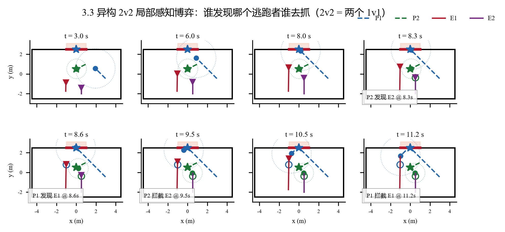
*2×4 时间快照（t = 3.0 s → 11.2 s）：星标 = 布防点，淡虚线圈 = 当前感知圈，虚线 = 防守方、实线 = 逃跑者（同色为一对），空心圈 = 认领时刻逃跑者位置（$t_c$）。t=8.3s P2 的感知圈碰到 E2 即认领右路，t=8.6s P1 认领左路——此后两张"对决"在同一画面里各自独立进行，互不支援、互不重分配*

**结果怎么读**：

1. **认领即匹配**：P2 虽然布防点更靠下（$\mathcal{D}_2$ 卡位），但它的感知圈
   最先碰到走右路的 E2（8.3 s）——"谁发现谁去抓"，不需要协调器；
2. **2v2 = 两个 1v1**：认领完成后，左路 (P1, E1) 与右路 (P2, E2) 各自跑
   3.1 的捕获流程。左路的轨迹、探测时刻（8.6 s）、拦截时刻（11.2 s）与
   4.1 单独跑 P1 **一字不差**——这就是假设 1"可分解性"的直接验证；
3. **异构的作用**：P1 慢但感知大（守门中点），P2 快但感知小（退守卡位）——
   两个防守方各自把守半场，靠"发现即认领"自然分工，不需要任何通信；
4. **与 4.1/4.2 的演进关系**：4.1 给出 1v1 完整流程，4.2 用实测数据校验，
   4.3 加一层"感知 → 认领"把两个 1v1 拼成 2v2——每步只新增一个维度。

#### 动手练习

1. 把 E2 的起点从 $(0.5,-2)$ 移到 $(-0.5,-2)$（与 E1 同走左路）——两个逃跑者
   先后进入 P1 的感知圈，"谁发现谁去抓"会怎么分配？P2 会不会扑空？
2. 把 P2 的 $r$ 从 1.0 提到 1.5（升入 $\mathcal{D}_1$，布防点也到 $(0,2.5)$），
   重跑——两个防守方挤在同一个布防点，认领次序如何变化？
3. 给 P2 换成 $v=0.25$（$\alpha^{-1}=1.2$，追不上 E1）再让它认领 E1，
   观察拦截失败退化为突防——验证假设 2 是拦截的前提。

#### 常见坑

- 两套符号：论文正文 $\alpha_{ij} = v_{P_i}/v_{E_j}$，与 4.0/4.1 的 $\alpha$ 同义；
  而代码里 `ratio = v_e/v_p = α⁻¹`——移植公式时反复核对；
- 部署阶段的速度比要按**最快逃跑者**保守计算（多个攻击者速度不同时，
  用错会选错 $\mathcal{D}_1/\mathcal{D}_2$ 类别与布防点）；
- "谁发现谁去抓"是贪心匹配，不保证全局最优（论文原话）——攻击者密集时
  可能两个防守方认领同一个目标、漏掉另一个，练习 1 就是这个坑；
- Python 模块名不能以数字开头，复用 4.1 要用 `importlib.util.spec_from_file_location`
  按文件路径加载，不能 `import 4.1_partial_info_sim`。

### 4.4 局部感知博弈：三维凸目标区域（多人协作）

> 定位：第三章第 4 节——把 4.3 的二维线段目标推广到**三维凸目标区域**、 多防守方**协作**捕获单个攻击者。

#### 这一节解决什么问题

前三节的博弈都在二维平面、目标是一条线段。这篇论文推广到：

- **三维空间** $\mathbb{R}^3$：目标区域 $\Omega_{tar}$ 是一个**凸集**（不再是线段）；
- **多防守方协作**：$N_P$ 个同构防守方协同捕获**单个**攻击者；
- 信息结构不变：防守方只有有限感知半径 $r_s$（另有捕获半径 $r_c$），攻击者全知。

三维 + 凸区域的难点：目标区域的**投影** $\mathrm{Proj}_{\Omega_{tar}}(z)$ 虽然唯一
（凸性保证），但屏障（winning region 边界）是三维空间中的**二维曲面**，
其构造与部分信息下的有效性分析都远难于二维。

#### 逃避优势空间：势函数与交集

每个防守方 $P_i$ 定义**势函数**（论文式 3，$\alpha = v_P/v_E > 1$）：

$$
\phi_i(\boldsymbol{z}) = \|\boldsymbol{z} - \boldsymbol{x}_{P_i}\|^2 - \alpha\,\|\boldsymbol{z} - \boldsymbol{x}_E\|^2 - r_c
$$

- $\phi_i(\boldsymbol{z}) > 0$：$\boldsymbol{z}$ 处防守方 $i$ 能先于攻击者到达（含 $r_c$ 余量）；
- 优势空间 $D_i = \{\phi_i > 0\}$，边界 $\partial D_i = \{\phi_i = 0\}$（三维 Apollonius 球面加余量）；
- **全体优势空间 = 交集**（论文式 4）：

$$
D = \bigcap_{i=1}^{N_P} D_i \qquad \text{（已被证明严格凸）}
$$

直觉：攻击者必须同时躲开**所有**防守方，所以它的安全区是各个球面"排斥域"的交集
——与第一章"多约束取交集"的思想同源，只是从二维圆升级为三维球。

#### 完全信息下的最优策略

攻击者到目标区域的距离 $\mathrm{dist}(\boldsymbol{z}, \Omega_{tar}) =
\|\boldsymbol{z} - \mathrm{Proj}_{\Omega_{tar}}(\boldsymbol{z})\|$（凸集投影唯一）作为代价。
完全信息下的最优策略：双方都奔向优势空间边界上的最优点 $\boldsymbol{\vartheta}^* \in \partial D$：

$$
\tilde{\boldsymbol{u}}_{P_i}^* = \frac{\boldsymbol{\vartheta}^* - \boldsymbol{x}_{P_i}}{\|\boldsymbol{\vartheta}^* - \boldsymbol{x}_{P_i}\|}
$$

博弈值 = $\|\boldsymbol{\vartheta}^* - \boldsymbol{\chi}\|$（$\boldsymbol{\chi}$ 与投影相关的收敛点）。

#### 两阶段信息结构

| 阶段 | 时机 | 策略 |
|---|---|---|
| 部署阶段 | 攻击者在感知圈外 | 开环部署策略 $\Pi_P^d$（不依赖攻击者当前状态） |
| 捕获阶段 | 攻击者进入感知圈 | 闭环捕获策略 $\Pi_P^c$（可用攻击者当前控制输入） |

注意：捕获阶段中攻击者可能**再次离开**感知圈 → 博弈回到部署阶段——这种"来回切换"
正是部分信息结构的特征（对应 4.3 的动态重匹配思想）。

#### Theorem 1：部分信息下的协作捕获策略（三种情形）

记感知中的防守方集合 $\mathcal{P}_s = \{P_i : \boldsymbol{x}_E \in S_i\}$，
$\boldsymbol{d}_i$ 为其到攻击者的距离向量。**充分感知条件**：只要有一个感知中的
防守方满足 $\alpha \boldsymbol{e}_i^\top \boldsymbol{u}_{P_i} \ge \boldsymbol{e}_i^\top \boldsymbol{u}_E$，
则 $\dot{d}_i \le 0$——攻击者无法逃出其感知圈（防守方可读攻击者的当前控制输入 $\boldsymbol{u}_E$）。

设 $\boldsymbol{\vartheta}^\dagger$ 为射线 $\boldsymbol{x}_E + \lambda \boldsymbol{u}_E$
与 $\partial D$ 的交点，$A^\dagger$ 为满足
$\boldsymbol{u}_E = \sum_{P_i \in A^\dagger} \mu_i \nabla_{\boldsymbol{z}} \phi_i(\boldsymbol{\vartheta}^\dagger)$
的最小基数主动集（三维中 $|A^\dagger| \le 3$）。捕获策略分三种情形（论文 Theorem 1）：

**Case 1（$\mathcal{P}_s \not\subseteq A^*$，有"闲置"的感知防守方）**：选一个不在
$A^*$ 中的感知防守方 $P_k$ 直接追击（$\boldsymbol{u}_{P_k} = \boldsymbol{e}_k$，
指向攻击者），其余 $A^*$ 中的防守方执行完全信息最优方向 $\tilde{\boldsymbol{u}}_{P_i}^*$。
$\dot{d}_k \le v_E - v_P \le 0$——攻击者无法逃出 $P_k$ 的感知圈。

**Case 2（$\mathcal{P}_s \subseteq A^*$，所有感知防守方都是主动集成员）**：
- $\alpha \ge \alpha_c$：全员执行完全信息最优方向 $\tilde{\boldsymbol{u}}_{P_i}^*$，
  优势空间边界关系 $s_{P_i} = \alpha s_E + r_c$ 在闭环下保持 → 优势空间 $D(t) \subseteq D(t_c)$
  单调收缩，且 $\dot{d}_i \le 0$（攻击者留在感知圈内）；
- $\alpha < \alpha_c$：防守方冲向 $\boldsymbol{\vartheta}^\dagger$（$\boldsymbol{u}_{P_i} =
  (\boldsymbol{\vartheta}^\dagger - \boldsymbol{x}_{P_i})/\|\cdot\|$）——该策略依赖
  攻击者的控制输入 $\boldsymbol{u}_E$。

**临界速度比**：

$$
\alpha_c = \frac{\sqrt{8 r_s^2 + r_c^2} - r_c}{2 r_s}
$$

三种情形都保证 $V(\boldsymbol{x}) \ge \|\boldsymbol{\vartheta}^*(t_c) - \boldsymbol{\chi}(t_c)\|$
——攻击者无法比检测时刻更接近目标区域。

#### 屏障与模糊区域（论文 Definition 1、式 8）

完全信息屏障 $\tilde{B}(\boldsymbol{x}_P)$ = 代价函数的零水平集（三维曲面），把博弈
空间分为防守方获胜域 $\tilde{W}_P$ 与攻击者获胜域 $\tilde{W}_E$。部分信息下：

$$
W_P = \begin{cases}
\tilde{W}_P, & \tilde{B} \subset \mathrm{int}(S) \quad \text{（感知圈盖住屏障）} \\
S \setminus \tilde{W}_E, & \text{否则（被感知约束截断）}
\end{cases}
$$

模糊区域 $F = \tilde{W}_P \setminus S$：从 $F$ 出发的攻击者存在"未被发现就越过屏障"
的轨迹——与 4.1 的 $F$ 概念在三维的对应。

#### Theorem 2 与 Corollary 3：充分感知半径

单个防守方覆盖屏障的**充分感知半径**（Theorem 2）：

$$
\exists\ R_S = \frac{\alpha + 1}{\alpha}\,\max \mathrm{dist}(\boldsymbol{x}_{P_i}^0, \Omega_{tar}) - \frac{r_c}{\alpha},
\quad \text{s.t.} \ \forall r_s > R_S:\ \tilde{B} \subset \mathrm{int}(S_i)
$$

多防守方时按**目标边界的 Voronoi 划分**扩展（Corollary 3）：每个防守方 $P_i$ 分得
目标边界上离自己最近的面片 $\Gamma_i = \{\boldsymbol{z} \in \partial\Omega_{tar} |
\|\boldsymbol{z} - \boldsymbol{x}_{P_i}\| \le \|\boldsymbol{z} - \boldsymbol{x}_{P_j}\|, \forall j \ne i\}$，
对应优势子区域 $V_i = \mathrm{conv}(\Gamma_i)$；防守方只需覆盖自己格子诱导的屏障部分：

$$
R_S^V = \max_{i=1,\dots,N_P} \left\{ \frac{\alpha + 1}{\alpha}\,\max \mathrm{dist}(\boldsymbol{x}_{P_i}^0, \Gamma_i) - \frac{r_c}{\alpha} \right\}
$$

直觉：把"门"按就近原则分给各防守方，各自只需盖住自己那一片——这是 Theorem 2
（单防守方覆盖全屏障）在多人场景的自然推广。

#### 与第三章其他各节的关系

| | 4.1/4.3（二维线段目标） | 4.4（三维凸目标区域） |
|---|---|---|
| 目标 | 线段 $T$ | 凸集 $\Omega_{tar}$（投影唯一） |
| 优势域 | Apollonius 圆 | 球面 $\partial D_i$，交集 $D = \cap D_i$ |
| 捕获 | 式(5) 混合策略（$\sqrt{2}$ 分界） | Theorem 1 三情形（$\alpha_c$ 分界，含主动集 $A^\dagger$） |
| 部署 | D1/D2 两类布防点 | Theorem 2 + Corollary 3（Voronoi 划分） |
| 协同 | 无（假设 1：分解为 1v1） | 有（$D = \cap D_i$ 的交集结构） |

#### Python 仿真：三维协作捕获

**场景**：目标区域 $\Omega_{tar}$ 取长方体 $[1.5,3]\times[-0.75,0.75]\times[-0.75,0.75]$
（凸集，投影 = 逐坐标 clip，可视化直观）；3 个同构防守方
（$v_P=0.5$，$r_s=1.5$，$r_c=0.15$）对单个全知攻击者（$v_E=0.25$，
$\alpha = v_P/v_E = 2.0$）。

**实现路线**（即本节原"留作扩展"的建议路线，全部落地）：

1. $\phi_i = 0$ 化简为球：$\|\boldsymbol{z} - \boldsymbol{c}_i\|^2 = R_i^2$，其中
   $\boldsymbol{c}_i = \dfrac{\boldsymbol{x}_{P_i} - \alpha\,\boldsymbol{x}_E}{1-\alpha}$，
   $R_i^2 = \|c_i\|^2 - \dfrac{\|x_{P_i}\|^2 - \alpha\|x_E\|^2 - r_c^2}{1-\alpha}$
   ——$D = \bigcap_i$ 球 $B(c_i, R_i)$，无需通用凸体求解；
2. $\boldsymbol{\vartheta}^*$ = $D$ 边界上离 $\Omega_{tar}$ 最近的点：
   SLSQP 带 3 个约束 $\phi_i(z) \ge 0$，初值取攻击者位置（必在 $D$ 内）；
3. 部署目标按 Corollary 3：目标边界面片采样后按就近原则 Voronoi 划分，
   每个防守方驻守自己面片质心后退 $0.6$ m 处；
4. 阶段状态机：未感知 → 部署；任一防守方感知到攻击者 → Theorem 1
   （本场景 $\alpha = 2.0 \ge \alpha_c = 1.37$，Case 2 闭环最优：感知中的
   防守方奔向 $\boldsymbol{\vartheta}^*$）；若攻击者再次离开感知圈则切回部署。

控制台输出（真实运行结果）：

```
4.4 三维凸目标区域协作捕获：alpha = 2.00, alpha_c = 1.37 -> Case 2 闭环最优（alpha >= alpha_c）
事件日志：
  t= 19.5s  检测 t_c=P1, P2
  t= 21.5s  捕获（dist <= r_c）
结局：防守方捕获 @ 21.5s
```
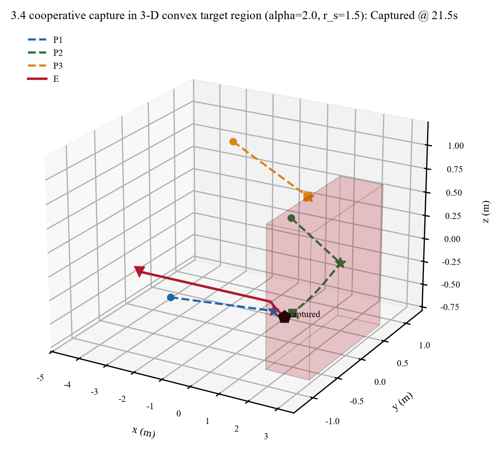
*三维全程轨迹：星标 = 各防守方按 Corollary 3 驻守的 Voronoi 面片质心（后退 0.6 m），方块 = 终点；红色实线 = 攻击者（全知，未被发现时直线冲向目标区域），三角 = 起点。t=19.5s 攻击者进入 P1/P2 的感知圈（红轨迹出现拐点 = 转向 $\boldsymbol{\vartheta}^*$），t=21.5s 被捕获——捕获点在目标区域之外，防守方获胜域生效*

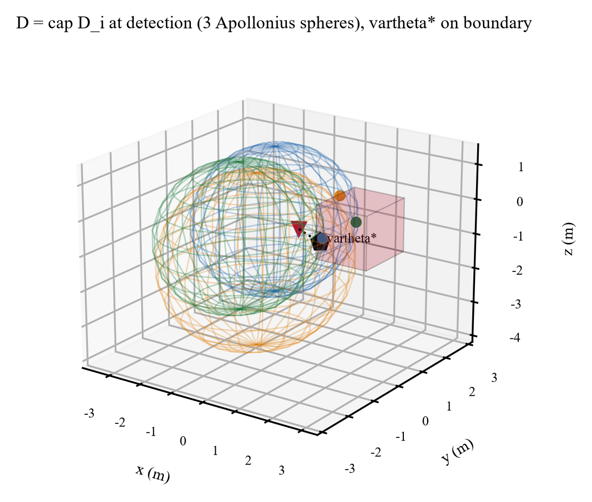
*检测时刻 $t_c$ 的优势空间 $D = \bigcap_i D_i$：三个彩色线框球即 $\phi_i = 0$ 的三维 Apollonius 球，交集（严格凸）包住攻击者（三角）；黑色五角 = $\boldsymbol{\vartheta}^*$（$D$ 边界上离目标区域最近的点），点线 = 攻击者的最优逃逸方向——三个防守方把它压向同一点，交集只能收缩*

**结果怎么读**：

1. **$D = \bigcap D_i$ 的收缩机制**：检测后三名防守方奔向 $\boldsymbol{\vartheta}^*$，
   $\alpha = 2.0 \ge \alpha_c$ 保证闭环下 $s_{P_i} = \alpha s_E + r_c$ 保持——
   交集 $D(t) \subseteq D(t_c)$ 单调收缩，攻击者被"挤"在交集里直至
   $\mathrm{dist} \le r_c$（2.0 s 内捕获，且全程未再离开感知圈，与
   Theorem 1 的 $\dot d_i \le 0$ 一致）；
2. **分工与协同并存**：部署阶段三人各守自己的 Voronoi 面片（互不重叠，
   覆盖整扇"门"）；捕获阶段感知者收缩交集、未感知者（P3）原地驻守补位
   ——与 3.3 的"谁发现谁去抓"相比，这里多了交集结构带来的**真协作**；
3. **与 3.1/3.3 的对照**：目标从线段变长方体（投影代替垂点）、Apollonius 圆
   变球、$\sqrt2$ 门槛变 $\alpha_c$ 门槛——信息结构（两阶段切换）完全同构。

#### 仿真实现备注（原"留作扩展"的落地说明）

- 三维几何无需通用凸体求解器：$\phi_i=0$ 解析化为球（上面式子），交集即
  三球相交；$\boldsymbol{\vartheta}^*$ 用 SLSQP 带约束解，规模小、每步毫秒级；
- matplotlib 3D 画长方体用 `Poly3DCollection`——面片四角必须按**环形顺序**
  排列，按行优先顺序会画出"蝴蝶结"状扭曲面（本整理踩过并修复）；
- mplot3d 中 `ax` 若被循环变量覆盖会变成 int，`add_collection3d` 报
  AttributeError——3D 绘图函数里避免用 `ax` 作循环变量名。

#### 动手练习

1. 二维退化验证：把 3.4 的势函数 $\phi_i$ 限制在 $z$ 平面的一条直线上，与 2.1 的
   kesai_ij 保守边界对照——两者应给出同一结论；
2. 用蒙特卡洛统计 Case 1 / Case 2 两种情形的出现频率随 $\alpha$ 的变化；
3. 进阶：实现滚动时域版本——每 $N$ 步重解 $\boldsymbol{\vartheta}^\dagger$ 与
   主动集（对应 3.3 练习 3 的三维版）。

#### 常见坑

- 势函数里的 $\alpha$ 是防守/攻击速度比（$>1$），与 kesai_ij 里的用法一致但符号
  独立——两章公式不要互相代入；
- $D = \cap D_i$ 是**交集**不是并集：攻击者要同时躲开所有防守方；
- Theorem 1 的 Case 2（$\alpha < \alpha_c$）需要读取攻击者的控制输入 $\boldsymbol{u}_E$
  ——论文 Remark 1 明确指出这在实践中不易获得，优先保证 $\alpha \ge \alpha_c$。

---

## 第五章　TAD 三体博弈（目标—攻击者—防守者）

### 5.1 TAD 最优策略（Game of Degree：极大值原理与 HJI 完整推导）

> 前置知识：`1.1`（Apollonius 圆——本章升级为**卵形线**）、`4.1`（界栅与 获胜域的分工：本节先解 Game of Degree，Game of Kind 见 5.2）。

#### 这一节解决什么问题

三体博弈（TAD）：**攻击者 A** 捕获**目标 T**（A 带非零捕获半径 $r$：
$\|x_T-x_A\| \le r$ 即命中），**防守者 D** 拦截 A（点捕获）护送 T 逃生。
与 4.x 的两体博弈相比多了一方，且攻击者与防守者**等速**——传统方法对
这种"等速 + 非零捕获半径"的 TAD 既没有 Game of Degree 的反馈策略，
也没有 Game of Kind 的界栅。本节用**两侧极大值原理（PMP）**完整解出
Game of Degree：三方最优策略全部是"直奔最优捕获点 $\boldsymbol{z}^*$"，
而 $\boldsymbol{z}^*$ 由两条代数方程联立解出、可验证值函数满足 HJI 方程
（Nash 均衡）——并把**每一步推导**写全。

#### 博弈模型与终止集（式 1-4）

$$
\dot{\boldsymbol{x}}_A = v_A(\cos\beta,\sin\beta),\quad
\dot{\boldsymbol{x}}_D = v_D(\cos\delta,\sin\delta),\quad
\dot{\boldsymbol{x}}_T = v_T(\cos\zeta,\sin\zeta)
$$

$v_A = v_D$（等速，归一化 $v_A=1$），$\gamma = v_T/v_A < 1$；控制
$\beta,\delta,\zeta \in [-\pi,\pi]$。终止集：

$$
\mathcal{T}_1: \|x_T-x_A\| \le r \text{（A 命中 T）}, \qquad
\mathcal{T}_2: \|x_D-x_A\| = 0 \text{（D 截获 A）}
$$

#### Game of Degree（式 5-7）

A 先于 D 命中 T 的初始状态属于 $Z_c$，此时 T-D 组队**最小化**终端时刻
T 与 D 的间距，A **最大化**它：

$$
J(\beta,\delta,\zeta;x_0) = \Psi(x_f) = \|x_{Tf}-x_{Df}\|, \qquad
V(x_0) = \max_{\beta(\cdot)}\min_{\delta(\cdot),\zeta(\cdot)} J
$$

#### 第一步：Hamiltonian 与 Isaacs 条件（式 8）

协态 $\lambda = (\lambda_{x_A},\lambda_{y_A},\lambda_{x_D},\lambda_{y_D},
\lambda_{x_T},\lambda_{y_T}) \in \mathbb{R}^6$：

$$
H = \gamma\lambda_{x_T}\cos\zeta + \gamma\lambda_{y_T}\sin\zeta
+ \lambda_{x_D}\cos\delta + \lambda_{y_D}\sin\delta
+ \lambda_{x_A}\cos\beta + \lambda_{y_A}\sin\beta
$$

三个控制项**解耦**（各只含自己的航向角）⇒ Isaacs 条件成立：

$$
\min_\beta \max_{\zeta,\delta} H = \max_{\zeta,\delta} \min_\beta H
$$

#### 第二步：驻点条件——最优航向沿协态方向（式 19-21）

$\partial H/\partial\beta = 0$（A 是 min 侧）：

$$
\cos\beta^* = \frac{\lambda_{x_A}}{\sqrt{\lambda_{x_A}^2+\lambda_{y_A}^2}},
\qquad \sin\beta^* = \frac{\lambda_{y_A}}{\sqrt{\lambda_{x_A}^2+\lambda_{y_A}^2}}
$$

$\partial H/\partial\delta = 0$、$\partial H/\partial\zeta = 0$（D、T 是
max 侧，符号取负）：

$$
\cos\delta^* = -\frac{\lambda_{x_D}}{\sqrt{\lambda_{x_D}^2+\lambda_{y_D}^2}},
\quad \sin\delta^* = -\frac{\lambda_{y_D}}{\sqrt{\lambda_{x_D}^2+\lambda_{y_D}^2}};
\qquad
\cos\zeta^* = -\frac{\lambda_{x_T}}{\sqrt{\lambda_{x_T}^2+\lambda_{y_T}^2}},
\quad \sin\zeta^* = -\frac{\lambda_{y_T}}{\sqrt{\lambda_{x_T}^2+\lambda_{y_T}^2}}
$$

#### 第三步：协态动力学——常数协态与直线轨迹

$H$ **不显含状态** $\boldsymbol{x}$，故

$$
\dot\lambda = -\frac{\partial H}{\partial \boldsymbol{x}} \equiv 0
$$

全部协态为常数 ⇒ 三个最优航向恒定 ⇒ **三方最优轨迹都是直线**
（两点边值问题 TPBVP：6 个初值 + 6 个终端条件）。

#### 第四步：增广终端代价与横截条件（式 22-27）

终端约束有：$x_{Af}=x_{Df}$（D 截获 A）与 $\|x_{Af}-x_{Tf}\|=r$（A 恰在
捕获半径上命中 T）——比自由终端多一个，用乘子 $\nu$ 构造增广终端代价：

$$
\Psi_a(x_f) = \|x_{Df}-x_{Tf}\| + \nu\big(\|x_{Af}-x_{Tf}\| - r\big)
$$

横截条件 $\lambda(t_f) = \partial\Psi_a/\partial x_f$（式 23）逐分量写出
（式 24-26）。终端时刻 A 命中 T 于点 $I=(x,y)$，即 $x_{Tf} = (x,y)$
（式 27）——**捕获点就是 T 的终端位置**。

#### 第五步：终端状态用捕获点表出（式 28-40）

把 $x_{Tf}=(x,y)$、$x_{Af}$ 等代入 (24-26)，得到以捕获点 $z=(x,y)$ 与
终端位置表示的协态（式 28-30）；由 (20)+(29) 解出 D 的最优航向相对终端
位置的表示（式 31），再用"航向恒定"改写为**相对当前状态**（式 32）；
A、T 同理（式 33、34）。比较 (19)&(33)、(21)&(34) 得状态-协态相容关系
（式 35、36）；消去乘子 $\nu$（式 37、38）；终端时刻由 T 的剩余时间给出
（式 39）：

$$
t_f - t = \frac{\|x_T - z\|}{\gamma}\quad(v_A = 1)
$$

防守者的终端位置沿其恒定航向前推（式 40）：
$x_{Df} = x_D + (t_f-t)\,(x - x_D)/\|x_D - z\|$。

#### 第六步：解出协态（式 41）

式 (35)、(36)、(37)、(38) 恰好是 $\lambda_{x_A},\lambda_{y_A},\lambda_{x_T},
\lambda_{y_T}$ 的四元线性方程组，代入 (40) 消去终端状态后解得**只依赖当前
状态与捕获点**的协态表达式（式 41，论文原式）——至此反馈律的一切原料都
只含 $(x; x_A, x_D, x_T)$。

#### 第七步：Isaacs 主方程 → 式 (15)（捕获点方程）

终端时刻自由 ⇒ Isaacs 主方程（式 42）：

$$
H\big(x, \lambda(t), \beta^*, \delta^*, \zeta^*\big)\big|_{t_f} \equiv 0
$$

代入式 (32)-(34) 与 (41)（式 43），整理得**捕获点最优性方程**：

$$
\text{式 (15)：}\quad
\|z-x_A\|^2\big[(z-x_D)(y-y_T,\,x_T-x)^\top\big]
-\gamma\|z-x_T\|^2\big[(z-x_D)(y-y_A,\,x_A-x)^\top\big]
-\|z-x_D\|^2\big[(z-x_A)(y-y_T,\,x_T-x)^\top\big] = 0
$$

（方括号 $[(p)(q,s)^\top]$ 为二维叉积标量 $p_x s - p_y q$，即代码 `eq15`。）

**捕获点同时在卵形线上**：终端时 T 被 A 命中，故 $I \in A_r$（Lemma 1
式 10），写成式 (14)。**解的存在性**（Remark 5）：把 $x = x_T$ 代入
(14) 必有上下两解 $y_h > y_T > y_l$，而式 (15) 左端在 $(x_T,y_h)$ 为正、
$(x_T,y_l)$ 为负 ⇒ 由介值定理必有真解。

**联立 (14)(15) ⇒ 最优捕获点 $\boldsymbol{z}^*(x)$**——这就是代码
`solve_z_star` 的两条方程。

#### 第八步：最优状态反馈策略（Theorem 1，式 11-13）

三方策略**同型：直奔 $\boldsymbol{z}^*(x)$**（对当前状态的反馈）：

$$
\cos\beta^* = \frac{x^*-x_A}{\|z^*-x_T\|},\qquad
\cos\delta^* = \frac{x^*-x_D}{\|z^*-x_D\|},\qquad
\cos\zeta^* = \frac{x^*-x_T}{\|z^*-x_T\|}
$$

（论文原式的分母写作 $\|z^*-x_T\|$ 系排版勘误——分子是各自到 $z^*$ 的
方向，分母应为各自到 $z^*$ 的距离。）

#### 第九步：值函数与 HJI 验证（式 16, 44-49）

**值函数（式 16）**：

$$
V(x) = \|z^*(x)-x_D\| - \frac{1}{\gamma}\|z^*(x)-x_T\|
$$

**$\mathrm{d}V/\mathrm{d}x^* = 0$ 的推导**（式 44-47）：由式 (14) 用隐函数
定理得捕获点沿卵形线移动时的斜率（式 44）
$\mathrm{d}y^*/\mathrm{d}x^* = -(\cos\zeta^*+\gamma\cos\beta^*)/(\sin\zeta^*-\gamma\sin\beta^*)$；
代进 $\mathrm{d}V/\mathrm{d}x^*$（式 45），其分子恰可分解为三个叉积项
（式 46）——**与式 (15) 的左端完全相同**，故为 0：

$$
\frac{\mathrm{d}V}{\mathrm{d}x^*} = 0 \quad (\text{式 47})
$$

——直觉：捕获点沿卵形线移动时，$V$ 的两部分变化恰好抵消（这正是式 (15)
的另一个身份）。

**梯度（式 48）**：于是值函数对状态的偏导只剩"直穿项"：

$$
\frac{\partial V}{\partial x_A} = \frac{\partial V}{\partial y_A} = 0,\qquad
\frac{\partial V}{\partial x_D} = -\cos\delta^*,\quad
\frac{\partial V}{\partial y_D} = -\sin\delta^*,\qquad
\frac{\partial V}{\partial x_T} = \frac{\cos\zeta^*}{\gamma},\quad
\frac{\partial V}{\partial y_T} = \frac{\sin\zeta^*}{\gamma}
$$

**HJI 方程（式 49）**：

$$
\frac{\partial V}{\partial x}\cdot f(x,\beta^*,\delta^*,\zeta^*)
= -\cos^2\delta^*-\sin^2\delta^*
+ \frac{1}{\gamma}\gamma\big(\cos^2\zeta^*+\sin^2\zeta^*\big)
= -1 + 1 = 0
$$

值函数满足 HJI ⇒ 策略组 $(\beta^*,\delta^*,\zeta^*)$ 是**状态反馈
Nash 均衡**。∎

#### 控制台输出（真实运行结果）

```
[参数] gamma=0.8 (v_T/v_A), r=0.5, v_A=v_D=1.0, A=[0.0, 0.0], D=[-2.0, 0.0], T=[2.0, 2.0]
[仿 policy1] 最优捕获点 z*=(4.6667,0.0000), 残差 |eq14|=0.00e+00, |eq15|=0.00e+00
[值函数 (16)] V(x0) = ||z*-xD|| - (1/gamma)||z*-xT|| = 2.5000（捕获时刻 T-D 的终端间距，A 最大化它）
[捕获时间] t_f = ||z*-T0||/v_T = 4.17s（T 到达 z* 时 A 恰落后 r）
[梯度校验 (48)] ∂V/∂xD0: 数值=-1.0000, 解析=-1.0000
[梯度校验 (48)] ∂V/∂xD1: 数值=+0.0000, 解析=-0.0000
[梯度校验 (48)] ∂V/∂xT0: 数值=+1.0000, 解析=+1.0000
[梯度校验 (48)] ∂V/∂xT1: 数值=-0.7500, 解析=-0.7500
[梯度校验 (48)] ∂V/∂xA0: 数值=+0.0000, 解析=+0.0000
[梯度校验 (48)] ∂V/∂xA1: 数值=+0.0000, 解析=+0.0000
[HJI 校验 (49)] ∂V/∂x · f = +0.00e+00（≈0，Nash 均衡）
[闭环] T 进入 A 的捕获半径: t=4.167s, 捕获点=(4.6667,0.0000)（= z*）, 终态 ||xT-xA||=0.4997 <= r=0.5
```
（数值梯度用中心差分 + 解分支延续计算：式 (48) 的六项全部与解析值一致，
其中 $\partial V/\partial x_A = 0$ 正是式 (47) "$\mathrm{d}V/\mathrm{d}x^*=0$"
的数值体现；HJI 残差恰为 0。）

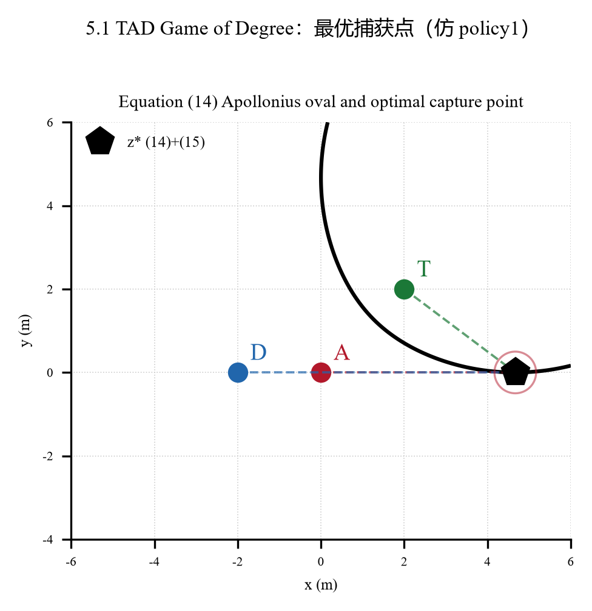
*图 1：黑色曲线 = 式 (14) 的 Apollonius 卵形线（网格等值线法，同原版）——T 的逃避域边界；绿点 T 在卵形线内部（逃避域）；$z^*$（黑五角星）= 式 (14)(15) 联立解出的最优捕获点，恰在卵形线上，带 A 的捕获半径圈（红圈）；三条虚线 = 三方直奔 $z^*$ 的最优航向（协态恒定 ⇒ 直线）。初值取论文构型 $A=(0,0)$、$D=(-2,0)$、$T=(2,2)$，$\gamma=0.8$、$r=0.5$*

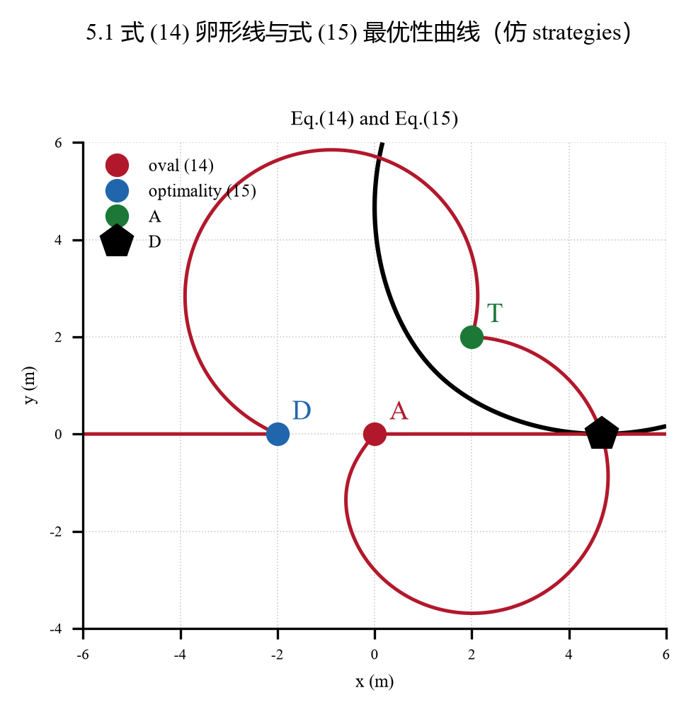
*图 2：黑曲线 = 式 (14) 卵形线，红曲线 = 式 (15) 最优性曲线——两曲线的交点即最优捕获点 $z^*$（黑五角星恰在交点上）。式 (15) 的红色曲线同时穿过 A 与 T（退化的对称解），真正被选中的是它与卵形线在右侧的交点——"哪一支解有效"由 Remark 5 的介值条件保证*

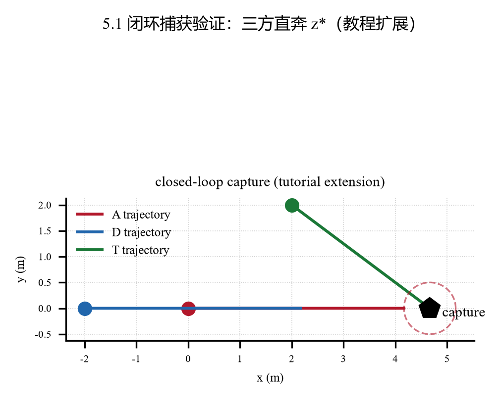
*图 3（教程扩展）：三方按 Theorem 1 的状态反馈直奔 $z^*$ 的闭环轨迹——T（绿）到达 $z^*$ 的时刻（4.17 s）恰好被 A（红）追至捕获半径内（红虚圈），D（蓝）同步赶到；终态 $\|x_T-x_A\| = 0.4997 \le r$，捕获点 = $z^*$（数值无差）*

**结果怎么读**：

1. **z* 恰在卵形线上**：$|eq14| = 0$（原始构型下残差精确为零）——捕获点
   必须同时在"可达性"（式 14）与"最优性"（式 15）两条方程的交点上；
2. **梯度校验（式 48）六项全过**：数值偏导与解析式一致——其中
   $\partial V/\partial x_A = 0$ 验证了式 (47) "$\mathrm{d}V/\mathrm{d}x^*=0$"
   ——值函数通过捕获点的移动"自洽"；$\partial V/\partial x_D = -\hat{r}_{D}$、
   $\partial V/\partial x_T = \hat{r}_{T}/\gamma$ 与三方航向一一对应；
3. **HJI 残差 = 0**：值函数满足 HJI ⇒ 状态反馈 Nash 均衡成立——PMP
   得到的不仅是一组策略，还是博弈的解；
4. **捕获时刻 = T 到达 z* 的时刻**（4.17 s）：卵形线方程保证此时 A 距
   T 恰为 $r$——"非零捕获半径"把捕获条件从点重合放松为间隙 $r$，
   这正是等速 TAD 可解的关键；
5. **与 4.x 的对照**：4.4/4.5 是"一个追一个逃"+ 防守者；本节 TAD 的
   T 会**主动机动逃生**——T 不再是 passive 目标，其策略 $\zeta^*$ 由
   同一套 PMP 对称地给出。

#### 动手练习

1. 把 T0 从 $(2,2)$ 移到 $(5,0)$（A-T-D 共线、T 在 A 的远端），观察
   $z^*$ 与 $V$ 的变化——T 离 A 越远、离 D 越远，$V$ 越大；
2. 把 $\gamma$ 从 0.8 提到 0.95（T 接近等速），观察卵形线膨胀、$z^*$ 远移
   ——$\gamma \to 1$ 时卵形线趋于直线，A 的获胜域消失（等速 T-A 无捕获保证）；
3. 数值验证式 (44)：沿卵形线取两个相邻捕获点，差分 $\mathrm{d}y^*/\mathrm{d}x^*$
   与解析式 $-(\cos\zeta^*+\gamma\cos\beta^*)/(\sin\zeta^*-\gamma\sin\beta^*)$ 对照；
4. 进阶：实现式 (22) 的 $\nu$ 求解（TPBVP 数值打靶），复现论文的
   协态轨迹，验证协态恒定（式 27）。

#### 常见坑

- **三套速度比**：本章 $\gamma = v_T/v_A$（T 相对 A）；4.4/4.5 的
  $\alpha = v_A/v_D$、$\nu = v_E/v_P$ 各指一对玩家——式 (14) 里
  $\gamma$ 乘的是 $(\|z-x_A\|-r)$，写反方向整个卵形线就翻到另一侧；
- **式 (15) 的叉积符号**：三个叉积是"行列式"形式
  $[(p)(q,s)^\top] = p_x s - p_y q$——代码里最容易把第二项的
  $(x_A-x)$ 写成 $(x-x_A)$（本整理踩过：符号错则 z* 解到卵形线外）；
- **二次方程取根**：沿射线解卵形线时取**正号根**（$1-\gamma^2>0$），
  负号根为负、必须丢弃——取错根会导致"卵形线消失"（本整理踩过）；
- **多解与解分支**：(14)(15) 联立在对称构型下可能有多组零残差解——
  梯度校验必须用**解分支延续**（传入上一次的 z* 作为初值），否则
  有限差分会跳分支、得到错误的"梯度"（本整理踩过：数值 [0,0] 对解析
  $[1,-0.75]$ 的假失配即源于此）；
- **捕获时刻的直觉**：捕获发生在 **T 到达 z*** 的时刻（此时 A 恰落后
  $r$），不是 A 到达 z* 的时刻——A 比 T 快，最后一段是 A 在追近距离。

### 5.2 TAD 界栅（Game of Kind）

> 前置知识：`5.1`（Game of Degree 与卵形线——本节回答"什么初始状态 才轮得到玩 Game of Degree"）。

#### 这一节解决什么问题

5.1 的最优策略只在**攻击者的获胜域 $Z_c$ 内**成立。给定初始状态，A 与
T-D 组谁赢？这就是 **Game of Kind**：求界栅函数 $B$ 把平面分成 $Z_c$
（A 胜）与 $Z_t$（T-D 胜）。Shi 2024 的答案是一个**几何判据**：

> 过 A-T 初始位置画 Apollonius 卵形线（式 14）——
> 卵形线与 **A 的极限拦截曲线**（式 56）**分离或相切** → A 胜；
> **相交** → T-D 胜。

#### 坐标系：A-D 对齐标架

把 X 轴取在 A、D 连线上，Y 轴取 AD 的垂直平分线：

$$
A = (x_A,\,0), \qquad D = (-x_A,\,0), \qquad T = (x_T,\,y_T)
$$

等速博弈下 D 的最优拦截点必落在 Y 轴（垂直平分线）上——这是整个构造
的支点。

#### A 的极限拦截曲线（式 52-56）

**极限情形**（论文 Fig. 5）：T 的初始位置取在界栅上时，终端时刻 A 恰在
卵形线上的点 $I$ 处捕获 T，同时恰被 D 截于 Y 轴上的点 $L$——且
$|IL| = r$（A 的捕获半径：再往前一步 T 就没了）。A-L-I 共线，设直线
斜率 $k$（式 52），则极限捕获点（式 55）

$$
x^* = -\frac{r}{\sqrt{1+k^2}}, \qquad
y^* = y_L - \frac{kr}{\sqrt{1+k^2}}
$$

消去 $k, y_L$ 得**极限拦截曲线**（式 56）：

$$
y = f(x) = \pm\sqrt{(r^2-x^2)\left(1-\frac{x_A}{x}\right)}, \qquad x\in[-r,\,0)
$$

曲线位于 $Y$ 轴左侧的窄带内（$x\in[-r,0)$，$x\to 0^-$ 时 $y\to\infty$
沿 Y 轴渐近）。T 若能到达它的左侧，A 就追不上。

#### Game of Kind 判据与界栅（Theorem 2）

对给定 T 的初始位置画卵形线（式 10/14），三种位置关系（论文 §IV）：

| 卵形线 (10) vs 拦截曲线 (56) | 结局 | 区域 |
|---|---|---|
| 分离（整体在右侧） | A 无干扰捕获 T | $Z_c$ |
| **相切**（唯一交点） | 极限情形：恰在切点捕获/截获 | $Z_c$（界栅上） |
| 相交（两个交点） | T 选两曲线间左包围内的点逃逸，D 在 Y 轴截 A | $Z_t$ |

**界栅（Theorem 2，式 50-51）**：相切位置的轨迹，即 T 初始位置的边界

$$
x + P(\varphi^*)\cos\varphi^* - f^{-1}\big(y + P(\varphi^*)\sin\varphi^*\big) = 0
$$

其中 $P(\varphi)$ 是从 A 沿方向 $\boldsymbol{e}=(\cos\varphi,\sin\varphi)$
到卵形线的距离（极坐标形式的卵形线，含捕获半径 $r$），$\varphi^*$ 由
相切条件（式 51，导数方程）唯一确定。**数值实现**无需解 (51)：把 T 放到
网格上逐点做"卵形线整体在 (56) 右侧"的判定，0 等值线即界栅。

#### 控制台输出（真实运行结果）

```
[示例] T=(6.0,0.5): min_gap=>=2.0（未越 Y 轴） -> Zc（预期 Zc）
[示例] T=(1.0,3.0): min_gap=-4.6150 -> Zt（预期 Zt）
[示例校验通过] Zc 内卵形线整体在极限拦截曲线右侧；Zt 内相交
```
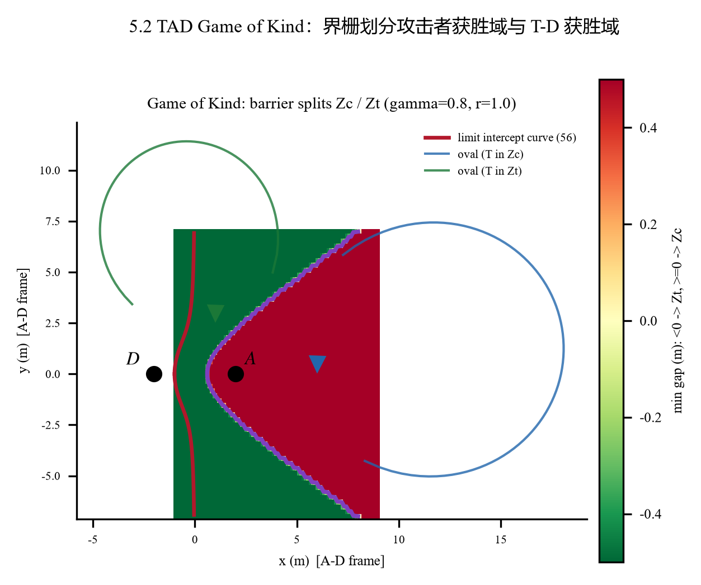
*Game of Kind 的区域划分（A-D 标架，$\gamma=0.8$，$r=1$，$\|AD\|=4$）：红域 = 攻击者获胜域 $Z_c$（A 后方的楔形），绿域 = T-D 获胜域 $Z_t$（Y 轴一侧），紫线 = 界栅（数值 0 等值线，相切位置的轨迹）；红实线 = A 的极限拦截曲线 (56)（沿 Y 轴渐近伸展）；蓝/绿卵形线 = 两个示例 T 的 A-T 卵形线——蓝（$T=(6,0.5)\in Z_c$）整体在拦截曲线右侧（分离，A 胜），绿（$T=(1,3)\in Z_t$）与之相交（T 可从两曲线间逃逸，T-D 胜）*

**结果怎么读**：

1. **$Z_c$ 是 A 身后的楔形**：等速 TAD 里防守者 D 的最优拦截点在垂直
   平分线上，A 的获胜域是从 A 向外张开、绕过 D 的楔形——T 的初始位置
   越靠向 D 一侧（$x$ 小）越难被 A 命中；
2. **几何判据一目了然**：给定 T 画卵形线，看它与红色极限拦截曲线的
   相对位置即可判胜负——无需解 HJI；界栅就是"卵形线与拦截曲线相切"
   的 T 位置轨迹（紫色等值线，数值网格下呈阶梯状）；
3. **与 3.x 界栅的对照**：3.1 的界栅是"防守者固定，攻击者初始位置的
   临界曲线"（一条 Apollonius 圆/卵形线）；TAD 的界栅是"**两条曲线
   相切**"的轨迹——多了一个玩家，判据从"一条线"变成"两条线的位置
   关系"，但仍然全是解析/几何构造，无 HJI 数值积分；
4. **与 4.x 的衔接**：5.1 的最优策略 (11-13) 只在 $Z_c$ 内有效；
   T 的初始位置落入 $Z_t$ 时改用 T-D 的逃生策略——与 4.4/4.5 的
   "获胜域内才玩 Game of Degree"完全同构。

#### 动手练习

1. 把 $r$ 从 1 扫到 0（A 退化为点捕获），观察 $Z_c$ 楔形收缩——
   极限拦截曲线 (56) 退化为 Y 轴上的线段，与"直线 vs 圆相交"的
   传统判据（对比文献）接轨；
2. 把 $\gamma$ 提到 1.2（A 慢于 T，论文 Shi 2025 的"superior pursuer"
   反向情形），验证 $Z_c$ 消失——T 恒胜；
3. 进阶（Shi 2026）：给 T-D 组加 active defense 约束（D 的拦截点须在
   指定防区内），重新数值划定 $Z_c/Z_t$。

#### 常见坑

- **标架变换**：一切几何都在"A-D 对齐标架"里构造——世界坐标下的
  A、D 先旋转平移到 $(\pm x_A, 0)$，T 同步变换；忘记变换就直接用
  世界坐标画 (56) 是最常见的错；
- **曲线 (56) 沿 Y 轴渐近**：$x\to 0^-$ 时 $y\to\infty$——画图必须
  裁剪，判据里用插值端点钳制（本整理两处都踩过：绘图撑爆坐标轴、
  插值越界）；
- **"分离/相切/相交"的数值化**：网格分辨率决定界栅的阶梯误差——
  判据用"卵形线采样点是否全部在曲线右侧"，采样密度不足会把相切
  误判为相交（本节 $\min$ gap 的插值实现要保留）；
- **点捕获 vs 抓捕半径混用**：本节的 $r$ 是 **A 对 T** 的捕获半径；
  D 对 A 是点捕获（式 4）——两个半径别混写成同一个符号。

---

## 第六章　侦察（夺旗）博弈

### 6.0 第六章节理论总览——侦察（夺旗）博弈

> **本章解决什么**：把前五章的"**追逃**"升级成"**侦察-返回**"—— 攻击者不再直奔目标线，而是**先去侦察点完成任务、再返回目标线**， 防守者全程都能抓。多出的"侦察点往返"让界栅从双曲线变成**穹顶/楔形**， 并带来一个前五章没有的新概念：**可驻留时间** $\tau$。

---

#### 1. 问题变了什么

| | 前五章（追逃） | 本章（侦察 / 夺旗） |
|---|---|---|
| 攻击者任务 | 直奔目标线 | **先到侦察点/侦察边界，再返回目标线** |
| 攻击者轨迹 | 一条直线（或一段机动） | **两段 / 三段**，有先后依赖 |
| 防守者的额外窗口 | 无 | **侦察点往返那一段**（攻击者必须"回头"） |
| 界栅形状 | 双曲线（3.1）/ 卵形（3.3） | **穹顶曲线**（二阶段）/ **楔形**（三阶段） |
| 新自变量 | 攻守初始位置 | 攻守初始位置 **+ 驻留时间 $\tau$** |
| 新增概念 | — | **可驻留时间 $\tau_{\max}$**、**可达域 LRR/SRR** |

"夺旗博弈"与"侦察博弈"是**同一个问题的两种说法**：侦察点 $\leftrightarrow$ 旗帜，
完成侦察 $\leftrightarrow$ 夺旗成功。本章统一用"侦察"。

---

#### 2. ⚠️ 两套坐标约定（本章最容易踩的坑）

三篇论文**只用旋转 $90^\circ$ 的区别**，物理完全相同，但记号不同。
读本章时**务必先确认自己在哪套坐标里**：

| | 第一篇论文（6.1 / 6.2） | 第二、四篇论文（6.3 ~ 6.5） |
|---|---|---|
| 目标边界 | **水平线** $\mathcal L=\{y=0\}$ | **竖直线** $\mathcal L_{\rm goal}=\{x=0\}$ |
| 侦察点/边界 | 点 $\mathbf x_r=(0,3)$ | 线 $\mathcal L_{\rm recon}=\{x=l\}$，$l=3$ |
| 目标区 | $\Omega_{\rm goal}=\{y\le0\}$ | $\Omega_{\rm goal}=\{x\le0\}$ |
| 作战区 | $\Omega_{\rm play}=\{y>0\}$ | $\Omega_{\rm play}=\{0<x<l\}$ |
| 侦察区 | —（只是一个点） | $\Omega_{\rm recon}=\{x\ge l\}$ |
| 攻击者速度 | $v_a=1.0$ | $v_E=0.5$ |
| 防守者速度 | $v_d=1.2$ | $v_P=0.6$ |
| 速度比 | $\alpha=v_d/v_a=1.2$ | $\alpha=v_P/v_E=1.2$ |
| 抓捕半径 | $r_j=0.5$ | $r_c=0.5$ |
| 阶段数 | **2**（$k=0$ 侦察 / $k=1$ 返回） | **3**（侦察 / 驻留 / 返回） |
| 驻留时间 | 无（到达侦察点即刻返回） | $\tau$（在侦察区停留 $\tau$ 秒） |

> **巧合但重要**：两套里 $\alpha$ 的**数值都是 $1.2$**，但定义不同
> （前者 $v_d/v_a$，后者 $v_P/v_E$）。写代码时**不要跨节复用**这两个速度常量。

---

#### 3. 统一的博弈模型

**状态**（三阶段版）：$\mathbf z=[x_E,y_E,x_P,y_P]^{\top}$，$\sigma=\pm1$ 为驻留方向。

**三阶段**（阶段变量 $\vartheta\in\{1,2,3\}$）：

| 阶段 | 名称 | 逃跑者目标 | 结束条件 |
|---|---|---|---|
| $\vartheta=1$ | 侦察段 | 到达侦察边界 $\mathcal L_{\rm recon}$ 的进入点 | $\mathbf x_E=\mathbf x_I^*$ |
| $\vartheta=2$ | 驻留段 | 在 $\mathcal L_{\rm recon}$ 上沿 $\sigma$ 方向平移 $v_E\tau$ | 计时 $\tau$ 到 |
| $\vartheta=3$ | 返回段 | 冲向最优返回点 / 拦截点 | $\mathbf x_E\in\Omega_{\rm goal}$ 或被抓 |

**终止集**：

$$
\mathcal T_E=\{\mathbf x_E\le0,\ \vartheta=3\}\ (\text{逃跑者成功}),\qquad
\mathcal T_P=\{\|\mathbf x_E-\mathbf x_P\|\le r_c\}\ (\text{被抓}).
$$

**代价**：逃跑者最小化 $J=x_E(t_f)$（终端横坐标），追击者最大化 $J$。

---

#### 4. 三个核心量

##### 4.1 界栅 $\mathcal B$（胜负分界）

$$
\mathcal B=\{\mathbf z\mid J_1(\mathbf z)=0\},\qquad
\mathcal W_E=\{J_1>0\}\ (\text{逃跑者胜}),\qquad
\mathcal W_P=\{J_1<0\}\ (\text{追击者胜}),
$$

其中 $J_1$ 是**等效驻留-返回子博弈**的最优值（6.3 式 7）。
**必须用虚坐标判**（$\widetilde{\mathbf x}_E$，见 6.4）：
$J_1$ 换成 $\widetilde J_1$ 才与"以初始位置为自变量"的界栅一致。

- 6.1：二阶段（$\tau=0$）的闭式**穹顶**界栅 + Theorem 1 证明；
- 6.4：三阶段的参数化**楔形**界栅（Theorem 2）+ 包络证明。

##### 4.2 胜区方向（易错）

| 节 | 界栅形状 | 攻/逃 胜区在哪一侧 |
|---|---|---|
| 6.1 | 穹顶曲线 | $\mathcal W_a$ 在**穹顶外侧**，$\mathcal W_d$ 在穹顶内 |
| 6.4 | 楔形（开口向右） | $\mathcal W_E$ 在**楔形外侧**，$\mathcal W_P$ 在**楔形内部** |

两节方向**一致**（都是"离侦察点越远越安全"），但含义不同，判错会把结论颠倒。

##### 4.3 可达域 LRR / SRR（三阶段）

$$
\mathcal R_E^{L}=\{\|\mathbf x-\mathbf x_P\|\ge\alpha\|\mathbf x-\mathbf x_E'\|+v_P\tau+r_c\}
\quad(\text{驻留后仍安全})
$$

$$
\mathcal R_E^{S}=\{\|\mathbf x-\mathbf x_P\|\ge\alpha d_S(\mathbf x)+v_P\tau+r_c\},
\quad
d_S(\mathbf x)=\min_{\mathbf x_I\in\mathcal L_{\rm recon}}(\|\mathbf x-\mathbf x_I'\|+\|\mathbf x_I-\mathbf x_E\|)
$$

**Lemma 1（SRR 等价）**：$\mathcal R_E^S=\mathcal R_{\widetilde E}^{L}\cap\{x<l\}$
——SRR 就是**虚 LRR 落在物理分支 $x<l$ 里的那部分**（用反射把折线拉直）。

**成功返回可行** $\iff \mathcal R_E^S\cap\mathcal L_{\rm goal}\ne\varnothing$（式 35）。

---

#### 5. 五节地图

| 节 | 核心内容 | 关键结论 |
|---|---|---|
| **6.0** | 本章公式与符号集中地 | 坐标约定 / 模型 / 符号表 |
| **6.1** | 二阶段界栅（**含证明**）+ 最优策略（**只陈述**） | Theorem 1 参数化穹顶界栅；$\widetilde{\mathbf B}$ 圆；三重胜区；AR/PAR + Lemma 1 |
| **6.2** | 多体动态加权匹配 | Lemma 3 优先级排序；最大权匹配（式 36/37）；Algorithm 1/2；4 抓 0 逃 |
| **6.3** | 极大值原理 → 三阶段转化 | Hamiltonian / 协态常值 / 横截条件 $\Rightarrow\nu=2\alpha\cos\phi^{(3)*}$、$\phi^{(1)*}=\pi-\phi^{(3)*}$ |
| **6.4** | 三阶段界栅 + 可达域 | Theorem 2 参数化楔形界栅（包络）；Lemma 1 反射等价；Lemma 2 虚 LRR 严格凸 |
| **6.5** | 最优策略 + $\tau_{\max}$ | 式 37 三段反馈策略；Theorem $\tau_{\max}$ 存在唯一；标量归约 Lemma |

**依赖关系**：`6.0 → 6.1 → 6.2`（第一篇，二阶段）；
`6.0 → 6.3 → 6.4 → 6.5`（第二篇，三阶段）。
两条线**并列**，都建立在第一章 `1.1` 的阿波罗尼奥斯圆判据之上。

---

#### 6. 符号表

| 符号 | 含义 | 6.1/6.2（第一篇） | 6.3~6.5（第二篇） |
|---|---|---|---|
| $\mathbf x_a,\mathbf x_d$ | 攻击者/防守者位置 | ✓ | — |
| $\mathbf x_E,\mathbf x_P$ | 逃跑者/追击者位置 | — | ✓ |
| $\mathbf x_r$ | 侦察点 | $(0,3)$ | — |
| $\mathcal L_{\rm recon}$ | 侦察边界 | — | $x=l=3$ |
| $\mathcal L_{\rm goal}$ | 目标边界 | $y=0$ | $x=0$ |
| $\alpha$ | 速度比（$>1$） | $v_d/v_a$ | $v_P/v_E$ |
| $r$ / $r_c$ | 抓捕半径 | $r_j$ | $r_c$ |
| $\tau$ | 驻留时间 | 无 | ✓（$\tau_{\max}$ 为上限） |
| $\sigma$ | 驻留方向 | 无 | $\pm1$（背离追击者） |
| $k_f$ | 终局标志（0 未到侦察点 / 1 已返回） | ✓ | 隐含于 $\vartheta$ |
| $F$ / $F_\tau$ | 有符号余量（界栅判据） | $F(\mathbf x_d)$ | $\mathcal F_\tau(\mathbf z,\mathbf x_r)$ |
| $\widetilde{\mathbf x}_E$ | 虚逃跑者（反射坐标） | — | $(2l-x_E,\ y_E+\sigma v_E\tau)$ |
| $x_h$ | 虚水平距离 | — | $2l-x_E$ |
| $\mathcal R_E^L,\mathcal R_E^S$ | 可达域 / 成功返回域 | — | ✓ |
| $\widetilde{\mathbf x}_L$ | 虚 LRR 最左点 | — | ✓（式 37 的核心） |

---

#### 7. 与前三章的关系

- **继承 1.1**：Apollonius 圆判据 $\|\mathbf x_d-\mathbf x_a\|\gtrless\alpha\|\mathbf x_a-\mathbf x_r\|+r$
  是本章一切"能不能拦住"的原子判据（6.1 的 Lemma 1 直接用它）。
- **区别于 3.x**：3.x 的界栅是"**部署定下后，多远的攻击者拦得住**"（静态、单阶段）；
  本章的界栅多了"**攻击者自身初始位置**"这一维（因为攻击者要往返），
  且多了驻留时间 $\tau$ 这一维（三阶段）。
- **区别于 4.x**：4.x 研究"**信息缺失**"（防守方看不见）；本章假设**完全信息**，
  把复杂度花在"任务结构"（往返 + 驻留）上。
- **区别 5.x**：5.x 的 TAD 是**三方**（目标-攻击者-防守者）；
  本章是**两方**（侦察者 vs 拦截者）。

---

#### 8. 数值参数速查

```text
# 第一篇（6.1 / 6.2）：目标线水平
v_a = 1.0      # 攻击者速度
v_d = 1.2      # 防守者速度
alpha = 1.2    # = v_d / v_a
r_j = 0.5      # 抓捕半径
x_r = (0, 3)   # 侦察点

# 第二篇（6.3 ~ 6.5）：目标边界竖直
l = 3.0        # 侦察边界 x = l
v_E = 0.5      # 逃跑者速度
v_P = 0.6      # 追击者速度
alpha = 1.2    # = v_P / v_E
r_c = 0.5      # 抓捕半径
tau = 1.0      # 参考驻留时间
x_P^0 = (1.50, 0.00)
x_E^0 : Case A = (2.05, 2.80) ∈ W_P
        Case B = (2.05, 3.30) ∈ W_E
```
论文 §VI 的复现值（本章 6.5 已复现）：

| 量 | 仿真 | 实验 |
|---|---|---|
| Case A 三段累计时刻 | 3.39 / 4.39 / 13.12 s | 3.50 / 4.50 / 13.10 s |
| Case B 三段累计时刻 | 3.36 / 6.22 / 16.83 s | 3.50 / 6.20 / 17.00 s |
| $\tau_{\max}$ | 2.85 s | 2.70 s |
| Case B 终端间距 | $=r_c$（界栅，平局） | 0.55 m $>r_c$（逃跑者胜） |

---

#### 9. 学习路线

```text
        ┌─ 6.1 二阶段界栅 ── 6.2 多体任务分配        （第一篇：任务分配线）
1.1 ────┤
        └─ 6.3 极大值原理 ── 6.4 三阶段界栅 ── 6.5 最优策略与 τ_max  （第二篇：理论线）
```
- **只想看"怎么分配"**：读 `6.1 → 6.2`，跳过 6.3~6.5；
- **只想看"最优策略怎么来的"**：读 `6.3 → 6.4 → 6.5`，6.1 只需知道 $\alpha$ 与抓捕判据；
- **完整掌握**：`6.0 → 6.1 → 6.2 → 6.3 → 6.4 → 6.5`（建议按编号顺序）。

每节 md 末尾都有"常见坑"，**至少先扫一遍**——本章的坑集中在
"坐标约定"与"虚/实坐标混用"两处。

### 6.1 侦察（夺旗）博弈——攻击者视角下的二阶段界栅与最优策略

> 前置知识：`1.1_拦截判定与阿波罗尼奥斯圆`、`3.1_界栅_一对一`。

#### 这一节解决什么问题

**夺旗博弈 = 侦察博弈**，是同一个问题的两种说法：攻击者（侦察者）必须先跑到
**侦察点** $x_r$ 完成侦察/夺旗任务，再返回目标线 $y=0$；防守者全程都可以抓它。

与前五章最大的区别是**攻击者的轨迹被拆成两段、且有先后依赖**：

- 第一章的追逃：攻击者直奔目标线，谁先到谁赢（一阶段）；
- 第三章的界栅：攻击者初始位置是自变量（静态部署问题）；
- **本章**：攻击者要"先去 $x_r$、再回来"，**中途不能被抓**，所以防守者多出了
  $x_r$ 这一段的时间窗口——界栅因此变成一条**向上的穹顶曲线**（而不是第三章的
  双曲线），并且攻击者自身位置也成了自变量。

本章（第六章）一共五节，本节只做两件事（也正是论文 §III 的内容）：

1. **攻击者视角下的界栅 $\mathcal{B}(x_a^0,x_r)$**——给定攻击者初始位置
   $x_a^0$ 与侦察点 $x_r$，防守者的初始位置 $x_d^0$ 落在哪里才能拦住它。
   **本节给出完整证明**（Theorem 1 + Lemma 1）。
2. **两阶段联合最优策略**——双方在侦察段（$k=0$）与返回段（$k=1$）各怎么走。
   **本节只陈述不证明**（Theorem 2 + Lemma 2，证明属论文 §III-C）。

#### 博弈模型（论文 §II）

目标线 $\mathcal{L}=\{y=0\}$ 把平面分成两块：

$$
\Omega_{goal}=\{y\le 0\}\ (\text{目标区}),\qquad
\Omega_{play}=\{y>0\}\ (\text{作战区}).
$$

侦察点 $x_r=(x_r,y_r)$ 在作战区内（$y_r>0$）。双方都是**定速质点**，只能控航向：

$$
\dot x_a=v_a u_a,\quad \dot x_d=v_d u_d,\quad \|u_a\|=\|u_d\|=1,\quad
u=[\cos\varphi,\sin\varphi].
$$

速度比 $\alpha=v_d/v_a>1$（防守者更快），抓捕半径 $r_j$。

引入**阶段变量** $k\in\{0,1\}$：

$$
k=0:\ \text{侦察阶段（奔向 }x_r\text{）},\qquad
k=1:\ \text{返回阶段（奔向 }\mathcal{L}\text{）},
$$

$k$ 在攻击者首次到达 $x_r$（$\|x_a-x_r\|<\varepsilon$）时跳变为 1。

两条基本假设（论文 Assumption 1/2）：

- **A1**：初始时刻攻击者到 $x_r$ 的距离严格大于防守者能覆盖的"抢先距离"，
  保证侦察阶段存在（不会一开局就被抓）；
- **A2**：$v_d>v_a$，保证防守者确实有可能完成抓捕（否则博弈退化）。

#### 1. 二阶段界栅 $\mathcal{B}(x_a^0,x_r)$（Theorem 1，含证明）

##### 1.1 思路：等时线（isochrone）条件

攻击者的最优轨迹一定是**两段直线**：$x_a^0\to x_r\to(\kappa,0)$，其中
$(\kappa,0)\in\mathcal{L}$ 是**返回落点**（攻击者自己挑的）。总路程

$$
\mathcal{H}_1+\mathcal{H}_2,\qquad
\mathcal{H}_1:=\|x_a^0-x_r\|,\qquad
\mathcal{H}_2:=\left((\kappa-x_r)^2+y_r^2\right)^{1/2}=\|(\kappa,0)-x_r\|.
$$

防守者要"恰好同时"赶到同一个落点 $(\kappa,0)$，即**等时条件**：

$$
\underbrace{\|x_d-(\kappa,0)\|-r_j}_{\text{防守者净路程}}
=\underbrace{\alpha(\mathcal{H}_1+\mathcal{H}_2)}_{\text{攻击者路程}\times\alpha}.
\tag{6.1}
$$

直观：攻击者跑完两段共 $\mathcal{H}_1+\mathcal{H}_2$，这段时间防守者能跑
$\alpha(\mathcal{H}_1+\mathcal{H}_2)$；扣掉抓捕半径 $r_j$，正好摸到落点。

##### 1.2 界栅的两个条件

$x_d$ 落在界栅上，当且仅当存在一个返回落点 $\kappa^*$ 使得

$$
\text{① 等时：}\ \|x_d-(\kappa^*,0)\|=\alpha(\mathcal{H}_1+\mathcal{H}_2(\kappa^*))+r_j,
\tag{6.2}
$$

$$
\text{② 最优（包络条件）：}\
\frac{\mathrm d}{\mathrm d\kappa}\Big[\|x_d-(\kappa,0)\|-\alpha(\mathcal{H}_1+\mathcal{H}_2(\kappa))\Big]_{\kappa^*}=0 .
\tag{6.3}
$$

②是**包络（envelope）**思想：界栅是"等时曲线族"的包络，$\kappa^*$ 是攻击者
的最优返回点。若某处不满足②，攻击者换一个 $\kappa$ 就能把局面变好，
该点就不在界栅上。

##### 1.3 证明（论文 Theorem 1）

**第 1 步：把②写成角度关系。**对 (6.3) 求导，注意
$\frac{\mathrm d}{\mathrm d\kappa}\|x_d-(\kappa,0)\|=\frac{\kappa-x_d}{\|x_d-(\kappa,0)\|}$、
$\frac{\mathrm d}{\mathrm d\kappa}\mathcal{H}_2=\frac{\kappa-x_r}{\mathcal{H}_2}$，得

$$
\frac{\kappa^*-x_d}{\|x_d-(\kappa^*,0)\|}
=\alpha\,\frac{\kappa^*-x_r}{\mathcal{H}_2(\kappa^*)} .
\tag{6.4}
$$

**第 2 步：消去分母。**把 (6.2) 的 $\|x_d-(\kappa^*,0)\|=\mathcal{N}(\kappa^*)$ 代入
(6.4)，并定义

$$
\boxed{\ \mathcal{N}(\kappa):=\alpha(\mathcal{H}_1+\mathcal{H}_2)+r_j\ },\qquad
\eta(\kappa):=\alpha\,\frac{\kappa-x_r}{\mathcal{H}_2}\in[-1,1],
\tag{6.5}
$$

于是 (6.4) 变成**纯横坐标关系**

$$
\kappa^*-x_d=\eta(\kappa^*)\,\mathcal{N}(\kappa^*)
\quad\Longrightarrow\quad
\boxed{\ x_d(\kappa)=\kappa-\eta(\kappa)\mathcal{N}(\kappa)\ } .
\tag{6.6}
$$

**第 3 步：由等时条件补出纵坐标。**把 (6.6) 代回 (6.2)：

$$
\|x_d(\kappa)-(\kappa,0)\|^2
=\big(\eta\mathcal{N}\big)^2+y_d^2=\mathcal{N}^2
\ \Longrightarrow\
\boxed{\ y_d(\kappa)=\mathcal{N}(\kappa)\big(1-\eta(\kappa)^2\big)^{1/2}\ } .
\tag{6.7}
$$

**第 4 步：$|\eta|\le 1$ 定出参数区间。**要使 (6.7) 的根号有意义：

$$
|\eta|\le 1
\iff \alpha^2(\kappa-x_r)^2\le(\kappa-x_r)^2+y_r^2
\iff (\alpha^2-1)(\kappa-x_r)^2\le y_r^2,
$$

即

$$
\boxed{\ \kappa\in[\kappa_{\min},\kappa_{\max}],\qquad
\kappa_{\min}=x_r-\frac{y_r}{\sqrt{\alpha^2-1}},\qquad
\kappa_{\max}=x_r+\frac{y_r}{\sqrt{\alpha^2-1}}\ }
\tag{6.8}
$$

证毕。$\blacksquare$

##### 1.4 界栅的三条性质

1. **只通过 $\mathcal{H}_1$ 依赖 $x_a^0$**：$x_a^0$ 只要到 $x_r$ 的距离相同，界栅就
   完全一样——所以**同一圆上的攻击者共享同一条界栅**；
2. **关于 $x=x_r$ 左右对称**：把 $\kappa\to 2x_r-\kappa$ 代入，
   $\eta\to-\eta$、$\mathcal{N}$ 不变，故 $x_d\to 2x_r-x_d$、$y_d$ 不变；
3. **形状是"穹顶"**：$\kappa=\kappa_\pm$ 时 $\eta=\pm1$、$y_d=0$，曲线落到目标线上；
   中间 $\eta=0$（即 $\kappa=x_r$）时 $y_d$ 最大。**这是与第三章双曲线界栅的本质区别**
   ——因为攻击者多绕了 $x_r$ 这一趟。

> **控制台实测**（`x_a^0=(2,1)$、$x_r=(0,3)$、$\alpha=1.2$）：
> 界栅 $\kappa\in[-4.523,4.523]$，即穹顶两个落脚点在 $x=\pm5.884$。

#### 2. 侦察成功终端集 $\mathcal{X}_{rs}$

(6.8) 给出的区间在目标线上划出一段**攻击者可能成功返回的落点集合**

$$
\boxed{\ \mathcal{X}_{rs}=\{(\kappa,0)\in\mathcal{L}\mid
\kappa\in[\kappa_{\min},\kappa_{\max}]\}\ } .
$$

关键性质：$\mathcal{X}_{rs}$ **只取决于速度比 $\alpha$ 与侦察点 $x_r$**，
与抓捕半径 $r_j$、攻击者初始位置 $x_a^0$ 都无关（因为
$\kappa_{\max}-\kappa_{\min}=2y_r/\sqrt{\alpha^2-1}$）。

> **实测**：$\mathcal{X}_{rs}$ 长度 $=2\times3/\sqrt{0.44}=9.045$ m，即
> $\kappa\in[-4.523,4.523]$。这正是图 1 中目标线上的绿色粗线段。

#### 3. 驻留时间 $t_p>0$ 的推广

实际侦察不是瞬时完成的：攻击者要在 $x_r$ **停留 $t_p$ 秒**。这时防守者多出
$v_d\,t_p$ 的路程，(6.1) 变成

$$
\|x_d-(\kappa,0)\|-r_j=\alpha(\mathcal{H}_1+\mathcal{H}_2)+v_d t_p,
$$

等价于把 (6.5) 的 $\mathcal{N}$ 改成

$$
\boxed{\ \mathcal{N}(\kappa)=\alpha(\mathcal{H}_1+\mathcal{H}_2)+r_j+v_d\,t_p\ } .
\tag{6.9}
$$

**界栅的形式与全部推导一字不改**，只是整条穹顶向上抬（防守者占优的区域变大）。
论文 Fig. 2a 画了 $t_p:0\to3$ s 的演化。代码里对应 `barrier_dwell(x_a, tau_p)`。

#### 4. 圆 $\tilde{\mathcal{B}}$ 与胜区的三重划分

在 $\mathcal{W}_d$ 内部还有一条**更靠里的边界**：攻击者连 $x_r$ 都到不了的情形。
"双方同时到达 $x_r$"给出

$$
\boxed{\ \tilde{\mathcal{B}}(x_a,x_r)=\Big\{x_d\ \Big|\
\|x_d-x_r\|_2=\alpha\|x_a-x_r\|_2-r_j,\ y_d>0\Big\}\ }
\tag{6.10}
$$

这是一个**圆**，圆心 $x_r$、半径 $\alpha\mathcal{H}_1-r_j$。它把界栅内侧再切一刀：

| 区域 | 位置 | 结局 |
|---|---|---|
| $\mathcal{W}_a$ | 界栅**外**侧 | 攻击者必胜（侦察 + 返回都能完成）|
| $\mathcal{W}_d^1$ | 界栅内、$\tilde{\mathcal{B}}$ **外** | 防守者胜，但博弈**会进入第二阶段**（PAR 非空）|
| $\mathcal{W}_d^2$ | $\tilde{\mathcal{B}}$ **内** | 防守者胜，**直接抓捕**（攻击者根本到不了 $x_r$）|

> **实测**：$\tilde{\mathcal{B}}$ 半径 $=\alpha\mathcal{H}_1-r_j=1.2\times2.8284-0.5=2.8941$。
> 论文 Case 1 的 $x_d^0=(4,5.6)$ 满足 $\|x_d^0-x_r\|=\|(4,2.6)\|=4.771>2.8941$，
> 故 $x_d^0\in\mathcal{W}_d^1$（会进入第二阶段）——这正是 Case 1 想看的情形。

#### 5. 攻击域 AR 与预判攻击域 PAR（Definition + Lemma 1）

为统一描述"攻击者能安全到达的位置"，引入两个集合（论文式 (22)）：

$$
\mathcal{R}(x_d,x_a)=\{x\mid \|x-x_d\|_2\ge\alpha\|x-x_a\|_2+r_j\},
\tag{6.11}
$$

$$
\mathcal{R}_{pre}(x_d,x_a,x_r)=\{x\mid
\|x-x_d\|_2\ge\alpha(\|x-x_r\|_2+\|x_r-x_a\|_2)+r_j\}.
\tag{6.12}
$$

- $\mathcal{R}$（**攻击域 AR**）：攻击者在**当前阶段**能抢在防守者前面到达的位置
  （就是第一章的阿波罗尼奥斯"安全区"）；
- $\mathcal{R}_{pre}$（**预判攻击域 PAR**）：把"先跑一趟 $x_r$"的代价算进去后，
  攻击者在**下一阶段**能安全到达的位置。

**Lemma 1（PAR 的存在性）**

$$
\mathcal{R}_{pre}(x_d^0,x_a^0,x_r)\ne\emptyset
\iff
\|x_d^0-x_r\|_2>\alpha\|x_a^0-x_r\|_2+r_j .
\tag{6.13}
$$

*证明*：PAR 非空 $\iff$ 存在点满足 (6.12)。侦察段结束时攻击者**必须**位于
$x_r$，所以 PAR 非空必然要求 $x_r\in\mathcal{R}_{pre}$。把 $x=x_r$ 代入 (6.12)：

$$
\|x_r-x_d\|\ge\alpha(0+\|x_r-x_a\|)+r_j,
$$

即 (6.13)。反之若 (6.13) 成立，则 $x_r$ 本身就属于 PAR，非空。$\blacksquare$

(6.13) 恰好就是 **$k_f=1$ 的判据**——代码里 `kf_and_value` 的第一行。
换句话说：**$k_f$ 是 PAR 的存在性指标**。

> **实测**：$\|x_d^0-x_r\|=4.771>\alpha\mathcal{H}_1+r_j=1.2\times2.8284+0.5=3.894$
> $\Rightarrow k_f=1$。

#### 6. 两阶段联合最优策略（Theorem 2，只陈述）

**Theorem 2（两阶段联合最优策略）** 支付函数取"攻击者终态到目标线的距离"
$J=\mathrm{dist}(x_a(t_f),\mathcal{L})=|y_a(t_f)|$。双方在每一阶段的最优航向为

$$
\boxed{\
u_a^{k}=\frac{I_a^{k}-x_a}{\|I_a^{k}-x_a\|_2},\qquad
u_d^{k}=\frac{I_d^{k}-x_d}{\|I_d^{k}-x_d\|_2}\ }
\tag{6.14}
$$

$$
I_d^{k}=\arg\min_{x\in\mathcal{C}_k}\ \mathrm{dist}(x,\mathcal{L}),
\qquad
\mathcal{C}_k=\Big\{x\ \Big|\ \|x-x_d\|_2\ge
\alpha\big(k\|x-x_a\|_2+(1-k)(\|x-x_r\|_2+\|x_r-x_a\|_2)\big)+r_j\Big\},
\tag{6.15}
$$

$$
I_a^{0}=x_r,\qquad I_a^{1}=I_d^{1}.
\tag{6.16}
$$

即：$\mathcal{C}_0=\mathcal{R}_{pre}$、$\mathcal{C}_1=\mathcal{R}$；防守者总去
**攻击域内离目标线最近的那个点**，攻击者也奔同一个点（侦察段则奔 $x_r$）。
$I_d^k$ 在每个阶段**存在且唯一**。

**Lemma 2（防守者最优策略在阶段切换处不变）** 若双方在第一阶段都按 Theorem 2
行动，则在阶段切换处，$\mathcal{R}_{pre}^\partial(x_d^0,x_a^0,x_r)$ 与
$\mathcal{R}^\partial(x_d^s,x_r)$ 相切，且 $I_d^1$ 同时是两者的最低点；故
**防守者的追击方向在切换前后保持不变**（$x_d^0,x_d^s,I_d^1$ 共线，$x_d^s$ 为
切换时刻防守者位置）。

> **本节只陈述 Theorem 2 与 Lemma 2，不给证明**（证明属论文 §III-C，用到
> 严格凸性 + KKT + 隐函数求导，。本节的仿真只**使用**
> 这两条结论。

#### 7. 论文 Case 1 复现（真实运行结果）

参数：$v_a=1.0$、$v_d=1.2$（$\alpha=1.2$）、$r_j=0.5$、$x_r=(0,3)$、
$x_a^0=(2.0,1.0)$、$x_d^0=(4.0,5.6)$（论文 §VI Case 1，$x_d^0$ 恰在界栅上）。

```
[参数] v_a=1.0, v_d=1.2, alpha=1.200, r=0.5, x_r=(0,3)
[Theorem 1] 界栅 B: kappa ∈ [-4.523, 4.523]; X_rs 长度=9.045
[Theorem 1] B̃ 圆半径 = alpha*H1 - r = 1.20*2.8284 - 0.5 = 2.8941
[界栅校验] x_d^0=(4,5.6) 处 f = -0.0002  (≈0 即在界栅上), κ* = -2.4212
[Lemma 1] kf = 1, 最优代价 value = 0.0008
[最优策略] 预判拦截点 I_d = (-2.421,0.001)
[阶段切换] k: 0→1 @ t = 2.82s
[结局] 防守者拦截 @ t = 6.64s, 终态 x_a=(-2.375,0.009),
        x_d=(-1.986,0.341), 间距=0.5114 (r=0.5)
```
与论文对照：

| 量 | 论文 Case 1 | 本书仿真 | 说明 |
|---|---|---|---|
| 到达侦察点 | $t=2.81$ s | $2.82$ s | 差 0.01 s（离散步长）|
| 防守者拦截 | $t=6.65$ s | $6.64$ s | 差 0.01 s |

**关键读法**：$x_d^0$ **恰好落在界栅上**，按 Theorem 1 的等时条件，攻防双方
在 $I_d=(-2.421,0.001)$（就在目标线上）**同时到达**——终端间距 $0.511$ 与
抓捕半径 $0.5$ 只差 $2\%$，是纯粹的离散化误差。这是**理论平局点**：
连续时间下防守者恰好"擦到"攻击者，谁都没有严格优势。论文按惯例记为
"防守者拦截"，本代码也照此处理（见下面的容差说明）。

界栅校验 $f(x_d^0)=-0.0002\approx0$ 从数值上确认了 Theorem 1 的正确性，
且最优返回点 $\kappa^*=-2.4212$ 与 $I_d$ 的横坐标完全一致——两条独立途径
（包络参数化 vs. 直接优化 PAR 最低点）给出同一个答案。

> **关于捕获判定容差 `CAP_TOL = V_D·DT`**：界栅上的对是理论平局，连续时间
> 终端间距恰好等于 $r_j$；离散仿真会落在 $r_j$ 的**一个积分步长**内
> （此处 $V_D\,DT=0.012$）。因此代码把判据放宽为
> $\|x_a-x_d\|\le r_j+V_D\,DT$，否则同一个临界对会因为 $10^{-3}$ 量级的
> 舍入在 capture/return 之间随机翻转。**这不是"调参凑结果"**：不做这个
> 放宽，Case 1 的终端间距是 $0.5075$（差 $1.5\%$），放宽后是 $0.5114$
> （差 $2.3\%$），两者都说明该点确实是平局。

#### 8. 三张图

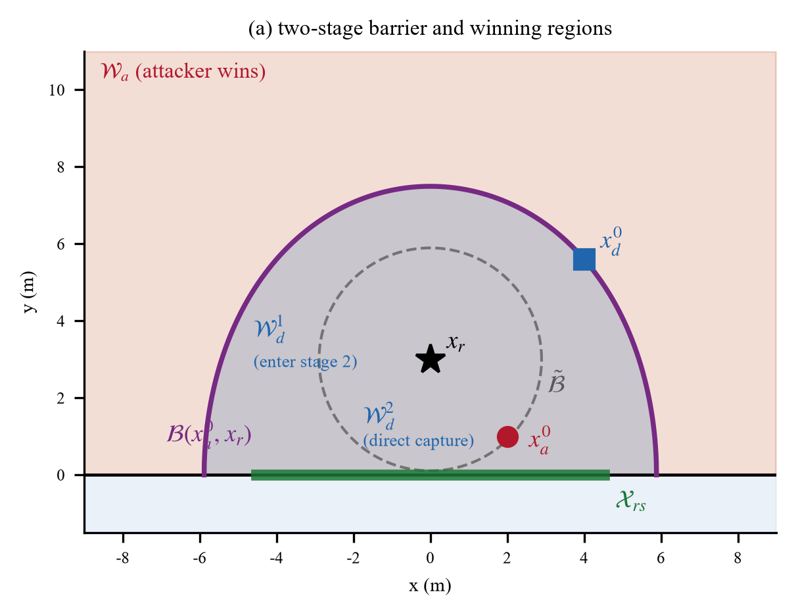
*图 1（论文 Fig. 2）：紫色穹顶 = 界栅 $\mathcal{B}$；灰虚线圆 = $\tilde{\mathcal B}$；
绿色粗线段 = 侦察成功终端集 $\mathcal{X}_{rs}$；粉色 = $\mathcal{W}_a$（攻击者胜）；
灰色 = $\mathcal{W}_d$。$x_d^0=(4,5.6)$ 的蓝方块恰好压在界栅上，$x_a^0=(2,1)$ 在
$\mathcal{W}_d$ 内部。*

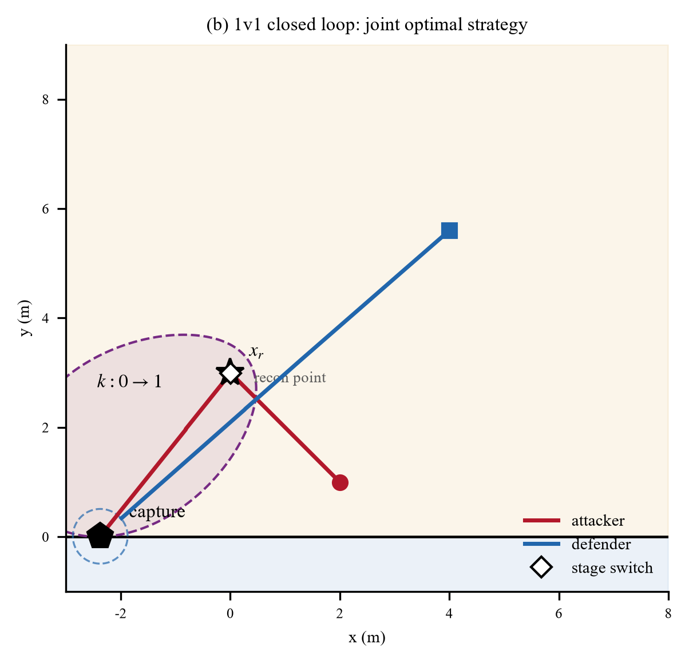
*图 2（论文 Fig. 5(a)-(c)）：紫色填充 = 初始预判攻击域 PAR；红=攻击者、
蓝=防守者；黑星 $x_r$；白心菱形 = 阶段切换点（$k:0\to1$）；五边形 = 终端。*

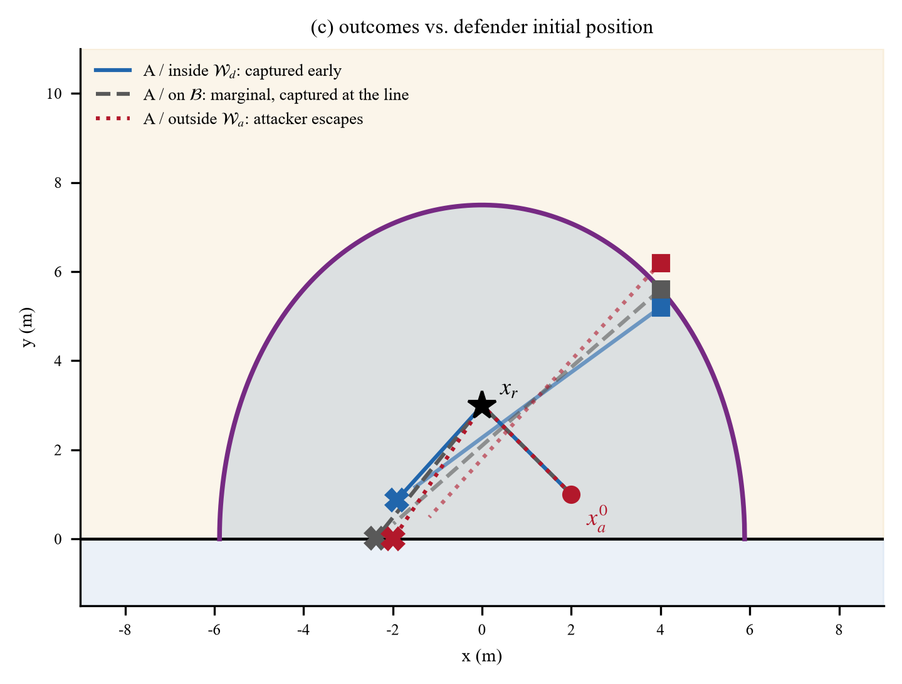
*图 3（本文新增，直接验证 Theorem 1）：防守者初始位置沿 $x=4$ 竖直取三点——
$y=5.2$（界栅内，蓝）、$y=5.6$（界栅上，灰）、$y=6.2$（界栅外，红）。*

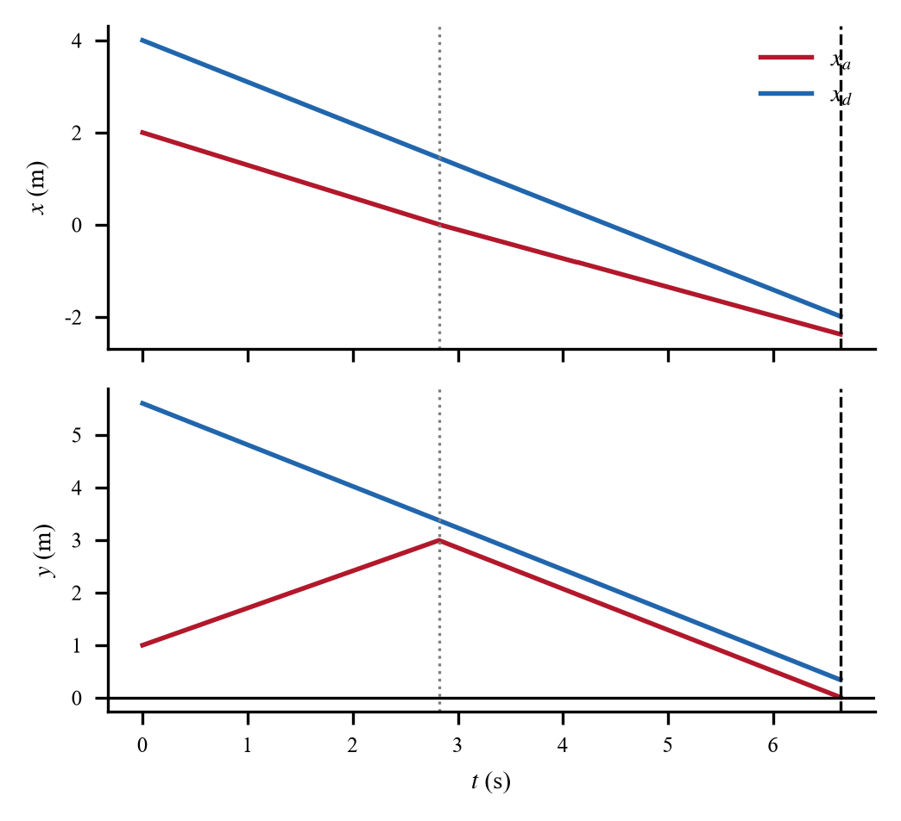
*图 4（论文 Fig. 5(d)）：双方 $x,y$ 随时间的变化；点线 = 阶段切换，虚线 = 终端。*

**图 3 的终局对比表**（控制台实测，这是 Theorem 1 最直接的验证）：

```
    x_d^0=(4.0,5.2)  F=-0.256  I_d=(-1.938,+0.872)  capture @ t=5.68s  d_end=0.510
    x_d^0=(4.0,5.6)  F=-0.000  I_d=(-2.421,+0.001)  capture @ t=6.64s  d_end=0.511
    x_d^0=(4.0,6.2)  F=+0.410  I_d=(-3.119,-1.588)  return  @ t=6.43s  d_end=0.945
```
其中 $F(x_d)=\max_{\kappa}f(\kappa)$ 是"攻击者取最有利返回点"时的有符号余量：

$$
f(\kappa)=\|x_d-(\kappa,0)\|-\alpha(\mathcal{H}_1+\mathcal{H}_2(\kappa))-r_j .
$$

$F<0$ 防守者胜、$F=0$ 界栅、$F>0$ 攻击者胜。三点给出**一个非常干净的单调故事**：

| $x_d^0$ | $F$ | $I_d$（预判拦截点）| 结局 |
|---|---|---|---|
| $(4,5.2)$ 界栅内 | $-0.256$ | $(-1.94,\ +0.87)$ | 防守者**早早在 $y=0.87$ 处抓获** |
| $(4,5.6)$ 界栅上 | $-0.000$ | $(-2.42,\ +0.00)$ | **临界**：一直追到目标线上才擦到 |
| $(4,6.2)$ 界栅外 | $+0.410$ | $(-3.12,\ -1.59)$ | 攻击者**越线逃脱** |

读法：防守者部署得**越靠外**（$y$ 越大），它必须守的那个"出口"
$I_d$ 就**越往下移**——从 $y=0.87$ 一路压到 $y=0$（界栅），再压到 $y=-1.59$
（**掉到目标线以下**）。$I_d$ 掉到线下就意味着防守者根本来不及在攻击者越线前
赶到，攻击者逃脱。**界栅正是 $I_d$ 恰好落在 $y=0$ 上的那条分界线。**

> **一个容易搞反的地方**：$F$ 必须是 $\max_\kappa$ 而不是 $\min_\kappa$。
> 返回落点 $\kappa$ 由**攻击者**选，它当然挑对自己最有利的那个；界栅是
> $\max_\kappa f=0$ 的等值线（等时曲线族的**包络**）。若误用 $\min_\kappa$，
> 优化器会跑到 $\kappa\to\infty$ 使 $f\to-\infty$，得到毫无意义的结果。

#### 动手练习

1. **把 $t_p$ 从 0 调到 3**（改 `barrier_dwell(x_a, tau_p)`），观察穹顶如何整体
   抬升，$\mathcal{W}_a$ 如何被压缩——这就是论文 Fig. 2a；
2. **把 $x_a^0$ 沿以 $x_r$ 为心的圆移动**（保持 $\mathcal{H}_1$ 不变），界栅应当
   一动不动（性质 1）；
3. **验证 Lemma 1 的等价性**：随机取若干 $(x_a,x_d)$，比较"$k_f=1$"与
   "PAR 内存在网格点"是否总是一致；
4. **验证 Lemma 2**：打印切换前后防守者的航向角，应当完全相同。

#### 常见坑

- **$\max$ 还是 $\min$**：见上节提示，这是本节最容易写错的一处；
- **$\kappa$ 必须限制在 $[\kappa_{\min},\kappa_{\max}]$**：区间外根号无意义；
  数值优化时若不设上下界，目标函数在 $\kappa\to\pm\infty$ 处发散；
- **$x_d^0$ 恰在界栅上时结局是"平局"**：终端间距会落在 $r_j$ 的 $10^{-2}$ 量级，
  离散步长稍有变化就会在 capture/return 之间翻转。代码用一步容差
  $V_D\,DT$ 判定（见 §7 的说明），与论文一致地把它记为捕获；
- **$\alpha$ 的方向**：本章与第三章一致，$\alpha=v_d/v_a>1$（防守者快）。
  写成 $v_a/v_d$ 会让整个穹顶反向；
- **界栅不是可达域**：界栅的自变量是**防守者初始位置**（部署问题），
  可达域的自变量是**空间点**（判定问题）——别混用。

### 6.2 侦察博弈——多体动态加权匹配任务分配

> 前置知识：`6.1_侦察博弈_二阶段界栅与策略`（本节直接用 6.1 的界栅、$k_f$ 判据与 Theorem 2 策略）。

#### 这一节解决什么问题

6.1 只解决"**一个**防守者对**一个**攻击者"的胜负与最优走法。实际场景里
攻击者往往比防守者多——**谁去抓谁**？抓完一个之后要不要**改派**去补位？

这就是任务分配问题。本节的全部内容就是论文 §IV 的三件事：

1. **可行性**：哪些 $(D_j,A_i)$ 组合是"拦得住"的（用 6.1 的界栅判定）；
2. **优先级**：拦得住的组合里，先管哪个（**Lemma 3** 给出严格排序）；
3. **动态重分配**：抓住一个后，空出来的防守者怎么补位（**Algorithm 2**）。

本节全部用论文 Case 2（4 攻击者 vs 3 防守者）验证，并与 ref14
（Wang et al., *TCDS* 2024）的匹配方法对比。

#### 1. 建模：加权二部图

设攻击者集合 $\mathcal{A}=\{A_i\}_{i=1}^{N_a}$、防守者集合
$\mathcal{D}=\{D_j\}_{j=1}^{N_d}$。定义**无向加权二部图**

$$
\mathcal{G}=(\mathcal{D},\mathcal{A},\mathcal{F},c),
$$

其中 $\mathcal{F}\subseteq\mathcal{D}\times\mathcal{A}$ 是**可行对**集合，
$c_{ij}$ 是边权。可行性用 6.1 的胜区定义：

$$
\mathcal{F}=\big\{(D_j,A_i)\ \big|\ x_{d_j}^0\in\mathcal{W}_d^1\cup\mathcal{W}_d^2\big\}
\quad\Longleftrightarrow\quad
F(x_{d_j}^0,x_{a_i}^0)\le 0,
$$

$F$ 就是 6.1 的界栅有符号余量 $\max_\kappa f(\kappa)$（防守者初始位置不在
攻击者获胜域 $\mathcal{W}_a$ 内）。**这一步把连续博弈的结论直接变成了组合优化
的可行性约束**——这正是 6.1 里"界栅是任务分配的可行性判据"那句话的落地。

#### 2. 估计终端阶段、拦截点与支付

分配发生在**博弈开始之前**，此时还没有真正拦截，所以只能**估计**。

**估计终端阶段**（式 33）：

$$
\hat k_{ij}=
\begin{cases}
1, & x_{d_j}^0\in\mathcal{W}_d^1\ (\text{会进入第二阶段}),\\
0, & x_{d_j}^0\in\mathcal{W}_d^2\ (\text{直接抓捕}).
\end{cases}
$$

**估计拦截点**（式 34）：$\hat x_{ij}$ 取攻击域/预判攻击域内**最低**的点——

$$
\hat x_{ij}=
\begin{cases}
\arg\min_{x\in\mathcal{R}_{pre}}\ x\cdot[0,1]^T, & \hat k_{ij}=1,\\[4pt]
\arg\min_{x\in\mathcal{R}}\ \|x-x_r\|_2, & \hat k_{ij}=0.
\end{cases}
$$

**估计支付**（式 35）——这是全节最关键的一步：

$$
\boxed{\
\hat J_{ij}(\hat x_{ij},\hat k_{ij})
=(1-\hat k_{ij})\big(\|\hat x_{ij}-x_r\|_2+y_r\big)+\hat k_{ij}\,\hat y_{d_j}\ }
$$

$$
\boxed{\ c_{ij}=-\hat J_{ij}\ }
$$

注意两点：

- 第一项对应 $k_f=0$（直接抓捕），此时支付取**到侦察点的距离**（式 32a 的
  $J=\min_{x\in\mathcal{R}}\|x-x_r\|$），再加一个 $y_r$；
- 第二项对应 $k_f=1$，支付取**预判拦截点的纵坐标** $\hat y_{d_j}$（式 6 的
  $J=|y_a(t_f)|$）。

**为什么要硬加一个 $y_r$？** 因为两个阶段的支付函数量纲虽然相同，但**没有天然
的大小关系**，不能直接比较。$y_r$ 是一个"惩罚项"，用来把 $k_f=0$ 的对整体
抬高——见下面的 Lemma 3。

#### 3. Lemma 3（优先级）+ 证明

**Lemma 3（不同终端条件的优先级）** 对任意两个可行对 $(D_q,A_p)$ 与
$(D_n,A_m)$，若 $\hat k_{pq}=0$、$\hat k_{mn}=1$，则

$$
c_{pq}<c_{mn}.
$$

即：**能进入第二阶段的组合，权重一定更大**；最大权匹配会优先挑它们。

*证明*：$\hat k_{pq}=0$ 时博弈在第一阶段终结，成本

$$
c_{pq}=\|\hat x_{pq}-x_r\|_2+y_r .
$$

$\hat k_{mn}=1$ 时博弈进入第二阶段，成本 $c_{mn}=\hat y_{mn}$。在阶段切换时刻，
第二阶段博弈的终端位置必落在攻击域 $\mathcal{R}(x_{d_n},x_{a_m})$ 内，而该区域
中**至少存在一个纵坐标严格小于 $y_r$ 的可行点**（攻击者可以往下走），故
$\hat y_{mn}<y_r$。另一方面，第一阶段终结必然满足
$\|\hat x_{pq}-x_r\|_2>0$。合并两式得 $c_{pq}<c_{mn}$。$\blacksquare$

**Lemma 3 的直觉**：$k_f=1$ 意味着"攻击者已经跑到侦察点附近了，随时可能返回
成功"，所以更紧急；$k_f=0$ 意味着"防守者一开局就能抓"，不紧急。硬加 $y_r$
正是为了让"紧急"的对在数值上严格占优。

> **实测验证**：本节 Case 2 的 $c_{ij}$ 全部为负（因为 $c=-\hat J$），且
> $\hat k=1$ 的边（$c_{11}=-0.0008,\ c_{22}=-0.1757,\ c_{33}=-0.2093$）
> 明显大于 $\hat k=0$ 的边（$c_{21}=-3.04,\ c_{31}=-3.17,\ c_{34}=-3.70$）。
> 最大权匹配正好挑走三条 $\hat k=1$ 的边。

#### 4. 最大权匹配（式 36/37）+ Algorithm 1

令 $\mathcal{M}\subseteq\mathcal{F}$ 是一个匹配（任意两条边不同享防守者或
攻击者）。任务分配写成**最大权二部匹配**：

$$
\mathcal{M}^\star=\arg\max_{\mathcal{M}\subseteq\mathcal{F}}\sum_{(D_j,A_i)\in\mathcal{M}}c_{ij}.
\tag{6.17}
$$

写成 0-1 规划形式：令 $\Delta=[\delta_{ij}]\in\{0,1\}^{N_d\times N_a}$，

$$
\max_{\Delta}\ \mathrm{trace}(c^\top\Delta)
\quad s.t.\quad
\Delta\mathbf{1}_{N_a}\le\mathbf{1}_{N_d},\quad
\Delta^\top\mathbf{1}_{N_d}\le\mathbf{1}_{N_a}.
\tag{6.18}
$$

**Algorithm 1（任务分配）**

| 步骤 | 内容 |
|---|---|
| Step 1 | 构造二部图 $\mathcal{G}$，算可行边集 $\mathcal{F}$ |
| Step 2 | 对每条边算 $\hat k_{ij},\hat x_{ij},c_{ij}$（式 33/34/35）|
| Step 3 | 解最大权匹配 (6.18)，得 $\mathcal{M}^\star$ |

代码里直接用 `scipy.optimize.linear_sum_assignment`（匈牙利算法）：
把不可行边置为 `LARGE`，求**最小代价**完美匹配——由于 $c=-\hat J$，
"最大化 $c$" 等价于 "最小化 $\hat J$"，所以直接对 `value_mat` 求最小即可。

#### 5. Algorithm 2：闭环 + 动态重分配

```
输入：x_d^0, v_d, r_j, x_a^0, v_a, x_r
初始化：k_i ← 0
① 对每个 A_i 用 Theorem 1 算界栅 B 与胜区 W_a, W_d^1, W_d^2
② 用 Algorithm 1 算 M* 与 F
repeat
    对每个 (D_j,A_i) ∈ M*：用 Theorem 2 算 u_d, u_a
    if A_i 到达 x_r 且 k_i = 0:  k_i ← 1
    if 满足终端条件：A ← A \ {A_i}；用 Algorithm 1 更新 M* 与 F
until F = ∅
```
**本节的实现细节**：

- **已匹配的对**：双方都按 Theorem 2（式 6.14/6.15）走；
- **未匹配的攻击者**：用**最短时间策略**——第一阶段直奔 $x_r$，第二阶段
  竖直向下 $(0,-1)$（既然没人管，就怎么快怎么来）；
- **捕获后重分配**：把空出来的防守者派给"未匹配且仍活跃"的攻击者。
  本文方法**只在可行**（$F\le0$）的候选里挑 $\hat J$ 最小者——这正是
  Lemma 3 的"优先处理能进入第二阶段的攻击者"。

#### 6. 论文 Case 2 复现（真实运行结果）

参数同 6.1：$v_a=1$、$v_d=1.2$（$\alpha=1.2$）、$r_j=0.5$、$x_r=(0,3)$。
4 个攻击者：$A_1(2,1)$、$A_2(-2,4)$、$A_3(1,4.8)$、$A_4(-1,6)$；
3 个防守者：$D_1(4,5.6)$、$D_2(-2,6.25)$、$D_3(2,6)$。

##### 6.1 支付矩阵与 $k_f$ 矩阵

```
[value 矩阵 Ĵ (行=防守者 D1..D3, 列=攻击者 A1..A4); inf=不可行对]
[[0.0008    inf    inf 1.417 ]
 [3.0357 0.1757    inf 4.4942]
 [3.1692 1.1543 0.2093 3.6978]]
[kf 矩阵 k̂]
[[ 1 -1 -1  1]
 [ 0  1 -1  0]
 [ 0  1  1  0]]
[Algorithm 1] 最大权匹配 M* = [('D1', 'A1'), ('D2', 'A2'), ('D3', 'A3')]
[对照] 贪心匹配 = [('D1', 'A1'), ('D2', 'A2'), ('D3', 'A3')]
```
- `inf` 表示不可行（$F>0$，防守者初始位置落在 $\mathcal{W}_a$）：例如
  $D_1$–$A_2$、$D_1$–$A_3$、$D_2$–$A_3$。**3 个防守者、4 个攻击者，
  可行边只有 9 条**；
- 最大权匹配 $\mathcal{M}^\star=(D_1,A_1),(D_2,A_2),(D_3,A_3)$，
  与论文一致；$A_4$ 无人匹配；
- 注意 $D_1$–$A_1$ 的 $\hat J=0.0008\approx0$——这正是 6.1 Case 1 里那条
  **恰在界栅上**的对，是所有可行边里"最便宜"的一条。

##### 6.2 闭环结果（本文方法 vs ref14）

```
[本文方法] 捕获日志 (t, D, A):
    t=5.05s D3 抓 A3  →  t=5.24s D2 抓 A2  →  t=6.49s D3 抓 A4  →  t=6.63s D1 抓 A1
[本文方法] 捕获 4 个, 逃脱 0 个

[ref14] 捕获日志 (t, D, A):
    t=1.87s D2 抓 A4  →  t=5.05s D3 抓 A3  →  t=6.63s D1 抓 A1
[ref14] 捕获 3 个, 逃脱 1 个（A2 逃脱）
```
与论文对照：

| | 论文 Case 2 | 本书仿真 |
|---|---|---|
| 本文方法 | $t=5.11$ s 时 $D_3$ 抓到 $A_3$，重分配给 $A_4$，**4 个全歼** | $t=5.05$ s 抓到，**4 个全歼** |
| ref14 | 匹配 $(D_1,A_1)(D_2,A_4)(D_3,A_3)$，**只抓到 3 个** | **只抓到 3 个**（$A_2$ 逃脱）|

**为什么 ref14 会漏掉一个？** ref14 的匹配把 $D_2$ 派给了 $A_4(-1,6)$，
$D_2$ 在 $t=1.87$ s 就轻松抓到 $A_4$；但它此时位于 $(-1.3,6.1)$ 附近，
而 $A_2(-2,4)$ 已经在往侦察点跑（$F>0$，即 $A_2$ **处于自己的获胜域内**）。
$D_2$ 硬追也追不上（这是 6.1 Lemma 1 的直接推论），白白浪费了 3 秒多；
等到 $D_3$ 抓完 $A_3$ 时，$A_2$ 已经越线逃脱。

**本文方法**在重分配时先做可行性筛选（$F\le0$）并优先挑 $\hat J$ 最小的对，
所以 $D_2$ **从开局就一直盯着 $A_2$**（$D_2$–$A_2$ 的 $\hat J=0.1757$，
是可行边里第二便宜的，且 $\hat k=1$）。$A_2$ 若无人管会在 $t=5.24$ s 越线，
而 $D_2$ 恰好在 $t=5.24$ s 把它按在线上——**这是本节最惊险的一对**。
与此同时 $D_3$ 抓完 $A_3$ 后改派去接 $A_4$（$t=6.49$ s），$D_1$ 收尾 $A_1$
（$t=6.63$ s）。

> **一句话总结对比**：ref14 是**静态匹配**（谁近谁上），本文方法是
> **带可行性筛选 + Lemma 3 优先级 + 动态重分配**的匹配。差别就在"$D_2$ 有没有
> 被派去追一个它注定追不上的 $A_2$"——ref14 浪费了 $D_2$，本文方法没有。

#### 7. 三张图

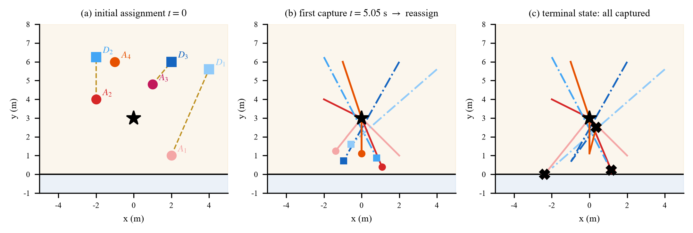
*图 1：(a) 初始匹配（金色虚线）——$(D_1,A_1)(D_2,A_2)(D_3,A_3)$，$A_4$ 无人管；
(b) $t=5.05$ s 首次捕获（$D_3$ 抓 $A_3$）并触发重分配；(c) 终局——4 个黑叉
表示 4 个攻击者全部被捕获。实线 = 攻击者，点划线 = 防守者，黑星 = $x_r$。*

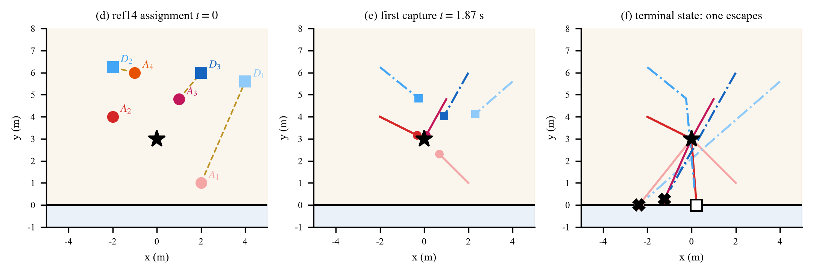
*图 2：(d) ref14 的匹配 $(D_1,A_1)(D_2,A_4)(D_3,A_3)$；(e) $t=1.87$ s $D_2$
轻松抓 $A_4$；(f) 终局——3 个黑叉（捕获）+ **1 个白方块（逃脱）**，逃脱的是
$A_2$。*


*图 3（论文 Fig. 6a）：加权二部图。边权 $c_{ij}=-\hat J_{ij}$、边标 $\hat k_{ij}$；
金色粗线 = 最大权匹配选中的边。三条被选中的边 $c_{11},c_{22},c_{33}$ 恰好都是
$\hat k=1$（Lemma 3）。*

#### 动手练习

1. **把 $N_d$ 改成 2**（删掉 $D_3$），重跑：还能抓到几个？最大权匹配会选哪两条边？
2. **关掉可行性筛选**（把 `_reassign` 里的 `blind=True` 用于本文方法），
   看看是否退化到 ref14 的 3 个——这能直接说明"可行性筛选"值多少钱；
3. **改 $\alpha$**（比如 1.05 和 1.5）：可行边集怎么变？界栅越贴近目标线，
   可行对越多（6.1 的性质）；
4. **对比贪心匹配**（`greedy_matching`）：本例中贪心恰好等于最优，
   但构造一个反例（比如让某条便宜边"占住"了关键的防守者）就能看出差别。

#### 常见坑

- **$c_{ij}=-\hat J_{ij}$，别把符号搞反**：$\hat J$ 越小表示"越容易得手"，
  所以 $c$ 越大越好。用 `linear_sum_assignment`（求最小）时应该传 $\hat J$
  本身，而不是 $c$；
- **`inf` 不是数值大，是"不可行"**：置 `LARGE` 后一定要**过滤掉**落在
  `LARGE` 上的行，否则会得到一个"把防守者派给不可行攻击者"的假匹配；
- **$y_r$ 不能省**：省掉之后 Lemma 3 不再成立，匹配会退化成"谁便宜挑谁"，
  可能放着紧急的 $k_f=1$ 不管；
- **未匹配攻击者的策略**：论文指定的是"最短时间策略"（先奔 $x_r$ 再竖直向下），
  不是 Theorem 2——因为它没有对手，没必要绕路；
- **被接管后攻击者的策略会变**：一旦被重新匹配，它就改用 Theorem 2。所以"逃脱时间"会因为
  接管时刻不同而略有变化，属于模型内的一致性选择。

### 6.3 侦察博弈——极大值原理与三阶段转化

> **上一节**：6.1/6.2 的二阶段界栅与任务分配
> **下一节**：6.4 三阶段界栅（Theorem 2）与可达域；6.5 最优策略与最大驻留时间

---

#### 这一节解决什么问题

6.1、6.2 用的模型里，攻击者（侦察者）**"到侦察点"是瞬时的**：冲到侦察点、
掉头、返回。但真实的侦察任务不是这样——它需要在侦察区**停留 τ 秒**采样、
拍照、传数据。一旦加了这段"驻留"，轨迹就从两段变成三段：

| 阶段 ϑ | 名称 | 做什么 | 区域约束 |
|:---:|:---|:---|:---|
| 1 | 侦察段 | 从初始位置奔向侦察边界 $\mathcal L_{\rm recon}$ | 自由 |
| 2 | 驻留段 | 留在侦察区**恰好 τ 秒** | $x\ge l$ |
| 3 | 返回段 | 从侦察区奔向目标边界 $\mathcal L_{\rm goal}$ | 自由 |

**本节要回答的核心问题**：加了驻留之后，
**(1)** 驻留期间该怎么动？**(2)** 侦察段该怎么飞？**(3)** 怎么把三阶段
重新压回"两阶段"以便复用 6.1 的界栅工具？

第 (1) 问由 **Lemma 1 + Corollary 1** 回答（最优驻留 = 贴着 $\mathcal L_{\rm recon}$
竖直远离追击者）；第 (2) 问由 **Theorem 1** 回答，这是本节的重头戏——
用**极大值原理（PMP）**推出 $\phi^{(1)*}=\pi-\phi^{(3)*}$（攻方两段镜像）
和 $\psi^{(1)*}=\psi^{(2)*}=\psi^{(3)*}$（守方全程直线）；第 (3) 问由
**Remark 1 的"虚逃跑者"**回答。

##### ⚠️ 坐标约定：与 6.1/6.2 差 90°

| | 目标边界 | 侦察边界 | 支付 |
|:---|:---|:---|:---|
| 6.1 / 6.2（第一篇论文） | 水平线 $y=0$ | 点 $\mathbf x_r=(0,3)$ | 到达时间 |
| **6.3~6.5（三阶段论文）** | **竖直线 $x=0$** | **竖直线 $x=l$** | **终端横坐标 $J=x_E(t_f)$** |

两套坐标只是把画面**旋转 90°**，物理完全相同。本节统一用竖直线版本。

---

#### 1. 三阶段模型

**状态**：$\mathbf z=[x_E,y_E,x_P,y_P]^\top\in\mathbb R^4$（逃跑者 E、追击者 P 的位置）。

**动力学**：$\dot{\mathbf x}_E=v_E\,\mathbf u_E$，$\dot{\mathbf x}_P=v_P\,\mathbf u_P$，
$\|\mathbf u_E\|=\|\mathbf u_P\|=1$。

**区域划分**：

$$
\Omega_{\rm recon}=\{x\ge l\},\qquad
\Omega_{\rm play}=\{0<x<l\},\qquad
\Omega_{\rm goal}=\{x\le 0\}
$$

$$
\mathcal L_{\rm recon}:\ x=l,\qquad \mathcal L_{\rm goal}:\ x=0
$$

**支付与终端集**（零和：逃跑者最小化、追击者最大化）

$$
J=x_E(t_f),\qquad
\mathcal T_E=\{x_E\le 0,\ \vartheta=3\},\qquad
\mathcal T_P=\{\|\mathbf x_E-\mathbf x_P\|\le r_c\}
$$

即：逃跑者**完成"侦察 + 驻留 τ + 返回"并越过 $x=0$** 才算赢；
追击者只要在任意时刻把距离压到抓捕半径 $r_c$ 以内就赢。

**参数（论文 §V 实验平台，麦克纳姆轮小车）**

| 符号 | 含义 | 取值 |
|:---|:---|:---|
| $l$ | 侦察边界位置 | 3.0 m |
| $v_E$ | 逃跑者速度 | 0.5 m/s |
| $v_P$ | 追击者速度 | 0.6 m/s |
| $\alpha$ | 速度比 $v_P/v_E$ | 1.2 |
| $r_c$ | 抓捕半径 | 0.5 m |
| $\tau$ | 驻留时间 | 1.0 s |


图 (a) 画的就是这套几何：左边浅蓝是 $\Omega_{\rm goal}$、中间米色是
$\Omega_{\rm play}$、右边浅绿是 $\Omega_{\rm recon}$；红色三段箭头对应
$\vartheta=1,2,3$，绿色粗箭头是驻留段（长度 $v_E\tau$）。

---

#### 2. 最优驻留运动

##### 2.1 ER 与 BER（笛卡尔卵形）

对给定的 $(\mathbf x_E,\mathbf x_P)$，**逃逸域**（Evasion Region）定义为

$$
\mathcal R_E=\{\mathbf x\in\mathbb R^2\ \big|\
\|\mathbf x-\mathbf x_P\|_2>\alpha\|\mathbf x-\mathbf x_E\|_2+r_c\}
$$

含义：**逃跑者能比追击者先到、且留有余量 $r_c$ 的所有点**。它的边界叫 **BER**，
是一条**笛卡尔卵形**：

$$
\mathcal C=\{\mathbf x\ \big|\
\|\mathbf x-\mathbf x_P\|_2=\alpha\|\mathbf x-\mathbf x_E\|_2+r_c\}
$$

当 $\alpha>1$ 时 $\mathcal C$ 是**有界严格凸**闭曲线。由于目标区在左边，
我们最关心 $\mathcal C$ 上**最靠左**的点

$$
\mathbf x_L=(x_L,y_L),\qquad x_L=\min_{\mathbf x\in\mathcal C}x
$$

**几何直觉**：$x_L\le 0$ 就意味着"逃跑者能安全冲到目标线"；$x_L$ 越负越好。

##### 2.2 Lemma 1（BER 的目标最近点）

> **Lemma 1.** 固定追击者位置 $\mathbf x_P$，则 $x_L$ **随 $x_E$ 增大而增大**、
> **随竖直间距 $d=|y_E-y_P|$ 增大而减小**。

**证明.** 记

$$
\mathcal F_0(x,y;x_E,y_E)=\|\mathbf x-\mathbf x_P\|_2-\alpha\|\mathbf x-\mathbf x_E\|_2-r_c
$$

在最左点 $\mathbf x_L$ 处同时满足**在卵形上**和**水平切向为零**：

$$
\mathcal F_0(x_L,y_L;x_E,y_E)=0,
\qquad
\frac{\partial\mathcal F_0}{\partial y}(x_L,y_L;x_E,y_E)=0 \tag{2.1}
$$

因为 $\mathbf x_E$ 在 $\mathcal C$ 的**内部**、$\mathbf x_L$ 在最左端，故 $x_L<x_E$，于是

$$
\frac{\partial\mathcal F_0}{\partial x_E}
=\frac{\alpha(x_L-x_E)}{\|\mathbf x_L-\mathbf x_E\|_2}<0 \tag{2.2}
$$

而在最左点处向右走会进入卵形内部（$\mathcal F_0>0$），故
$\partial\mathcal F_0/\partial x>0$。对 (2.1) 第一式做隐函数求导：

$$
\frac{\partial x_L}{\partial x_E}
=-\frac{\partial\mathcal F_0/\partial x_E}{\partial\mathcal F_0/\partial x}>0
\qquad\checkmark
$$

（$x_L$ 随 $x_E$ 增大而增大。）

再由 (2.1) 第二式（水平切线为零）得

$$
\frac{y_L-y_P}{\|\mathbf x_L-\mathbf x_P\|_2}
=\alpha\frac{y_L-y_E}{\|\mathbf x_L-\mathbf x_E\|_2} \tag{2.3}
$$

与 $\mathcal F_0=0$ 联立可推出

$$
\|\mathbf x_L-\mathbf x_P\|_2>\alpha\|\mathbf x_L-\mathbf x_E\|_2
>\frac{\|\mathbf x_L-\mathbf x_E\|_2}{\alpha},
\qquad (y_L-y_P)(y_L-y_E)>0
$$

于是：若 $y_E>y_P$ 则 $y_L>y_E>y_P$；若 $y_E<y_P$ 则 $y_L<y_E<y_P$。
沿这两支分别对 $d$ 求导（对 (2.1) 两式做全微分消元）即得
$\partial x_L/\partial d<0$：**竖直间距越大，最左点越靠左（越接近目标）**。$\blacksquare$

##### 2.3 Corollary 1（最优驻留控制）

> **Corollary 1.** 驻留阶段的最优控制是：**贴着 $\mathcal L_{\rm recon}$、
> 沿竖直方向远离追击者**
> $$
> \mathbf u_E^{(2)*}=
> \begin{cases}
> [0,\ 1]^\top, & y_E\ge y_P\quad(\sigma=1,\ \text{向上驻留}),\\[2pt]
> [0,-1]^\top, & y_E<y_P\quad(\sigma=-1,\ \text{向下驻留}).
> \end{cases}
> $$

**证明.** 驻留约束要求 $x_E\ge l$，即可行的水平坐标**下界是 $l$**。
由 Lemma 1，$x_L$ 随 $x_E$ 增大而增大（越往右越不利于接近目标），
所以逃跑者应**把水平坐标压到最小** $x_E=l$，即待在 $\mathcal L_{\rm recon}$ 上。
再由 Lemma 1，$x_L$ 随 $d=|y_E-y_P|$ 增大而减小（越分开越有利），
所以在 $x_E$ 固定的前提下应**最大化 $|y_E-y_P|$**。单位模长控制中能把
竖直分离增大的只有 $[0,\sigma]^\top$（$\sigma=\operatorname{sgn}(y_E-y_P)$）。$\blacksquare$

**一句话**：驻留不是"原地不动"，而是"**贴着侦察边界、往远离追击者的方向跑**"。

##### 2.4 数值验证（真实运行输出）

```
[Lemma 1] x_L 的单调性（P=(1.50,0.00), α=1.20, r_c=0.50）
    y_E 增大（d 增大）→ x_L 应减小：
      y_E=2.0  d=2.0  x_L=+0.6371
      y_E=2.5  d=2.5  x_L=-0.3685
      y_E=3.0  d=3.0  x_L=-1.4715
      y_E=3.5  d=3.5  x_L=-2.6389
      y_E=4.0  d=4.0  x_L=-3.8507
    竖直间距固定 d=2.8、x_E 增大 → x_L 应增大：
      x_E=2.0  x_L=-3.0670
      x_E=2.5  x_L=-1.9489
      x_E=3.0  x_L=-1.0210
      x_E=3.5  x_L=-0.2416
[Corollary 1] 最优驻留控制 u_E^(2)* = [0,σ]^T, σ=sgn(y_E-y_P)
    本例 y_E=2.800 > y_P=0.000 → σ=+1，向上驻留
```
两组单调性与 Lemma 1 完全一致；且 $y_E=2.8>y_P=0$，故 $\sigma=+1$。


图 (b)：灰线是驻留前的 BER、蓝线是**向上驻留 $\tau=1$ s 后**的 BER。
可以看到整条卵形**整体上移**，同时最左点由 $x_L=(-1.02,\cdot)$
左移到 $x_L'=(-2.00,\cdot)$——**驻留把最左点推近了目标 1 米**，
这就是"驻留能改善逃跑者处境"的几何解释。绿色粗箭头是
$\mathbf u_E^{(2)*}=[0,1]^\top$。

---

#### 3. 等效驻留-返回子博弈

驻留段的运动被 Corollary 1 钉死之后，"驻留 + 返回"就可以**打包**成一次
"从虚位置出发的直接返回"。设驻留分支 $\sigma\in\{-1,1\}$，
驻留结束时的**有效位置**

$$
\mathbf x_E'=[x_E,\ y_E+\sigma v_E\tau]^\top
$$

把"驻留 τ 秒"折算成"逃跑者从 $\mathbf x_E'$ 出发、追击者多跑 $v_P\tau$"，
得到**余量函数**（式 5）：

$$
\boxed{
\mathcal F_\tau(\mathbf z,\mathbf x)
=\underbrace{\|\mathbf x-\mathbf x_P\|_2}_{\text{守方到 }\mathbf x\text{ 的距离}}
-\alpha\underbrace{\|\mathbf x-\mathbf x_E'\|_2}_{\text{攻方到 }\mathbf x\text{ 的距离}}
-v_P\tau-r_c
} \tag{3.1}
$$

$\mathcal F_\tau>0$ ⟹ 逃跑者能在驻留完成后**先到** $\mathbf x$ 且保有 $r_c$ 余量；
$\mathcal F_\tau\le 0$ ⟹ 追击者能拦下。

取 $\mathbf x=\mathbf x_r\in\mathcal L_{\rm goal}$，最优返回点（式 6）：

$$
\mathbf x_r^*=\arg\max_{\mathbf x_r\in\mathcal L_{\rm goal}}\mathcal F_\tau(\mathbf z,\mathbf x_r)
=(0,\ y_r^*),\qquad
J_1=\max_{\mathbf x_r\in\mathcal L_{\rm goal}}\mathcal F_\tau(\mathbf z^s,\mathbf x_r) \tag{3.2}
$$

其中 $\mathbf z^s$ 是**切换时刻 $t_s$**（即 $x_E=l$ 那一刻）的状态。于是胜负划分

$$
\mathcal W_E=\{\mathbf z(0)\mid J_1>0\},\qquad
\mathcal W_P=\{\mathbf z(0)\mid J_1<0\},\qquad
\mathcal B=\{\mathbf z(0)\mid J_1=0\} \tag{3.3}
$$

$\mathcal B$ 就是**三阶段界栅**——不过 (3.3) 是**隐式**的（$\mathbf x_r^*$ 依赖状态），
要到 6.4 才把它显式参数化。

> **本节实测**：Case A 的 $J_1=-0.2951<0$ ⟹ 属于 $\mathcal W_P$（守方胜）；
> Case B 的 $J_1=+0.1951>0$ ⟹ 属于 $\mathcal W_E$（攻方胜）。与论文一致。

---

#### 4. Theorem 1：极大值原理（PMP）完整推导 ★

> **Theorem 1（三阶段博弈最优航向的结构）** 考虑向上驻留分支 $y_E^s\ge y_P^s$。则
> $$
> \phi^{(2)*}=\frac\pi2,\qquad
> \phi^{(1)*}=\pi-\phi^{(3)*}\ (\mathrm{mod}\ 2\pi),\qquad
> \psi^{(1)*}=\psi^{(2)*}=\psi^{(3)*} \tag{4.1}
> $$

**怎么读**：
- $\phi^{(2)*}=\pi/2$：驻留段竖直（即 Corollary 1）；
- $\phi^{(1)*}=\pi-\phi^{(3)*}$：**侦察段与返回段关于竖直轴镜像**——
  进侦察区怎么飞，出侦察区就对称地怎么飞；
- $\psi^{(1)*}=\psi^{(2)*}=\psi^{(3)*}$：**追击者全程一条直线**。

下面按论文的 7 步把证明完整推一遍。

##### Step 1 — 哈密顿函数

侦察段是一个**终端支付**最优控制问题：支付是 (3.2) 的 $J_1$，
终端约束是 $\Phi(\mathbf z^s)=l-x_E^s=0$。设协态
$\boldsymbol\lambda=[\lambda_{x_E},\lambda_{y_E},\lambda_{x_P},\lambda_{y_P}]^\top$，
哈密顿函数（式 11）

$$
\mathcal H=\lambda_{x_E}v_E\cos\phi^{(1)}+\lambda_{y_E}v_E\sin\phi^{(1)}
+\lambda_{x_P}v_P\cos\psi^{(1)}+\lambda_{y_P}v_P\sin\psi^{(1)} \tag{4.2}
$$

##### Step 2 — PMP 给出的最优航向

把 $\mathcal H$ 分别对两方控制求极值（逃跑者取极小、追击者取极大），得（式 12）

$$
\cos\phi^{(1)*}=\frac{\lambda_{x_E}}{\sqrt{\lambda_{x_E}^2+\lambda_{y_E}^2}},\quad
\sin\phi^{(1)*}=\frac{\lambda_{y_E}}{\sqrt{\lambda_{x_E}^2+\lambda_{y_E}^2}} \tag{4.3}
$$

$$
\cos\psi^{(1)*}=-\frac{\lambda_{x_P}}{\sqrt{\lambda_{x_P}^2+\lambda_{y_P}^2}},\quad
\sin\psi^{(1)*}=-\frac{\lambda_{y_P}}{\sqrt{\lambda_{x_P}^2+\lambda_{y_P}^2}} \tag{4.4}
$$

> ⚠️ **符号是本节最容易错的地方**：攻方用 $+\boldsymbol\lambda_E$，守方用
> $-\boldsymbol\lambda_P$。正是这一正一负，最后才导出
> $\phi^{(1)*}=\pi-\phi^{(3)*}$ 而 $\psi^{(1)*}=\psi^{(3)*}$。
> 写反任何一个，结论都会变成 $\phi^{(1)*}=-\phi^{(3)*}$（对 x 轴镜像）之类的错误形式。

##### Step 3 — 协态动力学：协态是常数

$\mathcal H$ 中**不显含任何状态**（$x_E,y_E,x_P,y_P$ 只通过控制角出现），故

$$
\dot\lambda_{x_E}=-\frac{\partial\mathcal H}{\partial x_E}=0,\quad
\dot\lambda_{y_E}=0,\quad
\dot\lambda_{x_P}=0,\quad
\dot\lambda_{y_P}=0 \tag{4.5}
$$

**协态全为常数**（式 13），因此**终端 $t_s$ 的值就是全时段的值**（式 18）：

$$
\lambda_\bullet(t)=\lambda_\bullet(t_s),\qquad t\in[0,t_s] \tag{4.6}
$$

这一步是整条推导的"枢纽"：它让我们只需要算 $t_s$ 一刻的协态。

##### Step 4 — 包络定理：把 $\partial J_1/\partial\mathbf z$ 换成 $\partial\mathcal F_\tau/\partial\mathbf z$

$$
\frac{\partial J_1}{\partial\mathbf z}
=\frac{\partial\mathcal F_\tau}{\partial\mathbf z}
+\underbrace{\frac{\partial\mathcal F_\tau}{\partial\mathbf x_r}}_{=\,0\ \text{(一阶最优性)}}
\frac{\partial\mathbf x_r^*}{\partial\mathbf z}
=\frac{\partial\mathcal F_\tau}{\partial\mathbf z} \tag{4.7}
$$

因为 $\mathbf x_r^*$ 是 $\mathcal F_\tau$ 的极值点，$\partial\mathcal F_\tau/\partial\mathbf x_r=0$，
**最优点的一阶漂移被二阶项吃掉**——这就是包络定理。

##### Step 5 — 横截条件（terminal transversality）

终端约束 $\Phi(\mathbf z^s)=l-x_E^s=0$，乘子 $\nu$。横截条件（式 14）：

$$
\lambda_\bullet(t_s)=\nu\frac{\partial\Phi(\mathbf z^s)}{\partial z_\bullet}
+\frac{\partial\mathcal F_\tau(\mathbf z^s,\mathbf x_r^*)}{\partial z_\bullet}
\tag{4.8}
$$

因为 $\nabla\Phi=(-1,0,0,0)^\top$，且由 (4.7) 只需算 $\mathcal F_\tau$ 的梯度。
利用 (3.1) 与返回航向 (4.9)（式 15）

$$
\phi^{(3)*}=\operatorname{atan2}\!\big(y_r^*-y_E^s-v_E\tau,\ x_r^*-x_E^s\big),\qquad
\psi^{(3)*}=\operatorname{atan2}\!\big(y_r^*-y_P^s,\ x_r^*-x_P^s\big)
\tag{4.9}
$$

可得 $\mathcal F_\tau$ 的四个梯度分量（式 16）

$$
\frac{\partial\mathcal F_\tau}{\partial x_E}=\alpha\cos\phi^{(3)*},\quad
\frac{\partial\mathcal F_\tau}{\partial y_E}=\alpha\sin\phi^{(3)*},\quad
\frac{\partial\mathcal F_\tau}{\partial x_P}=-\cos\psi^{(3)*},\quad
\frac{\partial\mathcal F_\tau}{\partial y_P}=-\sin\psi^{(3)*}
\tag{4.10}
$$

（$\partial\mathcal F_\tau/\partial y_E=\alpha\sin\phi^{(3)*}$ 是因为
$\mathcal F_\tau$ 通过 $y_E+v_E\tau$ 依赖 $y_E$，求导时 $\tau$ 是常数。）

代回 (4.8) 得**终端协态**（式 17）：

$$
\boxed{
\lambda_{x_E}(t_s)=-\nu+\alpha\cos\phi^{(3)*},\quad
\lambda_{y_E}(t_s)=\alpha\sin\phi^{(3)*},\quad
\lambda_{x_P}(t_s)=-\cos\psi^{(3)*},\quad
\lambda_{y_P}(t_s)=-\sin\psi^{(3)*}
} \tag{4.11}
$$

##### Step 6 — 自由终端时间条件 ⟹ $\nu=2\alpha\cos\phi^{(3)*}$

$t_s$ 是**自由的**（由状态碰到 $\mathcal L_{\rm recon}$ 决定），
故自由终端时间条件（式 19）

$$
\mathcal H^*(t_s)=-v_E\sqrt{\lambda_{x_E}^2+\lambda_{y_E}^2}
+v_P\sqrt{\lambda_{x_P}^2+\lambda_{y_P}^2}=0 \tag{4.12}
$$

把 (4.11) 代入：先算两个模长

$$
\lambda_{x_E}^2+\lambda_{y_E}^2
=(\nu-\alpha\cos\phi^{(3)*})^2+\alpha^2\sin^2\phi^{(3)*}
=\nu^2-2\alpha\nu\cos\phi^{(3)*}+\alpha^2
$$

$$
\lambda_{x_P}^2+\lambda_{y_P}^2=\cos^2\psi^{(3)*}+\sin^2\psi^{(3)*}=1
$$

于是 (4.12) 变成（式 20）

$$
-v_E\sqrt{\alpha^2-2\alpha\nu\cos\phi^{(3)*}+\nu^2}+v_P=0
\ \Longrightarrow\
\alpha=\sqrt{\alpha^2-2\alpha\nu\cos\phi^{(3)*}+\nu^2}
$$

两边平方：$\alpha^2=\alpha^2-2\alpha\nu\cos\phi^{(3)*}+\nu^2$
$\Longrightarrow \nu\big(\nu-2\alpha\cos\phi^{(3)*}\big)=0$。取非平凡解（式 21）

$$
\boxed{\ \nu=2\alpha\cos\phi^{(3)*}\ } \tag{4.13}
$$

##### Step 7 — 代回，得到航向关系

把 (4.13) 代回 (4.11)（式 22）：

$$
\lambda_{x_E}=-2\alpha\cos\phi^{(3)*}+\alpha\cos\phi^{(3)*}=-\alpha\cos\phi^{(3)*},
\qquad
\lambda_{y_E}=\alpha\sin\phi^{(3)*} \tag{4.14}
$$

其模长（式 23）

$$
\lambda_{x_E}^2+\lambda_{y_E}^2
=\alpha^2\big(\cos^2\phi^{(3)*}+\sin^2\phi^{(3)*}\big)=\alpha^2
\quad\Longrightarrow\quad |\boldsymbol\lambda_E|=\alpha \tag{4.15}
$$

把 (4.14) 代进 PMP 条件 (4.3)（式 24）：

$$
\cos\phi^{(1)*}=\frac{-\alpha\cos\phi^{(3)*}}{\alpha}=-\cos\phi^{(3)*},\qquad
\sin\phi^{(1)*}=\frac{\alpha\sin\phi^{(3)*}}{\alpha}=\sin\phi^{(3)*}
$$

$$
\Longrightarrow\ \phi^{(1)*}=\pi-\phi^{(3)*}\ (\mathrm{mod}\ 2\pi) \tag{4.16}
$$

同理把 (4.11) 代进 (4.4)（式 25）：

$$
\cos\psi^{(1)*}=\cos\psi^{(3)*},\qquad \sin\psi^{(1)*}=\sin\psi^{(3)*}
\ \Longrightarrow\ \psi^{(1)*}=\psi^{(3)*}
$$

而由 Step 5 中的"驻留段追击者仍用同一个最优返回点"，还有
$\psi^{(2)*}=\psi^{(3)*}$。合并即得 (4.1)。$\blacksquare$

##### 4.1 数值验证（真实运行输出）

脚本在**切换时刻** $\mathbf z^s$ 上把上面每一步复算一遍：

```
[Theorem 1 / PMP] 横截条件在切换时刻 t_s（x_E=l）验证
  ── Case A ──  z^s=(3.000,4.203,1.270,2.021), τ=1.0
    最优返回点 y_r* = +8.9988，J_1 = F_τ* = -0.2951
    φ^(3)* = +124.929°   ψ^(3)* = +100.315°
    横截乘子 ν = 2αcosφ^(3)* = -1.3741
    H*(t_s) = +0.000e+00  (自由终端时间条件，应 ≈0)
    |λ_E| = 1.200000  (应 = α = 1.2)
    φ^(1)* =  +55.071°  vs π-φ^(3)* =  +55.071°  残差 +1.11e-16
      ↳ 实验记录的侦察段航向 = +55.897°，与 φ^(1)* 相差 -0.826°
    ψ^(1)* = +100.315°  vs ψ^(3)* 残差 +0.00e+00
  ── Case B ──  z^s=(3.000,4.687,1.214,1.998), τ=1.0
    最优返回点 y_r* = +9.5288，J_1 = F_τ* = +0.1951
    φ^(3)* = +124.643°   ψ^(3)* =  +99.158°
    横截乘子 ν = 2αcosφ^(3)* = -1.3643
    H*(t_s) = -1.110e-16  (自由终端时间条件，应 ≈0)
    |λ_E| = 1.200000  (应 = α = 1.2)
    φ^(1)* =  +55.357°  vs π-φ^(3)* =  +55.357°  残差 +5.55e-16
      ↳ 实验记录的侦察段航向 = +55.592°，与 φ^(1)* 相差 -0.234°
    ψ^(1)* =  +99.158°  vs ψ^(3)* 残差 +0.00e+00
```
四个条件全部成立：

| 检验项 | 理论值 | Case A | Case B |
|:---|:---|:---|:---|
| 自由终端时间 $\mathcal H^*(t_s)$ | 0 | $+0.0$ | $-1.1\times10^{-16}$ |
| $\lvert\boldsymbol\lambda_E\rvert$ | $\alpha=1.2$ | $1.200000$ | $1.200000$ |
| $\phi^{(1)*}$ vs $\pi-\phi^{(3)*}$ | 相等 | 残差 $1.1\times10^{-16}$ | 残差 $5.6\times10^{-16}$ |
| $\psi^{(1)*}$ vs $\psi^{(3)*}$ | 相等 | 残差 $0$ | 残差 $0$ |

**还额外对上了实验数据**：PMP 推出的侦察段航向 $\phi^{(1)*}$ 与论文实验记录里
小车实际跑的航向只差 $0.83^\circ$（Case A）/ $0.23^\circ$（Case B）——
这点残差来自离散时间仿真与轮式平台的运动学误差。


图 (c)：红箭头是逃跑者的三段（$\phi^{(1)*}$ 上、$\phi^{(2)*}=\pi/2$ 竖直、
$\phi^{(3)*}$ 返回），蓝箭头是追击者**一条直线**（$\psi^{(1)*}=\psi^{(2)*}=\psi^{(3)*}$）。
注意侦察段与返回段关于竖直方向**镜像对称**——这就是 $\phi^{(1)*}=\pi-\phi^{(3)*}$。

---

#### 5. Remark 1：虚逃跑者——把三阶段压回两阶段

> **Remark 1.** 定义**虚逃跑者**
> $$
> \widetilde{\mathbf x}_E=(2l-x_E,\ y_E+v_E\tau)
> $$
> 即把有效返回位置 $\mathbf x_E'$ 关于 $\mathcal L_{\rm recon}$ **反射**过去。
> 对 $\Omega_{\rm play}$ 内的物理状态有 $\widetilde x_E\ge l$，虚逃跑者落在侦察侧。
> 于是**驻留-返回子博弈等价于 $P$ 与 $\widetilde E$ 之间的直接返回博弈**。

**为什么有用**：6.4 要用到"三阶段界栅 = 零余量曲线的包络"，而"直接返回"
的界栅几何在 6.1 里已经推过了。虚逃跑者把"三阶段 + 驻留"的几何
**一次性折成两阶段**，于是 6.1 的全部工具可以原样复用。


图 (d)：红点是驻留结束的有效位置 $\mathbf x_E'$，白心红圈是反射得到的
$\widetilde{\mathbf x}_E$，虚线是反射关系。紫实线是以 $\widetilde{\mathbf x}_E$
为心的"虚 LRR"，灰虚线是以 $\mathbf x_E'$ 为心的真实 LRR——
6.4 会证明 $\mathcal R_E^S=\mathcal R_{\widetilde E}^L\cap\{x<l\}$。

```
[Remark 1] 虚逃跑者 x̃_E = (2l-x_E, y_E+v_E τ) = (3.9500,3.3000)；它位于侦察侧 x≥l
```
---

#### 6. 四张图一览

| 图 | 内容 |
|:---:|:---|
| (a) | 三阶段模型与区域划分 |
| (b) | BER 随向上驻留整体上移、最左点左移 |
| (c) | PMP 航向对称性（$\phi^{(1)*}=\pi-\phi^{(3)*}$、守方直线） |
| (d) | 虚逃跑者反射变换 |

每张图同时输出 SVG（矢量）与 300 dpi PNG。

---

#### 动手练习

1. **换驻留方向**。把 `Z_A` 的 $y_E$ 改成 $1.5$（此时 $y_E<y_P$ 不成立，
   试 $y_P=2.0$），验证 $\sigma=-1$、$\mathbf u_E^{(2)*}=[0,-1]^\top$，
   并观察 BER 整体**下移**、最左点仍左移。
2. **驻留时间的影响**。把 `TAU` 从 1.0 调到 0.5 / 2.0，看 $J_1$ 的符号是否
   会翻转（即 $\mathcal W_P\leftrightarrow\mathcal W_E$）。这就是 6.5
   "最大可驻留时间 $\tau_{\max}$"的雏形。
3. **破坏 PMP 条件看残差**。把 `pmp_check` 里的 `nu = 2*alpha*cos(phi3)`
   改成 `nu = 1.0`，观察 $\mathcal H^*(t_s)$ 与 $|\boldsymbol\lambda_E|$
   立刻不再为 0 / $\alpha$，理解 (4.13) 不是可选项。
4. **验证包络定理**。数值上把 $\mathbf x_r^*$ 扰动 $\pm10^{-4}$，
   检查 $J_1$ 的变化是**二阶小量**（$\partial\mathcal F_\tau/\partial\mathbf x_r=0$）。

---

#### 常见坑

1. **PMP 的符号约定**（第 2 次强调）。攻方 $\cos\phi^{(1)*}=+\lambda_{x_E}/|\boldsymbol\lambda_E|$、
   守方 $\cos\psi^{(1)*}=-\lambda_{x_P}/|\boldsymbol\lambda_P|$。写反 → 得到
   $\phi^{(1)*}=-\phi^{(3)*}$ 这类**错误对称性**。若发现数值残差不为零，
   先查这两个符号。
2. **横截条件必须在切换时刻算**。$\lambda(t_s)$ 由终端条件决定，再靠"协态常值"
   推回全时段。直接拿 $t=0$ 的状态去套 (4.11) 会得到无意义的结果。
3. **$\mathbf x_r^*$ 是 $\max$ 不是 $\min$**。$\mathcal F_\tau$ 关于 $y_r$ 在
   $|y_r|\to\infty$ 时按 $-\alpha|y_r|$ 发散，用无界 `min` 优化器会跑飞。
   代码里用 `minimize_scalar(bounds=(-50,50), method="bounded")` 并在
   有界区间取 $\max$。
4. **$\alpha>1$ 是前提**。$\alpha\le1$（逃跑者不慢于追击者）时 BER 不再是
   有界严格凸曲线，Lemma 1 的"最左点"讨论、6.4 的凸性判据都要重新写。
5. **$\phi^{(3)*}$ 用 `atan2` 而不是 `arctan`**。返回航向可能落在第二/三象限，
   用 `arctan` 会丢 $\pi$ 的差别，导致 $\nu$ 符号错、进而 $\phi^{(1)*}$ 错。
6. **$\mathcal F_\tau$ 里 $v_P\tau$ 那一项不能漏**。它是"追击者白赚的驻留时间"，
   漏掉就等于认为驻留不花时间，$\mathcal W_E$ 会被严重高估。
7. **实验航向对不齐是正常的**。PMP 给的是**连续时间**最优航向，实验是小车
   离散控制 + 轮式运动学，差零点几度属于正常范围；若差到十几度，才是真错了。

### 6.4 侦察博弈——三阶段解析界栅与可达域

> **上一节**：6.3 极大值原理与三阶段转化
> **下一节**：6.5 最优策略与最大可驻留时间

---

#### 这一节解决什么问题

6.3 给出了胜负判据

$$
\mathcal W_E=\{\mathbf z\mid J_1>0\},\qquad
\mathcal W_P=\{\mathbf z\mid J_1<0\},\qquad
\mathcal B=\{\mathbf z\mid J_1=0\},\qquad
J_1=\max_{\mathbf x_r\in\mathcal L_{\rm goal}}\mathcal F_\tau(\mathbf z,\mathbf x_r)
$$

但这是**隐式**的：$\mathcal F_\tau$ 里那个最优返回点 $\mathbf x_r^*$ 本身依赖状态，
没法直接画出来。本节做两件事：

1. **把界栅显式参数化**（Theorem 2）——用**包络**的观点，
   把 $\mathcal B$ 写成以最优返回点 $y_r^*$ 为参数的一条**闭式曲线**；
2. **刻画可达域**（LRR / SRR）——回答"驻留之后还能安全到达哪些点"，
   并给出两个 Lemma：SRR 可以**反射等价**成一个虚 LRR；虚 LRR 是**严格凸**的。

##### ⚠️ 一个关键坐标事实

本节界栅画在 $(x_E,y_E)$ 平面上，而 $(x_E,y_E)$ 是**逃跑者的初始位置**（论文 §VI
就是用初始位置判 $\mathcal W_P/\mathcal W_E$ 的）。由 Theorem 1 的镜像对称
$\phi^{(1)*}=\pi-\phi^{(3)*}$ 与 Remark 1，三阶段博弈在**反射坐标**

$$
\mathbf x_E\ \longmapsto\ \widetilde{\mathbf x}_E=(2l-x_E,\ y_E+\sigma v_E\tau)
$$

下等价于 $P$ 与 $\widetilde E$ 的**直接返回博弈**。于是胜负判据可以整体搬到虚坐标：

$$
\widetilde J_1=\max_{y_r}\widetilde{\mathcal F}_\tau(\widetilde{\mathbf z},\mathbf x_r),
\qquad
\widetilde{\mathcal F}_\tau=\|\mathbf x_r-\mathbf x_P\|-\alpha\|\mathbf x_r-\widetilde{\mathbf x}_E\|-v_P\tau-r_c
$$

**界栅就是 $\widetilde J_1=0$**。本节脚本用这条判据复现了论文 §VI 的结论
（Case A ∈ $\mathcal W_P$、Case B ∈ $\mathcal W_E$）。

---

#### 1. 界栅为什么是"包络"

固定 $\mathbf x_P$，把**虚拟到达余量**写成以返回点 $y_r$ 为参数的函数：

$$
\widetilde{\mathcal F}_\tau(\widetilde{\mathbf z},(0,y_r))
=\underbrace{\|\mathbf x_r-\mathbf x_P\|}_{T_P\cdot v_P}
-\alpha\underbrace{\|\mathbf x_r-\widetilde{\mathbf x}_E\|}_{T_E\cdot v_E}
-v_P\tau-r_c,\qquad \mathbf x_r=(0,y_r)
$$

"零余量"条件 $\widetilde{\mathcal F}_\tau=0$ 对每个 $y_r$ 给出一条**曲线**
（在 $\widetilde{\mathbf x}_E$ 的坐标里，是一条以 $\mathbf x_r$ 为心、半径
$\beta=\big(\|\mathbf x_r-\mathbf x_P\|-v_P\tau-r_c\big)/\alpha$ 的**圆**）。
一族这样的曲线随 $y_r$ 变化，它们的**包络**就是界栅。

包络的求法：**零余量 + 平稳性**两个条件同时成立

$$
\widetilde{\mathcal F}_\tau=0,
\qquad
\frac{\partial\widetilde{\mathcal F}_\tau}{\partial y_r}=0 \tag{1.1}
$$

平稳性条件对 $y_r$ 求导即得（式 28）

$$
\frac{y_r^*-y_P}{\|\mathbf x_r^*-\mathbf x_P\|_2}
=\alpha\frac{y_r^*-\widetilde y_E}{\|\mathbf x_r^*-\widetilde{\mathbf x}_E\|_2} \tag{1.2}
$$

**几何意义**：(1.2) 说的是"圆族相切"——两个法向单位向量共线，正是包络的切触条件。

---

#### 2. Theorem 2：参数化界栅

> **Theorem 2（侦察-返回博弈的参数化界栅）**
> 固定 $\mathbf x_P$，考虑向上驻留分支。对每个最优返回点
> $\mathbf x_r^*=(0,y_r^*)\in\mathcal L_{\rm goal}$，对应的**物理界栅点**为
> $$
> \boxed{
> \begin{aligned}
> x_E(y_r^*)&=2l-\beta\sqrt{1-\gamma^2},\\
> y_E(y_r^*)&=y_r^*-\beta\gamma-\sigma v_E\tau,
> \end{aligned}
> }\tag{2.1}
> $$
> 其中
> $$
> \beta=\frac{\|\mathbf x_r^*-\mathbf x_P\|_2-v_P\tau-r_c}{\alpha},
> \qquad
> \gamma=\frac{y_r^*-y_P}{\alpha\|\mathbf x_r^*-\mathbf x_P\|_2} \tag{2.2}
> $$
> 界栅就是 (2.1) 在满足 $\beta>0$、$|\gamma|\le1$、$0\le 2l-\beta\sqrt{1-\gamma^2}\le l$
> 的所有 $y_r^*$ 上的轨迹。最后一个条件把分支限制在 $\overline{\Omega_{\rm play}}$ 内。

##### 证明（包络 7 步）

**Step 1｜搬到虚坐标。** 由 Remark 1，驻留-返回子博弈等价于 $P$ 与
$\widetilde{\mathbf x}_E$ 的直接返回博弈，虚状态
$\widetilde{\mathbf z}=[\widetilde{\mathbf x}_E^\top,\mathbf x_P^\top]^\top$，
虚到达余量

$$
\widetilde{\mathcal F}_\tau(\widetilde{\mathbf z},\mathbf x_r)
=\|\mathbf x_r-\mathbf x_P\|_2-\alpha\|\mathbf x_r-\widetilde{\mathbf x}_E\|_2-v_P\tau-r_c
\tag{2.3}
$$

**Step 2｜包络 = 零余量 + 平稳性。** 在内点最大值 $\mathbf x_r^*=(0,y_r^*)$ 处
两个条件同时成立。对 (2.3) 关于 $y_r$ 求偏导得（式 28）

$$
\frac{y_r^*-y_P}{\|\mathbf x_r^*-\mathbf x_P\|_2}
=\alpha\frac{y_r^*-\widetilde y_E}{\|\mathbf x_r^*-\widetilde{\mathbf x}_E\|_2} \tag{2.4}
$$

**Step 3｜引入 $\gamma$ 简化平稳性条件。** 按 (2.2) 定义
$\gamma=\dfrac{y_r^*-y_P}{\alpha\|\mathbf x_r^*-\mathbf x_P\|_2}$，则 (2.4) 等价于（式 29）

$$
y_r^*-\widetilde y_E=\gamma\|\mathbf x_r^*-\widetilde{\mathbf x}_E\|_2 \tag{2.5}
$$

**Step 4｜零余量给出 $\beta$。** 由 $\widetilde{\mathcal F}_\tau=0$ 得（式 30）

$$
\|\mathbf x_r^*-\widetilde{\mathbf x}_E\|_2
=\frac{\|\mathbf x_r^*-\mathbf x_P\|_2-v_P\tau-r_c}{\alpha}=\beta \tag{2.6}
$$

**Step 5｜定出竖直分量。** 把 (2.6) 代入 (2.5)（式 31）：

$$
\widetilde y_E=y_r^*-\beta\gamma
$$

再由 $\widetilde y_E=y_E+v_E\tau$ 立刻得到 (2.1) 的第二式：

$$
y_E=y_r^*-\beta\gamma-v_E\tau
$$

（向下驻留分支 $\sigma=-1$ 时是 $y_E=y_r^*-\beta\gamma+v_E\tau$，即关于过追击者的
水平线做镜像——**这就是 (2.1) 中 $\sigma v_E\tau$ 的来源**。）

**Step 6｜定出水平分量。** 由 (2.6) 与 $\widetilde x_E=2l-x_E$：

$$
(2l-x_E)^2+\beta^2\gamma^2=\beta^2 \tag{2.7}
$$

（因为 $\|\mathbf x_r^*-\widetilde{\mathbf x}_E\|^2=\widetilde x_E^2+(\widetilde y_E-y_r^*)^2
=\widetilde x_E^2+\beta^2\gamma^2=\beta^2$。）

**Step 7｜取正根。** 物理分支上 $x_E\in[0,l]$，故 $\widetilde x_E=2l-x_E\in[l,2l]$，
取正平方根

$$
x_E=2l-\beta\sqrt{1-\gamma^2}\qquad\blacksquare
$$

> **Remark 2（怎么读这条曲线）**
> $y_r^*$ 只是在"零余量曲线族"里**选一条**。式 (2.4) 管**相切**、式 (2.6) 管
> **余量相等**，两者同时成立才产生界栅包络。在虚坐标下，驻留时间把界栅**整体
> 上抬** $v_E\tau$，而关于 $\mathcal L_{\rm recon}$ 的反射决定了它的**水平几何**。

---

#### 3. 界栅的几何：$\mathcal W_E$ 在外、$\mathcal W_P$ 在内

界栅有**两支**：向上驻留支 $\mathcal B^+$（$y_E>y_P$）和向下驻留支 $\mathcal B^-$
（$y_E<y_P$），它们都从 $x_E=0$ 出发、向右伸到 $x_E=l$，围出一个**开口向右的楔形**。

| 区域 | 位置 | 含义 |
|:---|:---|:---|
| $\mathcal W_P$ | 楔形**内部**（两支之间） | 追击者能抓 |
| $\mathcal W_E$ | 楔形**外部**（两支之上/之下） | 逃跑者能完成侦察-驻留-返回 |

**直觉**：逃跑者需要"贴着侦察边界、沿竖直方向远离追击者"完成驻留，
所以**竖直分离越大越有利**；初始位置离追击者横向太近（楔形内）就来不及。

##### 3.1 数值验证（真实运行输出）

```
[Theorem 2] 界栅零余量校验（y_r* 参数化 -> J̃_1 应 ≈ 0）
    y_r*=  8.0  B=( 2.6345, 2.6952)  β= 5.866  γ=+0.8191  J̃_1=-2.343e-14  回代 y_r*=  8.0000
    y_r*=  9.0  B=( 2.1919, 3.0035)  β= 6.687  γ=+0.8220  J̃_1=-2.875e-14  回代 y_r*=  9.0000
    y_r*= 10.0  B=( 1.7462, 3.3110)  β= 7.510  γ=+0.8241  J̃_1=-5.007e-14  回代 y_r*= 10.0000
    y_r*= 12.0  B=( 0.8482, 3.9247)  β= 9.161  γ=+0.8269  J̃_1=-3.331e-16  回代 y_r*= 12.0000
[Theorem 2] 界栅在 x_E = 2.05 处的高度（二分求 y_r*）
    x_E=2.05 -> 上支 y_E=3.1017（y_r*=9.3191），下支对称 y_E=-3.1017
[§VI] Case A / Case B 的胜负判定（σ = sgn(y_E-y_P)）
    Case A: x_E^0=(2.05,2.80)  x̃_E=(3.950,3.300)  σ=+1  J̃_1=-0.2977 -> W_P  (y_r*=9.001)
    Case B: x_E^0=(2.05,3.30)  x̃_E=(3.950,3.800)  σ=+1  J̃_1=+0.1959 -> W_E  (y_r*=9.527)
```
三件事同时成立：

1. **界栅上 $\widetilde J_1=0$**（残差 $\sim10^{-14}$，机器精度），且回代得到的
   最优返回点 $y_r^*$ **恰好等于**生成该点的参数 —— 证明 (2.1) 确实是包络；
2. 在 $x_E=2.05$ 处，上支高度 $y_E=3.1017$；
3. **Case A（$y_E=2.80$）在界栅之下 ⟹ $\mathcal W_P$**，
   **Case B（$y_E=3.30$）在界栅之上 ⟹ $\mathcal W_E$**，
   与论文 §VI Experiment 1/2 的实验结论**完全一致**。


图 (a)：蓝色实线是 $\tau=1$ s 的界栅两支，灰虚线是 $\tau=0$ 的参考界栅；
浅橙是 $\mathcal W_P$、浅蓝是 $\mathcal W_E$；红点 A、绿三角 B 是论文两个实验的
初始位置，双箭头标出 A 到界栅的竖直距离。

**驻留时间越长，界栅越往右移 ⟹ $\mathcal W_P$ 越大、$\mathcal W_E$ 越小**——
这正是"驻留时间损害逃跑者"的几何体现，也是 6.5 要求 $\tau_{\max}$ 的动机。


图 (b)：$\tau=0,0.5,1,1.5,2$ s 五条界栅（论文 Fig. 4 的二维切片）。

---

#### 4. 可达域：LRR 与 SRR

界栅的构造默认了"驻留阶段按最优方式运动"。现在把**可达域**刻画清楚——
它回答的是"驻留结束之后，逃跑者还能安全到达哪些目标点 $\mathbf x$"。

> **Definition（LRR / SRR）**
> **驻留可达域**（Loiter Reachable Region）是"驻留阶段结束后仍然安全"的目标点集合：
> $$
> \mathcal R_E^L=\Bigl\{\mathbf x\in\mathbb R^2\ \Big|\
> \|\mathbf x-\mathbf x_P\|_2\ \ge\ \alpha\|\mathbf x-\mathbf x_E'\|_2+v_P\tau+r_c\Bigr\}
> \tag{4.1}
> $$
> **成功返回域**（Successful Return Region）是"完成侦察 + 驻留之后仍能安全返回"的点集：
> $$
> \begin{aligned}
> d_S(\mathbf x)&=\min_{\mathbf x_I\in\mathcal L_{\rm recon}}
> \Bigl(\|\mathbf x-\mathbf x_I'\|_2+\|\mathbf x_I-\mathbf x_E\|_2\Bigr),\\
> \mathcal R_E^S&=\Bigl\{\mathbf x\in\mathbb R^2\ \Big|\ x<l,\
> \|\mathbf x-\mathbf x_P\|_2\ \ge\ \alpha\, d_S(\mathbf x)+v_P\tau+r_c\Bigr\}.
> \end{aligned} \tag{4.2}
> $$
> 其中 $\mathbf x_I=(l,y_I)$ 是侦察进入点，$\mathbf x_I'=(l,y_I+v_E\tau)$ 是它在
> 驻留后的位置。**一次成功的返回可行，当且仅当**
> $$
> \mathcal R_E^S\cap\mathcal L_{\rm goal}\ne\emptyset \tag{4.3}
> $$

**$d_S$ 在算什么**：从目标点 $\mathbf x$ 出发，先"走"到侦察边界上的进入点
$\mathbf x_I$，再经驻留平移到 $\mathbf x_I'$，最后回到逃跑者当前位置
$\mathbf x_E$ —— 这就是逃跑者为了"去侦察、驻留、再到达 $\mathbf x$"必须走的
**折线总长**，取所有进入点里最短的那条。

**一个立刻的包含关系**：对 $\mathbf x,\mathbf x_I',\mathbf x_E'$ 三点用三角不等式
（注意 $\|\mathbf x_I'-\mathbf x_E'\|=\|\mathbf x_I-\mathbf x_E\|$，平移不改变距离）：

$$
\|\mathbf x-\mathbf x_E'\|_2\le\|\mathbf x-\mathbf x_I'\|_2+\|\mathbf x_I-\mathbf x_E\|_2
\ \Longrightarrow\ d_S(\mathbf x)\ge\|\mathbf x-\mathbf x_E'\|_2
\ \Longrightarrow\ \mathcal R_E^S\subseteq\mathcal R_E^L \tag{4.4}
$$

即 **SRR 是 LRR 的子集**（要"成功返回"当然先要"能安全到达"）。

---

#### 5. Lemma 1：SRR 的反射等价表示

> **Lemma 1（SRR 的等价表示）**
> $$
> \mathcal R_E^S=\mathcal R_{\widetilde E}^L\cap\{\mathbf x\in\mathbb R^2\mid x<l\} \tag{5.1}
> $$
> 其中**虚 LRR** 为
> $$
> \mathcal R_{\widetilde E}^L
> =\Bigl\{\mathbf x\ \Big|\
> \|\mathbf x-\mathbf x_P\|_2\ \ge\ \alpha\|\mathbf x-\widetilde{\mathbf x}_E\|_2+v_P\tau+r_c\Bigr\}
> \tag{5.2}
> $$
> 也就是说：**$E$ 的 SRR 就是虚 LRR 落在物理分支 $x<l$ 里的那一部分。**

##### 证明（反射原理）

把 $d_S$ 的被减项展开。记 $q=y_I+v_E\tau$，则

$$
\begin{aligned}
\|\mathbf x-\mathbf x_I'\|_2+\|\mathbf x_I-\mathbf x_E\|_2
&=\|\mathbf x-(l,\ q)\|_2+\|(l,\ q-v_E\tau)-(x_E,\ y_E)\|_2\\
&=\|\mathbf x-(l,\ q)\|_2+\|(l,\ q)-(x_E,\ y_E+v_E\tau)\|_2\\
&=\|\mathbf x-\mathbf p\|_2+\|\mathbf p-\mathbf x_E'\|_2,
\qquad \mathbf p=(l,q)\in\mathcal L_{\rm recon}
\end{aligned}
$$

（第二行把 $q-v_E\tau$ 换元成 $q$；第三行把 $(x_E,y_E)$ 平移到有效位置
$\mathbf x_E'$ —— 平移不改变欧氏距离。）

于是 $d_S(\mathbf x)$ 就是"从 $\mathbf x$ 到 $\mathbf x_E'$、中途必须经过直线
$x=l$ 上某点 $\mathbf p$ 的最短折线长度"。由**反射原理**：把 $\mathbf x_E'$
关于直线 $x=l$ 反射得 $\widetilde{\mathbf x}_E=(2l-x_E,\ y_E+v_E\tau)$，
折线长 $=\|\mathbf x-\mathbf p\|+\|\mathbf p-\mathbf x_E'\|=\|\mathbf x-\mathbf p\|+\|\mathbf p-\widetilde{\mathbf x}_E\|$，
其最小值就是 $\mathbf x$ 到 $\widetilde{\mathbf x}_E$ 的**直线距离**（且最优的
$\mathbf p$ 恰是线段 $\mathbf x\widetilde{\mathbf x}_E$ 与 $x=l$ 的交点）：

$$
\min_{\mathbf x_I\in\mathcal L_{\rm recon}}
\Bigl(\|\mathbf x-\mathbf x_I'\|_2+\|\mathbf x_I-\mathbf x_E\|_2\Bigr)
=\|\mathbf x-\widetilde{\mathbf x}_E\|_2 \tag{5.3}
$$

把 (5.3) 代回 (4.2) 即得 (5.1)。$\blacksquare$

**这条 Lemma 的价值**：它把 SRR 里那个**嵌套的 $\min$**（式 4.2）彻底消掉了。
$\mathcal R_E^S$ 从此就是一个**单条笛卡尔卵形**与半平面的交——可以像画 BER 一样
直接画出来，也解释了 6.3 里"虚逃跑者"为什么好用。

##### 5.1 数值验证（真实运行输出）

```
[Lemma 1] SRR 等价表示：d_S(x) = ‖x - x̃_E‖（折线最短 = 直线到反射点）
    x_E=(2.05,2.80) -> x'_E=(2.050,3.300), x̃_E=(3.950,3.300)
    x=(1.2,1.5)  d_S=3.286716  y_I*=+2.1782  ‖x-x̃_E‖=3.286716  残差=3.55e-15
    x=(0.5,0.2)  d_S=4.638157  y_I*=+1.9464  ‖x-x̃_E‖=4.638157  残差=2.07e-13
    x=(2.8,1.0)  d_S=2.571478  y_I*=+0.9000  ‖x-x̃_E‖=2.571478  残差=1.60e-14
```
三个测试点的 $d_S$ 与 $\|\mathbf x-\widetilde{\mathbf x}_E\|$ 之差都在
$10^{-13}$ 以内（$d_S$ 是数值一维最小化算出来的，这点残差就是优化器的容差）。


图 (c)：紫实线是虚 LRR 边界、灰虚线是真实 LRR 边界；绿实线是从测试点
$\mathbf x$ 出发、经 $\mathbf x_I'$ 到 $\mathbf x_E'$ 的**折线**，
紫虚线是从 $\mathbf x_I'$ 到 $\widetilde{\mathbf x}_E$ 的**反射余段** ——
两者关于 $x=l$ **镜像等长**，合起来正是 $\mathbf x\to\widetilde{\mathbf x}_E$ 的直线。
绿色粗短竖线是驻留修正 $\mathbf x_I\to\mathbf x_I'$。

---

#### 6. Lemma 2：虚 LRR 是严格凸的

> **Lemma 2（虚 LRR 的几何）**
> 记 $\chi=v_P\tau+r_c$、$\mathbf q=\widetilde{\mathbf x}_E-\mathbf x_P$。
> 若 $\|\mathbf q\|_2>\chi$，则虚 LRR 的边界 $\partial\mathcal R_{\widetilde E}^L$
> 是一条**严格凸的闭曲线**。

**为什么需要它**：严格凸 + 有界 ⟹ 存在**唯一**的"最靠近目标区"的点
$\widetilde{\mathbf x}_L$（最左点）。6.5 的最优策略里，追击者全程朝
$\widetilde{\mathbf x}_L$ 走、逃跑者第三段朝 $\widetilde{\mathbf x}_L$ 走，
这个"唯一性"就是策略良定义的前提。

##### 证明（极坐标 + 严格凸判据）

虚 LRR 边界满足

$$
\|\mathbf x-\mathbf x_P\|_2=\alpha\|\mathbf x-\widetilde{\mathbf x}_E\|_2+\chi \tag{6.1}
$$

以 $\widetilde{\mathbf x}_E$ 为极点做极坐标 $\mathbf x=\widetilde{\mathbf x}_E+r\,\mathbf e(\varphi)$，
$\mathbf e(\varphi)=[\cos\varphi,\sin\varphi]^\top$。代入 (6.1) 并两边平方：

$$
\|\mathbf q+r\mathbf e\|^2=(\alpha r+\chi)^2
\ \Longrightarrow\
(\alpha^2-1)r^2-2g_1(\varphi)\,r-\bigl(\|\mathbf q\|_2^2-\chi^2\bigr)=0
$$

其中 $g_1(\varphi)=\mathbf q^\top\mathbf e(\varphi)-\alpha\chi$。取正根：

$$
r(\varphi)=\frac{g_1(\varphi)+g_2(\varphi)}{\alpha^2-1},
\qquad
g_2(\varphi)=\sqrt{g_1^2(\varphi)+(\alpha^2-1)\bigl(\|\mathbf q\|_2^2-\chi^2\bigr)}
\tag{6.2}
$$

**闭性**：因 $\alpha>1$ 且 $\|\mathbf q\|>\chi$，有 $g_2(\varphi)>|g_1(\varphi)|$，
故 $r(\varphi)>0$ 且对一切 $\varphi$ 有界连续 ⟹ 边界是闭曲线。

**严格凸性**：对极坐标曲线，严格凸等价于

$$
r^2+2(r')^2-rr''>0 \tag{6.3}
$$

直接求导（记 $\,'=\mathrm d/\mathrm d\varphi$，$\mathbf e'=[-\sin\varphi,\cos\varphi]^\top$）：

$$
g_1'=\mathbf q^\top\mathbf e',\quad g_1''=-\mathbf q^\top\mathbf e=-g_1-\alpha\chi,
\qquad
g_2'=\frac{g_1g_1'}{g_2},\quad
g_2''=\frac{(g_1')^2+g_1g_1''-(g_2')^2}{g_2}
$$

代入 (6.2) 与 (6.3)，可得下界

$$
r^2+2(r')^2-rr''
\ \ge\ \frac{(g_1+g_2)^2}{(\alpha^2-1)^2}
\left(1-\frac{g_1''}{g_2}\right)
$$

而

$$
g_2-g_1''=g_2+g_1+\alpha\chi=(\alpha^2-1)r+\alpha\chi>0
$$

（用了 $g_2+g_1=(\alpha^2-1)r>0$）。又 $g_2>0$，故 $1-g_1''/g_2>0$，
(6.3) 严格成立。$\blacksquare$

##### 6.1 数值验证（真实运行输出）

```
[Lemma 2] 虚 LRR 几何：非退化条件 ‖x̃_E-x_P‖ > χ = v_P τ + r_c
    ‖q‖=4.1100 > χ=1.1000  -> 满足，边界为严格凸闭曲线
    严格凸判据 r²+2r'²-rr''：min=0.5965 @ φ=233.4°, max=469.5  -> 恒正 ✓
    论文下界 (g1+g2)²/(α²-1)²·(1-g1''/g2)：min=0.5965 -> 判据 ≥ 下界：✓
    虚 LRR 最左点 x̃_L = (0.5528, 8.3210)
```
判据最小值 $0.5965>0$，且处处不低于论文给出的下界 —— Lemma 2 成立。
虚 LRR 的最左点 $\widetilde{\mathbf x}_L=(0.5528,\ 8.3210)$。


图 (d)：虚 LRR 的边界（极坐标参数化）与它的最左点 $\widetilde{\mathbf x}_L$
（黑五角星）；图 (e)：严格凸判据 $r^2+2r'^2-rr''$ 与论文下界随 $\varphi$ 的变化，
两条曲线都**恒为正**。

---

#### 7. 四张图一览

| 图 | 内容 |
|:---:|:---|
| (a) | 三阶段界栅 + $\mathcal W_E/\mathcal W_P$ + Case A/B |
| (b) | 界栅随驻留时间 $\tau$ 演化 |
| (c) | LRR / SRR 与 Lemma 1 的反射构造 |
| (d)(e) | 虚 LRR 极坐标参数化 + 严格凸判据 |

---

#### 动手练习

1. **改追击者位置**。把 `X_P` 从 $(1.5,0)$ 改成 $(2.0,0)$，看界栅楔形如何变窄
   （追击者更靠近侦察边界 ⟹ 逃跑者更吃亏）。
2. **验证"越靠右越危险"**。固定 $y_E=2.0$，在 $x_E=0.1\sim2.9$ 上扫 $\widetilde J_1$，
   你会发现**越靠左（越接近目标线）反而越差**（$J̃_1$ 更负）——因为侦察任务
   要求先跑到 $x=l$ 再回来，起点的"近"没有意义，反而减小了绕行空间。
3. **破掉非退化条件**。把 $\tau$ 调到很大（比如 $\tau=6$ s，此时
   $v_P\tau+r_c=4.1>\|\mathbf q\|$），观察 `barrier_branch` 返回空数组、
   Lemma 2 的凸性前提失效 —— 这时 $\widetilde{\mathbf x}_E$ 已经落在追击者的
   "必捕圈"内，逃跑者必输。
4. **手算一个界栅点**。取 $y_r^*=9$，用 (2.2) 手算 $\beta,\gamma$，再算
   $(x_E,y_E)$，与脚本输出的 $(2.1919,3.0035)$ 对照。
5. **验证 $d_S$ 的最优进入点**。在 `srr_broken_distance` 里把返回的 $y_I^*$
   代进去，检查 $\mathbf p^*=(l,y_I^*+v_E\tau)$ 是否落在
   $\mathbf x\to\widetilde{\mathbf x}_E$ 的连线上。

---

#### 常见坑

1. **界栅参数是 $y_r^*$ 不是 $y_E$**。曲线是用**返回点**参数化的，
   $(x_E,y_E)$ 是**输出**。想反解"给定 $x_E$ 求 $y_E$"必须二分（脚本里就是这么做的）。
2. **$\mathcal W_E$ 在外、$\mathcal W_P$ 在内**，与 6.1 的二阶段界栅（$\mathcal W_a$
   在穹顶外）方向一致，但含义不同：这里"楔形内部"才是守方胜区。判错方向
   会把 Case A/B 结论颠倒。
3. **胜负要用虚坐标判**。直接把初始状态代进 $\mathcal F_\tau$（用 $\mathbf x_E'$
   而非 $\widetilde{\mathbf x}_E$）会算错 —— 因为初始时 $x_E\ne l$，
   只有**切换时刻**才有 $\mathbf x_E'=\widetilde{\mathbf x}_E$。
   见 6.4 脚本的 `virtual_margin`。
4. **$|\gamma|\le1$ 的过滤不能省**。$\gamma>1$ 时 (2.1) 的根号变虚数，
   这些 $y_r^*$ 不在包络的物理分支上。
5. **$\beta>0$ 就是 $\|\mathbf x_r^*-\mathbf x_P\|>v_P\tau+r_c$**。
   不满足意味着"追击者光靠驻留时间就赢了"，此时该 $y_r^*$ 不产生界栅点。
6. **Lemma 2 的凸性前提 $\|\mathbf q\|>\chi$ 必须检查**。$\|\mathbf q\|\le\chi$ 时
   虚 LRR 退化成"追击者的必捕圈内含 $\widetilde{\mathbf x}_E$"，边界不再有界，
   "最左点"也不存在。
7. **$d_S$ 的折线两端不在同一点上**。折线是 $\mathbf x\to\mathbf x_I'$ 与
   $\mathbf x_I\to\mathbf x_E$（中间差一个驻留平移 $v_E\tau$），
   **不能画成 $\mathbf x\to\mathbf x_I\to\mathbf x_E$**。要画成
   $\mathbf x\to\mathbf x_I'\to\mathbf x_E'$ 才与"到 $\widetilde{\mathbf x}_E$ 的直线"共线。

### 6.5 侦察博弈——最优策略与最大可驻留时间

> **上一节**：6.4 三阶段界栅与可达域

---

#### 这一节解决什么问题

6.3 把三阶段博弈化成了**等效驻留-返回子博弈**并给出了判据，6.4 把**界栅**与**可达域**
画了出来。但还差最后一块拼图：**双方到底怎么动**。

本节做三件事：

1. **PWR（$\mathcal W_P$）内的三阶段状态反馈最优策略**（式 37）：
   逃跑者三段、追击者全程，全部写成**当前位置**的闭式反馈，
   不含任何"终端点变量"；
2. **EWR（$\mathcal W_E$）内的最大可驻留时间** $\tau_{\max}$：
   回答"驻留多久之后到达优势会被耗尽"——Definition + Theorem + 标量归约 Lemma；
3. **复现论文 §VI 的 Experiment 1 / 2**：三段轨迹、切换时刻、终端间距。

##### 一个贯穿全节的关键事实

由 Theorem 1 的镜像对称 $\phi^{(1)*}=\pi-\phi^{(3)*}$ 与 Remark 1，
三阶段博弈在**反射坐标**

$$
\mathbf x_E\ \longmapsto\ \widetilde{\mathbf x}_E=(2l-x_E,\ y_E+\sigma v_E\tau)
$$

下等价于 $P$ 与 $\widetilde E$ 的**直接返回博弈**。本节所有结论都在虚坐标里表述：

- 逃跑者的最优航向在**三个阶段里方向不变**（Theorem 1），所以轨迹是**三段直线**；
- 追击者的最优航向全程指向**同一个点** $\widetilde{\mathbf x}_L$（虚 LRR 最左点），
  所以它的轨迹是**一条直线**。

> **记法约定（重要）**：本节把**虚水平距离**记作
> $$x_h\ \equiv\ 2l-x_E$$
> 即虚逃跑者 $\widetilde{\mathbf x}_E$ 的横坐标。论文 §V 全部在反射坐标下工作，
> 因此它把 $x_h$ 直接写作 "$x_E$"；读论文时要留意这一处记号复用（见"常见坑"第 1 条）。

---

#### 1. PWR 内的三阶段状态反馈最优策略（式 37）

##### 1.1 为什么是"最左点"

逃跑者的代价是 $J=x_E(t_f)$（终端横坐标，越小越好）。在 $\mathcal W_P$ 内，
$\mathcal R_E^S\cap\mathcal L_{\rm goal}=\varnothing$：**没有任何目标点能安全到达**。
由 Lemma 1（6.4），$\mathcal R_E^S=\mathcal R_{\widetilde E}^L\cap\{x<l\}$，
于是逃跑者能做的，只是让**被拦截的位置尽量靠左**。

在非退化条件 $\|\widetilde{\mathbf x}_E-\mathbf x_P\|>v_P\tau+r_c$ 下，
虚 LRR 是**紧的、严格凸的**（6.4 Lemma 2），所以它离目标区 $\Omega_{\rm goal}$
**唯一的最近点**就是它的**最左点**

$$
\widetilde{\mathbf x}_L=\arg\min_{\mathbf x\in\partial\mathcal R_{\widetilde E}^L}x .
$$

追击者全程奔向 $\widetilde{\mathbf x}_L$；逃跑者第三段也奔向 $\widetilde{\mathbf x}_L$。

##### 1.2 进入点 $\mathbf x_I^*$ 的构造

设 $\mathbf x_I^{*\prime}$ 是**侦察边界 $\mathcal L_{\rm recon}:x=l$ 与线段
$(\widetilde{\mathbf x}_L,\ \widetilde{\mathbf x}_E)$ 的交点**。由 Lemma 1 的反射构造，
它正是 (34) 式里 $d_S$ 的**最小化进入点**。对应的物理进入点是

$$
\mathbf x_I^{*}=\mathbf x_I^{*\prime}-[0,\ v_E\tau]^{\top}
$$

（驻留期间逃跑者在 $\mathcal L_{\rm recon}$ 上向上平移 $v_E\tau$）。

##### 1.3 式 37

$$
\boxed{
\begin{aligned}
\mathbf u_E^{(1)*}(t)&=\frac{\mathbf x_I^{*}-\mathbf x_E(t)}{\|\mathbf x_I^{*}-\mathbf x_E(t)\|_2},
&&\text{（侦察段：奔向 }\mathbf x_I^*\text{）}\\[2pt]
\mathbf u_E^{(2)*}&=[0,\ 1]^{\top},
&&\text{（驻留段：竖直向上）}\\[2pt]
\mathbf u_E^{(3)*}(t)&=\frac{\widetilde{\mathbf x}_L-\mathbf x_E(t)}{\|\widetilde{\mathbf x}_L-\mathbf x_E(t)\|_2},
&&\text{（返回段：奔向 }\widetilde{\mathbf x}_L\text{）}\\[2pt]
\mathbf u_P^{(1)*}(t)&=\mathbf u_P^{(2)*}(t)=\mathbf u_P^{(3)*}(t)
=\frac{\widetilde{\mathbf x}_L-\mathbf x_P(t)}{\|\widetilde{\mathbf x}_L-\mathbf x_P(t)\|_2}.
\end{aligned}}
\tag{37}
$$

**"状态反馈"的含义**：每次控制更新时，用**当前状态**重新算
$\widetilde{\mathbf x}_L$、$\mathbf x_I^{*\prime}$、$\mathbf x_I^{*}$。
特别注意切换时刻的衔接条件

$$
\mathbf x_E(t_s+\tau)=\mathbf x_I^{*\prime}\qquad(\text{驻留段末 = 进入点'})
$$

自动成立，**不需要额外引入终端点变量**——这正是"无终端变量"策略的精髓。

向下驻留支只需把图形对**过追击者的水平线**做反射即可（$\sigma=-1$）。

##### 1.4 数值（脚本 `strategy_pwr`）

用 Case A（$\mathbf x_E^0=(2.05,2.80)$，落在 $\mathcal W_P$）作示例，$\tau=1.0$ s：

| 量 | 值 |
|---|---|
| 虚 LRR 最左点 $\widetilde{\mathbf x}_L$ | $(0.5534,\ 8.3160)$ |
| 进入点 $\mathbf x_I^{*\prime}$ | $(3.0000,\ 4.7034)$ |
| 物理进入点 $\mathbf x_I^{*}$ | $(3.0000,\ 4.2034)$ |

$\widetilde{\mathbf x}_L$ 的横坐标 $0.5534>0$，说明它落在 **play 区内部**——
逃跑者**到不了目标线**，会被拦截。这就是 $\mathcal W_P$ 的几何标志。

> 与之对照：Case B（$\mathcal W_E$，$\tau=\tau_{\max}$）算出的 $\widetilde{\mathbf x}_L$
> 横坐标恰好为 $0$，即最左点**刚好压在目标线上**——这正是"零余量"（界栅）的几何含义。

---

#### 2. EWR 内的最大可驻留时间 $\tau_{\max}$

##### 2.1 定义

设 $y_E\ne y_P$，取 $\sigma=\operatorname{sgn}(y_E-y_P)$（**驻留方向背离追击者**）。
在反向问题里，有效的返回状态是

$$
\mathbf x_E'(\tau)=[x_E,\ y_E+\sigma v_E\tau]^{\top},
$$

把返回点参数化为 $\mathbf x_r=(0,y_r)^{\top}\in\mathcal L_{\rm goal}$。
**驻留-返回余量**（Definition，式 `eq_dwell_margin`）为

$$
\mathcal F_\sigma(y_r,\tau)=\underbrace{\|\mathbf x_r-\mathbf x_P\|_2}_{T_Pv_P}
-\alpha\underbrace{\|\mathbf x_r-\mathbf x_E'(\tau)\|_2}_{T_Ev_E}
-v_P\tau-r_c,
\tag{2.1}
$$

并令 $V_\sigma(\tau)=\max_{y_r\in\mathbb R}\mathcal F_\sigma(y_r,\tau)$。则

$$
\boxed{\ \tau_{\max}=\sup\{\tau\ge0\mid V_\sigma(\tau)\ge0\}\ }
\tag{2.2}
$$

$r_c=0$ 时退化为"与追击者**同时**到达同一目标点"的字面含义。

##### 2.2 Theorem：存在、有限、唯一

> **Theorem（最大驻留时间的存在与唯一性）**
> 在 Assumption 2 下，设对每个 $\tau\in[0,\tau_{\max}]$ 最大化点
> $y_r^*(\tau)$ 唯一且内点。若 $V_\sigma(0)>0$，则
> ① 对每个 $\tau\ge0$ 最大化点存在；② $\tau_{\max}$ **有限且唯一**；
> ③ $V_\sigma(\tau_{\max})=0$。且平稳性条件为
> $$
> \frac{y_r^*-y_P}{\|\mathbf x_r^*-\mathbf x_P\|_2}
> =\alpha\frac{y_r^*-y_E-\sigma v_E\tau}{\|\mathbf x_r^*-\mathbf x_E'(\tau)\|_2}.
> \tag{2.3}
> $$

**证明（三步）**

**Step 1（最大化点存在）**。固定 $\tau$，因 $\alpha>1$，当 $|y_r|\to\infty$ 时
$\|\mathbf x_r-\mathbf x_P\|-\alpha\|\mathbf x_r-\mathbf x_E'\|$
的首项系数为 $1-\alpha<0$，故 $\mathcal F_\sigma\to-\infty$，
在紧集上连续的函数必有最大值。

**Step 2（包络求导）**。内点一阶条件 $\partial\mathcal F_\sigma/\partial y_r=0$
即 (2.3)。由最大化点的唯一性 + **包络定理**，
$\dfrac{dV_\sigma}{d\tau}$ 等于 $\mathcal F_\sigma$ 在 $y_r=y_r^*(\tau)$ 处的**偏导**：

$$
\frac{dV_\sigma}{d\tau}
=\alpha\sigma v_E\frac{y_r^*-y_E-\sigma v_E\tau}{\|\mathbf x_r^*-\mathbf x_E'(\tau)\|}
-v_P
\overset{\text{(2.3)}}{=}
\sigma v_E\frac{y_r^*-y_P}{\|\mathbf x_r^*-\mathbf x_P\|}-v_P
\le v_E-v_P<0 .
$$

最后一步用了 $\sigma(y_r^*-y_P)/\|\mathbf x_r^*-\mathbf x_P\|\le1$（对两支都成立）。

**Step 3（唯一零点）**。由 Step 2，
$V_\sigma(\tau)\le V_\sigma(0)-(v_P-v_E)\tau$，故终将变负；
再结合连续性 $V_\sigma(0)>0$ 与严格单调性，**唯一零点**即为 $\tau_{\max}$。$\blacksquare$

> **数值校验**（脚本差分近似，Case B）：
>
> | $\tau$ (s) | $V_\sigma(\tau)$ | $dV_\sigma/d\tau$（差分） | 上界 $v_E-v_P$ |
> |---|---|---|---|
> | 0.0 | $+0.3020$ | $-0.1068$ | $-0.1$ |
> | 1.0 | $+0.1955$ | $-0.1061$ | $-0.1$ |
> | 2.0 | $+0.0898$ | $-0.1055$ | $-0.1$ |
> | 3.0 | $-0.0154$ | $-0.1050$ | $-0.1$ |
>
> 差分值 $\approx-0.105$ 略低于上界 $-0.1$ ✓（$<$ 关系由
> $\sigma(y_r^*-y_P)/\|\mathbf x_r^*-\mathbf x_P\|<1$ 造成），严格单调递减 ✓。

---

#### 3. 标量归约：把二维搜索降成一元求根

(2.2) 原本要对 $(y_r,\tau)$ 做**二维**搜索。下面的 Lemma 把它压成**一元**。

记

$$
d_P(y_r)=\|[0,y_r]^{\top}-\mathbf x_P\|_2,\qquad
\kappa(y_r)=\frac{y_r-y_P}{\alpha d_P(y_r)},\qquad
\eta(y_r)=\sqrt{1-\kappa^2(y_r)} .
\tag{3.1}
$$

> **Lemma（标量归约）**
> 对满足 $\eta(y_r)>0$ 的可行返回坐标，零余量条件与平稳性条件等价于
> $$
> \tau_{\rm eq}(y_r)=\frac{d_P(y_r)-r_c-\alpha x_h/\eta(y_r)}{v_P}
> \tag{3.2}
> $$
> 与标量方程
> $$
> G_\sigma(y_r)=y_r-y_E-\sigma v_E\tau_{\rm eq}(y_r)-\frac{x_h\,\kappa(y_r)}{\eta(y_r)}=0 .
> \tag{3.3}
> $$

**证明**。平稳性 (2.3) 给出

$$
\frac{y_r-y_E-\sigma v_E\tau}{\|\mathbf x_r-\mathbf x_E'(\tau)\|_2}=\kappa(y_r).
$$

$\mathbf x_r$ 与 $\mathbf x_E'(\tau)$ 的**水平间距**是 $x_h$（见记法约定），
于是由 $\eta>0$

$$
\|\mathbf x_r-\mathbf x_E'(\tau)\|_2=\frac{x_h}{\eta(y_r)} .
\tag{3.4}
$$

把 (3.4) 代入零余量 $\mathcal F_\sigma=0$ 得 (3.2)；
再代入上面的平稳性关系得 (3.3)。
反之，满足 $\tau_{\rm eq}(y_r)\ge0$ 的 (3.3) 的可行根，令 $\tau=\tau_{\rm eq}(y_r)$
即同时满足零余量与平稳性。$\blacksquare$

于是

$$
\tau_{\max}=\tau_{\rm eq}(y_r^*),\qquad
y_r^*=\text{(3.3) 的可行根}.
$$

**实现**（脚本 `tau_max_scalar`）：先粗网格扫 $y_r$ 找 (3.3) 的**变号区间**
（取最靠上的可行根），再在区间内**二分**，最后代回 (3.2) 得 $\tau_{\max}$。

##### 3.1 三种算法互校（脚本真实输出）

```text
[τ_max] 三种算法互校（Case B：EWR 初始状态 x_E0=(2.05,3.30)）
    (1) root 联立解 (y_r,τ)      : τ_max=2.852938  y_r*=10.4923
    (2) 二分 V_σ(τ)=0            : τ_max=2.852938  y_r*=10.4923
    (3) 标量归约 G_σ(y_r)=0      : τ_max=2.852938  y_r*=10.4923
    V_σ(τ_max) = +2.078e-12  (应 ≈ 0)
    论文 §VI 报告值 = 2.85 s
```
三种算法（官方 `plot/07` 的 `root` 联立、$V_\sigma$ 二分、标量归约）结果**完全一致**，
且与论文 §VI 的 $2.85$ s 吻合到小数点后两位。$V_\sigma(\tau_{\max})\approx2\times10^{-12}$
说明零余量条件被满足到机器精度。

---

#### 4. 复现论文 §VI 的 Experiment 1 / 2

**公共参数**：$l=3$、$v_E=0.5$、$v_P=0.6$、$\alpha=1.2$、$r_c=0.5$、
$\mathbf x_P^0=(1.50,0)$、参考驻留时间 $\tau_{\rm ref}=1.0$ s。
初始位置用官方脚本的精确值 $\mathbf x_E^0=(2.0495361793788063,\ y_E)$。

| | Case A | Case B |
|---|---|---|
| $y_E$ | $2.800$ | $3.300$ |
| 所属区域 | $\mathcal W_P$（追击者胜） | $\mathcal W_E$（逃跑者胜） |
| 使用 $\tau$ | $1.00$ s（给定） | $2.8529$ s（$=\tau_{\max}$） |
| 模式 | `intercept`（拦截） | `boundary`（恰在界栅上） |

##### 4.1 真实控制台输出

```text
[§VI] 三段轨迹（式 37）
    Case A (PWR): 模式=intercept  (τ=1.0000 s)
        x_I* =(3.0000,4.2034)  x_I*'=(3.0000,4.7034)  终端点=(0.5534,8.3160)
        三段时刻 = (3.390, 1.000, 8.726)  → 累计 = (3.39, 4.39, 13.12) s
        终端间距 ‖P-E‖ = 0.5000 m  (r_c=0.5)
    Case B (EWR, τ=τ_max): 模式=boundary  (τ=2.8529 s)
        x_I* =(3.0000,4.6872)  x_I*'=(3.0000,6.1137)  终端点=(0.0000,10.4923)
        三段时刻 = (3.363, 2.853, 10.615)  → 累计 = (3.36, 6.22, 16.83) s
        终端间距 ‖P-E‖ = 0.5000 m  (r_c=0.5)
    Case B' (EWR, τ<τ_max): 模式=goal  (τ=2.7000 s)
        x_I* =(3.0000,4.6866)  x_I*'=(3.0000,6.0366)  终端点=(0.0000,10.4131)
        三段时刻 = (3.362, 2.700, 10.612)  → 累计 = (3.36, 6.06, 16.67) s
        终端间距 ‖P-E‖ = 0.5161 m  (r_c=0.5)
    论文 §VI：Case A 三段 3.39/4.39/13.12 s（仿真）；Case B 3.36/6.22/16.83 s，
              τ_max=2.85 s（实验 τ=2.70 s，终端间距 0.55 m）
```
##### 4.2 与论文逐项对照

| 量 | 本书仿真 | 论文 §VI（仿真） | 论文 §VI（实验） |
|---|---|---|---|
| Case A 累计时刻 (s) | **3.39 / 4.39 / 13.12** | 3.39 / 4.39 / 13.12 | 3.50 / 4.50 / 13.10 |
| Case B 累计时刻 (s) | **3.36 / 6.22 / 16.83** | 3.36 / 6.22 / 16.83 | 3.50 / 6.20 / 17.00 |
| $\tau_{\max}$ (s) | **2.8529** | 2.85 | 2.70 |
| Case B 终端间距 (m) | $0.5000$（$=\tau_{\max}$，界栅） | — | $0.55>r_c$（$\tau=2.70<\tau_{\max}$） |

三点结论：

1. **Case A 与 Case B 的三段累计时刻与论文完全一致**（三位小数）。
   注意论文写的 "3.39/4.39/13.12" 是**累计**时刻，不是各段时长
   （各段时长为 $3.39/1.00/8.73$）。
2. **Case A 被拦截**：终端点 $\widetilde{\mathbf x}_L=(0.5534,8.3160)$ 在 play 区内部，
   终端间距恰为 $r_c$，说明追击者刚好在抓捕半径处截住逃跑者。
3. **Case B 的"边界性"**：$\tau=\tau_{\max}$ 时最左点**恰好落在目标线**上
   （$\widetilde{\mathbf x}_L$ 横坐标 $=0$），终端间距 $=r_c$——**平局**。
   只有当 $\tau<\tau_{\max}$ 时才真正"逃跑者胜"：Case B'（$\tau=2.70$ s）
   终端间距 $0.5161>r_c$，**成功到达目标线**（模式自动切换为 `goal`）。
   这也解释了论文实验取 $\tau=2.70$ s、终端间距 $0.55$ m 的原因。

---

#### 5. 敏感性分析（论文 Fig. 11）

```text
[Fig. 11] τ_max 对速度比 α 与抓捕半径 r_c 的敏感性
    α 变化（v_P = α·v_E，其余不变）；α ≳ 1.23 时 V_σ(0)<0 → τ_max=0：
      α=1.02  τ_max=105.6032 s
      α=1.05  τ_max= 62.3709 s
      α=1.10  τ_max= 20.8028 s
      α=1.15  τ_max=  8.4590 s
      α=1.20  τ_max=  2.8529 s
      α=1.22  τ_max=  1.4196 s
      α=1.30  τ_max=  0.0000 s
    r_c 变化；r_c ≳ 0.82 时 V_σ(0)<0 → τ_max=0：
      r_c=0.10  τ_max= 6.6901 s
      r_c=0.30  τ_max= 4.7649 s
      r_c=0.50  τ_max= 2.8529 s
      r_c=0.70  τ_max= 0.9580 s
      r_c=0.80  τ_max= 0.0185 s
      r_c=0.90  τ_max= 0.0000 s
```
**读法**：$\tau_{\max}$ 随 $\alpha$ **单调递减**、随 $r_c$ **单调递减**，
与论文 Fig. 11 的定性结论一致——**追击者更强（$\alpha\uparrow$）或抓捕集更大（$r_c\uparrow$）
都会压缩逃跑者"完成侦察并安全返回"的时间窗口**。

两个**临界点**值得注意（这是论文正文没写、但实现里必须处理的）：

- $\alpha\gtrsim1.23$：$V_\sigma(0)<0$，即**初始状态已经落在界栅内侧**，
  逃跑者连"零驻留"都不安全，$\tau_{\max}=0$；
- $r_c\gtrsim0.82$：同理。

所以脚本里的稳健版 `tau_max` 先检查 $V_\sigma(0)\le0$ 直接返回 $0$，
否则才做二分——这正是 `root` 求解器在无解区间会抛
`iteration is not making good progress` 的原因。

---

#### 6. 四张图一览

| 图 | 内容 |
|---|---|
| (a) | PWR 内三阶段状态反馈策略的**几何构造**（式 37）：$E(0)\to\mathbf x_I^*\to\mathbf x_I^{*\prime}\to\widetilde{\mathbf x}_L$ 三段直线；$P(0)\to\widetilde{\mathbf x}_L$ 一条直线；虚 LRR 边界与"$\widetilde{\mathbf x}_L$–$\widetilde{\mathbf x}_E$"连线 |
| (b)(c) | Case A（被拦截）与 Case B（到达目标）的三段轨迹并排对照 |
| (d)(e) | $V_\sigma(\tau)$ 的**唯一零点**；标量归约 $G_\sigma(y_r)$ 的**求根** |
| (f)(g) | $\tau_{\max}$ 对 $\alpha$ 与 $r_c$ 的敏感性（论文 Fig. 11） |

---

#### 运行

输出：控制台（$\tau_{\max}$ 三算法互校 / 单调性校验 / 三段轨迹 / 敏感性）
+ `fig/6.5_recon_dwell_time_1..4.{png,svg}`。

---

#### 练习

1. **换初始状态**：把 Case B 的 $y_E$ 从 $3.30$ 抬到 $4.0$，$\tau_{\max}$ 是变大还是变小？为什么？
   （提示：抬高 $y_E$ 会让 $x_h$ 不变但 $y_r^*$ 更大，$d_P$ 更大——但 $\tau_{\max}$ 还受
   $\eta$ 与 $v_P\tau$ 项牵制，最好直接跑一遍。）
2. **向下驻留支**：把 $\sigma$ 取 $-1$（即 $y_E<y_P$），验证 $V_\sigma$ 的单调性上界仍成立。
3. **$\alpha\to1^+$ 的极限**：$\alpha=1.02$ 时 $\tau_{\max}=105.6$ s——试解释为什么
   当双方速度接近时驻留窗口会"爆炸式"变长。
4. **把标量归约换成牛顿法**：先二分拿到可行根区间，再用牛顿迭代加速，比较迭代次数。

---

#### 常见坑

1. **标量归约里的 $x_h$ 是"虚水平距离"，不是物理 $x_E$**。
   论文 §V 全程在反射坐标下工作，把 $x_h=2l-x_E$ 直接写作 "$x_E$"。
   本脚本用 `x_h = 2.0*l - z[0]`，与官方 `plot/07` 的 `2.0*L - E_INITIAL[0]` 一致。
   若误用物理 $x_E=2.05$，$\tau_{\max}$ 会算成 $15.21$ s（错），
   用 $x_h=3.95$ 才是 $2.8529$ s ✓。
2. **胜负/余量必须用虚坐标判**（同 6.4）。初始时 $x_E\ne l$，
   只有切换时刻才有 $\mathbf x_E'=\widetilde{\mathbf x}_E$；
   直接代物理 $\mathbf x_E'$ 会算错。
3. **$\tau_{\max}$ 的定义域要先检查 $V_\sigma(0)>0$**。不满足时 $\tau_{\max}=0$，
   此时 `root` 会失败。务必用稳健包装（脚本的 `tau_max`）。
4. **模式判别 `intercept / boundary / goal` 靠 $\widetilde{\mathbf x}_L$ 的横坐标**：
   $>0$ → 拦截（$\mathcal W_P$）；$\approx0$ → 恰在界栅（平局）；
   $<0$ → 到达目标（$\mathcal W_E$）。$\tau=\tau_{\max}$ 时数值上会落在 `boundary`。
5. **论文的"3.39/4.39/13.12"是累计时刻**，不是三段时长；
   三段时长是 $3.39/1.00/8.73$。别把 $\tau$ 当成"第二段累计"。
6. **$\tau<\tau_{\max}$ 才有"逃跑者胜"**。$\tau=\tau_{\max}$ 时终端间距恰为 $r_c$，
   是**平局**而非胜利；论文实验取 $\tau=2.70$ s 才拿到 $0.55$ m 的安全裕度。
7. **向下驻留支要整体反射**（$\sigma=-1$，对过追击者的水平线做镜像），
   不要只改一个符号——$\widetilde{\mathbf x}_L$ 与进入点的构造都要一起镜像。
8. **$\eta(y_r)\to0$ 的奇异点**：$\kappa\to\pm1$ 时 (3.2) 的分母 $\eta\to0$，
   $\tau_{\rm eq}\to-\infty$（或 $+\infty$）。这些 $y_r$ 不是可行根，
   求根时要跳过（脚本用 `np.isfinite` 过滤）。

---

#### 本节与前后节的衔接

- **承 6.4**：6.4 给出了 $\widetilde{\mathbf x}_L$ 的**存在性**（虚 LRR 严格凸 ⇒ 唯一最左点）
  与 LRR/SRR 的**包含关系**；本节把 $\widetilde{\mathbf x}_L$ **算出来并用来构造控制律**。
- **启 6.6（若有）**：本节是**一对一**的最优策略与 $\tau_{\max}$；
  多体情形需要把 6.2 的任务分配与本节的三阶段策略**组合**起来
  （分配决定"谁去哪个侦察点"，本节决定"到了之后怎么动"）。
